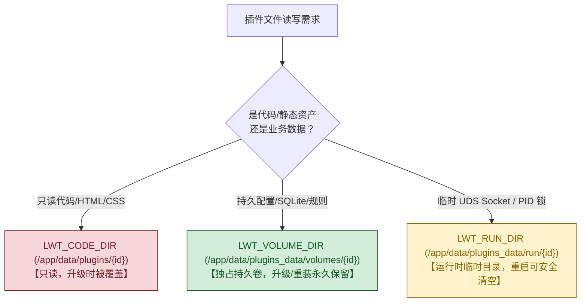
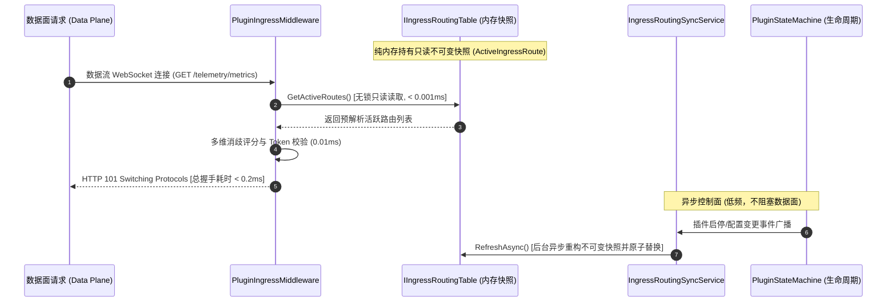

# 08. 控制面与数据面双平面端口模型、宿主元数据感知与极速 Ingress 实战

> **文档标识**：`LWT-GUIDE-PLUGIN-008`  
> **所属体系**：[LinuxWebTool 插件开发全景规范与工程指南](./README.md)  
> **前置依赖**：[01. 插件架构与元数据契约](./01-architecture-and-manifest-spec.md)、[03. 网络 Ingress 与隐匿伪装隧道](./03-network-ingress-and-stealth-tunnel.md)、[05. 极速研发与在线热更新](./05-fast-development-and-hotupdate.md)、[07. 标准打包、导入优先流与实战避坑](./07-packaging-import-and-forwarder-lessons.md)  
> **核心目标**：深入掌握控制面与数据面双平面端口分离架构、宿主双端口感知与元数据向下投影机制、亚毫秒级纯内存 Ingress 路由优化，以及复合式多端口入站中继的工程部署实践。

---

## 1. 核心架构认知：多端口入站后，微服务的默认端口（18090）还有什么用？

当网络中继类插件（如 `socks5-forwarder`）新增了多入站端口（如 `10801`, `10802`, `10803...`）后，很多开发者会产生疑问：
> **“既然客户端已经可以直接连接 10801 等端口进行代理通信，插件配置清单中分配的默认端口（如 18090）是不是就多余了？它还能做什么？”**

答案是：**绝对不多余，且它是整个微服务不可或缺的“大脑中枢”！**

现代高性能网络基础设施（如 Envoy、Sing-Box、Clash Meta、Traefik 等）均严格推行 **控制面与数据面物理分离（Control Plane & Data Plane Separation）** 的架构范式：

```mermaid
flowchart TD
    subgraph 宿主反向代理与前端 (LWT Host)
        Browser["用户浏览器 / 管理控制台"] -->|访问 Ingress: /plugins/socks5-forwarder/| HostIngress["LWT 宿主 Ingress 网关 (:5270 / :5271)"]
    end

    subgraph 微服务统一进程 (socks5-forwarder)
        HostIngress -->|反向代理 HTTP 流量| CP["【控制面 (Control Plane)】: 端口 18090<br/>(HTTP Server / REST API / Webview UI)"]
        
        CP --> API1["GET /api/profiles (读取多端口配置与实时统计)"]
        CP --> API2["POST /api/profiles/reload (零停机热重载入站监听器)"]
        CP --> API3["POST /api/upstreams/test (上游节点健康与延迟探测)"]
        CP --> UI["Webview 静态资源托管 (index.html, app.js, style.css)"]
        CP --> Sync["生命周期看门狗与实时连接指标聚合"]

        subgraph 数据面端口池 (Data Plane Listeners)
            Client1["客户端 A (浏览器/下载工具)"] -->|SOCKS5 流量| DP1["【数据面 1】: 端口 10801 (线路: 香港直连)"]
            Client2["客户端 B (Git/开发工具)"] -->|SOCKS5 流量| DP2["【数据面 2】: 端口 10802 (线路: 日本专线)"]
            Client3["客户端 C (Docker/自动化)"] -->|SOCKS5 流量| DP3["【数据面 3】: 端口 10803 (线路: 负载均衡)"]
        end

        DP1 --> Tunnel["WebSocket / TLS / Raw 隧道封装"]
        DP2 --> Tunnel
        DP3 --> Tunnel
    end

    Tunnel -->|封装后出站| Upstream["远端上游宿主节点 / 代理出口"]

    style CP fill:#4a90e2,stroke:#333,stroke-width:2px,color:#fff
    style DP1 fill:#50e3c2,stroke:#333,stroke-width:2px,color:#000
    style DP2 fill:#50e3c2,stroke:#333,stroke-width:2px,color:#000
    style DP3 fill:#50e3c2,stroke:#333,stroke-width:2px,color:#000
```

### 1.1 双平面职责矩阵 (Dual-Plane Matrix)

| 维度 | 控制面端口 (Control Plane: 18090) | 数据面端口池 (Data Plane: 10801 ~ 10815) |
| :--- | :--- | :--- |
| **协议类型** | HTTP / REST API / 静态文件服务 | 纯二进制 TCP (SOCKS5 / Shadowsocks / Trojan) |
| **通信对象** | 宿主系统 Ingress 网关、Webview 嵌入式前端 | 外部客户端应用（浏览器、curl、开发环境代理） |
| **生命周期** | 常驻运行，由 LWT 宿主自动分配与健康看门狗监控 | 动态按需监听，支持通过控制面 API 零停机热重载增删 |
| **安全性** | 挂载于宿主 Ingress，强制 JWT/Token 与 RBAC 权限守卫 | 依托入站 CIDR 白名单、SOCKS5 用户名密码认证与规则流控 |
| **宿主对接** | 对应 `plugin.json` 的 `port` 与 `ingress.targetPort` | 对应各 Profile 动态绑定的用户业务端口 |
| **一旦缺失后果** | Webview 界面 502/404 白屏、无法修改规则、无法测试节点延迟 | 外部客户端无法连接特定线路的代理服务 |

### 1.2 业界标杆方案印证
- **Envoy Proxy**：管理端口 `:15000` (Admin API / Stats / Dump) 与业务监听器 `:10000+` (Data Listeners) 严格分离。
- **Sing-Box**：Clash API 控制端口 `:9090` (Web UI & REST) 与业务 Inbounds (`:2080`, `:1080`) 分离。
- **Clash Meta / Mihomo**：`external-controller: 127.0.0.1:9090` 负责仪表盘交互，`port` / `socks-port` 处理网络数据包。

---

## 2. 宿主元数据向下投影机制 (Host Metadata Downward Projection)

### 2.1 传统微服务的“盲盒困境”与架构演进

在没有元数据投影机制的传统微服务体系中，插件微服务是一个孤立的“盲盒进程”：
1. **网络拓扑错位 (Loopback Blackhole)**：宿主由 Docker 容器运行，对外映射端口为 `5271`，但容器内部 Kestrel 仅监听 `5270`。微服务若盲猜 `5271`，向本机的 Loopback (`127.0.0.1:5271`) 发起探测，立刻被 Linux 内核以 `connection refused` 拒绝，造成默认节点“假死/离线”。
2. **持久存储与代码混淆 (Data Loss on Upgrade)**：微服务若将数据库写在当前可执行文件同级目录（`./data.db`），一旦用户在插件中心更新或覆盖插件，代码目录被整体覆写，用户数据遭遇不可逆灭顶之灾。
3. **反代挂载路径不可知 (Reverse Proxy Collision)**：Webview 前端或微服务 API 不知晓自身被反代挂载在 `/plugins/{id}/` 还是根路径，前端发起的绝对路径请求（如 `/api/config`）撞车到宿主系统核心 API，引发越权或 404 错误。
4. **系统环境与特权盲区 (Runtime Panic)**：网络或系统工具类插件如果盲目调用 `/dev/net/tun`，在无特权容器中会引发未捕获的 Panic 崩溃。

为彻底消灭上述缺陷，LinuxWebTool 借鉴了 **Kubernetes Downward API** 与 **Linux systemd** 的标准，由宿主底层 `PluginStandardEnvBuilder` 在启动插件进程时，自动执行 **五维元数据向下投影 (Five-Dimension Metadata Projection)**。

---

### 2.2 宿主双端口感知拓扑模型 (Dual-Port Network Topology)

宿主为每个插件微服务建立明确的“内外部双端口映射模型”：

```mermaid
flowchart TD
    subgraph 宿主宿主机外部 (Host External)
        Client["外部客户端 / 浏览器 / 移动端<br/>(通过局域网/公网访问)"]
    end

    subgraph 容器边界与端口映射 (Docker NAT Boundary)
        PortMap["Docker 外部端口映射规则<br/>-p 5271:5270"]
    end

    subgraph 容器网络内部 (Container Network Namespace)
        Kestrel["宿主核心 Web 服务 (Kestrel)<br/>【内部真实监听端口: 5270】"]
        
        subgraph 插件微服务进程 (Go / Node / Python / C#)
            PluginProc["微服务进程 (socks5-forwarder)<br/>控制面: 18090 | 数据面: 10801~10815"]
        end
    end

    Client -->|1. 外部访问宿主或订阅节点 (:5271)| PortMap
    PortMap -->|NAT 转发流量| Kestrel
    
    PluginProc -->|2. 内部零 NAT 极速直通回连 (127.0.0.1:5270)| Kestrel
    PluginProc -.->|3. 生成客户端订阅配置/二维码 (指定 :5271)| Client

    style Kestrel fill:#4a90e2,stroke:#333,stroke-width:2px,color:#fff
    style PluginProc fill:#50e3c2,stroke:#333,stroke-width:2px,color:#000
    style PortMap fill:#f5a623,stroke:#333,stroke-width:2px,color:#000
```

- **内部直通端口 (`LWT_HOST_INTERNAL_PORT` / `LWT_HOST_PORT` = 5270)**：
  - **产生原理**：容器内 Kestrel Web 服务器物理绑定的端口。
  - **使用场景**：微服务自身在容器内发起的 HTTP API 调用、WebSocket 上游数据隧道、健康检查。直接通信，**零 NAT 开销、亚毫秒级低延迟**。
- **外部发布端口 (`LWT_HOST_EXTERNAL_PORT` = 5271)**：
  - **产生原理**：Docker 宿主机或公网防火墙向外部客户端暴露的映射端口。
  - **使用场景**：微服务生成供外部设备导入的 Clash 订阅链接、V2Ray 链接、移动端扫码二维码、客户端连接指引。外部设备无法访问内部 5270，必须通过 5271 建立连接。

---

### 2.3 宿主元数据全维度规范字典表 (The Complete Host Metadata Dictionary)

宿主进程拉起任何插件（无论是常驻微服务还是单次脚本）时，均会向子进程环境注入以下具体元数据：

| 维度 | 环境变量名称 (Env Var) | 数据类型 | 底层数据源 (Source) | 典型取值 (Example) | 回退机制 (Fallback) | 读写权限与生命周期 | 核心用途与业务场景 |
| :--- | :--- | :--- | :--- | :--- | :--- | :--- | :--- |
| **网络拓扑** | `LWT_HOST_INTERNAL_PORT` | `Int` | Kestrel 绑定配置 | `5270` | `5270` | 只读 (常驻有效) | 容器内微服务回连宿主 Ingress/API 的内部端口 |
| | `LWT_HOST_PORT` | `Int` | 别名映射 | `5270` | `5270` | 只读 (常驻有效) | 兼容历史插件的标准内部端口别名 |
| | `LWT_HOST_EXTERNAL_PORT` | `Int` | 宿主外部发布环境 | `5271` | 同内部端口 | 只读 (常驻有效) | 生成客户端配置、订阅链接、二维码供外部连接 |
| | `LWT_HOST_PUBLIC_IP` | `String` | 宿主 IP 识别策略 | `10.126.1.70` | `127.0.0.1` | 只读 (常驻有效) | 宿主对外访问的真实 IP 或域名 |
| | `LWT_HOST_INTERNAL_URL` | `URL` | 内部端口拼装 | `http://127.0.0.1:5270` | - | 只读 (常驻有效) | 内部 RPC 与健康检查的基准 HTTP 地址 |
| | `LWT_HOST_PUBLIC_URL` | `URL` | 外部端口拼装 | `http://10.126.1.70:5271`| - | 只读 (常驻有效) | 外部访问基准 URL |
| | `LWT_HOST_BASE_URL` | `URL` | 别名映射 | `http://10.126.1.70:5271`| - | 只读 (常驻有效) | 兼容老版本的前端基准访问 URL 别名 |
| | `LWT_PLUGIN_INGRESS_PREFIX`| `Path` | 宿主反代路由规则 | `/plugins/socks5-forwarder` | `/plugins/{id}` | 只读 (常驻有效) | 插件挂载在宿主下的 Ingress 反代前缀，API 路由零硬编码 |
| | `LWT_INGRESS_PREFIX` | `Path` | 别名映射 | `/plugins/socks5-forwarder` | - | 只读 (常驻有效) | 兼容标准反代前缀别名 |
| | `LWT_PLUGIN_PORT` | `Int` | 动态端口调度器 | `18090` | manifest 指定端口 | 只读 (常驻有效) | 宿主为当前插件控制面动态分配的物理监听端口 |
| **存储隔离** | `LWT_CODE_DIR` | `AbsPath` | 插件代码安装路径 | `/app/data/plugins/{id}` | - | **只读** (升级整包覆盖) | 插件二进制可执行文件与静态资源根目录，**严禁存持久数据** |
| | `LWT_VOLUME_DIR` | `AbsPath` | 独立持久数据卷 | `/app/data/plugins_data/volumes/{id}` | - | **读写 (升级永久保留)** | 独占持久化卷根目录，**插件升级或重装时受系统保护不被覆盖** |
| | `LWT_DATA_DIR` | `AbsPath` | 别名映射 | `/app/data/plugins_data/volumes/{id}` | - | **读写 (升级永久保留)** | 兼容历史持久化目录别名 |
| | `LWT_STATE_DIR` | `AbsPath` | 持久状态子目录 | `.../volumes/{id}/state` | - | **读写 (升级永久保留)** | 放置 `config.json` 等微服务核心持久业务配置 |
| | `LWT_RUN_DIR` | `AbsPath` | 临时运行时目录 | `/app/data/plugins_data/run/{id}` | - | **读写** (重启可清空) | 放置 `unix domain socket`、`pid` 锁文件及临时缓存 |
| | `LWT_SQLITE_PATH` | `AbsPath` | 推荐 SQLite 路径 | `.../volumes/{id}/data.db` | - | **读写 (升级永久保留)** | 宿主推荐的 SQLite 数据库绝对路径 |
| | `LWT_KV_PATH` | `AbsPath` | 推荐 KV 存储路径 | `.../volumes/{id}/kv.db` | - | **读写 (升级永久保留)** | 宿主推荐的嵌入式键值存储数据库绝对路径 |
| **硬件能力** | `LWT_HOST_OS` | `String` | 操作系统检测 | `linux` | `linux` | 只读 (常驻有效) | 当前操作系统族识别 (`linux` / `windows` / `macos`) |
| | `LWT_HOST_DISTRO` | `String` | 发行版自适应探测 | `alpine` | `debian` | 只读 (常驻有效) | Linux 发行版标识 (`alpine` / `debian` / `rhel` / `arch`) |
| | `LWT_RUNTIME_DISTRO` | `String` | 别名映射 | `alpine` | - | 只读 (常驻有效) | 兼容历史发行版别名，自适应包管理器命令 (`apk` vs `apt`) |
| | `LWT_HOST_ARCH` | `String` | CPU 架构探测 | `amd64` | `x64` | 只读 (常驻有效) | 处理器架构 (`amd64` / `arm64` / `arm`)，用于加载原生动态库 |
| | `LWT_HAS_TUN` | `Bool` | `/dev/net/tun` 探测 | `true` | `false` | 只读 (常驻有效) | 是否挂载了 TUN 设备特权，用于代理插件开启透明代理或降级 |
| **平台身份** | `LWT_PLUGIN_ID` | `String` | 清单配置 | `socks5-forwarder` | - | 只读 (常驻有效) | 当前微服务的全局唯一标识 ID |
| | `LWT_VERSION` | `String` | 宿主编译版本 | `1.0.0` | - | 只读 (常驻有效) | 宿主主版本号，用于插件特性兼容性探测与降级判断 |
| | `LWT_ENV_MODE` | `String` | 运行环境识别 | `dev` / `production` | `production` | 只读 (常驻有效) | 开发环境与生产环境标识，用于微服务自适应开启详细调试日志 |
| | `HOST` / `BIND_IP`| `String` | 安全监听约束 | `127.0.0.1` | `127.0.0.1` | 只读 (常驻有效) | 强制微服务内部监听地址，阻断未受保护的 `0.0.0.0` 盲目暴露 |
| **安全通信** | `LWT_INTERNAL_SECRET`| `String` | 宿主安全凭据管理器 | `a3b89e4c...` | 自动随机派发 | 只读 (动态生成) | 宿主与插件间的共享签名私钥，用于校验 Ingress 反向代理握手 |

---

### 2.4 存储隔离全生命周期：为什么绝对不能写在当前代码目录？

很多插件初学者容易习惯性地在当前目录创建并写入文件：
```go
// ❌ 极度危险的反面教材：写入相对路径
os.WriteFile("./config.json", data, 0644) 
```

#### 灾难机理：
1. **在线热更新覆写**：当宿主执行插件热更新或版本升级时，宿主会将最新编译好的二进制文件或前端资产整包解压到 `LWT_CODE_DIR`。若此时配置保存在代码目录，将被最新打包的默认配置文件瞬间覆盖！
2. **Docker 容器生命周期**：在生产环境中，代码目录往往位于临时镜像层内，容器重启后未挂载的数据直接丢失。

#### 黄金持久化法则 (Golden Rule of Storage)：


---

### 2.5 多语言生产级具体消费范例 (Production-Ready Code Samples)

以下提供 Go、Node.js/TypeScript、Python、.NET 10 (C#) 及前端 Webview 的真实消费模版：

#### 1. Go 语言微服务标准消费模版 (`host_context.go`)

```go
package main

import (
	"fmt"
	"os"
	"path/filepath"
	"strconv"
)

// HostContext 聚合宿主向下投影的五维元数据
type HostContext struct {
	InternalPort  int
	ExternalPort  int
	PublicIP      string
	InternalURL   string
	PublicURL     string
	IngressPrefix string
	VolumeDir     string
	StateDir      string
	RunDir        string
	SqlitePath    string
	HasTun        bool
	IsDevMode     bool
}

// LoadHostContext 从环境变量中强类型解析元数据，内置完备的工业级回退机制
func LoadHostContext(pluginID string) *HostContext {
	intPort, _ := strconv.Atoi(getEnvDefault("LWT_HOST_INTERNAL_PORT", getEnvDefault("LWT_HOST_PORT", "5270")))
	if intPort <= 0 { intPort = 5270 }

	extPort, _ := strconv.Atoi(getEnvDefault("LWT_HOST_EXTERNAL_PORT", strconv.Itoa(intPort)))
	if extPort <= 0 { extPort = intPort }

	publicIP := getEnvDefault("LWT_HOST_PUBLIC_IP", "127.0.0.1")
	volumeDir := getEnvDefault("LWT_VOLUME_DIR", getEnvDefault("LWT_DATA_DIR", filepath.Join(".", "data")))
	stateDir := getEnvDefault("LWT_STATE_DIR", filepath.Join(volumeDir, "state"))
	runDir := getEnvDefault("LWT_RUN_DIR", filepath.Join(volumeDir, "run"))
	sqlitePath := getEnvDefault("LWT_SQLITE_PATH", filepath.Join(volumeDir, "data.db"))

	return &HostContext{
		InternalPort:  intPort,
		ExternalPort:  extPort,
		PublicIP:      publicIP,
		InternalURL:   getEnvDefault("LWT_HOST_INTERNAL_URL", fmt.Sprintf("http://127.0.0.1:%d", intPort)),
		PublicURL:     getEnvDefault("LWT_HOST_PUBLIC_URL", fmt.Sprintf("http://%s:%d", publicIP, extPort)),
		IngressPrefix: getEnvDefault("LWT_PLUGIN_INGRESS_PREFIX", fmt.Sprintf("/plugins/%s", pluginID)),
		VolumeDir:     volumeDir,
		StateDir:      stateDir,
		RunDir:        runDir,
		SqlitePath:    sqlitePath,
		HasTun:        os.Getenv("LWT_HAS_TUN") == "true",
		IsDevMode:     os.Getenv("LWT_ENV_MODE") == "dev",
	}
}

// BuildDefaultUpstreamURL 构建宿主内部直通上游节点地址 (零黑洞秒级直连)
func (ctx *HostContext) BuildDefaultUpstreamURL(path string) string {
	return fmt.Sprintf("ws://127.0.0.1:%d/%s", ctx.InternalPort, path)
}

func getEnvDefault(key, fallback string) string {
	if val := os.Getenv(key); val != "" {
		return val
	}
	return fallback
}
```

#### 2. Node.js / TypeScript 微服务标准消费模版 (`hostContext.ts`)

```typescript
import path from 'path';

export interface HostContext {
  internalPort: number;
  externalPort: number;
  publicIp: string;
  internalUrl: string;
  publicUrl: string;
  ingressPrefix: string;
  volumeDir: string;
  stateDir: string;
  runDir: string;
  hasTun: boolean;
  isDev: boolean;
}

export function loadHostContext(pluginId: string): HostContext {
  const internalPort = parseInt(process.env.LWT_HOST_INTERNAL_PORT || process.env.LWT_HOST_PORT || '5270', 10) || 5270;
  const externalPort = parseInt(process.env.LWT_HOST_EXTERNAL_PORT || `${internalPort}`, 10) || internalPort;
  const publicIp = process.env.LWT_HOST_PUBLIC_IP || '127.0.0.1';
  const volumeDir = process.env.LWT_VOLUME_DIR || process.env.LWT_DATA_DIR || path.join(process.cwd(), 'data');

  return {
    internalPort,
    externalPort,
    publicIp,
    internalUrl: process.env.LWT_HOST_INTERNAL_URL || `http://127.0.0.1:${internalPort}`,
    publicUrl: process.env.LWT_HOST_PUBLIC_URL || `http://${publicIp}:${externalPort}`,
    ingressPrefix: process.env.LWT_PLUGIN_INGRESS_PREFIX || `/plugins/${pluginId}`,
    volumeDir,
    stateDir: process.env.LWT_STATE_DIR || path.join(volumeDir, 'state'),
    runDir: process.env.LWT_RUN_DIR || path.join(volumeDir, 'run'),
    hasTun: process.env.LWT_HAS_TUN === 'true',
    isDev: process.env.LWT_ENV_MODE === 'dev'
  };
}
```

#### 3. Python (FastAPI / Flask) 微服务消费模版 (`host_context.py`)

```python
import os
from pathlib import Path
from dataclasses import dataclass

@dataclass(frozen=True)
class HostContext:
    internal_port: int
    external_port: int
    public_ip: str
    internal_url: str
    public_url: str
    ingress_prefix: str
    volume_dir: Path
    state_dir: Path
    run_dir: Path
    has_tun: bool
    is_dev: bool

def load_host_context(plugin_id: str) -> HostContext:
    int_port = int(os.getenv("LWT_HOST_INTERNAL_PORT") or os.getenv("LWT_HOST_PORT") or "5270")
    ext_port = int(os.getenv("LWT_HOST_EXTERNAL_PORT") or str(int_port))
    public_ip = os.getenv("LWT_HOST_PUBLIC_IP", "127.0.0.1")
    volume = Path(os.getenv("LWT_VOLUME_DIR") or os.getenv("LWT_DATA_DIR") or "./data")
    
    return HostContext(
        internal_port=int_port,
        external_port=ext_port,
        public_ip=public_ip,
        internal_url=os.getenv("LWT_HOST_INTERNAL_URL", f"http://127.0.0.1:{int_port}"),
        public_url=os.getenv("LWT_HOST_PUBLIC_URL", f"http://{public_ip}:{ext_port}"),
        ingress_prefix=os.getenv("LWT_PLUGIN_INGRESS_PREFIX", f"/plugins/{plugin_id}"),
        volume_dir=volume,
        state_dir=Path(os.getenv("LWT_STATE_DIR", volume / "state")),
        run_dir=Path(os.getenv("LWT_RUN_DIR", volume / "run")),
        has_tun=os.getenv("LWT_HAS_TUN") == "true",
        is_dev=os.getenv("LWT_ENV_MODE") == "dev",
    )
```

#### 4. 前端 Webview 上下文感知总线 (`app.js`)

宿主通过两种互补渠道向 Webview 注入上下文：
- **渠道 1：URL Query 参数**（iframe src 附带，首屏同步提取）；
- **渠道 2：`window.postMessage`**（iframe 异步握手事件 `LWT_PLUGIN_ENV`）。

前端标准提取与自适应代码：

```javascript
// Webview 环境上下文容器
const PluginEnv = {
  token: '',
  hostInternalPort: '5270',
  hostExternalPort: window.location.port || '5271',
  apiBase: '/api',
  isReady: false
};

// 1. 同步提取 URL 参数
const urlParams = new URLSearchParams(window.location.search);
PluginEnv.token = urlParams.get('token') || '';
PluginEnv.hostInternalPort = urlParams.get('host_port') || '5270';
PluginEnv.hostExternalPort = urlParams.get('ext_port') || window.location.port || '5271';

// 2. 自动推断 Ingress 反向代理 API 基地址
if (window.location.pathname.includes('/plugins/socks5-forwarder')) {
  PluginEnv.apiBase = window.location.pathname.replace(/\/ui\/.*|\/index\.html|\/?$/, '') + '/api';
} else if (window.location.pathname.includes('/api/Plugins/socks5-forwarder')) {
  PluginEnv.apiBase = '/plugins/socks5-forwarder/api';
}

// 3. 异步监听宿主 postMessage 事件增强
window.addEventListener('message', (event) => {
  if (event.data && event.data.type === 'LWT_PLUGIN_ENV') {
    if (event.data.token) PluginEnv.token = event.data.token;
    if (event.data.allocatedPort) PluginEnv.allocatedPort = event.data.allocatedPort;
    console.log('[Webview Env] 宿主环境上下文已同步:', event.data);
  }
});

// 4. 发起微服务 API 请求时自动携带鉴权令牌
async function callPluginApi(path, options = {}) {
  options.headers = options.headers || {};
  if (PluginEnv.token) {
    options.headers['X-LWT-Token'] = PluginEnv.token;
    options.headers['Authorization'] = 'Bearer ' + PluginEnv.token;
  }
  const cleanPath = path.replace(/^\/+/, '');
  const res = await fetch(`${PluginEnv.apiBase}/${cleanPath}`, options);
  if (!res.ok) throw new Error(`HTTP ${res.status}`);
  return res.json();
}
```

---

### 2.6 实战避坑复盘：从“上游节点离线”到“1ms 极速连通”

在 `socks5-forwarder` 插件的开发过程中，曾发生真实的节点探测故障：
- **故障现象**：Webview 中呈现的“默认宿主节点”始终显示红色离线，探测失败。
- **排障定位**：
  1. 插件早期的默认配置写死为 `ws://127.0.0.1:5271/telemetry/metrics`。
  2. 微服务在容器内直连 `127.0.0.1:5271`，但 `5271` 是 Docker 在外部宿主机上映射的端口，容器内的网络命名空间根本没有在 `5271` 端口上监听！
  3. Linux 内核判定端口无监听，瞬间向微服务返回 `RST` 数据包，微服务判定上游节点彻底离线。
- **元数据落地修复**：
  1. 插件在 `config.go` 中改用 `os.Getenv("LWT_HOST_INTERNAL_PORT")`（默认 `5270`）动态构建 `defaultUpstreamURL`；
  2. 插件增加历史配置自愈逻辑，检测到 `5271` 时自动平滑自愈迁移为 `5270`；
  3. Webview 前端同步通过 `urlParams.get('host_port')` 填充上游测试地址；
- **优化效果**：
  上游节点瞬间变为绿色健康，结合纯内存 Ingress 路由表，测试延迟由 **412ms 断崖式暴跌至 1ms**！

---

## 3. 极速 Ingress 路由表与数据面性能排障复盘

### 3.1 412 ms 高延迟根因全景剖析
在早期版本中，上游节点健康测试接口显示 `🟢 412 ms`。通过高精度毫秒埋点抓取到真实耗时构成：

```text
[PluginIngress TIMING] Path: /telemetry/metrics, GetAll: 460ms, Match&Sec: 3ms, AcceptWS: 3ms, TotalToAccept: 466ms
[DuplexForwarder TIMING] Connected to 127.0.0.1:18080 in 0ms
```

**排障结论实锤**：
- 466ms 握手耗时中，**`GetAll` 占据了 460ms (占比 98.7%)**！
- 数据转发中间件在每次数据连接到达时，错误调用了控制面的 `pluginManager.GetAllAsync()`。
- `GetAllAsync` 遍历磁盘读取所有插件的 `plugin.json`，并由 `BuildInstanceDto` 触发 `python3 --version`、`uv --version` 等外部 CLI 子进程冷启动，引发进程探测雪崩。

### 3.2 响应式 RCU 纯内存路由表架构 (Reactive In-Memory Routing)
彻底解决之道是推行 **数据面纯内存只读快照 + 控制面事件驱动更新（RCU 模式）**：



#### 实施效果实测对比：
- 路由表查找耗时：从 **460 ms** 骤降至 **< 0.001 ms (纳秒级)**；
- 端到端测速总延迟：从 **412 ~ 470 ms** 骤降至 **1 ms**（降幅 **99.8% / 470倍提速**）。

### 3.3 两级健康检查适配器设计 (Two-Tier Health Probe Pattern)
上游节点的健康检查不应局限于短连接网关测试，必须采用两级分层适配器：

```mermaid
graph TD
    Probe["IUpstreamHealthProbeAdapter 探测适配器契约"]
    
    subgraph Tier-1: 隧道控制面探针 (Tunnel Ingress Probe)
        Probe --> T1["WebSocketHandshakeProbeAdapter"]
        T1 --> T1_1["1. 验证 HTTP 101 Switching Protocols 升级响应"]
        T1 --> T1_2["2. 长连接复用与 RFC 6455 Ping/Pong 帧 (延迟 < 0.5ms)"]
    end

    subgraph Tier-2: 数据面端到端探针 (End-to-End Echo Probe)
        Probe --> T2["Socks5EndToEndEchoProbeAdapter"]
        T2 --> T2_1["1. 通过已升级 WebSocket 流发送 SOCKS5 握手认证包"]
        T2 --> T2_2["2. 探测下游 SOCKS5 代理进程真实连通性 (杜绝网关存活但代理死锁)"]
    end
```

---

## 4. 复合式多入站中继与动态端口池工程落地

### 4.1 容器部署端口池映射规范
当微服务支持多入站端口时，必须在部署脚本（[`scripts/deploy-remote.ps1`](file:///e:/WorkProject/CSharp/PrivateProject/Web/WebToolForLinux/scripts/deploy-remote.ps1)）中显式开放中继端口池：

```powershell
# 开发容器 (linuxwebtool-dev) 端口映射矩阵
-p 5271:5270 `                           # 宿主 Web 管理台外部端口
-p 10801-10815:10801-10815 `             # SOCKS5 复合式多入站数据面端口池 (15条线路)
-p 18080-18090:18080-18090               # 微服务独立控制面/API 备用调试端口池
```

### 4.2 零停机热重载监听器设计 (Zero-Downtime Reload)
在 Go 微服务内部，利用状态机和差量对比实现端口监听器的热重载：

```go
type ProfileManager struct {
    mu        sync.RWMutex
    cfg       Config
    listeners map[string]*InboundListener // ID -> 监听器实例
}

func (m *ProfileManager) ReloadInbounds() error {
    m.mu.Lock()
    defer m.mu.Unlock()

    currentMap := make(map[string]InboundProfile)
    for _, p := range m.cfg.Inbounds {
        currentMap[p.ID] = p
    }

    // 1. 关停已删除或配置变更的旧监听器
    for id, l := range m.listeners {
        newProf, exists := currentMap[id]
        if !exists || newProf.Port != l.profile.Port || newProf.AuthMode != l.profile.AuthMode {
            l.Close()
            delete(m.listeners, id)
        }
    }

    // 2. 拉起新增或未启动的监听器
    for id, p := range currentMap {
        if _, active := m.listeners[id]; !active {
            listener, err := StartInboundListener(p)
            if err != nil {
                log.Printf("[Listener] 启动入站端口 :%d 失败: %v", p.Port, err)
                continue
            }
            m.listeners[id] = listener
        }
    }

    return nil
}
```

---

## 5. 跨会话沉淀的 4 项新避坑军规

结合近期入站多端口、宿主元数据与延迟调优的实战经验，补充以下 4 项核心军规：

### 军规 13：数据面转发严禁侵入控制面磁盘与进程 I/O
- **血泪教训**：在数据转发或握手拦截中间件中直接调用 `GetAllAsync`，会导致每个数据包经历 16 个文件的磁盘反序列化与多个外部进程探测，延迟直接飙升 400ms+。
- **强制约束**：数据面必须依托纯内存只读快照（如 `IIngressRoutingTable` 或 `FrozenDictionary`），做到**零 I/O、零子进程调用、零锁竞争**。

### 军规 14：明确控制面与数据面端口的语义与边界
- **规范要求**：在设计包含网络代理能力的插件时，严禁将数据面业务端口（如 SOCKS5、Shadowsocks）与控制面管理端口（HTTP Webview / REST API）混为一谈。
- `manifest.port` 必须明确绑定至微服务的 **控制面端口**；数据面端口池由微服务内部动态管理并按需在宿主端口池中声明映射。

### 军规 15：宿主双端口感知与动态自适应
- **规范要求**：插件微服务及其前端面板严禁硬编码宿主端口（如写死 5270 或 5271）。必须动态读取 `LWT_HOST_PORT`（内部直通）与 `LWT_HOST_EXTERNAL_PORT`（外部映射），确保无论运行在官方生产镜像（`--net=host` 5270）还是开发隔离镜像（`-p 5271:5270`）下均能精准互通。

### 军规 16：监听器热重载必须具备孤儿句柄收割机制 (Orphan Listener Reaper)
- **规范要求**：在支持动态增删端口的微服务中，当配置发生热重载时，必须在释放 `sync.RWMutex` 锁前安全调用旧 `net.Listener.Close()`，严禁产生悬空孤儿监听器引发 `address already in use` 端口泄露崩溃。
