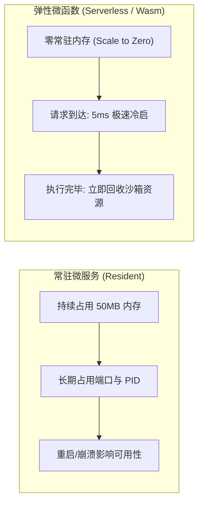
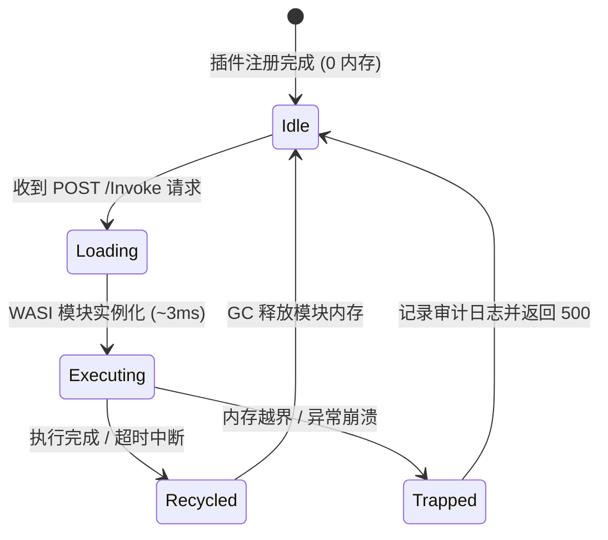

# 09. Wasm 运行时与 Serverless 弹性微函数开发规范

> **目标**：规范 Archetype 2（`⚡ 弹性微函数与计算`）的技术实现、Wasm/WASI 轻量级沙箱隔离、按需冷启动与内存回收、标准化 JSON 调用契约与资源熔断机制。

---

## 1. 为什么需要 Serverless / Wasm 微函数？

在微服务插件（Archetype 1）中，常驻进程需要持续占用端口、文件句柄与 20MB~100MB 内存。然而在以下场景中，常驻进程存在极大的资源浪费：
1. **轻量计算转换**：如证书解析、Base64 / JWT 编解码、YAML/JSON 互转。
2. **偶发自动化任务**：每天仅执行一次的数据报表汇整、备份校验。
3. **高密度多租户隔离**：在有限的特权容器内运行数十个由第三方贡献的独立算子。



---

## 2. Manifest v3 规范声明 (`archetype: "serverless-wasm"`)

在 `plugin.json` 中，通过声明 `profile: "Serverless"` 与 `archetype: "serverless-wasm"` 激活微函数运行时调度器：

```json
{
  "manifestVersion": 3,
  "id": "cert-inspector-wasm",
  "name": "X.509 证书深度解析算子",
  "version": "1.0.0",
  "profile": "Serverless",
  "archetype": "serverless-wasm",
  "build": {
    "entry": "bin/inspector.wasm",
    "runtime": "wasm"
  },
  "interface": {
    "type": "json-rpc",
    "supportedMethods": ["parseCertificate", "verifyChain", "extractSAN"]
  },
  "resources": {
    "maxMemoryMb": 64,
    "executionTimeoutSeconds": 10
  },
  "layout": {
    "displayMode": "none",
    "hasWebview": false
  }
}
```

---

## 3. WASI 沙箱隔离与能力边界

LWT 平台微函数运行时遵循 **PoLP（最小特权原则）**：
- **只读根文件系统**：默认禁止微函数向容器底层写文件，所有临时计算必须在内存中完成。
- **零网络访问**：除非显式声明 `network.allowEgress: true`，微函数沙箱禁止发起外部 Socket 网络连接。
- **强制内存上限**：受限于 `resources.maxMemoryMb`，一旦申请内存超过阈值，WASI 引擎将立即抛出 `Trap::MemoryOutOfBounds` 并中断调用。
- **时钟超时守卫**：单次调用超过 `executionTimeoutSeconds`（默认 10 秒）将触发软超时取消，防止恶意长耗时计算耗尽 CPU。

---

## 4. 多语言编译与工程构建示例

### 4.1 Go (TinyGo) 编译为 WASI
```go
// main.go
package main

import (
	"encoding/json"
	"io"
	"os"
)

type Request struct {
	CertPem string `json:"certPem"`
}

type Response struct {
	Subject string   `json:"subject"`
	SANs    []string `json:"sans"`
	Expires string   `json:"expires"`
}

func main() {
	input, _ := io.ReadAll(os.Stdin)
	var req Request
	_ = json.Unmarshal(input, &req)

	// 解析证书逻辑...
	resp := Response{
		Subject: "CN=example.com",
		SANs:    []string{"example.com", "*.example.com"},
		Expires: "2027-01-01T00:00:00Z",
	}

	output, _ := json.Marshal(resp)
	os.Stdout.Write(output)
}
```
**编译指令**：
```bash
tinygo build -o bin/inspector.wasm -target=wasi main.go
```

### 4.2 Rust (wasm32-wasi) 编译
```bash
cargo build --target wasm32-wasi --release
cp target/wasm32-wasi/release/cert_inspector.wasm bin/inspector.wasm
```

### 4.3 Node.js 弹性微函数 (`archetype: "serverless-event"`)
若无需 Wasm 沙箱，亦可使用 Node.js 编写轻量级单次函数：
```javascript
// handler.js
module.exports.invoke = async function (payload, context) {
  const { certPem } = payload;
  return {
    valid: true,
    issuedBy: "LWT Root CA"
  };
};
```

---

## 5. 宿主统一调用契约与 API 规范

宿主平台提供统一的调用中枢，支持异步与同步微函数调用：

### 5.1 REST 端点同步调用
```http
POST /api/Plugins/{plugin-id}/Invoke
Content-Type: application/json
Authorization: Bearer <JWT_TOKEN>

{
  "method": "parseCertificate",
  "params": {
    "certPem": "-----BEGIN CERTIFICATE-----\n...\n-----END CERTIFICATE-----"
  }
}
```

### 5.2 统一响应结构
```json
{
  "success": true,
  "executionTimeMs": 4.2,
  "result": {
    "subject": "CN=example.com",
    "sans": ["example.com", "*.example.com"],
    "expires": "2027-01-01T00:00:00Z"
  },
  "error": null
}
```

---

## 6. 冷启动生命周期状态机



1. **瞬时拉起**：平均冷启动开销低于 5 毫秒。
2. **隔离安全**：每次调用均在独立的内存实例中运行，状态绝不跨请求污染。
3. **运维透明**：主控台无需维护子进程 PID，统一以算子执行耗时与成功率呈现。
