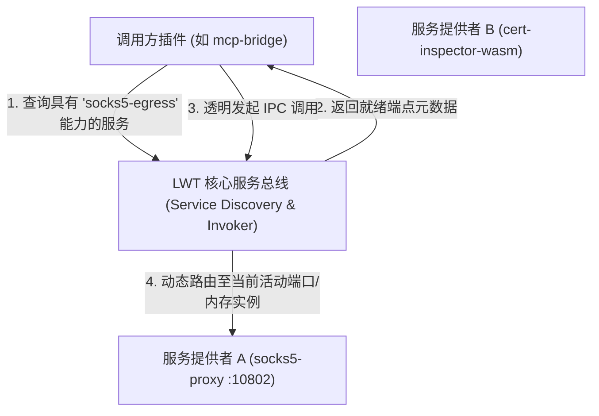
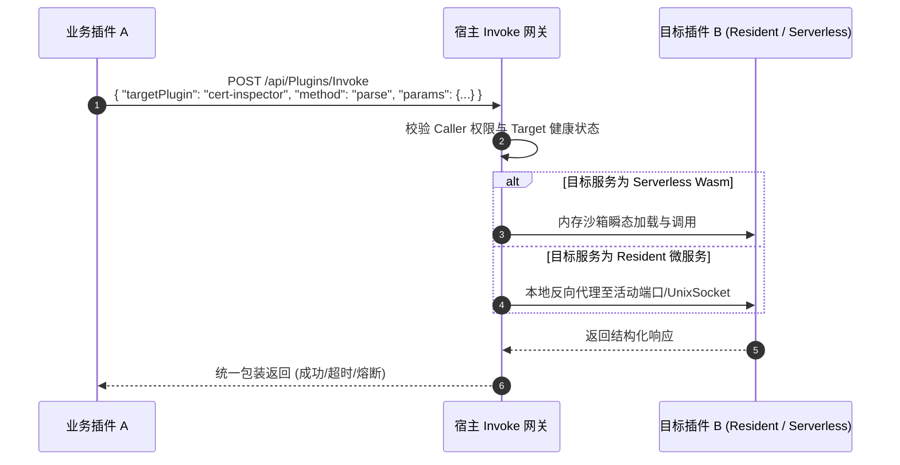

# 10. 服务动态发现与透明服务网关 (Dynamic Discovery & Transparent Gateway)

> **目标**：规范跨插件间的服务契约声明、动态能力发现（`Service Discovery`）、透明内部 IPC 寻址与跨插件调用链路，彻底消除插件间硬编码端口或对端 IP 的强耦合痛点。

---

## 1. 为什么需要跨插件动态发现？

在 LWT 插件生态演进中，不同微服务之间经常需要协同工作：
- `disk-explorer` 需要调用系统的凭据脱敏或系统审计服务；
- `mcp-bridge` 需要动态查找当前正在运行的外部代理（如 `socks5-proxy`）；
- 定时任务脚本（OneShot）需要调用常驻微服务（Resident）执行按需诊断。

若每个插件都硬编码目标服务的端口（如 `127.0.0.1:18080`），一旦目标服务因端口冲突自愈迁移至 `10802`，调用链路将立即崩溃。



---

## 2. 服务能力契约声明 (`interface.services`)

在 Manifest v3 规范中，服务提供方在 `interface` 块中显式声明其对外导出的标准化服务契约：

```json
{
  "manifestVersion": 3,
  "id": "socks5-proxy",
  "name": "SOCKS5 安全代理微服务",
  "interface": {
    "type": "custom",
    "services": [
      {
        "name": "socks5-egress",
        "protocol": "socks5",
        "description": "提供透明 SOCKS5 外部出口路由能力",
        "tags": ["network", "proxy", "egress"]
      }
    ]
  }
}
```

---

## 3. 动态服务发现端点 (`GET /api/Plugins/Discovery`)

宿主平台提供全局动态服务发现接口，任何拥有合法凭据的插件或前端组件均可按需检索：

### 3.1 检索请求
```http
GET /api/Plugins/Discovery?capability=socks5-egress&status=running
Authorization: Bearer <JWT_TOKEN>
```

### 3.2 发现响应快照
```json
{
  "total": 1,
  "services": [
    {
      "pluginId": "socks5-proxy",
      "pluginName": "SOCKS5 安全代理微服务",
      "serviceName": "socks5-egress",
      "protocol": "socks5",
      "status": "running",
      "endpoint": {
        "host": "127.0.0.1",
        "port": 10802,
        "mode": "port"
      },
      "tags": ["network", "proxy", "egress"]
    }
  ]
}
```

---

## 4. 透明服务调用网关 (`POST /api/Plugins/Invoke`)

除了直接基于发现的端口通信外，对于 HTTP / JSON-RPC / 微函数类型的服务，宿主提供**零网络端口透明网关**：



### 4.1 调用请求范式
```http
POST /api/Plugins/Invoke
Content-Type: application/json
Authorization: Bearer <JWT_TOKEN>

{
  "targetPlugin": "cert-inspector-wasm",
  "service": "cert-inspector",
  "method": "parseCertificate",
  "params": {
    "certPem": "-----BEGIN CERTIFICATE-----\n...\n-----END CERTIFICATE-----"
  },
  "timeoutMs": 5000
}
```

---

## 5. 跨插件安全隔离与调用授权 ACL

为了防止低权限脚本越权调用核心服务，Manifest v3 支持在 `security` 块中配置调用白名单：

```json
"security": {
  "allowedCallers": [
    "mcp-bridge",
    "disk-explorer",
    "admin"
  ],
  "requirePermission": "plugin.execute"
}
```

- **调用方身份透传**：调用网关会自动从 JWT Token 中提取发起方插件 ID 并校验 `allowedCallers`。
- **未授权拦截**：非法调用立即返回 `403 Forbidden` 并记入宿主审计安全日志。
- **熔断保护 (Circuit Breaker)**：若目标插件连续 3 次超时或崩溃，网关自动对该目标进行 30 秒熔断保护，防止级联雪崩。
