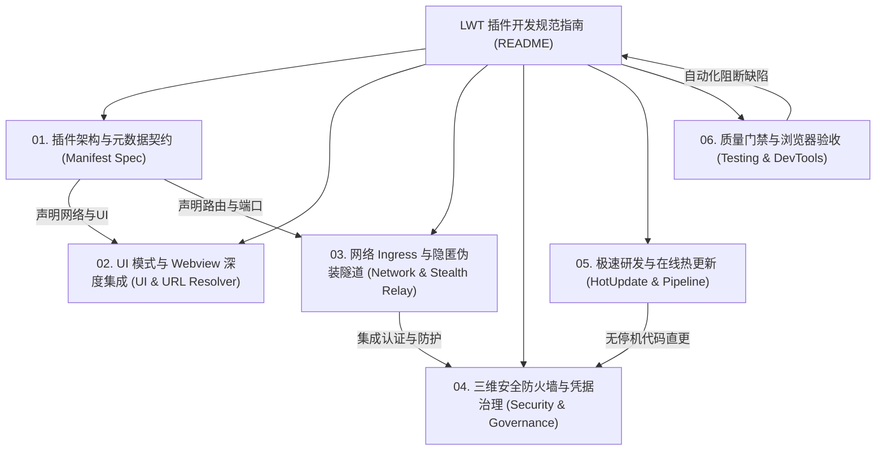

# LinuxWebTool (LWT) 插件开发全景规范与工程指南

> **版本**：v1.0.0  
> **适用对象**：LWT 插件微服务开发者、平台架构师、跨会话 AI Coding Agent  
> **设计哲学**：轻量底座、微服务隔离、纯原生技术栈（零构建包袱）、双轨无停机热更、零泄漏防御。

---

## 1. 规范体系全景图

LinuxWebTool (LWT) 拥有高度模块化与隔离度的插件系统，将系统底层能力（PTY 终端、网络转发、组网）与高层业务（AI 网关、代理穿透、自动化运维）进行解耦。本规范体系将历史沉淀的工程经验、协议契约、安全治理与避坑方案固化为 6 大标准分册：

---

## 2. 规范分册索引与导航

| 分册编号与文档 | 核心关注领域与核心收益 | 必读场景 |
| :--- | :--- | :--- |
| [**01. 插件架构与元数据契约**](./01-architecture-and-manifest-spec.md) | 插件类型分类（常驻微服务 vs 轻量脚本）、`plugin.json` 完整契约、生命周期状态机、多语言运行时环境要求（Go/.NET 10/Node/Python） | 新建插件、定义配置、配置自启动与环境变量 |
| [**02. UI 模式与 Webview 深度集成**](./02-ui-modes-and-webview-integration.md) | 三大 UI 模式（`none` / `web` / `custom`）、Webview iframe 安全沙箱、跨源通信总线、`PluginUrlResolver` URL 策略仲裁与坏死按钮防御 | 编写插件前端面板、嵌入 Web 视图、处理 URL 跳转与 Token 传递 |
| [**03. 网络 Ingress 与隐匿伪装隧道**](./03-network-ingress-and-stealth-tunnel.md) | 端口模式 vs 反向代理 vs UDS 零端口、宿主核心保留路由短路守卫、双轨命名空间（`standard` vs `stealth`）、HTTP/TLS 伪装隧道与 WebSocket 防探测 | 开发网络服务、内网穿透、SOCKS5/HTTP 代理、防止被主动扫描探测 |
| [**04. 三维安全防火墙与凭据治理**](./04-security-firewall-and-credentials.md) | 三维多层防护网（协议身份认证、入站客户端 CIDR 限制、出站目标网段与域名通配符白名单）、RFC 5737 凭据脱敏规范、Git 预提交安全门禁 | 暴露网络接口、设计访问控制策略、编写测试用例与开发文档 |
| [**05. 极速研发与在线热更新**](./05-fast-development-and-hotupdate.md) | 开发运维双轨制（`-Mode Dev` vs `-Mode Official`）、5秒在线热更新（`-HotUpdatePlugin` 零容器停机）、原子 Inode 替换防 `ETXTBSY`、LF 换行符跨平台防御 | 日常功能迭代、Bug 修复排障、代码推送与部署发布 |
| [**06. 质量门禁与浏览器验收**](./06-testing-and-browser-acceptance.md) | C# 架构测试（`LinuxArch*`）、前端架构与行为门禁（`frontend-gate.cjs`）、Chrome DevTools MCP 内置浏览器无感验收规范 | 功能交付验收、合并分支、CI/CD 自动化检测 |

---

## 3. 插件开发十项军规 (Ten Golden Rules)

在 LWT 插件的设计、编码与维护过程中，所有开发者及 AI Coding Agent 必须时刻牢记以下红线准则：

1. **更新粒度最小化原则**：凡涉及插件微服务逻辑/页面代码修改，**统一强制使用在线热更新 (`-HotUpdatePlugin <id>`)**，耗时 5~8 秒且零容器停机；严禁滥用全量重启容器！
2. **凭据安全绝对零泄露**：文档与测试用例中严禁出现真实公网 IP、密钥、密码或 Token，统一使用标准占位符（如 RFC 5737）；真实凭据必须且仅能来自受 `.gitignore` 保护的 `env/.envdev`。
3. **HTTP 声明语义保真**：`manifest.network.supportHttp` 仅能用于提供真实 HTTP 控制面或 Web 站点的微服务；**纯 TCP/UDP/SOCKS5 代理服务严禁声明为 true**，防止前端渲染无效外链。
4. **URL 统一策略仲裁**：所有插件卡片按钮与弹窗 URL **必须经由 `PluginUrlResolver` 解析**，严禁在业务组件中直接读取裸 `plugin.gatewayUrl`（违反触发 `FE-PLUGIN-GATEWAY-FALLBACK` 门禁）。
5. **系统核心路由神圣不可侵犯**：插件反代 Ingress 严禁声明或占用宿主系统保留路径（`/api/*`、`/app/*`、`/assets/*`、`/terminal`、`/health` 等），中间件层自动执行绝对短路拦截。
6. **主动探测免疫防御**：暴露于宿主 Web 端口的伪装隧道必须具备“主动探测免疫”机制（Active Probing Immune），非法握手请求必须平滑降级至合法静态页面，坚决杜绝泄露代理指纹。
7. **三维访问防护一体化**：网络类插件必须同时具备三维控制网（身份鉴权、入站 CIDR IP 白名单、出站目标网段与域名白名单），杜绝内网穿透安全放大效应。
8. **跨平台换行符严格归一**：所有 Shell 脚本、HTML、CSS 与 JavaScript 源码必须采用 Unix LF (`\n`) 换行符，严禁携带 Windows CRLF (`\r\n`)。
9. **Linux 静态 ELF 预编译与原子 Inode 替换**：Go 语言插件在本地更新时必须交叉编译 Linux 架构的 ELF 静态二进制（`CGO_ENABLED=0 GOOS=linux GOARCH=amd64`），覆盖运行时使用 `cp -> chmod +x -> mv -f` 原子操作，杜绝 `Text file busy` (ETXTBSY)。
10. **代码入库双重门禁阻断**：任何改动提交前，必须运行全仓凭据扫描（`node .githooks/security-gate.cjs --full`）与前端架构门禁（`node src/LinuxWebTool.WebHost/wwwroot/frontend-gate.cjs`）。
