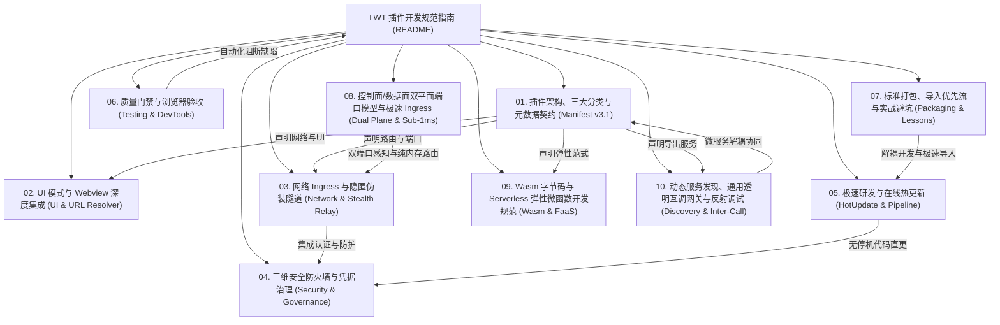

# LinuxWebTool (LWT) 插件开发全景规范与工程指南 (Schema v3.1)

> **版本**：v3.1.0 (工业级标准)  
> **制定时间**：2026-11-08  
> **适用对象**：LWT 插件微服务开发者、平台架构师、跨会话 AI Coding Agent  
> **设计哲学**：轻量底座、正交工作负载隔离、纯原生技术栈（零构建包袱）、双轨无停机热更、通用透明互调、零泄漏防御。

---

## 1. 规范体系全景图

LinuxWebTool (LWT) 拥有高度模块化与沙箱隔离的插件微服务系统，将系统底层基础设施（PTY 终端、网络转发、EasyTier 组网、磁盘分析）与高层业务（AI 智能网关、代理穿透、自动化运维、Web 站点托管）进行深度解耦。

本规范体系全面对齐 **Schema v3.1 通用多维架构**（生命周期 `PluginLifecycle`、协议 `InterfaceProtocol`、架构形态 `PluginArchetype`、目录规范 `PluginLayoutSpec`、构建规范 `PluginBuildSpec`、服务接口 `PluginInterfaceSpec`），固化为 10 大标准工程分册：



---

## 2. 规范分册索引与导航

| 分册编号与文档 | 核心关注领域与核心收益 | 必读场景 |
| :--- | :--- | :--- |
| [**01. 插件架构、三大分类与元数据契约**](./01-architecture-and-manifest-spec.md) | **三大顶级正交工作负载分类**（常驻微服务、弹性微函数、运维指令）、Schema v3.1 `plugin.json` 完整规范块、生命周期状态机、目录规整（`layout`）、声明式构建（`build.command`）与 Revision 版本追踪。 | 新建插件、定义清单、声明构建命令与资源约束 |
| [**02. UI 模式与 Webview 深度集成**](./02-ui-modes-and-webview-integration.md) | 三大 UI 模式（`none` / `web` / `custom`）、Webview iframe 安全沙箱、Token 鉴权穿透、`PluginUrlResolver` URL 策略仲裁、坏死按钮防御与暗黑赛博 UI 规范（`FE-CONTAINER-HEIGHT-LIMIT`）。 | 编写插件前端面板、嵌入 Web 视图、处理 URL 跳转与 Token 传递 |
| [**03. 网络 Ingress 与隐匿伪装隧道**](./03-network-ingress-and-stealth-tunnel.md) | 端口模式 vs 反向代理 vs UDS 零端口、宿主核心保留路由短路守卫、双轨命名空间（`standard` vs `stealth`）、HTTP/TLS 伪装隧道与 WebSocket 防探测主动免疫机制。 | 开发网络服务、内网穿透、SOCKS5/HTTP 代理、防止被主动扫描探测 |
| [**04. 三维安全防火墙与凭据治理**](./04-security-firewall-and-credentials.md) | 三维多层防护网（协议身份认证、入站客户端 CIDR 限制、出站目标网段与域名通配符白名单）、RFC 5737 凭据脱敏规范、Git 预提交安全门禁与香农熵防泄露。 | 暴露网络接口、设计访问控制策略、编写测试用例与开发文档 |
| [**05. 极速研发与在线热更新**](./05-fast-development-and-hotupdate.md) | 开发部署双轨制（`-Mode Dev` vs `-Mode Official`）、5秒在线热更新（`-HotUpdatePlugin` 零容器停机）、原子 Inode 替换防 `ETXTBSY`、LF 换行符跨平台防御与终端控制字符清洗。 | 日常功能迭代、Bug 修复排障、代码推送与部署发布 |
| [**06. 质量门禁与浏览器验收**](./06-testing-and-browser-acceptance.md) | C# 架构测试（`LinuxArch*`）、前端架构与行为门禁（`frontend-gate.cjs`）、Chrome DevTools MCP 内置浏览器自动化无感验收规范。 | 功能交付验收、合并分支、CI/CD 自动化检测 |
| [**07. 标准打包、导入优先流与实战避坑**](./07-packaging-import-and-forwarder-lessons.md) | 标准 Zip 文件布局规范、一键打包工具（`scripts/pack-plugin.ps1`）、Web/API 导入流、数据保护机制及 `socks5-forwarder` 经典踩坑复盘。 | 插件跨平台分发、第三方生态接入、离线部署与日常排障 |
| [**08. 控制面/数据面双平面端口模型与极速 Ingress**](./08-control-plane-ports-metadata-projection-and-sub-1ms-routing.md) | 控制面端口（18090 UI/API）与数据面多端口池（10801~10815）物理分离架构、宿主双端口感知与元数据向下投影（`LWT_*`）、RCU 纯内存路由表将延迟由 412ms 降至 1ms。 | 复合网络中继开发、高并发网关、多入站端口调度、探针延迟性能调优 |
| [**09. Wasm 字节码与 Serverless 弹性微函数开发规范**](./09-wasm-and-serverless-microfunctions.md) | WebAssembly (WasmAbi / WASI / C# NativeAOT / WAT) 与 Node.js Serverless 弹性微函数规范、纳秒/毫秒级冷启动、按需拉起（Scale-to-Zero）、沙箱内存安全隔离。 | 高性能计算、轻量无状态函数计算、跨平台安全执行不受信任代码 |
| [**10. 动态服务发现、通用透明互调网关与反射调试**](./10-dynamic-discovery-and-transparent-gateway.md) | 声明式服务契约导出（`interface.services`）、统一反射互调网关（`GET /api/Plugins/Discovery` & `POST /api/Plugins/Invoke`）、控制台跨微服务一键反射调试抽屉。 | 微服务解耦交互、组件能力对外暴露、跨插件流程编排与动态服务发现 |

---

## 3. 三大顶级工作负载分类 (Top-Level Archetypes)

遵循云原生与计算机科学本质，LWT 插件彻底摒弃将“底层技术栈 (Wasm)”与“生命周期 (Resident)”混淆的二元旧分类，重构为三大互斥且穷尽（MECE）的计算范式：

```
+---------------------------------------------------------------------------------------------------+
|                                 LWT Schema v3.1 正交工作负载分类学                                |
+---------------------------------------------------------------------------------------------------+
                                                  |
           +--------------------------------------+--------------------------------------+
           |                                      |                                      |
           v                                      v                                      v
  [ 🌐 常驻微服务与网关 ]                 [ ⚡ 弹性微函数与计算 ]                 [ 🛠️ 运维指令与单次任务 ]
  • 持有网络端口 / 监听套接字              • 无状态、按需冷启动 (Scale-to-Zero)   • 有限生命周期、随调随走
  • 由 Supervisor 守护自愈                • 内存安全沙箱强隔离 (Wasm/FaaS)       • 承载系统运维、巡检与配额探测
  • 提供持续 REST / TCP 服务              • 纳秒级 Wasm / 毫秒级 Node.js 函数    • 典型: caddy-manager,
  • 典型: mcp-bridge, lxc-manager,        • 典型: demo-nativeaot-wasm,           ssh-access-guard,
    socks5-proxy, disk-explorer             demo-dotnet-wasm, serverless-api       sample-healthcheck
```

---

## 4. 插件开发十八项军规 (Eighteen Golden Rules)

在 LWT 插件的设计、编码与维护过程中，所有开发者及 AI Coding Agent 必须时刻牢记以下红线准则：

1. **更新粒度最小化原则**：凡涉及插件微服务逻辑/页面代码修改，**统一强制使用在线热更新 (`-HotUpdatePlugin <id>`)**，耗时 5~8 秒且零容器停机；严禁滥用全量重启容器！
2. **凭据安全绝对零泄露**：文档与测试用例中严禁出现真实公网 IP、密钥、密码或 Token，统一使用标准占位符（如 RFC 5737 示例 IP `192.0.2.1`、测试密钥 `sk-proj-test-secret-key-1234567890`）；真实凭据必须且仅能来自受 `.gitignore` 保护的 `env/.envdev`。
3. **HTTP 声明语义保真**：`manifest.network.supportHttp` 仅能用于提供真实 HTTP 控制面或 Web 站点的微服务；**纯 TCP/UDP/SOCKS5 代理服务严禁声明为 true**，防止前端渲染无效外链。
4. **URL 统一策略仲裁**：所有插件卡片按钮与弹窗 URL **必须经由 `PluginUrlResolver` 解析**，严禁在业务组件中直接读取裸 `plugin.gatewayUrl`（违反触发 `FE-PLUGIN-GATEWAY-FALLBACK` 门禁）。
5. **系统核心路由神圣不可侵犯**：插件反代 Ingress 严禁声明或占用宿主系统保留路径（`/api/*`、`/app/*`、`/assets/*`、`/terminal`、`/health` 等），中间件层自动执行绝对短路拦截。
6. **主动探测免疫防御**：暴露于宿主 Web 端口的伪装隧道必须具备“主动探测免疫”机制（Active Probing Immune），非法握手请求必须平滑降级至合法静态页面，坚决杜绝泄露代理指纹。
7. **三维访问防护一体化**：网络类插件必须同时具备三维控制网（身份鉴权、入站 CIDR IP 白名单、出站目标网段与域名白名单），杜绝内网穿透安全放大效应。
8. **跨平台换行符严格归一**：所有 Shell 脚本、HTML、CSS 与 JavaScript 源码必须采用 Unix LF (`\n`) 换行符，严禁携带 Windows CRLF (`\r\n`)。
9. **Linux 静态 ELF 预编译与原子 Inode 替换**：Go 语言插件在本地更新时必须交叉编译 Linux 架构的 ELF 静态二进制（`CGO_ENABLED=0 GOOS=linux GOARCH=amd64`），覆盖运行时使用 `cp -> chmod +x -> mv -f` 原子操作，杜绝 `Text file busy` (ETXTBSY)。
10. **导入优先与零宿主侵入**：生态扩展与新功能插件开发优先遵循独立打包与 ZIP 导入规范（`scripts/pack-plugin.ps1`），严禁非必要侵入宿主 C# 代码；内置插件由目录提供者自适应同步。
11. **Webview 路径自适应与 Localhost 禁令**：插件前端与后端通信必须采用相对反代路径（`/plugins/{id}/api`），严禁向前端直接暴露裸 `http://localhost:<port>` 造成远程客户端拒绝连接。
12. **代码入库双重门禁阻断**：任何改动提交前，必须运行全仓凭据扫描（`node .githooks/security-gate.cjs --full`）与前端架构门禁（`node src/LinuxWebTool.WebHost/wwwroot/frontend-gate.cjs`）。
13. **数据面转发严禁侵入控制面 I/O**：在数据转发与请求拦截 fast path 中，严禁调用全量磁盘扫描或外部子进程探测方法，必须依赖纯内存只读快照（`IIngressRoutingTable`）确保亚毫秒级分发。
14. **控制面与数据面端口严格物理分离**：网络微服务清单的 `manifest.port` 必须明确绑定至微服务的 **控制面端口**（提供 Webview 和 RESTful API）；多入站数据面端口池由服务内部动态管理并按需在宿主端口池中声明。
15. **宿主双端口感知与动态自适应**：严禁在插件后端与 Webview 中硬编码宿主端口。必须动态读取 `LWT_HOST_PORT`（内部直通）与 `LWT_HOST_EXTERNAL_PORT`（外部发布），确保容器内外均能准确通信。
16. **动态监听器热重载防端口泄露**：在支持动态增删端口的微服务中，当配置发生热重载时，必须在释放锁前安全关闭旧 `net.Listener` 句柄，杜绝孤儿监听器导致的 `address already in use` 故障。
17. **持久卷存储与代码目录物理隔离**：插件微服务绝对禁止在当前代码目录（`LWT_CODE_DIR`）中保存持久化状态或业务数据库（热更新会整包覆写代码资产）；持久配置与数据库必须写入受系统保护的独立持久卷（`LWT_VOLUME_DIR` 或 `LWT_STATE_DIR`）。
18. **服务契约显式声明与跨服务互调**：对外提供能力的微服务必须在 `interface.services` 中显式声明方法与描述，优先通过 `POST /api/Plugins/Invoke` 进行通信，严禁在微服务间私下硬编码探测内部未导出的私有端口。
