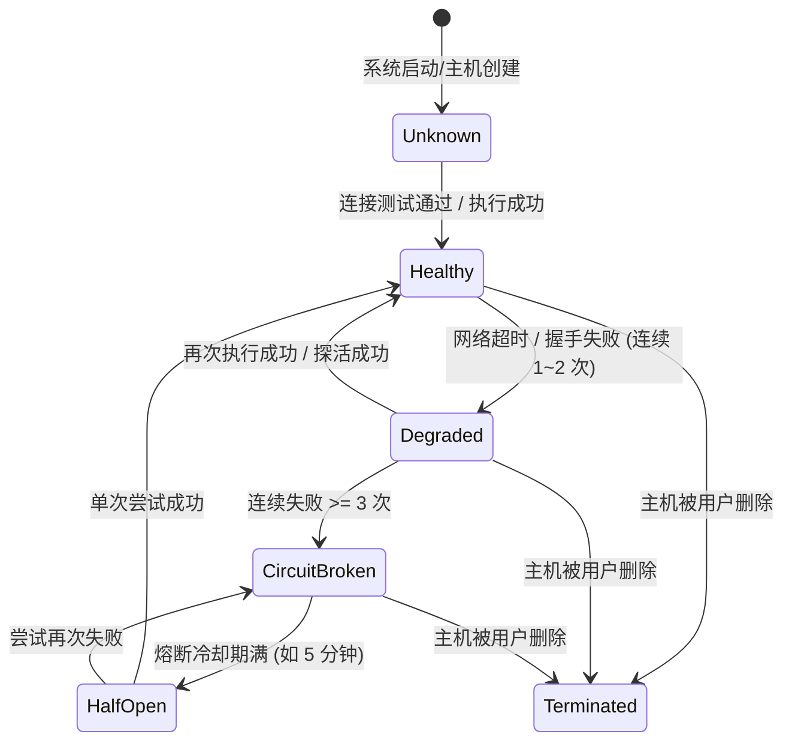
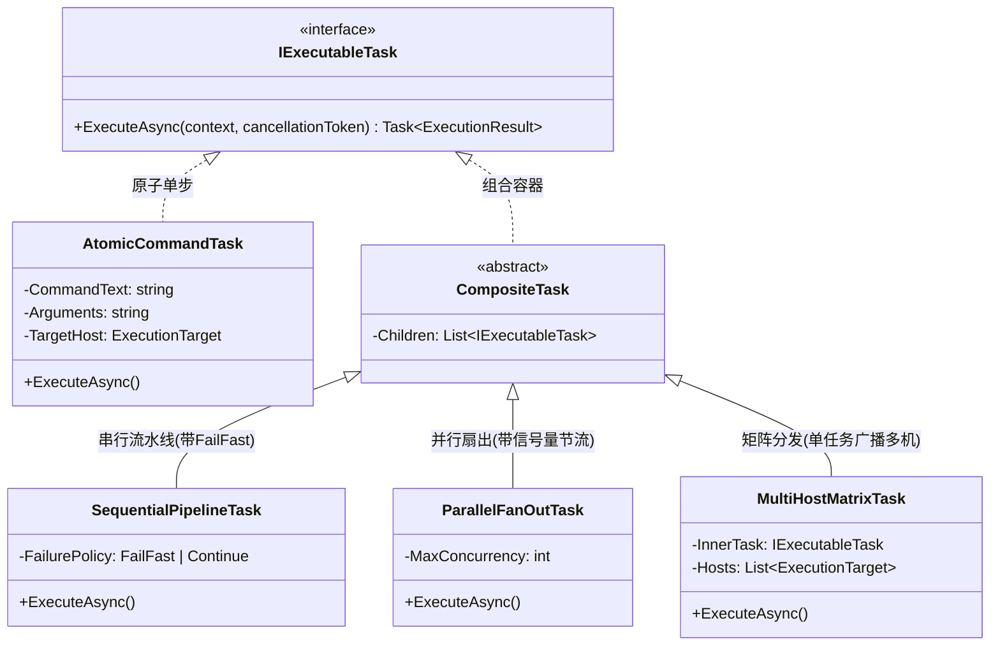
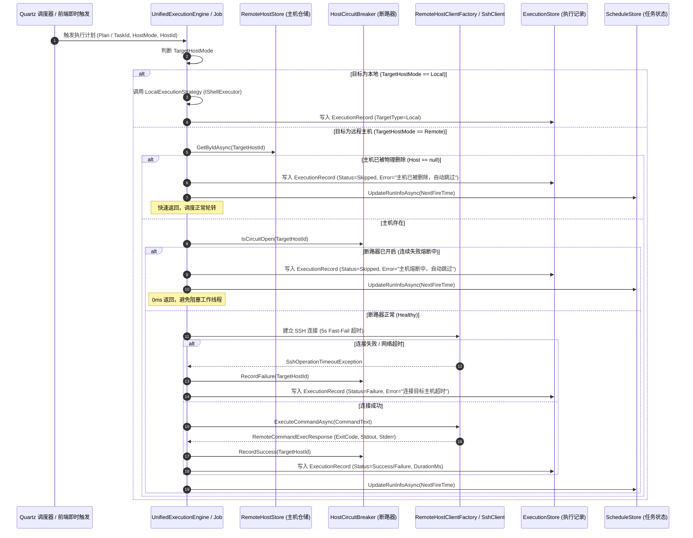
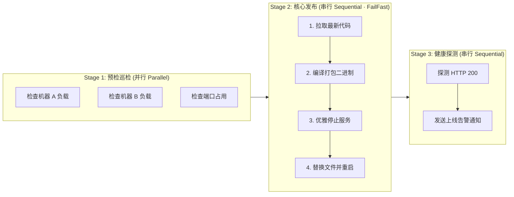
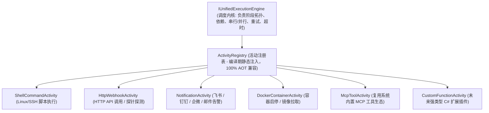

# 指令管理与定时任务跨主机调度（本地与远程主机）架构调研与落地方案

> **文档状态**：方案调研、架构论证、设计模式重构与工程落地蓝图 (RFC / Technical Design & Implementation Blueprint)  
> **文档版本**：v1.1.0 (已合入指令多选批量执行与失败处理闭环设计)  
> **关联版本**：`v0.2.17`  
> **涉及分层**：
> - 领域契约层：`src/LinuxWebTool.Contracts/Features/Scheduling/*`、`src/LinuxWebTool.Contracts/Features/Commands/*`
> - 业务编排层：`src/LinuxWebTool.Application/Features/Commands/*`、`LinuxWebTool.Application/Features/Scheduling/*`
> - 技术基础设施层：`src/LinuxWebTool.Infrastructure/Features/Scheduling/*`、`LinuxWebTool.Infrastructure/Features/RemoteHost/*`、`Persistence/*`
> - 宿主展示层：`src/LinuxWebTool.WebHost/Features/Commands/*`、`Features/Schedule/*`、`wwwroot/app/views/CommandsView.js`、`SchedulesView.js`、`HistoryView.js`

---

## 目录

- [一、 核心需求分析与背景解构](#一-核心需求分析与背景解构)
  - [1.1 业务背景与用户痛点](#11-业务背景与用户痛点)
  - [1.2 核心命题拆解与精准回答](#12-核心命题拆解与精准回答)
  - [1.3 系统核心技术契约与架构约束](#13-系统核心技术契约与架构约束)
- [二、 深度头脑风暴：可行性、逻辑欠缺与性能风险评估](#二-深度头脑风暴可行性逻辑欠缺与性能风险评估)
  - [2.1 解耦 vs 强绑定：多维逻辑推演与架构抉择](#21-解耦-vs-强绑定多维逻辑推演与架构抉择)
  - [2.2 多主机并发分发（1-to-N）可行性与潜在欠缺](#22-多主机并发分发1-to-n可行性与潜在欠缺)
  - [2.3 异常容错与逻辑闭环：主机删除、离线、网络闪断与挂死防范](#23-异常容错与逻辑闭环主机删除离线网络闪断与挂死防范)
  - [2.4 安全沙箱与权限继承边界](#24-安全沙箱与权限继承边界)
- [三、 软件架构重构与经典设计模式应用](#三-软件架构重构与经典设计模式应用)
  - [3.1 策略模式 (Strategy Pattern)：统一执行引擎内核](#31-策略模式-strategy-pattern统一执行引擎内核)
  - [3.2 适配器模式 (Adapter Pattern)：输入输出上下文规整](#32-适配器模式-adapter-pattern输入输出上下文规整)
  - [3.3 状态机与断路器模式 (Host Health State Machine & Circuit Breaker)](#33-状态机与断路器模式-host-health-state-machine--circuit-breaker)
  - [3.4 扇出分发器与聚合器模式 (Fan-out Dispatcher & Aggregator)](#34-扇出分发器与聚合器模式-fan-out-dispatcher--aggregator)
  - [3.5 终极统一模型：组合模式 (Composite Pattern) 与四维正交调度矩阵](#35-终极统一模型组合模式-composite-pattern-与四维正交调度矩阵)
- [四、 现有开源库评估与业界主流方案横向对比](#四-现有开源库评估与业界主流方案横向对比)
  - [4.1 现有库利用与借鉴评估 (.NET 生态)](#41-现有库利用与借鉴评估-net-生态)
  - [4.2 业界主流运维调度系统全景对比矩阵](#42-业界主流运维调度系统全景对比矩阵)
  - [4.3 业界成熟实践的核心经验吸收与摒弃](#43-业界成熟实践的核心经验吸收与摒弃)
- [五、 详细系统设计与落地规范](#五-详细系统设计与落地规范)
  - [5.1 数据实体拓扑与 SQLite 零停机向后兼容升级](#51-数据实体拓扑与-sqlite-零停机向后兼容升级)
  - [5.2 核心执行流与断路跳过时序设计 (Mermaid)](#52-核心执行流与断路跳过时序设计-mermaid)
  - [5.3 统一执行历史与多主机聚合关联设计](#53-统一执行历史与多主机聚合关联设计)
  - [5.4 完整前端交互设计规范（保存关联/预选/绑定模型与精细化优化）](#54-完整前端交互设计规范保存关联预选绑定模型与精细化优化)
    - [5.4.1 指令偏好与任务强绑定模型规范](#541-指令偏好与任务强绑定模型规范)
    - [5.4.2 智能预选的“非侵入原则”（Dirty State Tracking）](#542-智能预选的非侵入原则dirty-state-tracking)
    - [5.4.3 健康态可搜索主机选择器组件规范 (Searchable Host Selector)](#543-健康态可搜索主机选择器组件规范-searchable-host-selector)
    - [5.4.4 指令即时调试的双模态执行（1-Click Fast Run vs Console Drawer）](#544-指令即时调试的双模态执行1-click-fast-run-vs-console-drawer)
    - [5.4.5 主机失效后的软着陆与一键批量重定向 (One-Click Batch Re-route)](#545-主机失效后的软着陆与一键批量重定向-one-click-batch-re-route)
  - [5.5 串行与并行指令统一编排系统详细设计（Stage-Pipeline 模式与数据流）](#55-串行与并行指令统一编排系统详细设计stage-pipeline-模式与数据流)
    - [5.5.1 编排拓扑架构：Stage-Pipeline 阶段流水线模型](#551-编排拓扑架构stage-pipeline-阶段流水线模型)
    - [5.5.2 编排的三大呈现形态：即时编排、持久化任务流 (Pipeline) 与定时调度](#552-编排的三大呈现形态即时编排持久化任务流-pipeline-与定时调度)
    - [5.5.3 串行步骤间数据流与上下文传递（Variable Chaining & Env Injection）](#553-串行步骤间数据流与上下文传递variable-chaining--env-injection)
    - [5.5.4 并行执行与并发节流控制器 (Bounded Concurrency Guard)](#554-并行执行与并发节流控制器-bounded-concurrency-guard)
    - [5.5.5 失败处理三大策略矩阵与取消机制](#555-失败处理三大策略矩阵与取消机制)
    - [5.5.6 批量编排交互原型与抽屉式实时时间线](#556-批量编排交互原型与抽屉式实时时间线)
  - [5.6 工作流独立模块架构与 DSL 编排语法设计（Workflows & DSL）](#56-工作流独立模块架构与-dsl-编排语法设计workflows--dsl)
    - [5.6.1 终极三层资产架构模型（指令库 -> 工作流编排 -> 定时任务触发）](#561-终极三层资产架构模型指令库---工作流编排---定时任务触发)
    - [5.6.2 编排语法方案抉择：可视化积木 UI + 现有指令引用 + 内联即席脚本（双轨融合）](#562-编排语法方案抉择可视化积木-ui--现有指令引用--内联即席脚本双轨融合)
    - [5.6.3 工作流定义 DSL 规范（WorkflowDefinition JSON Schema）](#563-工作流定义-dsl-规范workflowdefinition-json-schema)
    - [5.6.4 数据实体拓扑与定时任务无损挂载升级](#564-数据实体拓扑与定时任务无损挂载升级)
    - [5.6.5 插件化活动提供者模式 (IWorkflowActivity) 与未来多功能调用扩展矩阵](#565-插件化活动提供者模式-iworkflowactivity-与未来多功能调用扩展矩阵)
  - [5.7 Native AOT 契约与编译门禁合规保证](#57-native-aot-契约与编译门禁合规保证)
- [六、 分阶段实施路线图 (Phase-by-Phase Roadmap)](#六-分阶段实施路线图-phase-by-phase-roadmap)
  - [Phase 1: 核心解耦与单远程主机调度落地（P0 基础骨架）](#phase-1-核心解耦与单远程主机调度落地p0-基础骨架)
  - [Phase 2: 断路器自愈跳过与可观测审计日志闭环（P0 容错防护）](#phase-2-断路器自愈跳过与可观测审计日志闭环p0-容错防护)
  - [Phase 3: 多主机分发与多指令批量流水线引擎（P1 高阶增强）](#phase-3-多主机分发与多指令批量流水线引擎p1-高阶增强)
- [七、 总结与决策建议](#七-总结与决策建议)

---

## 一、 核心需求分析与背景解构

### 1.1 业务背景与用户痛点
在 LinuxWebTool（LWT）当前的体系中：
1. **指令管理（Commands）**：用户可以保存常用的 Linux 指令或 Bash 脚本，但当前执行通道完全硬编码走 `IShellExecutor`，即仅在部署了 LWT 进程的“本地服务器（Host OS）”上运行。
2. **定时任务（Schedules）**：通过 Quartz.NET 实现按 Cron 表达式自动触发，底层通过 `ScheduledCommandJob` 调用 `IShellExecutor`，同样被局限在“本地服务器”。
3. **远程主机管理（Remote Hosts）**：系统在 `v0.2.14 ~ v0.2.16` 中成功建立起了完善的多协议远程主机纳管体系（SSH、SFTP、双轨自愈传输、Web 终端、在线文件编辑与流式操作），并在 `RemoteHostsView.js` 中提供了简单的“远端即时单指令调试（`/api/RemoteHosts/{id}/ExecuteCommand`）”。

**核心矛盾**：
- 用户在“指令管理”中精心编排并保存的丰富脚本资产、在“定时任务”中配置的自动化巡检逻辑，无法直接作用于纳管的多台远程 Linux 虚拟机、物理机或边缘节点；
- 远程主机如果发生宕机、网络不通、重装系统或被物理删除，定时任务如果未做容错，会导致后台任务挂死、线程池耗尽，甚至破坏整个 Quartz 调度引擎的健康循环。

### 1.2 核心命题拆解与精准回答

| 核心问题 | 结论与确凿回答 | 架构根因与推演依据 |
| :--- | :--- | :--- |
| **Q1: 指令管理页面与定时任务页面能否支持选择服务器（本地和远程特定主机）？** | **完全可行，且架构天然契合**。 | 系统已具备成熟的 `RemoteHostClientFactory`、`SshHostAdapter.ExecuteCommandAsync` 与本地 `IShellExecutor`。只需在执行调度层抽象统一的“执行引擎门面”，即可无缝路由。 |
| **Q2: 远程主机被删除或存在问题无法访问时，定时任务能否自动跳过并记录？** | **必须支持，且这是保证调度系统高可用的基石**。 | 当任务绑定的 `HostId` 在数据库中已不存在，或网络握手探测超时（如 5s fast-fail），任务立即标记为 `Skipped`（跳过）或 `Failed`，记录结构化错误日志，**绝不抛出未处理异常**，下一次 Cron 执行时间正常推进。 |
| **Q3: 指令、执行主机还有定时任务选择保持解耦还是不解耦？** | **必须保持解耦（强推荐）**。指令是纯模板（What to do），执行主机是拓扑环境（Where to run），定时任务是编排实例（When & Where to do What）。 | 强绑定违背 DRY 原则：若一条通用指令要在 5 台机器执行，强绑定需复制 5 条相同指令；解耦后同一指令可被不同的定时任务绑定到不同主机，或手动执行时自由分发。指令层仅保留一个“默认执行目标”快捷提示。 |
| **Q4: 是否允许定时任务/指令支持多主机并发执行？** | **架构设计上直接按 1-to-N 抽象，工程分步开放**。 | 极为有用（如全节点巡检、批量配置生效）。但必须通过“并发节流（`SemaphoreSlim`）+ 批次号（`BatchId`）+ 局部故障隔离”进行并发风暴抑制，防止连接数暴增与线程挂死。 |
| **Q5: 指令管理页面能否支持多选执行？如何处理失败？** | **完全支持，且必须具备“遇错即停 (Fail-Fast)”等灵活策略**。 | 支持流水线（串行）与并发两种执行模式；失败策略标配“遇错即停”（前序失败中断后续并标记跳过）与“忽略错误继续”，并通过 `BatchId` 批次流水线树状归档。 |

### 1.3 系统核心技术契约与架构约束
1. **.NET 10 Native AOT 契约**：
   - 严禁引入任何未经标注的动态反射或运行时代码生成；
   - 所有的请求/响应 Record 与 DTO 必须在 `AppJsonSerializerContext.cs` 中注册 `[JsonSerializable]`；
   - 所有新增的 Minimal API 端点必须在源生成器路由体系（`EndpointsMapper.g.cs`）约束内，或通过标准 Controller 反射注册并在 Native AOT 根下显式保留元数据。
2. **架构门禁与代码防线（`LinuxArch`）**：
   - 单文件行数严守 **700 行硬顶限制**（`LinuxArch026`）；
   - 分层依赖方向不可倒置：Contracts（无依赖）← Application ← Infrastructure ← WebHost；
   - 业务逻辑一律沉淀在 Application/Infrastructure，禁止在 Controller 中堆砌复杂分发逻辑。
3. **向后兼容性契约**：
   - 现有 SQLite 数据库在用户环境已存在数据，历史数据升级必须支持零破坏平滑过渡（默认值兼容老数据为“本地服务器”）。

---

## 二、 深度头脑风暴：可行性、逻辑欠缺与性能风险评估

### 2.1 解耦 vs 强绑定：多维逻辑推演与架构抉择

#### 深度推演：方案 A（强绑定模式：Command 绑定 Host）
- **实现方式**：在 `LinuxCommand` 实体中增加 `HostId`，保存指令时就定死这台指令属于哪台机器。
- **致命缺陷**：
  1. **代码与配置大量冗余**：用户有 20 台远程主机，若需要部署监控脚本 `check_disk.sh`，必须在界面上点击新增 20 次，生成 20 条一模一样的指令；一旦脚本需要微调，必须逐一修改 20 次。
  2. **逻辑混乱**：快速执行（QuickExecute）或者手动执行时，如果临时想在主机 B 上测一下主机 A 的脚本，需要克隆或重新录入。
  3. **生命周期耦合**：当某台主机被下线删除时，关联的这 20 条指令是级联删除还是变脏数据？若删除指令，导致历史关联任务全崩；若不删除，残留一堆失效指令。

#### 深度推演：方案 B（完全解耦模型：Command 为纯模板，Schedule/Run 绑定 Host）
- **实现方式**：
  - **LinuxCommand（指令）**：纯逻辑执行模板（定义脚本内容、参数格式、预期超时）。可选保留 `DefaultTargetHostId`（仅作为 UI 交互上的默认偏好建议，不产生物理强绑定约束）。
  - **ScheduleTask（定时任务）**：定义具体的“调度执行实例”。天然拥有 `TargetHostMode`（0=本地, 1=单远程主机, 2=多远程主机）与 `TargetHostIds`。
  - **Manual Execution（单次手动执行）**：用户在指令卡片点击“立即执行”时，弹出的参数框中提供“目标主机下拉框”（默认选中指令推荐的默认主机或本地），用户可自由切换目标执行。
- **架构决策**：**坚决采用方案 B（完全解耦模型）**。这完全符合 Unix“机制与策略分离”的哲学，也是业界（Ansible、Rundeck、AWX、Jenkins）被验证数十年的标准解法。

```
+-------------------------------------------------------+
|              LinuxCommand (指令模板: 怎么做)          |
|  - Id, Name, CommandText, ScriptType, TimeoutSeconds  |
|  - [可选偏好] DefaultTargetHostId (仅用于UI默认值)    |
+-------------------------------------------------------+
                           |
            +--------------+--------------+
            | (1 对多引用)                | (1 对多手动运行)
            v                             v
+-----------------------------+   +-----------------------------+
| ScheduleTask (编排: 何时何地)|   | Manual Execution (即时测试) |
| - CronExpression, Arguments |   | - Arguments                 |
| - TargetHostMode (本地/远程)|   | - TargetHost (临时指定/默认)|
| - TargetHostIds             |   +-----------------------------+
+-----------------------------+                  |
            |                                    |
            +------------------+-----------------+
                               v
               +-------------------------------+
               | ExecutionRecord (执行追溯日志)|
               | - CommandId, ScheduleTaskId   |
               | - TargetHostId, HostName      |
               | - Output, ExitCode, Status    |
               +-------------------------------+
```

### 2.2 多主机并发分发（1-to-N）可行性与潜在欠缺

#### 潜在欠缺与风险分析：
1. **线程池耗尽与雪崩效应（Thread Starvation）**：
   - 假设一个定时任务配置了分发到 50 台远程主机。如果使用简单的 `Task.WhenAll(hosts.Select(...))` 且无并发控制，系统将瞬间发起 50 个底层 SSH 握手请求。
   - 当遇到网络拥堵或弱网边缘节点时，50 个任务同时等待 TCP 握手超时（默认 10~30s），会导致 .NET 工作线程池急剧膨胀，进而拖慢 Web 界面 HTTP 请求响应，甚至导致健康检查超时被系统杀进程。
   - **防范机制**：**有界并发节流（Bounded Concurrency Dispatcher）**。引入 `SemaphoreSlim(maxDegreeOfParallelism: 5~10)`，无论绑定多少台主机，同时并发执行的连接数始终受控。
2. **局部失败与结果聚合的二义性（Partial Failure Ambiguity）**：
   - 假设 5 台主机中：3 台返回成功（ExitCode 0），1 台脚本执行报错（ExitCode 1），1 台主机离线或已被删除。
   - 那么这个定时任务在汇总层面是“成功”还是“失败”？
   - **防范机制**：引入 **批次级聚合机制（Batch Aggregation）**：
     - 单个任务运行产生一个 `BatchExecutionId`；
     - 每一台目标主机的执行生成一条明细 `ExecutionRecord`（记录具体的 HostId、主机名、耗时、独立 ExitCode 与状态）；
     - 聚合状态采用业界标准的三态或四态：`AllSuccess`（全部成功）、`PartialSuccess`（部分成功）、`AllFailure`（全部失败）、`Skipped`（全部跳过）。
3. **执行时间与 Cron 周期冲突（Schedule Overlap）**：
   - 广播到多台主机时，总耗时可能上升。若 Cron 周期设置为每分钟一次，而多机分发耗时 1 分 15 秒，可能引发任务堆积。
   - **防范机制**：保留已有的 `[DisallowConcurrentExecution]` Quartz 特性，并在执行器内部设置全局广播总超时（Global Dispatch Timeout）。

### 2.3 异常容错与逻辑闭环：主机删除、离线、网络闪断与挂死防范

#### 异常场景全景容错矩阵：

| 异常场景 | 表现与潜在风险 | 闭环处理机制 | 最终执行状态 |
| :--- | :--- | :--- | :--- |
| **场景 1：目标主机在管理后台被物理删除** | 定时任务触发，数据库中查不到该 `HostId` 的连接信息。若直接报空引用或抛出未捕获异常，会导致 Quartz 线程挂死。 | **存在性前置断言**：执行前通过 `RemoteHostStore.GetByIdAsync(hostId)` 校验。若为 `null`，不发起任何网络调用，生成提示性审计记录。 | `ExecutionStatus.Skipped` (自动跳过)；错误信息：`[主机已移除] 目标主机已从系统删除`。 |
| **场景 2：目标主机已关机或网络断开（不可达）** | TCP 无法建连，SSH 库默认超时可能长达数十秒甚至几分钟，造成任务长时间占坑。 | **快速建连守卫 (Fast Connect Guard)**：将远程执行的握手连接超时硬约束为 **5 秒**（独立于脚本执行超时）。若建连超时立即终止。 | `ExecutionStatus.Failure`；错误信息：`[连接超时] 无法在 5s 内连接至 10.126.1.70:22`。 |
| **场景 3：目标主机 SSH 凭据过期或被修改** | 认证失败（Authentication Failed）。 | 捕获 `SshAuthenticationException`，记录认证失败详情，阻止无限重试。 | `ExecutionStatus.Failure`；错误信息：`[认证失败] 用户名或私钥/密码校验未通过`。 |
| **场景 4：连续多次失败（雪崩与防爆破）** | 目标机一直离线，每分钟的定时任务持续对远端发起无意义连接，浪费系统资源甚至触发安全设备封禁。 | **主机级轻量断路器 (Circuit Breaker)**：若某台主机连续 N 次（如 3 次）发生网络超时/连接失败，该主机进入 `CircuitOpen`（熔断）状态，后续定时任务直接跳过执行（并告警），直到后台探活成功后恢复。 | `ExecutionStatus.Skipped`；错误信息：`[熔断跳过] 主机连续 3 次无法连通，已自动熔断保护`。 |

### 2.4 安全沙箱与权限继承边界
- **本地执行**：继承 LWT 后台进程的运行权限（若配置了 ApiKey 的 `AllowedPaths`，则作为工作目录约束）。
- **远程主机执行**：运行权限完全取决于远程主机录入时配置的 SSH 用户（如 `root`、`deploy`、`www-data`）。
- **参数注入防范**：对于 Bash 脚本类型，远程执行复用现有的 Posix 规范安全转义策略，将脚本正文作为标准输入（Stdin）或安全临时文件推送执行，避免通过拼接 Shell 字符串引发引号逃逸安全漏洞。

---

## 三、 软件架构重构与经典设计模式应用

为了让指令与定时任务在“本地执行”和“远程多主机执行”之间无缝切换，并具备强大的扩展性（未来甚至可扩展容器 Exec、Kubernetes Pod Exec），必须对现有的执行执行链进行合理的设计模式重构。

```
              [CommandsController]     [SchedulesController]      [ScheduledCommandJob]
                       \                  |                   /
                        \                 |                  /
                         v                v                 v
                +---------------------------------------------------+
                |        IUnifiedExecutionEngine (统一执行引擎)     |
                +---------------------------------------------------+
                                          |
                +-------------------------+-------------------------+
                |                                                   |
 (本地执行策略: Local)                                (远程执行策略: Remote-SSH)
                v                                                   v
+-------------------------------+                   +-------------------------------+
|    LocalExecutionStrategy     |                   |    RemoteExecutionStrategy    |
| (适配 IShellExecutor 进程调用)|                   | (适配 IRemoteHostAdapter 协议)|
+-------------------------------+                   +-------------------------------+
                |                                                   |
                |                                   +---------------+---------------+
                |                                   | (熔断器检测)  | (并发扇出调度)|
                v                                   v               v               v
       [本地操作系统 Bash]                    [Host Circuit]  [SemaphoreSlim] [SshClient]
```

### 3.1 策略模式 (Strategy Pattern)：统一执行引擎内核
定义统一的抽象执行策略契约 `ICommandExecutionStrategy`：
- **`LocalCommandExecutionStrategy`**：负责调度本地宿主机的 Shell 进程（直接调用现有的 `IShellExecutor`）。
- **`RemoteSshCommandExecutionStrategy`**：负责根据 `HostId` 从 `RemoteHostStore` 取出主机信息，通过 `RemoteHostClientFactory` 获取适配器，执行远程命令并返回结构化输出。
- **`ExecutionStrategyResolver`**：根据目标类型（`Local` 还是 `RemoteHost`）动态解析对应的策略实例。

### 3.2 适配器模式 (Adapter Pattern)：输入输出上下文规整
当前系统中存在两套执行契约：
- 本地执行：输入 `ShellRequest`，输出 `ShellResult`；
- 远程执行：输入 `RemoteCommandExecRequest`，输出 `RemoteCommandExecResponse`。

通过适配器模式，引入标准化的领域执行模型：
```csharp
public sealed record CommandExecutionContext(
    string CommandText,
    int ScriptType,
    string? Arguments,
    int TimeoutSeconds,
    string? WorkingDirectory,
    ExecutionTarget Target
);

public sealed record ExecutionTarget(
    TargetType Type,         // Local = 0, RemoteHost = 1
    string? HostId = null,   // 远程主机 ID
    string? HostName = null  // 远程主机名称（快照）
);

public sealed record StandardExecutionResult(
    ExecutionStatus Status,
    int? ExitCode,
    string StandardOutput,
    string ErrorOutput,
    long DurationMs,
    bool TimedOut,
    string? SkipReason = null
);
```
适配器负责将不同底层的原始返回统一转换为 `StandardExecutionResult`，向上为 Controller、Scheduler、ExecutionStore 提供一致的语义。

### 3.3 状态机与断路器模式 (Host Health State Machine & Circuit Breaker)
为了防止故障主机拖死系统，为纳管的主机引入轻量内存状态机：



- 在 `CircuitBroken`（熔断状态）下：
  - 定时任务被触发时，断路器拦截器直接返回 `Skipped`，跳过原因标注为 `[熔断防护] 目标主机连续不可达，已自动跳过执行`；
  - 调度任务耗时由“5秒超时”降低为“0毫秒直接返回”，系统整体吞吐量获得极佳保护。

### 3.4 扇出分发器与聚合器模式 (Fan-out Dispatcher & Aggregator)
针对未来或即刻具备的“多主机分发（1-to-N）”需求：
- **`FanOutCommandDispatcher`**：
  - 输入：指令上下文 + 目标主机列表 `IReadOnlyList<ExecutionTarget>`；
  - 内部机制：利用 `SemaphoreSlim(10)` 控制最大并行 SSH 连接数，使用 `Task.WhenAll` 并发扇出；
  - 容错：单个主机的异常或崩溃被 `try-catch` 完全隔离在单机上下文内部，绝不扩散感染其他兄弟主机。
- **`BatchExecutionAggregator`**：
  - 为本次执行生成唯一的 `batchId = Guid.NewGuid()`；
  - 每一个子执行结果单独持久化一条 `ExecutionRecord`（记录 `BatchId`、`TargetHostId`、`HostName`）；
  - 输出聚合结果对象给调用方。

### 3.5 终极统一模型：组合模式 (Composite Pattern) 与四维正交调度矩阵

当面对“单指令”、“串行指令流水线”、“并行指令巡检”、“多主机编排分发”、“定时任务调度”以及“即时指令调用”等看似繁杂的多样化场景时，如果各自独立开发，系统势必陷入逻辑割裂、代码冗余、审计分散的泥潭。

业界成熟体系（如 Kubernetes Job/CronJob、GitHub Actions、Ansible、Temporal）的统一之道，是将**“机制与策略”彻底剥离**，通过**四维正交解耦**与**组合模式（Composite Pattern）**实现全生命周期的终极归一。

#### 3.5.1 四维正交统一架构 (WHAT / HOW / WHERE / WHEN)

系统所有的调度与执行诉求，均可严格解构为 4 个互相正交、独立变化的维度：

```
+-----------------------------------------------------------------------------------------+
|                                统一执行体系 (Execution Matrix)                           |
+-----------------------------------------------------------------------------------------+
| 1. 任务元语 (WHAT)  │ 纯脚本指令模板 (LinuxCommand: 脚本内容、类型、超时、参数)          |
+---------------------+-------------------------------------------------------------------+
| 2. 拓扑编排 (HOW)   │ 单步 (Single) │ 串行流水线 (Sequential) │ 并发扇出 (Parallel)      |
+---------------------+-------------------------------------------------------------------+
| 3. 目标环境 (WHERE) │ 本地宿主机 (Local) │ 单远程节点 (Single Remote) │ 多主机集群 (Cluster) |
+---------------------+-------------------------------------------------------------------+
| 4. 触发源头 (WHEN)  │ 手动即时点击 (Ad-hoc) │ 定时触发 (Schedule/Cron) │ API/MCP 外部调用 |
+-----------------------------------------------------------------------------------------+
```

任何业务操作，本质上都是这 4 个维度的**笛卡尔积（Cartesian Product）组合**。

#### 3.5.2 组合任务树对象模型 (IExecutableTask)

在领域架构中，使用**组合模式 (Composite Pattern)** 对“单原子执行”与“多任务组合”进行统一抽象，使高阶编排器对待单指令和多指令如同对待同一类对象：



* **`AtomicCommandTask`（原子单步）**：单条指令在单个物理节点（本地或远程）上的原子执行；
* **`SequentialPipelineTask`（串行流水线）**：持有子任务列表，按顺序执行。支持 `FailurePolicy`（`FailFast` 遇错即停 或 `Continue` 容错继续）；
* **`ParallelFanOutTask`（并发扇出）**：持有子任务列表，利用 `SemaphoreSlim` 有界并发并行执行；
* **`MultiHostMatrixTask`（多机矩阵分发）**：装饰器容器，将任意一个子任务（无论单步还是流水线）向多台主机广播分发。

#### 3.5.3 统一执行计划 DSL (ExecutionPlan)

无论是用户在 Web 页面多选即时执行、单指令执行，还是 Quartz 守护进程按 Cron 触发，**在上层业务与底层执行引擎之间，完全通过同一个标准领域协议——`ExecutionPlan` 进行交互**：

```csharp
public sealed record ExecutionPlan(
    Guid PlanId,
    string Name,
    ExecutionSource TriggerSource,        // Manual | Schedule | Quick | Mcp
    Guid? ScheduleTaskId,                // 若由定时任务触发则非空
    ExecutionMode Mode,                  // Sequential(串行) | Parallel(并行)
    FailurePolicy FailurePolicy,          // FailFast(遇错即停) | Continue(容错继续)
    int MaxConcurrency,                  // 最大并行度(默认 5~10)
    IReadOnlyList<ExecutionStep> Steps   // 具体步骤序列
);

public sealed record ExecutionStep(
    int StepOrder,
    Guid? CommandId,
    string CommandText,
    int ScriptType,
    string? Arguments,
    ExecutionTarget Target,              // Local | RemoteHost
    int TimeoutSeconds
);
```

#### 3.5.4 所有具体场景的代数映射全景表

| 业务场景 | 统一后的 `ExecutionPlan` 表达 | 目标主机维度 (Where) | 编排模式 (How) | 失败策略 (Failure) |
| :--- | :--- | :--- | :--- | :--- |
| **1. 单指令立即执行** | `Steps.Count = 1` | 选定单机（本地或特定远程） | `Sequential` | N/A |
| **2. 单指令多主机广播** | 1 个指令衍生出 N 个步骤，分发到 N 台机器 | 多台远程主机（有界并发节流 10） | `Parallel` | `Continue`（隔离单机故障） |
| **3. 多指令串行流水线** | 勾选多条指令，生成对应顺序的 `Steps` | 统一在指定主机运行 | `Sequential` | **`FailFast`**（A 失败则跳过 B、C） |
| **4. 多指令并发巡检** | 勾选多条指令，生成独立步骤 | 统一在指定主机运行 | `Parallel` | `Continue`（同时跑，聚合结果） |
| **5. 定时任务 (单指令)** | Quartz Job 触发时，生成单步 `ExecutionPlan` | 任务绑定的主机（本地或单远程主机） | `Sequential` | 若主机不可达，安全标记 `Skipped` |
| **6. 定时任务 (多机/流水线)** | Quartz Job 触发时，生成包含多步骤/多主机的 `ExecutionPlan` | 任务绑定的多台主机 | `Sequential` / `Parallel` | 按任务配置走 `FailFast` 或 `Continue` |

#### 3.5.5 单一执行内核 (IUnifiedExecutionEngine) 与统一审计模型

1. **唯一执行内核：`IUnifiedExecutionEngine`**
   - 系统中不存在分裂的“定时任务执行器”、“控制器命令执行器”或“批量执行器”；
   - 唯一的执行入口就是 `IUnifiedExecutionEngine.ExecuteAsync(ExecutionPlan plan)`；
   - 所有 Controller、Quartz Job、MCP Provider 仅作为**触发器与请求参数收集者**；
   - 断路器守卫、SSH 建连探测超时（5s）、信号量节流、退出码校验、ANSI 终端输出洗净、步骤状态推进等核心逻辑全部由执行内核统一兜底。

2. **单一审计模型：树状执行记录 (`ExecutionRecord`)**
   - 一次 `ExecutionPlan` 执行产生一个统一的 `BatchId`；
   - 每一个执行步骤生成一条明细记录，通过 `BatchId` + `StepOrder` + `TargetHostId` 构成清晰的树状结构；
   - 执行历史查询、前端时间线渲染、告警统计全部基于这一张表与同一套 API，实现全系统 100% 审计收敛。

---

## 四、 现有开源库评估与业界主流方案横向对比

### 4.1 现有库利用与借鉴评估 (.NET 生态)

1. **Quartz.NET**：
   - **现有状态**：已在系统中用于定时调度，运行非常稳定。
   - **利用点**：
     - `JobDataMap`：支持任意可序列化元数据传递。可在调度器中透传 `TargetMode`、`TargetHostId` 或 `TargetHostIds`。
     - `IJobListener`：Quartz 原生提供了作业监听器接口。通过实现 `JobToBeExecuted`，可以作为任务执行的前置拦截守卫（检查主机是否存在、断路器是否熔断），并在不符合执行条件时调用 `context.CancellationTokenSource.Cancel()` 或优雅记录跳过，使核心业务代码更整洁。
2. **Polly (.NET 容错与弹性库)**：
   - **评估结论**：Polly 提供了现成的 `AsyncCircuitBreakerPolicy` 与 `AsyncTimeoutPolicy`。
   - **借鉴与权衡**：
     - 若引入 Polly Nuget 包，可以省去手写断路器的代码；
     - 但考虑到当前项目的 **.NET 10 Native AOT** 极端严格的体积控制与架构门禁，我们推荐采用项目中已有的轻量 `ConcurrentDictionary` + 状态机自研实现，仅需约 80 行代码即可完全掌控且 100% AOT 零风险。
3. **SSH.NET**：
   - **现有状态**：已是系统的底层核心依赖，成熟稳定。
   - **优化点**：
     - 当前 `SshHostAdapter.ExecuteCommandAsync` 内部每次均新建 `SshClient` 并执行 `Connect()`。
     - **借鉴点**：连接超时必须使用更短的探测控制（5秒），在执行指令时利用 `CreateCommand` 的流式取消令牌，确保在用户取消或任务超时时立即向远程主机发送 SSH 终止信号。

### 4.2 业界主流运维调度系统全景对比矩阵

| 架构维度 | LinuxWebTool (本规划方案) | Ansible | 1Panel | 宝塔面板 (BT-Panel) | Rundeck / PagerDuty Runbook | Jenkins |
| :--- | :--- | :--- | :--- | :--- | :--- | :--- |
| **指令与主机拓扑模型** | **完全解耦**：Command (剧本模板) ↔ Schedule (执行实例) ↔ Host (执行宿主) | **完全解耦**：Playbook (剧本) ↔ Inventory (主机清单) | **部分耦合**：计划任务支持选择本地或特定已纳管主机 | **紧耦合**：单机计划任务，多机靠付费的多云控聚合 | **完全解耦**：Job (步骤定义) ↔ Node Filter (节点标签筛选) | **完全解耦**：Job (Pipeline) ↔ Node/Agent (执行节点) |
| **多主机并发分发** | 支持并发扇出，有界信号量节流控制 (`SemaphoreSlim`) | 原生支持，通过 `forks` 参数并发批量推送到节点 | 社区版单机，企业版多机批量执行 | 依赖批量运维模块，执行结果分散 | 原生高阶多节点分发，支持节点执行策略 | 原生 Agent 并行构建或分发 |
| **主机不可达与删除处理** | **自动安全跳过 (Skipped)，记录故障日志与告警，断路器防卡死** | `--ignore-unreachable` 参数标记 unreachable 并跳过其余节点 | 连接失败报错并记录单次任务日志，继续下次调度 | 写入单次执行错误日志，任务继续挂载 | 支持设置 Failed Nodes Handling (Fail fast / Continue) | 节点离线时任务排队等待或超时终止 |
| **多指令流水线执行** | **支持批量勾选流水线/并发执行，遇错即停 (Fail-Fast) 闭环** | 原生 Playbook Tasks 顺序执行，单 Task 失败终止 | 单脚本顺序执行，缺乏可视化批量勾选编排 | 计划任务单项独立，不支持多选链路编排 | 原生 Multi-step Workflow，支持每步失败策略配置 | 原生 Multi-stage Pipeline，支持 post 阶段处理 |
| **执行追溯与审计** | 统一 `ExecutionRecord`，精确下钻到 Host、耗时、退出码与标准错误，支持 BatchId 树 | 终端控制台按 Host 颜色分类输出结果汇总 | 任务日志查看器（单文件日志流） | 面板日志查看 | 节点级实时步骤日志树状折叠图 | 按构建号下钻控制台日志 |

### 4.3 业界成熟实践的核心经验吸收与摒弃

1. **必须吸收的经验**：
   - **Ansible 的 “Playbook 零主机侵入” 原则**：脚本内容绝不要出现硬编码的 Host 信息。指令必须具备普适性，依赖位置参数（Arguments）或环境变量来区分不同主机的个性化参数。
   - **Rundeck 的 “节点不可达直接跳过并不破坏调度流” 原则**：在自动化调度体系中，单个节点故障是常态，调度引擎必须具备免疫能力，绝对不能因为一台节点网络挂掉而造成整个调度器任务阻塞或取消。
   - **GitHub Actions / GitLab CI 的 “Fail-Fast 流水线中断” 原则**：在多步骤批量流水线执行中，前序构建失败必须自动跳过后续依赖任务，防止错误级联放大。
2. **需要摒弃的反模式**：
   - **宝塔的 “指令与机器强耦合” 模式**：在单机里写单机任务，多机时只能重复粘贴维护，导致脚本版本漂移，后期维护灾难。

---

## 五、 详细系统设计与落地规范

### 5.1 数据实体拓扑与 SQLite 零停机向后兼容升级

为了实现完全解耦且向前完全兼容，设计实体演进规范如下：

#### 1. `LinuxCommand`（已保存指令）：
- 保持纯模板性质。
- 新增可选字段：
  - `DefaultTargetHostId TEXT NULL`：用于在前端新建定时任务或点击立即执行时，作为 UI 下拉框的默认选中推荐；老数据该字段为 `NULL`（代表默认推荐本地）。

#### 2. `ScheduleTask`（定时任务）：
- 新增字段：
  - `TargetHostMode INTEGER NOT NULL DEFAULT 0`：
    - `0 = Local`（本地宿主机执行）
    - `1 = SingleRemote`（单远程主机，对应 `TargetHostId`）
    - `2 = MultiRemote`（多远程主机并发分发，对应 `TargetHostIds`）
  - `TargetHostId TEXT NULL`：当 `TargetHostMode = 1` 时的远程主机 GUID 字符串。
  - `TargetHostIds TEXT NULL`：当 `TargetHostMode = 2` 时的 JSON 数组（存储多个远程主机 ID，例如 `["id1","id2"]`）。
  - `FailurePolicy INTEGER NOT NULL DEFAULT 0`：多机或流水线触发时的失败处理策略（`0 = FailFast 遇错即停`, `1 = Continue 容错继续`）。
- **向后兼容性保障**：老记录在数据库迁移时，`TargetHostMode` 自动取默认值 `0`，`TargetHostId` 为 `null`，老任务 100% 保持在本地宿主机正常执行，零破损。

#### 3. `ExecutionRecord`（执行历史与追溯日志）：
- 新增字段：
  - `TargetType INTEGER NOT NULL DEFAULT 0`：`0 = Local`, `1 = RemoteHost`
  - `TargetHostId TEXT NULL`：执行目标主机 ID
  - `TargetHostName TEXT NULL`：执行目标主机快照名（防止主机被删除后历史记录显示为空）
  - `BatchId TEXT NULL`：多机分发或多指令批量执行时的批次关联 GUID
  - `StepOrder INTEGER NOT NULL DEFAULT 0`：批次流水线中的步骤执行序号（1, 2, 3...）
- `ExecutionStatus` 枚举扩展：
  - `0 = Success`
  - `1 = Failure`
  - `2 = Timeout`
  - `3 = Cancelled`
  - `4 = Skipped`（新增：代表主机不存在、离线熔断或前序步骤失败跳过）

#### 4. SQLite 自动无损迁移 DDL：
```sql
-- 系统启动时通过 PRAGMA table_info 校验后增量添加列：
ALTER TABLE ScheduleTasks ADD COLUMN TargetHostMode INTEGER NOT NULL DEFAULT 0;
ALTER TABLE ScheduleTasks ADD COLUMN TargetHostId TEXT NULL;
ALTER TABLE ScheduleTasks ADD COLUMN TargetHostIds TEXT NULL;
ALTER TABLE ScheduleTasks ADD COLUMN FailurePolicy INTEGER NOT NULL DEFAULT 0;

ALTER TABLE LinuxCommands ADD COLUMN DefaultTargetHostId TEXT NULL;

ALTER TABLE ExecutionRecords ADD COLUMN TargetType INTEGER NOT NULL DEFAULT 0;
ALTER TABLE ExecutionRecords ADD COLUMN TargetHostId TEXT NULL;
ALTER TABLE ExecutionRecords ADD COLUMN TargetHostName TEXT NULL;
ALTER TABLE ExecutionRecords ADD COLUMN BatchId TEXT NULL;
ALTER TABLE ExecutionRecords ADD COLUMN StepOrder INTEGER NOT NULL DEFAULT 0;
```

### 5.2 核心执行流与断路跳过时序设计 (Mermaid)



### 5.3 统一执行历史与多主机聚合关联设计

在执行记录查询接口 `/api/Commands/History`、`/api/Schedules/{id}/Records` 以及全局 `/api/ExecutionHistory` 中：
1. **列表直观标注目标环境**：
   - 增加徽标展示：`[本地服务器]` 或 `[远程: 10.126.1.70 (Debian-Node)]`；
2. **跳过状态专用高亮**：
   - 针对 `Status == Skipped`，UI 采用黄色 `[已跳过]` 标签，点击详情弹窗醒目展示跳过原因（如 `目标主机已删除`、`网络不可达熔断`、`前序步骤失败中止`）；
3. **多主机 / 多指令批次聚合**：
   - 当任务通过 `BatchId` 触发多机或多指令执行时，查询返回支持按 `BatchId` 聚合成一个主项，点击可展开看到各步骤或各子主机的详细执行结果树。

---

### 5.4 完整前端交互设计规范（保存关联/预选/绑定模型与精细化优化）

```
[指令管理页面 CommandsView]
  ├── 保存指令表单 ────>「推荐执行目标 (可选)」: [ 🖥️ 本地 (默认) | 🌐 远程主机 A | 🌐 远程主机 B ]
  └── 双模态即时调试 ──> ① 点击 [ ▶ 运行 ] ──> 无参指令按推荐主机后台秒跑 (Toast 浮层反馈)
                        ② 点击 [ ⚙ 运行于... ] ──> 展开带主机选择与参数填写的控制台抽屉

[定时任务页面 SchedulesView]
  └── 保存任务表单 ────> ① 选择指令 ──(非侵入预选)──> ②「执行目标服务器 (必选)」: 
                           ├─ [●] 🖥️ 本地宿主机
                           ├─ [○] 🌐 远程特定主机 [ 10.126.1.70 (Debian · 🟢 4ms) ▼ ]
                           └─ [○] 👥 多主机广播 (多选)
```

#### 5.4.1 指令偏好与任务强绑定模型规范
* **指令保存时（LinuxCommand）**：主机为**“可选的默认执行偏好（Default Target Host）”**，不进行物理强绑定。
  * 卡片右上角展示轻量徽标：`🖥️ 本地` 或 `🌐 10.126.1.70`；
  * 若偏好主机被删除，指令脚本完整保留，偏好静默回退至“本地服务器”。
* **定时任务保存时（ScheduleTask）**：主机为**“必选强绑定字段”（必填）**。
  * 任务列表清晰呈现目标主机；若主机离线则标注黄色 ⚠️ 警告，若主机被删除则标红 ❌ `[关联主机已失效]`，执行时自动安全跳过并不阻断后续调度。

#### 5.4.2 智能预选的“非侵入原则”（Dirty State Tracking）
为彻底规避用户“先选好目标主机、后选指令时被系统暴力覆盖”的体验反噬，引入表单脏状态检测：
1. **未触碰才预选（Pristine Only）**：只有当表单的主机选择器处于“初始未修改状态（Pristine）”或仍为默认的“本地服务器”时，选择指令才自动填充该指令配置的偏好主机；
2. **已选择不覆盖（Dirty Lock）**：若用户已显式手动挑选过特定主机，切换指令时**坚决保留用户的选择**，仅在下方呈现温和微提示：*“当前所选主机与指令推荐偏好 (10.126.1.70) 不一致 [ 点击应用推荐 ]”*。

#### 5.4.3 健康态可搜索主机选择器组件规范 (Searchable Host Selector)
为解决纳管 15~50+ 台多主机时的查找困难，全面淘汰原生 `<select>`，定制专门的主机选择组件：
1. **输入即过滤**：支持对 IP（`10.126.1.70`）、主机别名（`Debian-Node1`）或分组标签进行拼音/英文字符实时模糊搜索；
2. **探针健康度直观指示**：下拉项右侧实时渲染网络延迟与状态：
   * 🟢 `10.126.1.70 (Debian-Node1 · 4ms)`
   * 🔴 `10.126.1.90 (测试机 · 离线失联)` —— 选中离线节点时，输入框即时给出黄色预警：*“该主机当前不通，任务触发时若未恢复将自动跳过并告警”*；
3. **环境归类折叠**：区分展示 `[ 🖥️ 本地宿主 ]`、`[ 🏢 局域网机房 ]`、`[ ☁️ 云端 VPS ]`。

#### 5.4.4 指令即时调试的双模态执行（1-Click Fast Run vs Console Drawer）
针对无需参数的高频日常排障指令（如 `查看负载`、`检查磁盘空间`），提供极速双模态通道：
1. **快捷一键秒跑（1-Click Fast Run）**：点击主按钮 `[ ▶ 立即执行 ]`，直接按默认推荐主机在后台秒跑，右上方弹出 Toast 并浮现紧凑的执行结果浮层，无需弹窗确认；
2. **完整控制台抽屉（Console Drawer）**：点击副按钮 `[ ⚙ 运行于... ]`，右侧滑出完整抽屉，支持临时换机、调整超时（秒）、输入 Bash `$1 $2...` 位置参数并查看流式高亮输出。

#### 5.4.5 主机失效后的软着陆与一键批量重定向 (One-Click Batch Re-route)
当某台旧服务器退役被删除后，原本绑定在该机上的所有定时任务均会标红 `❌ [关联主机已失效]` 并触发安全跳过。为免除用户逐个点进表单修复的繁重负担：
* 定时任务页面顶部检测到失效主机任务时，常驻浮动告警条：  
  > ⚠️ **检测到 5 项定时任务的目标主机 [10.126.1.70] 已被移除**。  
  > `[ 🔧 一键批量迁移到新主机 ]`  `[ 忽略提示 ]`
* 点击一键迁移弹窗选择新主机后，后端原子更新受影响任务的 `TargetHostId`，秒级自愈全量调度。

---

### 5.5 串行与并行指令统一编排系统详细设计（Stage-Pipeline 模式与数据流）

在分布式运维中，指令既有强依赖的先后顺序需求（如先拉代码、再构建、再重启），也有无依赖的多维度并发巡检需求（如同时在多台机上查内存、网络、磁盘）。

为避免引入像 Apache Airflow 或 Argo Workflows 那样极其厚重复杂的任意 DAG 图连线门槛，本系统采用业界最符合工程师心智模型的 **Stage-Pipeline（阶段流水线）** 编排拓扑。

#### 5.5.1 编排拓扑架构：Stage-Pipeline 阶段流水线模型



* **Pipeline（流水线）**：由多个按先后次序执行的 **Stage（阶段）** 组成；阶段间严格遵循先后顺序推进；
* **Stage（阶段）**：包含若干指令步骤，每个 Stage 独立定义其内部执行机制：
  * **串行模式（Sequential）**：内部步骤依次执行，严格支持 `FailFast`（前序出错即中断）；
  * **并行模式（Parallel）**：内部步骤利用 `SemaphoreSlim` 信号量并发执行，支持配置 `MaxConcurrency`；
  * **矩阵扇出（Matrix Fan-out）**：同一套步骤自动广播扇出到多台目标主机上执行。

#### 5.5.2 编排的三大呈现形态：即时编排、持久化任务流 (Pipeline) 与定时调度
1. **形态 1：列表临时多选编排（Ad-hoc Multi-select）**：
   * 在指令管理列表中勾选多条指令，底部浮出操作栏；
   * 点击「批量执行」，弹窗内支持**拖拽手柄调整上下顺序**，选择统一执行模式（串行/并行）即刻开跑；
2. **形态 2：持久化任务流资产（Saved Pipeline / Workflow）**：
   * 用户可将调试成熟的指令组合在界面上点击「保存为任务流」，命名为如“生产发布流水线”、“全节点每日巡检”；
   * 任务流作为持久化资产沉淀，支持版本修改与一键复用；
3. **形态 3：定时任务挂载任务流（Scheduled Pipeline）**：
   * 定时任务不仅可以挂载单条指令，还可以直接挂载持久化的“任务流”；
   * 到达 Cron 触发点时，由 Quartz 驱动整条流水线自动化运行。

#### 5.5.3 串行步骤间数据流与上下文传递（Variable Chaining & Env Injection）
在串行流水线执行中，前序步骤的执行产物经常需要流向后续步骤（例如：Step 1 生成了临时构建包路径，Step 2 需要解压该路径）。

系统提供**环境变量注入**与**模板占位符插值**双轨机制：
1. **系统预置环境变量注入**（自动注入各步骤执行进程）：
   * `LWT_PREV_EXIT_CODE`：前序步骤的退出码（如 `0`）；
   * `LWT_PREV_STDOUT`：前序步骤的标准输出文本（截取前 4KB 安全文本）；
   * `LWT_BATCH_ID`：当前执行批次号；
   * `LWT_STEP_INDEX`：当前步骤索引（从 1 开始）；
   * `LWT_TARGET_HOST`：当前步骤运行所在的目标主机 IP。
2. **模板占位符语法（Template Replacement）**：
   * 在后续指令内容中可声明占位符，执行引擎在派发前自动求值替换：
     * `{{steps[1].output}}`：精准引用步骤 1 的输出；
     * `{{prev.output}}`：引用紧邻上一步的输出。

#### 5.5.4 并行执行与并发节流控制器 (Bounded Concurrency Guard)
在执行并行指令或向多主机广播时，严禁使用无节制的 `Task.WhenAll`：
* **有界信号量节流**：统一注入 `SemaphoreSlim(maxDegreeOfParallelism: 5~10)` 控制最大并行 SSH 连接数；
* **资源风暴防护**：无论挂载 50 个并行任务还是广播 100 台主机，底层 TCP 建连与工作线程始终处于平稳受控区间；
* **单步隔离超时**：每个并行子步骤拥有独立的 `TimeoutSeconds`，单步卡死超时不影响兄弟任务继续运行。

#### 5.5.5 失败处理三大策略矩阵与取消机制

```
                    ┌─── 遇错即停 (Fail-Fast) ───► 中断后续所有指令，后续标记为 [已跳过] (推荐默认)
                    │
[某一步指令执行失败] ├─── 忽略错误 (Continue)  ───► 记录失败但强行继续跑后续指令，最终统计汇总
                    │
                    └─── 交互暂停 (Pause/Prompt) ──► 弹窗提示用户: [重试当前步] | [跳过继续] | [终止放弃]
```

| 失败策略 | 运行行为 | 后续任务状态 | 适用场景 |
| :--- | :--- | :--- | :--- |
| **遇错即停 (Fail-Fast)** | 某步失败（ExitCode != 0 或超时）立即中断整个流水线 | 标记为 `Skipped` (已跳过)，记录跳过原因为 `因前置步骤 [xxx] 失败而中止` | 存在强依赖关系的操作（如拉代码、编译、部署） |
| **忽略错误 (Continue on Error)** | 某步失败后，记录失败信息，但继续调用下一步指令 | 正常按次序继续执行 | 互不影响的独立监控巡检、日志清理任务 |
| **交互暂停 (Prompt on Error)** | 某步失败后，执行流挂起（Paused），前端弹出提示等待用户决策 | 挂起等待决策：`[重试当前步]` / `[跳过继续]` / `[放弃终止]` | 交互式人工排障、半自动化发布 |

* **协同取消机制（Cooperative Cancellation）**：
  * 在并行阶段若配置为快速失败，任一节点抛出异常时，调度器立即触发 `CancellationTokenSource.Cancel()`，向正在运行的其他兄弟 SSH 会话发送取消中断信号，防止无效计算消耗网络流量。

#### 5.5.6 批量编排交互原型与抽屉式实时时间线
1. **多选操作入口**：指令表格左侧复选框，选中后页面底部滑出暗黑浮动操作栏 `[ 已选择 3 项 ] | [ ▶ 批量执行 ] [ 📁 移动 ] [ 🗑️ 删除 ]`；
2. **编排与配置抽屉**：
   * 展示所选指令列表，支持**拖拽手柄自由排序**；
   * 一键切换执行模式：`[●] 串行流水线` / `[○] 立即并发`；
   * 一键切换失败策略：`[●] 遇错即停` / `[○] 忽略错误继续`；
   * 目标服务器设置：`[●] 统一在指定主机` / `[○] 各指令自带偏好`；
3. **执行控制台抽屉（Drawer）**：
   * **左侧：步骤时间线进度树（Step Timeline）**：直观展示每一步的运行态（排队中 ⚪ / 运行中 🔵 / 成功 🟢 / 失败 🔴 / 跳过 🟡）及毫秒级耗时；
   * **右侧：终端输出查看器**：点击任意步骤即可切换查看该步骤的 ANSI 实时控制台输出流。

---

### 5.6 工作流独立模块架构与 DSL 编排语法设计（Workflows & DSL）

#### 5.6.1 终极三层资产架构模型（指令库 -> 工作流编排 -> 定时任务触发）
系统将运维自动化资产收敛为清晰的三层模型，彻底隔离职责：
1. **第一层：指令管理 (Commands)** —— 原子工具箱，专注于单个命令/脚本资产的保存、单机测试与偏好推荐；
2. **第二层：工作流管理 (Workflows)** —— 组合流水线，专注于串行/并行编排、步骤与主机信息绑定、失败策略配置与一键执行；
3. **第三层：定时任务调度 (Schedules)** —— 纯粹的时间闹钟触发器，支持挂载单指令或直接挂载完整工作流。

#### 5.6.2 编排语法方案抉择：可视化积木 UI + 现有指令引用 + 内联即席脚本（双轨融合）
在实际运维中，工作流编排面临两难：
- **纯手写 YAML/DSL 的劣势**：学习曲线陡峭，缩进排错痛苦，在 Web 端手写 YAML 体验不佳；
- **纯引用现有指令的劣势**：过于僵化。流水线中常有微小的过渡动作（如 `sleep 5`、`mkdir -p /tmp/cache`），若必须逼迫用户先在指令库创建保存该命令，会导致指令库充斥垃圾资产。

**系统采用业界最佳的【双轨融合模型】（Visual First, Code/DSL Compatible）**：
1. **前端交互体验**：100% 可视化拖拽积木组装，无需手写 YAML；
2. **步骤添加双模式**：
   - **方式 A：【引用已保存指令】（推荐）**：从下拉框挑选常用指令，自动带出指令名称、内容与推荐主机；
   - **方式 B：【内联即席脚本 (Inline Script)】**：直接在步骤卡片中敲写单行或多行 Shell，即用即走，不污染全局指令库；
3. **底层存储协议**：标准结构化 JSON（满足 .NET 10 Native AOT 强类型静态反序列化），并支持未来一键导出/导入 YAML/JSON。

#### 5.6.3 工作流定义 DSL 规范（WorkflowDefinition JSON Schema）
工作流在数据库以 `DefinitionJson` 字段存储，遵循严谨的 DSL Schema 契约：
```json
{
  "version": "1.0",
  "name": "生产发布与巡检流水线",
  "defaultFailurePolicy": "FailFast",
  "stages": [
    {
      "stageOrder": 1,
      "name": "环境与负载预检",
      "mode": "Parallel",
      "maxConcurrency": 5,
      "steps": [
        {
          "name": "检查本地磁盘",
          "stepType": "CommandRef",
          "commandId": "b1a2c3d4-...",
          "target": { "type": 0, "hostId": null },
          "timeoutSeconds": 30
        },
        {
          "name": "检查远程机房状态",
          "stepType": "InlineScript",
          "commandText": "uptime && free -m",
          "target": { "type": 1, "hostId": "host-debian-01" },
          "timeoutSeconds": 15
        }
      ]
    },
    {
      "stageOrder": 2,
      "name": "核心部署流水线",
      "mode": "Sequential",
      "failurePolicy": "FailFast",
      "steps": [
        {
          "name": "拉取最新代码",
          "stepType": "CommandRef",
          "commandId": "c2d3e4f5-...",
          "target": { "type": 1, "hostId": "host-debian-01" },
          "timeoutSeconds": 60
        },
        {
          "name": "重启服务守护进程",
          "stepType": "InlineScript",
          "commandText": "systemctl restart myapp.service",
          "target": { "type": 1, "hostId": "host-debian-01" },
          "timeoutSeconds": 30
        }
      ]
    }
  ]
}
```

#### 5.6.4 数据实体拓扑与定时任务无损挂载升级
1. **新增 `Workflows` 表**：
   ```sql
   CREATE TABLE IF NOT EXISTS Workflows (
       Id TEXT PRIMARY KEY,
       Name TEXT NOT NULL,
       Description TEXT NULL,
       GroupId TEXT NULL,
       DefinitionJson TEXT NOT NULL,
       SortOrder INTEGER NOT NULL DEFAULT 0,
       CreateTime TEXT NOT NULL,
       UpdateTime TEXT NOT NULL
   );
   ```
2. **定时任务表 `ScheduleTasks` 增量升级挂载**：
   ```sql
   ALTER TABLE ScheduleTasks ADD COLUMN TargetBizType INTEGER NOT NULL DEFAULT 0; -- 0=Command, 1=Workflow
   ALTER TABLE ScheduleTasks ADD COLUMN WorkflowId TEXT NULL;
   ```
   * 老版本定时任务中 `TargetBizType` 默认为 `0`（单指令），`WorkflowId` 为空，100% 保持原有调度不变；
   * 新建定时任务时选择“工作流”，设置 `TargetBizType = 1` 并填充 `WorkflowId`；触发时 Quartz 直接将该工作流解析为 `ExecutionPlan` 派发给 `IUnifiedExecutionEngine` 执行。

#### 5.6.5 插件化活动提供者模式 (IWorkflowActivity) 与未来多功能调用扩展矩阵

在技术选型论证中，针对“工作流引擎是使用自研还是第三方开源库”，以及“未来如何扩展加入更多方法或功能调用”进行了深度研判：

##### 1. 为什么坚决摒弃传统第三方工作流库？
* **.NET 生态现状**：目前市面上的主流通用工作流库（如 Elsa Workflows 3.x、Workflow Core、CoreWF）在设计之初就重度依赖动态反射（Reflection）、动态表达式（`System.Linq.Expressions`）、JIT 运行时编译与运行时扫描程序集。
* **致命冲突**：这与 .NET 10 **Native AOT 静态编译约束完全冲突**。在 Native AOT 模式下，所有的未标注动态代码都会被剪裁或在运行时抛出 `MissingMetadataException` 崩溃；同时第三方库会引入数十个 NuGet 包，使自包含二进制文件体积膨胀 30MB+。

##### 2. 破局之道：自研绝不等于硬编码，采用【Activity 插件化提供者模式】
为满足“未来加入更多功能与方法调用（如 HTTP Webhook、告警通知、Docker 管理、MCP 工具）”的扩展需求，系统采用与现代微内核架构相同的 **Activity 插件化提供者模式**：



* **调度引擎与具体功能彻底解耦**：
  调度内核（`IUnifiedExecutionEngine`）**完全不知道也不关心**某一个步骤到底是在跑 Shell、调接口还是发通知，它只面向通用的抽象活动契约：
  ```csharp
  public interface IWorkflowActivity
  {
      /// <summary>活动类型标识：如 "Shell", "Http", "Notification", "Docker", "McpTool"</summary>
      string ActivityType { get; }

      /// <summary>执行具体功能</summary>
      Task<ActivityResult> ExecuteAsync(ActivityExecutionContext context, CancellationToken ct);
  }
  ```

##### 3. 未来多功能调用横向扩展矩阵

| 活动类型 (ActivityType) | 对应提供者类 | 具备的实际运维能力 |
| :--- | :--- | :--- |
| **`Shell` (当前基础)** | `ShellCommandActivity` | 本地宿主机与远程 SSH 上的 Shell 命令及 Bash 脚本执行 |
| **`Http` (API 调用)** | `HttpWebhookActivity` | 发送 GET/POST/PUT 请求，通知外部运维系统或执行 HTTP 探针探活 |
| **`Notification` (通知)** | `NotificationActivity` | 部署或巡检完成后，向**企业微信、飞书、钉钉机器人或邮件**推送图文告警卡片 |
| **`Docker` (容器管理)** | `DockerContainerActivity` | 调用 Docker API 进行容器优雅重启、停止、启动或拉取最新镜像 |
| **`McpTool` (MCP 生态)** | `McpToolActivity` | **直接复用系统内已注册的全部 MCP 工具**（如文件探测、健康诊断），零重复开发 |
| **`Custom` (C# 扩展)** | `CustomFunctionActivity` | 注册自定义强类型 C# 方法插件 |

##### 4. 100% Native AOT 零反射静态依赖注入
系统启动时，通过标准强类型依赖注入注册所有已实现的活动：
```csharp
builder.Services.AddKeyedSingleton<IWorkflowActivity, ShellCommandActivity>("Shell");
builder.Services.AddKeyedSingleton<IWorkflowActivity, HttpWebhookActivity>("Http");
builder.Services.AddKeyedSingleton<IWorkflowActivity, NotificationActivity>("Notification");
builder.Services.AddKeyedSingleton<IWorkflowActivity, McpToolActivity>("McpTool");
```
* **编译器 100% 静态追踪**：所有实现类在编译期确定，完全消灭 ILLink 裁剪警告；
* **开闭原则 (OCP)**：未来新增任意功能，仅需新建一个 `IWorkflowActivity` 类并注入，核心调度引擎与持久化表结构**零修改**。

##### 5. 前端可视化步骤类型选择原型
在工作流编辑卡片中，每一步顶部提供类型切换下拉框：
```
+-------------------------------------------------------------------+
| 步骤 2:                                             [ 🗑️ 删除步骤 ]|
| 步骤类型: [ 🌐 HTTP Webhook 请求                                ▼ ]|
|           ├─ 🐚 Shell 脚本与指令 (本地 / 远程)                    |
|           ├─ 🌐 HTTP Webhook 请求 (REST API / 探针)                |
|           ├─ 🔔 发送运维通知 (飞书 / 钉钉 / 企业微信 / 邮件)       |
|           ├─ 🐳 Docker 容器管理 (启停 / 拉取)                     |
|           └─ 🤖 MCP 智能工具调用                                  |
|                                                                   |
| URL 地址: [ https://oapi.dingtalk.com/robot/send?access_token=... ]|
| 请求方法: [ POST ▼ ]    超时时间: [ 10 ] 秒                       |
| 请求 Body:                                                        |
| { "msgtype": "text", "text": { "content": "部署成功: {{prev.output}}" } } |
+-------------------------------------------------------------------+
```

---

### 5.7 Native AOT 契约与编译门禁合规保证

1. **序列化注册**：
   在 `src/LinuxWebTool.WebHost/Composition/AppJsonSerializerContext.cs` 中增加新增的 DTO 契约：
   ```csharp
   [JsonSerializable(typeof(CommandExecutionContext))]
   [JsonSerializable(typeof(StandardExecutionResult))]
   [JsonSerializable(typeof(ExecutionTarget))]
   [JsonSerializable(typeof(ExecutionPlan))]
   [JsonSerializable(typeof(ExecutionStep))]
   [JsonSerializable(typeof(WorkflowDefinition))]
   [JsonSerializable(typeof(WorkflowStage))]
   [JsonSerializable(typeof(WorkflowStep))]
   [JsonSerializable(typeof(ExecuteCommandOnHostRequest))]
   [JsonSerializable(typeof(BatchExecutionRequest))]
   [JsonSerializable(typeof(BatchExecutionResponse))]
   ```
2. **架构门禁检查**：
   - 代码行数控制：新建分发与适配服务（如 `UnifiedExecutionEngine.cs`、`HostCircuitBreaker.cs`、`ExecutionStrategies.cs`）独立存放在 `Infrastructure/Features/Scheduling/`，严禁在 `ScheduledCommandJob.cs` 或 Controller 堆砌导致突破 700 行限制。
   - 保证执行 `dotnet test tests/LinuxWebTool.ArchTests` 时 36 项门禁 100% 通过。

---

## 六、 分阶段实施路线图 (Phase-by-Phase Roadmap)

为了保证生产环境平滑过渡与极致代码质量，建议分三个阶段稳健推进：

### Phase 1: 核心解耦与单远程主机调度落地（P0 基础骨架）
- **目标**：实现指令、定时任务与单台远程主机的解耦，确立 `IUnifiedExecutionEngine` 统一调度底座。
- **具体实施项**：
  1. 数据库升级：在 `ScheduleTasks`、`LinuxCommands` 与 `ExecutionRecords` 中增量添加 `TargetHostId` 相关列；
  2. 抽象并实现 `IUnifiedExecutionEngine` 统一执行引擎与 `ICommandExecutionStrategy`，统一封装 `LocalExecution` 与 `RemoteSshExecution`；
  3. 重构 `ScheduledCommandJob` 与 `CommandsController`，统一路由至 `IUnifiedExecutionEngine` 执行；
  4. 重构 `CommandsView.js`，支持保存推荐主机并在执行时自由切换目标服务器；
  5. 重构 `SchedulesController` 与 `SchedulesView.js`，支持选指令联动预选主机并保存。

### Phase 2: 断路器自愈跳过与可观测审计日志闭环（P0 容错防护）
- **目标**：彻底解决主机被删除或异常宕机导致的卡死风险。
- **具体实施项**：
  1. 在 `IUnifiedExecutionEngine` 执行入口注入“目标主机生命周期与健康断言”；
  2. 实现轻量内存断路器 `HostCircuitBreaker`（连续 3 次失败熔断，5 秒快速建连超时）；
  3. 执行历史新增 `Skipped` 状态，结构化记录跳过原因；
  4. 当主机被删除时，定时任务触发自动记录 `[主机已被删除] 任务已跳过`，并推送操作告警日志；
  5. 补充针对“主机被删除跳过”、“网络握手超时跳过”的自动化架构与单元测试。

### Phase 3: 多主机分发与多指令批量流水线引擎（P1 高阶增强）
- **目标**：在统一执行计划 `ExecutionPlan` 基础上，开放多主机广播分发与多指令批量执行能力。
- **具体实施项**：
  1. 扩展 `IUnifiedExecutionEngine` 内部的有界扇出调度，引入 `SemaphoreSlim(10)` 并发节流；
  2. 完善步骤流转，实现失败处理策略（`FailFast` 遇错即停与 `Continue` 容错继续）；
  3. 前端 `CommandsView.js` 增加底部浮动批量操作栏与步骤拖拽排序抽屉；
  4. 前端 `HistoryView.js` 增加 `BatchId` 批次流水线折叠树状视图。

---

## 七、 总结与决策建议

1. **核心回答总结**：
   - **完全支持**：指令管理和定时任务选择本地或远程特定主机是完全可行的，系统已有底层能力，架构升级水到渠成；
   - **自动跳过是必选项**：必须引入主机存在性守卫、快速建连超时（5s）与轻量断路器，主机被删除或不可达时安全跳过并记录审计日志，彻底消除调度卡死隐患；
   - **必须坚持完全解耦**：指令是纯逻辑模板（可选配置默认偏好），主机是拓扑环境，定时任务是编排实例（强绑定执行宿主）；
   - **多选批量执行极其完备**：通过“遇错即停（Fail-Fast）”保障强依赖脚本的安全，通过批次号与时间线视图提供工业级的审计体验。
2. **当前状态说明**：
   - 本文已作为系统正式的技术决策与实施方案完整沉淀在 `docs/remote-host-command-and-schedule-dispatch-plan.md`；
   - **遵循用户指示：“先不要执行修改”，当前未对业务代码进行任何修改，等待用户审阅与确认后再启动具体代码实施**。
