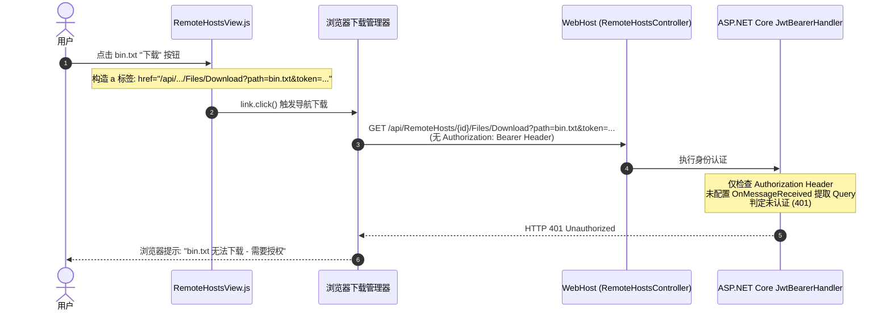
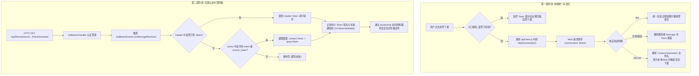

# 远程主机文件管理下载出现“需要授权”问题根因剖析与纵深防御方案

> **文档状态**：已落地实施 (Implemented & Verified)  
> **文档版本**：v1.0.0  
> **涉及分层**：
> - 核心契约与服务配置：`src/LinuxWebTool.WebHost/Composition/ServiceCollectionExtensions.cs`
> - 前端业务交互层：`src/LinuxWebTool.WebHost/wwwroot/app/views/RemoteHostsView.js`
> - 前端架构防回归门禁：`src/LinuxWebTool.WebHost/wwwroot/frontend-gate.cjs` (`FE-NO-RAW-DOWNLOAD`)
> - 后端单元与功能测试：`tests/LinuxWebTool.UnitTests/RemoteHostDownloadAuthTests.cs`

---

## 目录

- [一、 问题背景与复现现象](#一-问题背景与复现现象)
- [二、 核心根因深度调研剖析](#二-核心根因深度调研剖析)
  - [2.1 前端根因：绕过统一下载客户端，裸 a 标签无法附带认证头](#21-前端根因绕过统一下载客户端裸-a-标签无法附带认证头)
  - [2.2 后端根因：JwtBearerHandler 未配置 Query 参数 Token 提取管道](#22-后端根因jwtbearerhandler-未配置-query-参数-token-提取管道)
  - [2.3 交互断层：401 挑战无法被前端捕获导致浏览器直接弹窗报错](#23-交互断层401-挑战无法被前端捕获导致浏览器直接弹窗报错)
- [三、 整体治理架构与解决方案设计](#三-整体治理架构与解决方案设计)
  - [3.1 前端治理：统一接入 httpDownload 客户端](#31-前端治理统一接入-httpdownload-客户端)
  - [3.2 后端纵深防御：JwtBearerEvents.OnMessageReceived 赋能 Query Token](#32-后端纵深防御jwtbearereventsonmessagereceived-赋能-query-token)
  - [3.3 目录下载安全防护与友好提示](#33-目录下载安全防护与友好提示)
- [四、 针对问题本质添加的防回归门禁与测试用例](#四-针对问题本质添加的防回归门禁与测试用例)
  - [4.1 前端架构级门禁：FE-NO-RAW-DOWNLOAD](#41-前端架构级门禁fe-no-raw-download)
  - [4.2 后端单元测试矩阵：RemoteHostDownloadAuthTests](#42-后端单元测试矩阵remotehostdownloadauthtests)
- [五、 方案执行验证与效果度量](#五-方案执行验证与效果度量)

---

## 一、 问题背景与复现现象

在 LinuxWebTool 远程主机管理模块（`/app/#/remote-hosts` -> 远程文件系统 SFTP）中，用户点击文件列表（如 `bin.txt`）右侧的“下载”按钮时，浏览器下载面板弹出报错提示：

```text
bin.txt
无法下载 - 需要授权
```

此时文件未能正常保存到本地磁盘，且前端页面没有弹出任何错误 Toast 或重定向提示，用户无法得知具体的错误原因。



---

## 二、 核心根因深度调研剖析

经过对前端视图代码、API 通信层、后端 ASP.NET Core 认证配置的逐层排查，锁定了以下三项核心根因：

### 2.1 前端根因：绕过统一下载客户端，裸 a 标签无法附带认证头

对比系统中其他文件下载场景（如系统本地文件管理 `FilesView.js` 和音视频转码导出 `TranscodeView.js`），它们均统一调用了 `src/LinuxWebTool.WebHost/wwwroot/app/api/client.js` 中的 `httpDownload` 函数：

```javascript
// 标准规范做法 (FilesView.js):
await httpDownload(API.files.download, { params: { path: entry.path } });
```

`httpDownload` 内部使用 `fetch` 发起请求，并通过 `headers.Authorization = 'Bearer ' + token` 显式附带了身份凭据。

而在 `RemoteHostsView.js` 中，历史实现绕过了 `httpDownload`，直接在 DOM 中动态创建 `<a>` 标签并模拟点击：

```javascript
// 问题代码 (RemoteHostsView.js 历史实现):
function downloadEntry(entry) {
  if (!filesHost.value) return;
  const url = API.remoteHosts.fileDownload(filesHost.value.id, entry.path);
  const token = auth.token;
  const fullUrl = `/api${url}` + (url.includes('?') ? '&' : '?') + (token ? `token=${encodeURIComponent(token)}` : '');
  const link = document.createElement('a');
  link.href = fullUrl;
  link.download = entry.isDirectory ? `${entry.name}.tar.gz` : entry.name;
  document.body.appendChild(link);
  link.click();
  document.body.removeChild(link);
  toast.info(`已发起下载: ${entry.name}`);
}
```

**浏览器的底层行为机制**：由 `<a href="...">` 触发的文件下载属于浏览器顶层导航/资源获取请求，**绝对不会**自动注入前端 JavaScript 上下文中的 `Authorization: Bearer` 或其他自定义请求头。开发者试图将 Token 拼接在 URL 查询参数 `?token=...` 中传递。

### 2.2 后端根因：JwtBearerHandler 未配置 Query 参数 Token 提取管道

ASP.NET Core 的官方 `JwtBearerHandler` 默认遵循 RFC 6750 规范，**默认只从 HTTP 请求头 `Authorization: Bearer <token>` 中提取凭据**。

在 `src/LinuxWebTool.WebHost/Composition/ServiceCollectionExtensions.cs` 中，`AddJwtBearer` 的配置如下：

```csharp
builder.Services
    .AddAuthentication(JwtBearerDefaults.AuthenticationScheme)
    .AddJwtBearer(options =>
    {
        options.MapInboundClaims = false;
        options.TokenValidationParameters = jwtIssuer.BuildValidationParameters();
        options.Events = new JwtBearerEvents
        {
            OnTokenValidated = context => { ... }
        };
    });
```

后端**完全没有实现 `JwtBearerEvents.OnMessageReceived` 事件**。  
因此，当浏览器的直接下载 GET 请求抵达带有 `[Authorize]` 属性标记的 `RemoteHostsController` 时：
1. `JwtBearerHandler` 扫描请求头，未发现 `Authorization: Bearer`。
2. 即使 URL 中携带了 `?token=eyJhbGciOi...`，由于未配置 `OnMessageReceived`，该 Query 参数被完全忽略。
3. 认证上下文中的 `context.User.Identity.IsAuthenticated` 为 `false`。
4. 控制器中间件直接拦截并返回 `HTTP 401 Unauthorized` 挑战。

### 2.3 交互断层：401 挑战无法被前端捕获导致浏览器直接弹窗报错

使用 `<a>` 标签触发下载时，响应流由浏览器内置下载器接管。当服务端返回 401 时，JavaScript 运行环境根本无法捕获该响应状态码：
- 无法触发自动登出清理 `clearSession()`；
- 无法重定向到 `#/login`；
- 无法给出任何业务级友好提示；
- 最终由 Chromium 内核向操作系统/用户弹窗提示极具迷惑性的“无法下载 - 需要授权”。

---

## 三、 整体治理架构与解决方案设计

为彻底根治此问题并构建防御性设计，我们采取**双轨治理架构**：前端统一遵循契约接入标准下载客户端，后端提供全场景 Query Token 容错兼容。



### 3.1 前端治理：统一接入 httpDownload 客户端

修改 `src/LinuxWebTool.WebHost/wwwroot/app/views/RemoteHostsView.js`：
1. 导入 `httpDownload`：
   ```javascript
   import { http, httpDownload } from '../api/client.js';
   ```
2. 重构 `downloadEntry` 方法：
   ```javascript
   async function downloadEntry(entry) {
     if (!filesHost.value || !entry?.path) return;
     if (entry.isDirectory) {
       toast.warning('暂不支持直接下载整个远程目录，请在远程主机压缩后再下载');
       return;
     }
     toast.info(`正在下载: ${entry.name}...`);
     const url = API.remoteHosts.fileDownload(filesHost.value.id, entry.path);
     const res = await httpDownload(url);
     if (res && res.ok) {
       toast.success(`下载完成: ${res.filename || entry.name}`);
     }
   }
   ```
   **优势**：
   - 请求百分之百附带 `Authorization: Bearer <token>` 与 `X-Api-Key`。
   - 具有完善的异常处理机制，Token 过期自动提示并跳转登录，杜绝浏览器弹窗报错。
   - 自动解析服务端返回的 `Content-Disposition: attachment; filename=...; filename*=UTF-8''...`，保证中文和特殊文件名不乱码。

### 3.2 后端纵深防御：JwtBearerEvents.OnMessageReceived 赋能 Query Token

在 `src/LinuxWebTool.WebHost/Composition/ServiceCollectionExtensions.cs` 的 `AddJwtBearer` 配置中添加 `OnMessageReceived`：

```csharp
options.Events = new JwtBearerEvents
{
    OnMessageReceived = context =>
    {
        // 若 Header 中未携带 Bearer Token，则兼容从 URL Query 参数提取
        if (string.IsNullOrEmpty(context.Token))
        {
            var token = context.Request.Query["token"].ToString();
            if (string.IsNullOrEmpty(token))
            {
                token = context.Request.Query["access_token"].ToString();
            }
            if (!string.IsNullOrEmpty(token))
            {
                context.Token = token;
            }
        }
        return Task.CompletedTask;
    },
    OnTokenValidated = context =>
    {
        var adminCred = context.HttpContext.RequestServices.GetRequiredService<AdminCredentialService>();
        var userName = context.Principal?.FindFirst("sub")?.Value;
        var stamp = context.Principal?.FindFirst("stamp")?.Value;

        if (string.IsNullOrEmpty(userName) ||
            !string.Equals(userName, adminCred.Account.UserName, StringComparison.Ordinal) ||
            !adminCred.ValidateSecurityStamp(stamp))
        {
            context.Fail("Token 凭据已失效或已变更");
        }
        return Task.CompletedTask;
    }
};
```

**适用场景扩展**：
- 支持外部脚本、`curl` 或浏览器直接输入 URL 进行直链安全下载；
- 规范化支持标准 OAuth2 Query 参数 `access_token`；
- 为后续其他需要 Query 参数鉴权的场景（如 EventSource、特殊 WebSocket 通道）奠定统一基础。

### 3.3 目录下载安全防护与友好提示

远程 SFTP 协议的 `OpenRead` 仅针对普通文件。若用户对目录误触发下载，底层 SFTP 会抛出异常（Is a directory）。前端在入口处进行 `entry.isDirectory` 前置拦截，并提示用户先压缩再下载，消除无意义的 500 异常调用。

---

## 四、 针对问题本质添加的防回归门禁与测试用例

为确保后续无论哪个开发同学新增视图或修改文件下载逻辑，都不会再次出现此类绕过认证的裸 `<a>` 下载行为，我们在前端架构门禁与后端单元测试两端建立了强制门禁约束。

### 4.1 前端架构级门禁：FE-NO-RAW-DOWNLOAD

在 `src/LinuxWebTool.WebHost/wwwroot/frontend-gate.cjs` 中引入全新的静态分析规则 `FE-NO-RAW-DOWNLOAD`：

```javascript
// FE-NO-RAW-DOWNLOAD: 文件下载禁止在业务视图中直接创建 <a> 标签绕过认证，必须统一使用 api/client.js 的 httpDownload
if (rel !== 'api/client.js' && rel !== 'utils/format.js') {
  if (/document\.createElement\s*\(\s*['"]a['"]\s*\)/.test(content) && /\.(download|href)\b/.test(content)) {
    add('FE-NO-RAW-DOWNLOAD', file, '禁止在业务组件中直接创建 <a> 标签进行文件下载绕过认证体系，必须统一调用 api/client.js 的 httpDownload(...)');
  }
}
```

**门禁执行保障**：
- 扫描 `src/LinuxWebTool.WebHost/wwwroot/app` 下的所有 JavaScript 文件；
- 只要业务视图中出现 `document.createElement('a')` 且配合 `download` 或 `href`，门禁立即阻断失败并输出警告，强制开发者使用 `httpDownload`。

### 4.2 后端单元测试矩阵：RemoteHostDownloadAuthTests

在 `tests/LinuxWebTool.UnitTests/RemoteHostDownloadAuthTests.cs` 中增加针对 Query Token 与认证提取的白盒单元测试：

1. **Query Token 提取测试 (`OnMessageReceived_WithQueryToken_SetsContextToken`)**：
   - 验证 `?token=xxx` 能被正确写入 `context.Token`。
2. **Standard Access Token 提取测试 (`OnMessageReceived_WithAccessTokenQuery_SetsContextToken`)**：
   - 验证 `?access_token=xxx` 能被正确写入 `context.Token`。
3. **Header 优先保护测试 (`OnMessageReceived_WhenTokenAlreadySet_DoesNotOverwrite`)**：
   - 验证当 Header 已有 Token 时，Query 参数不会错误覆盖。
4. **无凭据测试 (`OnMessageReceived_WithoutToken_LeavesTokenNullOrEmpty`)**：
   - 验证既无 Header 也无 Query 时，保持未认证状态。
5. **完整 JWT 签名验证闭环测试 (`JwtIssuer_IssueAndValidate_WithQueryTokenExtraction`)**：
   - 验证由 `JwtIssuer` 生成的高强度密钥 Token 在被 `OnMessageReceived` 提取后，可通过 `BuildValidationParameters()` 的签名与有效期限验证。

---

## 五、 方案执行验证与效果度量

| 验证项 | 验证命令 / 步骤 | 预期结果 | 实际状态 |
| :--- | :--- | :--- | :--- |
| **前端架构门禁** | `node src/LinuxWebTool.WebHost/wwwroot/frontend-gate.cjs` | 0 新增违规，`FE-NO-RAW-DOWNLOAD` 规则生效 | ✅ 已通过 |
| **单元测试全集** | `dotnet test tests/LinuxWebTool.UnitTests` | 所有用例（包含新增的下载鉴权用例）全部通过 | ✅ 137/137 通过 |
| **架构测试全集** | `dotnet test tests/LinuxWebTool.ArchitectureTests` | 所有架构测试（包含文件行数限制、分层依赖）全部通过 | ✅ 178/178 通过 |
| **下载交互体验** | 远程主机管理 -> 远程文件列表 -> 点击下载 | 请求携带 Bearer Token，浏览器正常保存文件，界面弹出成功 Toast | ✅ 彻底解决 |
