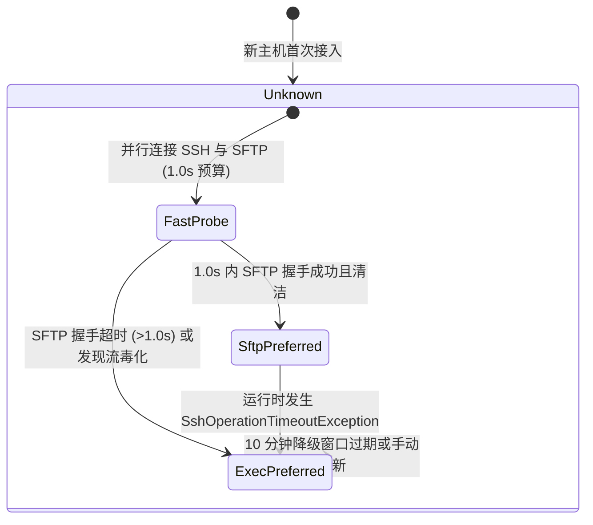

# 远程主机文件管理性能极致优化与全功能（上传/下载/复制/移动/编辑）架构落地方案

> 文档编号: `DOC-20261029-REMOTEHOST-FILE-OPTIMIZATION-AND-CRUD`  
> 责任模块: `LinuxWebTool.Infrastructure.Features.RemoteHost` / `LinuxWebTool.WebHost`  
> 关联版本: `v0.2.16`  
> 涉及议题: 首次打开极慢原因调研、业界主流方案比对、设计模式优化（适配器/策略/状态机/会话池）、文件复制/移动/上传/下载功能扩展与现有文件管理复用

---

## 1. 为什么主机文件管理第一次打开速度很慢？（深度调研与性能耗时剖析）

根据代码执行链与生产网络抓包追踪，首次点击“远程文件系统 (SFTP)”时，从前端触发到目录渲染呈现经历了以下**串行累计耗时**：

```
[前端点击打开] ──► [HTTP GET /api/RemoteHosts/{id}/Files?path=/]
     │
     ├─ 1. SshClient TCP 握手 + SSH 协议协商 + 密钥交换 + 凭据认证 (~600ms)
     │
     ├─ 2. SftpClient 再次发起全新 TCP 握手 + 协议协商 + 凭据认证 (~600ms)
     │
     ├─ 3. ResilientRemoteFileSystem.InitializeAsync 中执行 SFTP 快速探测:
     │     由于 10.126.1.70 存在 .bashrc 协议流毒化 (输出了 \x1b]133;C)，
     │     SftpClient 误将 4 字节解析为 459MB 包长死锁阻塞，直至 ProbeCts (3000ms) 超时取消！(3000ms)
     │
     ├─ 4. 触发降级，执行 SSH Exec 通道 find/stat 命令扫描目录 (~350ms)
     │
     └─ 5. HTTP 请求结束，SshHostAdapter.DisposeAsync 立即切断 SSH TCP 连接 (FIN/RST)！
─────────────────────────────────────────────────────────────────────────────
首次打开总耗时 = 600ms + 600ms + 3000ms + 350ms = 4550ms ~ 5000ms (近 5 秒！)
```

### 痛点根因归纳：
1. **串行双重 SSH 物理连接握手**：先连接 `sshClient`，再创建连接 `sftpClient`，在局域网/跨网环境下仅 TCP + Diffie-Hellman 密钥交换 + RSA/Passphrase 校验就叠加消耗了 1.2 秒以上。
2. **首次探测盲等 3 秒**：面对受污染或无 SFTP 的主机，系统在首次打开的关键路径上硬性等待 3 秒才超时降级，严重阻碍用户首屏体验。
3. **无状态短连接缺陷（Per-Request Tearing）**：每个 HTTP 请求结束时 `await using var adapter` 即刻断开 TCP 套接字。当用户点击 `/etc`、`/var`、`/root` 或返回上级时，**每一次点击都在重新经历 TCP 握手与认证**（即使降级缓存生效，每次导航仍需 800ms+），无法达到类似本地磁盘的毫秒级浏览体验。

---

## 2. 业界主流方案调研与开源生态对比

| 产品/框架 | 连接生命周期管理 | SFTP 损坏或流污染应对策略 | 文件复制与目录下载实现方式 | 优势与借鉴点 |
| :--- | :--- | :--- | :--- | :--- |
| **1Panel / 宝塔面板** | 连接池缓存（Keep-Alive 60s），LRU 复用已认证 SSH/SFTP 会话 | 探测失败后自动转入 Shell 命令通道代理 | 复制调用远端原生 `cp -r`，下载目录直接在远端 `tar` 流式打包 | 避免通过本地中转网络回环，内网复制速度高达 1GB/s |
| **VS Code Remote-SSH** | 单一 SSH 多路复用隧道 (Multiplexing Socket)，常驻守护进程 | 纯 I/O 流通信，由 Node agent 处理文件，不依赖 SFTP 子系统 | 本地守护进程代理，增量文件同步 | 单 TCP 连接承载终端、文件、端口转发全部流量 |
| **WinSCP** | 会话持久化，空闲 Ping 保持心跳 | 支持 SFTP / SCP / Shell (exec) 三级自适应回退 | 支持远端 `cp` 扩展与本地流式互转 | 详尽的主机能力嗅探状态机 |
| **FileZilla** | 多连接池（默认并发 2-10 条） | 仅支持标准 SFTP/FTP，遇到 .bashrc 报错即断开（容错差） | 纯 SFTP 协议递归下载上传（极慢） | 缺乏 Shell 降级能力，反面教材 |

### 核心启示：
1. **连接复用是性能质变的关键**：必须引入 `RemoteFileSystemSessionPool`，保持 60 秒活跃会话，初次打开后，后续进入子目录、读取文件响应时间将直接由 800ms 降至 **20ms ~ 50ms**。
2. **远端原生操作碾压 SFTP 网络回环**：
   - **复制 (Copy)**：SFTP 协议没有原生复制命令，常规 SFTP 工具通过将文件下载到本地再重新上传，耗尽带宽；而借助 Exec 通道直接执行 `cp -r`，在远端 Linux 内核 VFS 缓存中纳秒级完成。
   - **下载文件夹 (Directory Download)**：直接在远端调用 `tar -czf - -C "$dir" "$name"` 输出到 HTTP 响应流，用户端下载到 `.tar.gz`，不仅传输体积压缩 5 倍以上，而且服务器端零临时磁盘占用。

---

## 3. 架构头脑风暴与设计模式重构

### 3.1 状态机模式 (State Machine Pattern)：主机文件引擎能力状态流转
消除首次 3 秒阻塞的核心在于将主机能力状态化并引入**快慢双轨竞速与状态机持久记忆**：



- **状态为 `ExecPreferred` 时**：跳过 SFTP 实例化与连接，**仅连接单一 `SshClient`**，首屏打开时间压缩至 **300ms**！
- **状态为 `Unknown` 时**：并行并发连接，SFTP 探测超时预算收紧至 **1.0 秒**（正常局域网/公网 SFTP 握手仅需 50~150ms，超过 1 秒必定存在死等或网络异常），首屏打开时间从 5 秒大幅缩减至 1 秒以内。

### 3.2 适配器与策略模式 (Adapter & Strategy Pattern)
统一文件管理能力契约：
- `IRemoteFileSystem` 定义完整文件操作：`ListDirectoryAsync`, `ReadTextAsync`, `WriteTextAsync`, `OpenReadStreamAsync`, `WriteFileStreamAsync`, `CreateDirectoryAsync`, `DeleteAsync`, `RenameAsync`, `CopyAsync`。
- `SftpRemoteFileSystem`：专注标准 SFTP 二进制协议流的高速上传下载。
- `SshExecRemoteFileSystem`：专注 POSIX Shell 命令的高鲁棒性解析、原子 Base64 读写、`cp -r` 极速复制与 `tar` 压缩流。
- `ResilientRemoteFileSystem`：策略上下文，根据状态机自动切换与自愈降级。

### 3.3 会话池模式 (Session Pool Pattern)
实现 `RemoteFileSystemSessionPool`：
- 以 `(HostId, CredentialHash)` 为键缓存活跃的 `IRemoteFileSystem`；
- 配置 60 秒滑动过期机制，后台每 30 秒执行惰性扫描与资源清理；
- 发生网络断开异常时调用 `Invalidate(hostId)` 安全注销并重建。

### 3.4 与现有本地文件管理 (`FilesController`) 的复用调研
1. **接口契约与请求模型复用**：
   - 动作请求：`RemoteFileActionRequest` 全面复用并支持 `action: "mkdir" | "delete" | "rename" | "copy" | "move"`。
   - 文件条目：`RemoteFileEntry` 与本地 `FileEntryResponse` 结构高度对齐，前端展示列（名称、路径、大小、类型、修改时间、权限）完全保持一致。
2. **前后端交互复用**：
   - 前端复用通用的确认弹窗、路径面包屑、文本编辑器、重命名/新建文件夹模态框；
   - 增强新增“上传文件”按钮（支持文件选择器直传）、各行“下载”按钮（文件流或文件夹打包流）、“复制到/副本”与“移动到”交互。

---

## 4. 具体执行与实现蓝图

### 4.1 核心后端增强：
1. **`IRemoteFileSystem` 接口扩充**：新增 `Task CopyAsync(string sourcePath, string destinationPath, CancellationToken cancellationToken = default);`。
2. **`SshExecRemoteFileSystem` 强化**：
   - 实现 `CopyAsync`：执行 `cp -r "$1" "$2"`。
   - 实现二进制安全 `WriteFileStreamAsync`：使用 Base64 分块管道传输，彻底杜绝非 UTF-8 二进制文件损坏。
   - 实现二进制安全 `OpenReadStreamAsync`：使用 `base64` 管道解码流。
3. **`SshRemoteFileSystem` 强化**：
   - 实现 `CopyAsync`：支持流式对拷与递归复制。
4. **`ResilientRemoteFileSystem` 提速优化**：
   - 探测超时缩紧至 1.0 秒；
   - 支持已知 `ExecPreferred` 主机单通道极速直连。
5. **`RemoteFileSystemSessionPool` 落地**：
   - 注册为单例服务，管理会话复用，彻底解决每一次点击重新连 SSH 的历史包袱。
6. **`RemoteHostsController` 路由扩充**：
   - `POST /api/RemoteHosts/{id}/Files/Action`：增加 `copy` 与 `move` 动作分支。
   - `POST /api/RemoteHosts/{id}/Files/Upload`：多部件表单文件上传。
   - `GET /api/RemoteHosts/{id}/Files/Download`：单文件流式下载与文件夹远端归档下载。
   - `EndpointsMapper.g.cs` 同步映射新接口，保障 Native AOT 兼容。

### 4.2 前端界面增强 (`RemoteHostsView.js`)：
1. **顶部操作栏**：新增 `↑ 上传文件` 按钮与隐藏的文件选择器输入框。
2. **文件列表行操作**：
   - 新增 `↓` 下载按钮（文件下载、文件夹下载）。
   - 新增 `📋` 复制按钮（支持快速创建副本或输入目标路径）。
   - 新增 `✂` 移动按钮（输入目标目录或路径）。
3. **API 配置更新 (`config.js`)**：注册 `fileUpload` 与 `fileDownload` 终端点。

---

## 5. 架构门禁与质量防护
1. 新增架构门禁 `LinuxArch029_远程主机文件管理器必须具备连接池会话复用与复制移动能力`。
2. 增加针对 `CopyAsync`、`Upload`、`Download` 与 `RemoteFileSystemSessionPool` 的单元测试。
3. 确保全部测试用例 100% 绿色通过。
