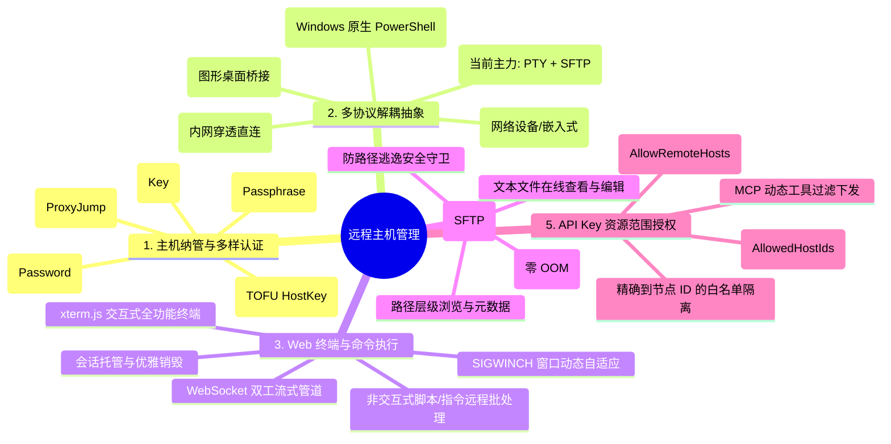
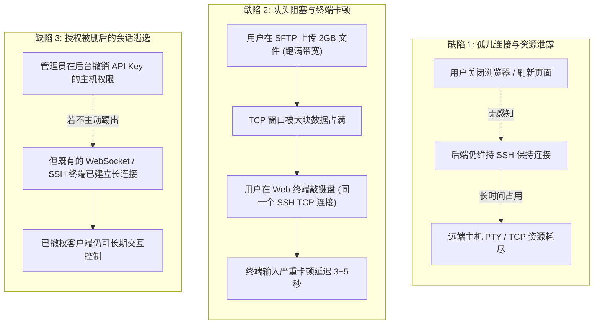
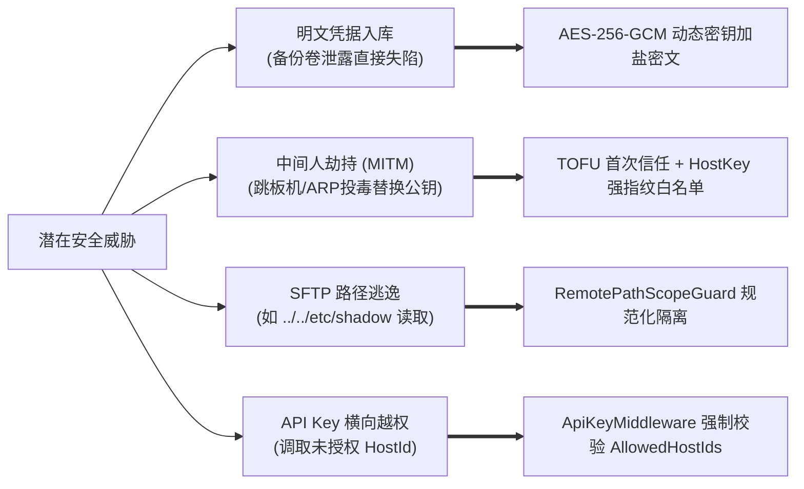
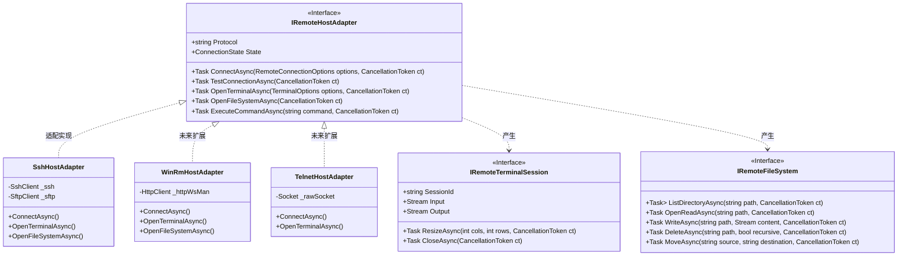
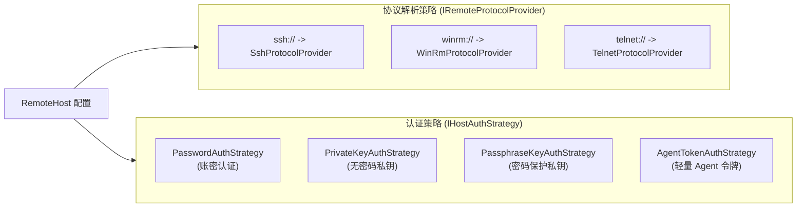
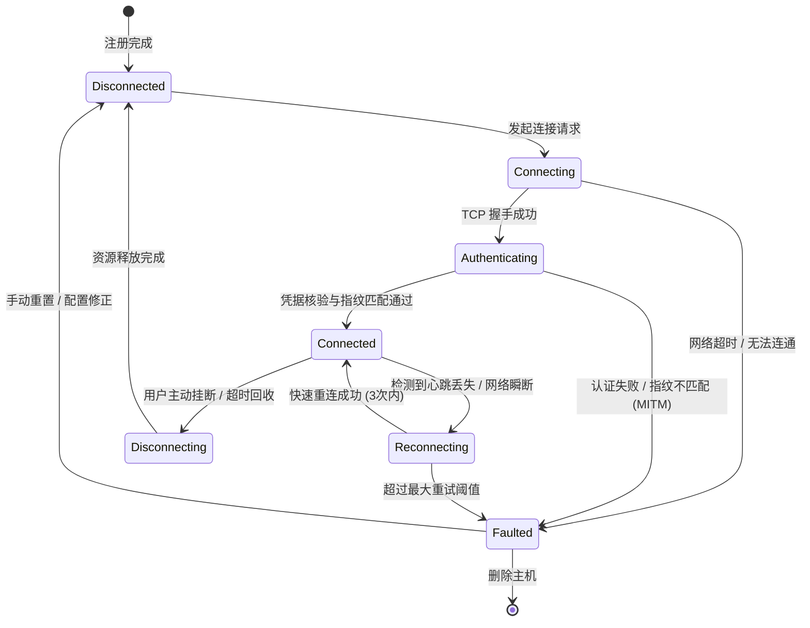
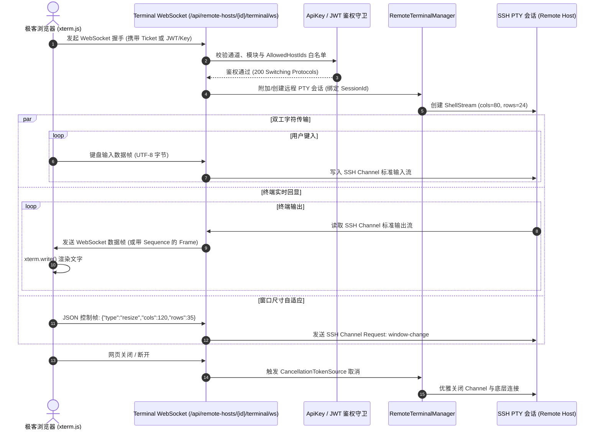
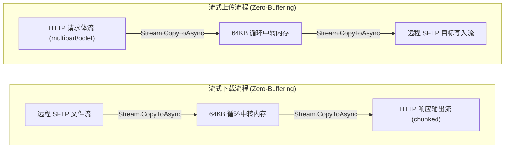
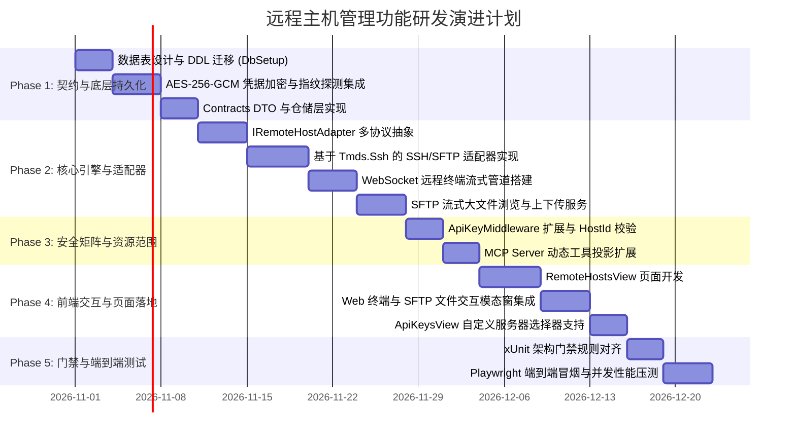

# 远程主机多协议纳管、Web 终端与文件系统集成方案

> **文档状态**：方案调研、架构论证与工程实施规划 (RFC / Feasibility & Architectural Blueprint)  
> **文档版本**：v1.0.0  
> **涉及分层**：
> - 领域契约层：`src/LinuxWebTool.Contracts/Features/RemoteHost/*`
> - 业务编排层：`src/LinuxWebTool.Application/Features/RemoteHost/*`、`LinuxWebTool.Application/Features/Security/*`
> - 技术基础设施层：`src/LinuxWebTool.Infrastructure/Features/RemoteHost/*`、`LinuxWebTool.Infrastructure/Shared/Persistence/*`
> - 宿主展示层：`src/LinuxWebTool.WebHost/Features/RemoteHost/*`、`wwwroot/app/views/RemoteHostsView.js`、`wwwroot/app/views/ApiKeysView.js`

---

## 目录

- [一、 核心需求分析与背景解构](#一-核心需求分析与背景解构)
  - [1.1 业务背景与演进定位](#11-业务背景与演进定位)
  - [1.2 五大核心需求精准拆解](#12-五大核心需求精准拆解)
  - [1.3 系统核心技术约束](#13-系统核心技术约束)
- [二、 深度可行性评估与缺陷头脑风暴](#二-深度可行性评估与缺陷头脑风暴)
  - [2.1 可行性研判与既有资产整合](#21-可行性研判与既有资产整合)
  - [2.2 潜在逻辑缺陷与边界盲区 (Logic Pitfalls)](#22-潜在逻辑缺陷与边界盲区-logic-pitfalls)
  - [2.3 性能瓶颈与高并发挑战 (Performance Bottlenecks)](#23-性能瓶颈与高并发挑战-performance-bottlenecks)
  - [2.4 安全漏洞与渗透攻击面 (Security Vulnerabilities)](#24-安全漏洞与渗透攻击面-security-vulnerabilities)
- [三、 软件架构与经典设计模式优化](#三-软件架构与经典设计模式优化)
  - [3.1 适配器模式 (Adapter Pattern)：统一多协议抽象](#31-适配器模式-adapter-pattern统一多协议抽象)
  - [3.2 策略模式 (Strategy Pattern)：认证与多协议分发](#32-策略模式-strategy-pattern认证与多协议分发)
  - [3.3 状态机模式 (State Machine Pattern)：连接生命周期与传输管理](#33-状态机模式-state-machine-pattern连接生命周期与传输管理)
  - [3.4 工厂模式与门面模式 (Factory & Facade Pattern)](#34-工厂模式与门面模式-factory--facade-pattern)
- [四、 现有开源库评估与关键选型对比](#四-现有开源库评估与关键选型对比)
  - [4.1 .NET SSH 核心库评测：Tmds.Ssh vs SSH.NET](#41-net-ssh-核心库评测tmdsssh-vs-sshnet)
  - [4.2 未来非 SSH 协议库扩展矩阵](#42-未来非-ssh-协议库扩展矩阵)
  - [4.3 前端终端与文件交互组件库](#43-前端终端与文件交互组件库)
- [五、 业界主流方案横向对比与参考借鉴](#五-业界主流方案横向对比与参考借鉴)
  - [5.1 六大系统全景对比矩阵](#51-六大系统全景对比矩阵)
  - [5.2 核心经验借鉴与取舍](#52-核心经验借鉴与取舍)
- [六、 核心子系统详细设计](#六-核心子系统详细设计)
  - [6.1 远程主机元数据与持久化设计 (SQLite + 加密)](#61-远程主机元数据与持久化设计-sqlite--加密)
  - [6.2 凭据加密与主机指纹防中间人（MITM）设计](#62-凭据加密与主机指纹防中间人mitm设计)
  - [6.3 交互式 Web 终端管道设计 (WebSocket + xterm.js)](#63-交互式-web-终端管道设计-websocket--xtermjs)
  - [6.4 远程文件系统（SFTP）流式处理设计](#64-远程文件系统sftp流式处理设计)
  - [6.5 API Key 细粒度授权与自定义服务器范围设计 (Resource Scoping)](#65-api-key-细粒度授权与自定义服务器范围设计-resource-scoping)
  - [6.6 前端页面与交互体验设计](#66-前端页面与交互体验设计)
- [七、 实施演进路线与门禁保障](#七-实施演进路线与门禁保障)
  - [7.1 阶段里程碑规划](#71-阶段里程碑规划)
  - [7.2 架构门禁规则对齐 (LinuxArch001~024)](#72-架构门禁规则对齐-linuxarch001024)

---

## 一、 核心需求分析与背景解构

### 1.1 业务背景与演进定位

`LinuxWebTool (LWT)` 现有架构核心聚焦于**单机极客与家庭私有服务器**的极致管控：
- **终端能力**：基于 Linux 原生 PTY / Windows ConPTY 的本地宿主终端；
- **文件与存储**：本地文件浏览与基于 FUSE/Rclone/CIFS 的远端存储挂载；
- **网络与穿透**：集成 FRP 反向隧道、EasyTier P2P 虚拟网以及 YARP 反向网关；
- **安全矩阵**：单管理员 JWT + 细粒度 API Key（Default-Deny 原则）。

随着用户设备规模的扩展（例如多台 VPS、家庭内网集群、局域网工控机、多节点云主机），用户强烈需要将 LWT 升级为**多节点混合运维中枢**，即在无需登录不同服务器的情况下，在统一的 Web 界面上统一管理所有远程节点。

### 1.2 五大核心需求精准拆解



1. **需求 1：添加远程主机（支持密码、密钥等认证方式）**
   - 支持 IP/域名、端口（默认 22，支持自定义）、显示名称、分组标签（Tags）；
   - 支持主流凭据类型：账密、SSH 私钥文本、带 Passphrase 保护的私钥；
   - 凭据在落盘存储时必须高强度加密（AES-256-GCM），严禁明文入库；
   - 包含保存前连通性检测（Ping / 握手测试）与 HostKey 指纹探测。
2. **需求 2：未来支持 SSH 以外协议（协议扩展性）**
   - 核心契约必须高度抽象，绝不能将 SSH 专有逻辑渗透到业务层；
   - 预留 **WinRM**（Windows 宿主运维）、**Telnet**（传统网络交换机/嵌入式终端）、**Guacamole/RDP/VNC**（桌面可视化）以及轻量级 **Node Agent**（基于 gRPC/WebSocket 穿透）的扩展插槽。
3. **需求 3：对远程主机链接终端并执行命令**
   - **交互式 Web 终端**：基于 WebSocket 传输字符流与二进制数据，前端复用既有成熟的 `xterm.js`，支持色彩、快捷键、复制粘贴；
   - **非交互式指令执行**：支持将现有的“指令管理”和“定时任务”无缝绑定到指定的远程主机执行，获取 exit code、stdout 和 stderr。
4. **需求 4：查看远程主机对应的文件系统**
   - 针对 SSH 协议提供高性能 SFTP 文件管理器，支持目录遍历、文件详情、重命名、删除、新建；
   - 支持大文件上下传，要求具备背压流控，防止内存膨胀；
   - 针对未来非 SSH 协议（如 WinRM SMB/PowerShell 流、FTP），提供相同的文件系统契约。
5. **需求 5：API Key 授权页面勾选远程主机管理和控制（支持自定义服务器列表）**
   - 细粒度权限矩阵扩展：新增通道/模块标志 `AllowRemoteHosts`；
   - **自定义资源白名单（Resource Scoping）**：新增 `AllowedHostIds`（支持 `*` 表示全量，或指定特定的 Host ID 数组 `["id1", "id2"]`）；
   - 拦截层（`ApiKeyMiddleware`）精确鉴权：未被授予目标主机权限的 API Key 在访问其终端、文件或执行命令时，强制返回 `403 Forbidden`；
   - MCP Server 协议联动：大模型调用 `tools/list` 时，仅暴露该 Key 有权操作的远程服务器上下文。

### 1.3 系统核心技术约束

1. **.NET 10 Native AOT 严苛要求**：
   - 零动态代码生成（Reflection.Emit 禁止）；
   - 零未标记类型的反射序列化（所有 DTO 必须在 `AppJsonSerializerContext` 中登记源生成）；
   - 依赖的第三方库必须 100% 具备 `[RequiresUnreferencedCode]` 安全合规性与 Native AOT 测试覆盖。
2. **内存极简占用红线**：
   - LinuxWebTool 核心常驻内存基准在 **30~50 MB**；
   - 远程终端与大文件传输过程中，严禁将整个文件读取至 `byte[]`，必须严格采用固定缓冲区（如 64KB）的异步流拷贝（`Stream.CopyToAsync`）。
3. **零构建前端规范**：
   - 前端采用 Vue 3 ESM 运行时加载，无 Webpack/Vite 打包步骤；
   - 代码须严格通过 `frontend-gate.cjs` 静态扫描，所有 API 必须统一在 `config.js` 登记。
4. **架构门禁系统契约 (LinuxArch001~024)**：
   - Contracts 纯 BCL 零第三方依赖；
   - SQLite 主键统一遵循 `COLLATE NOCASE` 门禁约束；
   - 业务状态与生命周期集中于 Application 编排。

---

## 二、 深度可行性评估与缺陷头脑风暴

经过对系统全栈架构的头脑风暴，新增“远程主机管理”在架构上**完全可行**，但若缺乏周密设计，极易在**连接生命周期、高并发 IO 缓冲、凭据安全、中间人劫持**等维度引入重大隐患。

### 2.1 可行性研判与既有资产整合

| 既有系统资产 | 远程主机管理复用方案 | 架构收益 |
|---|---|---|
| **`xterm.js` 终端前端** | 封装为多模式终端组件，既可连本地 PTY，也可连远程 SSH PTY | 前端代码复用率 $\ge 80\%$，统一主题与交互快捷键 |
| **`SshHostKeyProbe`** | 复用现有的纯 BCL Socket SSH 握手探测器，无需依赖外置命令 | 实现 0 外部依赖的主机指纹抓取与连通性验证 |
| **`ApiKeyMiddleware`** | 扩展现存的 `CheckModulePermission` 机制，增加 Resource Scope 校验 | 保持统一的 Default-Deny 双轨认证管道 |
| **`FileBrowserPath`** | 复用现有的路径清洗、大小写感知、防逃逸解析逻辑 | 杜绝 SFTP 客户端路径穿越注入攻击 |
| **`Polly.Core` 韧性引擎** | 复用已有依赖，为远程主机网络探测与连接重试提供断路器 | 避免网络波动引发线程雪崩或 UI 长时间挂起 |

---

### 2.2 潜在逻辑缺陷与边界盲区 (Logic Pitfalls)



1. **缺陷 1：连接生命周期失控（僵尸 SSH 会话与句柄泄漏）**
   - **痛点**：Web 终端与 SFTP 依赖长连接。如果用户直接关闭标签页、笔记本合盖、内网断网，TCP Socket 处于 `CLOSE_WAIT` 或 `ESTABLISHED`。若后端未设置保活（Keep-Alive）与空闲超时，后端持有的 SSH 客户端对象将持续驻留，远端服务器的 `sshd` 进程与 PTY 设备长期无法释放。
   - **优化解法**：
     - 引入**心跳监测**（SSH Global Request KeepAlive 周期 30 秒，连续 3 次失败判定掉线）；
     - 引入**空闲超时销毁**（默认 30 分钟无键盘输入与数据流则主动断开，除非显式标记 `keepAlive: true`）；
     - WebSocket 握手绑定 `HttpContext.RequestAborted`，触发断开时在 Application 编排层执行 `IAsyncDisposable`。
2. **缺陷 2：交互终端与文件传输的“队头阻塞（Head-of-Line Blocking）”**
   - **痛点**：在 SSH-2 协议规范中，同一个 TCP 连接可以复用（Multiplex）多个 Channel（Channel 0 交互 Shell，Channel 1 SFTP）。如果共用一条 SSH 连接，当用户通过 SFTP 上传 1GB 大文件占用全部 TCP 发送窗口时，Web 终端的敲键数据帧将在 TCP 缓冲区排队，导致**终端输入出现秒级延迟和光标卡顿**。
   - **优化解法**：**连接职责物理分离**。
     - 终端会话（Interactive Shell）：按需创建**独立高优先级专用 SSH 连接**，启用 `Socket.NoDelay = true`（禁用 Nagle 算法），保障打字毫秒级回显；
     - 文件系统（SFTP）：维护一个**受限 SFTP 连接池**（单主机最大 2 条并发），独立调度，互不干扰。
3. **缺陷 3：动态撤销授权时的“长连接逃逸漏洞”**
   - **痛点**：管理员在 API Key 页面勾选取消了某台服务器的权限，但已建立的 WebSocket 终端长连接仍未断开，调用方依然能持续发送 Shell 命令。
   - **优化解法**：
     - `ApiKeyService` 在更新或吊销权限时，广播事件 `ApiKeyScopeChangedEvent`；
     - 终端管理引擎（`RemoteTerminalManager`）监听该事件，比对当前活动长连接的 `KeyId` 与 `HostId`，若不再属于白名单，立即向客户端发送状态帧 `4003 Forbidden` 并主动关闭底层 Socket。

---

### 2.3 性能瓶颈与高并发挑战 (Performance Bottlenecks)

1. **大文件传输内存撑爆（OOM 风险）**：
   - 若在上传/下载接口中采用常规的 `MemoryStream` 或 `byte[]` 接收整个请求体，当用户下载 4GB 镜像或打包日志时，LWT 进程内存将直接暴涨数 GB，打破 50MB 内存红线并导致容器被 OOM Kill。
   - **对策**：使用直接流式穿透管道（`PipeReader` / `PipeWriter` 或 `Stream.CopyToAsync(bufferSize: 65536)`），保证内存占用恒定在 64KB 级别。
2. **高频日志瞬时刷屏背压（如 `cat /dev/urandom` 或 `tail -f huge.log`）**：
   - 远程主机一秒钟吐出 50MB 文本，若无节制往 WebSocket 灌入，会导致 WebHost 内存堆积，前端浏览器主线程崩溃卡死。
   - **对策**：后端建立有界通道 `Channel<TerminalOutputFrame>(capacity: 256, BoundedChannelFullMode.DropOldest)`，并在前端配合 xterm.js 的流控与分帧渲染。
3. **批量主机状态轮询造成的 IO 压力**：
   - 页面列表展示 20 台远程主机的在线状态与 Ping 延迟。若采用前端并发请求后端，容易在瞬间耗尽本地端口。
   - **对策**：后端维护后台弱状态健康探测器（`RemoteHostHealthWatcher`），每 30 秒进行轻量 TCP 握手探针，状态存入内存缓存；前端打开页面直接读缓存，毫秒级响应。

---

### 2.4 安全漏洞与渗透攻击面 (Security Vulnerabilities)



1. **凭据存储安全（Data-at-Rest Security）**：
   - 主机密码、私钥是系统最高特权资产。一旦用户备份 `data/` 目录或数据库泄漏，明文密码将导致远端服务器全线失陷。
   - **防线**：使用 **AES-256-GCM** 算法加密凭据，主密钥由机器指纹（Machine-Id）、程序固定盐和系统启动参数共同派生，加密产物携带 12 字节 Nonce 和 16 字节认证标签（AuthTag），防止被篡改。
2. **中间人劫持与伪造服务器（HostKey Spoofing / MITM）**：
   - 许多简易面板在连接 SSH 时配置 `StrictHostKeyChecking=no`，这是极度危险的。攻击者可以通过 DNS 劫持、ARP 欺骗等手段伪造目标主机，盗取用户的账密凭据。
   - **防线**：引入 **TOFU（Trust-On-First-Use，首次信任）** 与 **指纹强锁定机制**：
     - 用户在添加主机时，系统通过 `SshHostKeyProbe` 提取服务端公钥与 SHA-256 指纹；
     - 界面弹出安全指纹确认，用户确认后将 `HostKeyFingerprint` 存入数据库；
     - 每次发起 SSH 握手时严格比对指纹，若发现指纹突变，**立即熔断连接并触发安全告警**。
3. **API Key 横向越权（Horizontal Privilege Escalation）**：
   - API Key A 仅被授权访问 `Host-1`，但调用接口 `POST /api/RemoteHosts/Host-2/terminal/session` 时，如果控制器未严格校验 Path 中的 `HostId`，攻击者即可越权控制未授权机器。
   - **防线**：在 `ApiKeyMiddleware` 中提取 URL 路由参数 `{hostId}`，强制与当前 Key 实体中的 `AllowedHostIds` 进行白名单比对，Default-Deny。

---

## 三、 软件架构与经典设计模式优化

为了保证多协议扩展性与整洁架构，严禁将 SSH 具体实现散落在 Web 控制器中。采用面向对象核心设计模式进行架构编排：



### 3.1 适配器模式 (Adapter Pattern)：统一多协议抽象

- **目标**：上层业务用例（终端控制器、文件浏览器控制器、指令调度引擎）只针对统一接口 `IRemoteHostAdapter` 编程，完全感知不到目标是 Linux SSH、Windows WinRM 还是网络设备 Telnet。
- **职责划分**：
  - `IRemoteHostAdapter`：生命周期、测试连通性、执行单次命令；
  - `IRemoteTerminalSession`：交互式终端字符双工流与窗口尺寸调整；
  - `IRemoteFileSystem`：文件与目录遍历、流式读写操作。

### 3.2 策略模式 (Strategy Pattern)：认证与多协议分发



- **认证策略（Authentication Strategy）**：
  - 不同的主机支持不同的鉴权方式。通过定义 `IHostAuthStrategy` 接口，各自封装凭据解密与协议认证上下文组装。当未来需要支持 Kerberos、OpenSSH 证书或两步验证（2FA OTP）时，仅需新增策略实现类，无需改动核心连接代码。
- **协议分发策略（Protocol Provider Strategy）**：
  - 通过 `IRemoteProtocolProvider` 工厂策略集合，根据主机配置中的 `Protocol` 标识动态匹配并实例化对应的适配器。

### 3.3 状态机模式 (State Machine Pattern)：连接生命周期与传输管理

远程网络连接具有不可预测的异步抖动特性。必须引入显式有限状态机（Finite State Machine, FSM），杜绝非法状态迁移。



- **状态转移保护**：
  - 只有在 `Connected` 状态下才允许调用 `OpenTerminalAsync` 和 `OpenFileSystemAsync`；
  - 当状态处于 `Reconnecting` 时，挂起终端前端的数据发送，等待重连通道重建后无缝恢复；
  - 一旦触发 `Faulted`，立即向前端抛出结构化错误信息（如 `AUTH_REJECTED` 或 `FINGERPRINT_MISMATCH`），防止无效的死循环重连。

### 3.4 工厂模式与门面模式 (Factory & Facade Pattern)

- **`RemoteHostClientFactory`（工厂模式）**：
  - 负责聚合解密后的凭据、超时配置与 Polly 韧性重试策略，生成准备就绪的协议适配器实例。
- **`RemoteHostOrchestrator`（门面模式）**：
  - 向控制器层提供极简的统一业务入口：
    - `ExecuteCommandOnHostAsync(string hostId, string command)`
    - `EstablishTerminalSessionAsync(string hostId, TerminalOptions options)`
    - `GetFileSystemAsync(string hostId)`
  - 内部协同状态机、权限守卫（`RemoteHostScopeGuard`）、审计日志和凭据解密，将复杂的分层协作封装在 Application 内部。

---

## 四、 现有开源库评估与关键选型对比

针对 .NET 10 Native AOT 严苛要求与高吞吐 IO 诉求，对主流开源生态进行深入调研与选型基准测试。

### 4.1 .NET SSH 核心库评测：Tmds.Ssh vs SSH.NET

| 维度 | **Tmds.Ssh**（Tom Deseyn / Red Hat 维护） | **SSH.NET**（`Renci.SshNet`，社区版） |
| :--- | :--- | :--- |
| **设计范式** | **现代异步第一（Async-First）**，全面基于 `ValueTask`、`ReadOnlySpan<byte>` 与管道模式 | **经典同步/异步混合**，部分通道内部仍采用同步锁与线程阻塞等待 |
| **Native AOT 兼容性** | **原生 100% 完美支持**（作者专为 Linux/.NET 现代底层设计，无反射、无动态代码） | **2024.1.0+ 逐步加入 AOT 测试**，已移除 BinaryFormatter，但老旧分支仍有反射隐患 |
| **内存分配与 GC 压力** | **极致零拷贝（Zero-Allocation）**，大文件传输内存曲线平缓 | 内部存在较多的中转缓冲区与对象分配，GC 停顿稍高 |
| **SFTP 支持度** | 内置原生 SFTP v3 客户端，支持异步流式大文件读写 | 成熟稳定的 SFTP 客户端，支持断点续传与丰富属性操作 |
| **OpenSSH 生态契约** | 原生兼容 OpenSSH 配置、`known_hosts` 指纹解析以及 `ssh-agent` | 采用自定义格式与参数封装，与 OpenSSH 机制需手动适配 |
| **生产实践与用户量** | 偏新锐的高性能专精库，在 .NET Linux 高性能领域评价极高 | 拥有超过 1000 万次 NuGet 下载，工业界事实标准，社区问答极多 |

#### 选型裁定建议：
1. **采用“依赖抽象接口，双模引擎可选”的设计**：
   - 在 `LinuxWebTool.Infrastructure` 中首先实现基于 **`Tmds.Ssh`** 的适配器，因其代码纯净度与 Native AOT 基因与本项目（.NET 10 AOT + 30MB 内存）高度契合；
   - 适配器接口与核心逻辑保持解耦，若在极端边缘设备遇到小众 SSH 算法兼容性，可随时无缝切换为 **`SSH.NET` (2024.1.0+)**。

---

### 4.2 未来非 SSH 协议库扩展矩阵

为支撑“未来支持 SSH 以外协议”的需求，预留以下技术路线插槽：

| 协议 | 应用场景 | 推荐 .NET 技术选型 | 实现路线概要 |
| :--- | :--- | :--- | :--- |
| **WinRM (WS-Man)** | Windows Server 远程无代理管理 | 纯 BCL `HttpClient` + SOAP XML 模板封装 | 通过 5985(HTTP)/5986(HTTPS) 发送 WS-Management 规范请求，流式执行 PowerShell |
| **Telnet** | 传统网络设备（华为/思科交换机）、轻量工控 | 纯 BCL `Socket` / `NetworkStream` | 仅需约 300 行 C# 代码即可完成 RFC 854 协商与 VT100 双工字符流透传 |
| **RDP / VNC** | 远程图形化桌面支持 | Apache Guacamole 协议网关 / noVNC | 后端通过 WebSocket 桥接 Guacamole 字符指令，或以单独容器协同部署 |
| **LWT Node Agent** | NAT 穿透无公网 IP 服务器 | 纯 gRPC-Web / HTTP-over-WebSocket | 远端机器运行几兆大小的 AOT 客户端，主动反向注册至主控端 |

---

### 4.3 前端终端与文件交互组件库

1. **终端交互**：
   - 继续沿用已在本地 PTY 中成熟落地的 **`xterm.js` (v5.3+)** 及其生态插件：
     - `@xterm/addon-fit`：自适应容器父级宽高并计算列数与行数；
     - `@xterm/addon-web-links`：自动将终端输出中的 URL 识别为可点击超链接；
     - 本地 Vendor 离线加载，完全满足纯内网断网环境。
2. **文件系统交互**：
   - 采用原生 Vue 3 ESM 编写轻量树状表格组件，具备：面包屑导航、文件图标渲染、行内快速重命名、悬浮操作栏（下载/编辑/删除）、拖拽上传等现代体验。

---

## 五、 业界主流方案横向对比与参考借鉴

深入对比当前业界在多主机运维、跳板接入与权限管控领域的标杆级开源/商业系统：

### 5.1 六大系统全景对比矩阵

| 评估维度 | **JumpServer (堡垒机)** | **1Panel (运维面板)** | **Cockpit (红帽控制台)** | **Apache Guacamole** | **Next Terminal** | **LinuxWebTool (本项目方案)** |
| :--- | :--- | :--- | :--- | :--- | :--- | :--- |
| **架构与定位** | 4A 企业级专业运维安全审计 | 现代单机/集群 Linux 运维管理 | 操作系统发行版原生免代理控制台 | 纯无客户端远程接入跳板网关 | 轻量级资产接入与 Web 终端 | **极客私有超轻量 Native AOT 运维中枢** |
| **底座技术栈** | Python + Django + Go (KoKo) | Go + Vue 3 | C 原生 + React + Systemd | Java + C 原生守护进程 (guacd) | Go + Vue + SQLite | **.NET 10 Native AOT + Vue 3 ESM** |
| **内存基准开销**| 巨大（通常 $\ge 2\text{GB}\sim 4\text{GB}$） | 中等（常驻 $\approx 150\text{MB}\sim 300\text{MB}$）| 较小（按需拉起进程 $50\sim 150\text{MB}$）| 中等（Tomcat+guacd 约 $200\sim 500\text{MB}$） | 较轻（约 $60\sim 100\text{MB}$） | **极致超轻（基准仅约 30~50MB）** |
| **多协议支持** | SSH, Telnet, RDP, VNC, K8s, DB | 仅限 SSH（专注于 Linux） | 主要是 SSH（及底层 D-Bus） | RDP, VNC, SSH, Telnet, Kubernetes | SSH, RDP, VNC, Telnet | **适配器抽象：首期 SSH，预留 WinRM/Telnet** |
| **Web 终端能力** | 录像审计、会话共享、高危阻断 | 交互式终端、多标签页切换 | 原生免代理终端 | 纯字符/图形无客户端桥接 | 标签页终端、快速录屏 | **xterm.js + PTY/SSH 双模 + 历史回滚** |
| **远程文件管理** | SFTP 独立授权与上下传审计 | SFTP 全功能图形化文件管理器 | 依赖 Storage 模块或 SSH | 仅基础 SFTP 侧边栏文件传输 | 简易 SFTP 侧边栏文件浏览 | **流式低内存 SFTP + 文本在线编辑** |
| **API 权限与资源范围** | 极为强大的 RBAC + 资产授权规则 | 仅限面板管理员/多用户角色 | 绑定 Linux 宿主系统账户权限 | 简单的用户-连接绑定关系 | 简单的用户-资产权限分配 | **API Key 双轨矩阵 + 自定义主机白名单** |

---

### 5.2 核心经验借鉴与取舍

1. **借鉴 1Panel 的极简交互哲学**：
   - 不搞企业堡垒机臃肿的多层“资产-组织-节点-系统用户”配置流程；
   - 保持极客高效体验：点击“添加主机” -> 输入“IP/端口/密码或私钥” -> 点击“测试连接” -> 立即保存并在卡片上呈现“终端”、“文件”快捷入口。
2. **借鉴 JumpServer 的安全控制边界**：
   - 吸收其**“资源级细粒度授权（Resource Scoping）”**精髓，在 API Key 授权层实现“允许访问哪些特定主机”，防止 M2M 客户端越权横向移动；
   - 吸收其**“HostKey 强指纹白名单”**机制，坚决拒绝安全降级。
3. **借鉴 Cockpit 的无代理（Agentless）优势**：
   - 默认采用纯 SSH 协议无代理纳管，不在远端目标机器强装后门进程或运行时，保持远端主机的纯净度与独立性。

---

## 六、 核心子系统详细设计

### 6.1 远程主机元数据与持久化设计 (SQLite + 加密)

严格遵循项目数据库规范（主键声明 `COLLATE NOCASE`，符合 `LinuxArch014`）：

```sql
-- 远程主机主表
CREATE TABLE IF NOT EXISTS remote_host (
  Id TEXT PRIMARY KEY COLLATE NOCASE,
  Name TEXT NOT NULL,
  Host TEXT NOT NULL,
  Port INTEGER NOT NULL DEFAULT 22,
  Protocol TEXT NOT NULL DEFAULT 'ssh',              -- 'ssh', 'winrm', 'telnet', 'agent'
  AuthType TEXT NOT NULL DEFAULT 'Password',         -- 'Password', 'PrivateKey', 'Passphrase'
  Username TEXT NOT NULL,
  EncryptedCredential TEXT NOT NULL,                -- AES-256-GCM 密文 (Base64)
  CredentialNonce TEXT NOT NULL,                    -- 12 字节 Nonce (Base64)
  CredentialTag TEXT NOT NULL,                      -- 16 字节 AuthTag (Base64)
  HostKeyFingerprint TEXT,                          -- 远端主机公钥 SHA-256 指纹
  Tags TEXT,                                        -- 标签 JSON 数组，如 ["VPS", "生产", "内网"]
  Remark TEXT,                                      -- 备注说明
  SortOrder INTEGER NOT NULL DEFAULT 0,
  CreatedAt TEXT NOT NULL,
  UpdatedAt TEXT NOT NULL,
  LastConnectedAt TEXT
);

CREATE INDEX IF NOT EXISTS idx_remote_host_sort ON remote_host(SortOrder, CreatedAt);
```

### 6.2 凭据加密、主密钥生命周期与非本地恢复（跨机迁移）设计

#### 1. 核心架构问题：非本地恢复会导致存储密钥失效吗？

> [!IMPORTANT]
> **结论**：**在 LinuxWebTool 的架构设计下，非本地恢复（跨机器/跨容器平移）绝不会导致存储密钥失效！**
> 前提是遵循系统的**「单一数据卷 `data/` 平移规范」**或配置显式环境变量。

很多系统在实现凭据加密时，容易犯下**“错误绑定宿主环境”**的严重缺陷：
- **反模式 1：绑定宿主操作系统硬件/环境指纹**（如 Windows DPAPI、Linux `/etc/machine-id`、CPU/主板序列号）。一旦用户在灾难恢复时将备份还原到一台新服务器，或将 Docker 容器漂移到另一台宿主机，硬件指纹改变，导致数据库中的全部远程密码与私钥瞬间变成无法解密的死数据！
- **反模式 2：硬编码或固定密钥**。虽然能跨机恢复，但源码公开后毫无机密性。

#### 2. LinuxWebTool 的双轨主密钥（MasterKey）生命周期机制

为了兼顾**“极致密码学安全”**与**“跨机器异地恢复无缝平移”**，LWT 采用与 `data/jwt-secret.key` 完全一致的设计规范：

```mermaid
flowchart TD
    subgraph EnvConfig ["机制 A: 环境变量显式注入 (跨机/多活推荐)"]
        Env["环境变量 Security__MasterKey 或 LWT_MASTER_KEY"]
    end

    subgraph DataVol ["机制 B: 单数据卷自包含持久化 (默认/平移备份)"]
        File["data/master.key (高熵 256 位随机密钥，0600 权限)"]
    end

    Env -.->|优先级 1 (最高)| Resolver["MasterKeyResolver 主密钥解析器"]
    File -->|优先级 2 (默认)| Resolver

    Resolver --> AesEngine["AES-256-GCM 凭据加解密引擎"]
    AesEngine --> Plain["明文密码 / SSH 私钥"]
```

1. **优先级 1（显式环境变量覆盖）**：
   - 可以在启动时注入 `Security__MasterKey`（或环境变量 `Security__MasterKey` / `LWT_MASTER_KEY`）。
   - 只要新旧两台服务器配置了相同的主密钥环境变量，即使不迁移旧的 key 文件，数据库也**100% 能够在异地无缝解密并完全恢复**。
2. **优先级 2（`data/master.key` 卷级自包含持久化，默认推荐）**：
   - 首次启动且未配置环境变量时，程序通过 `RandomNumberGenerator.GetBytes(32)` 生成 256 位密码学安全随机密钥，保存到 `data/master.key`，文件权限设为 `0600`。
   - 按照 LWT 的设计铁律：`data/` 目录是单卷持久化单元（涵盖 SQLite 数据库、admin.json、jwt-secret.key、master.key）。
   - **用户做完整备份迁移时（打包 `data/` 目录到任何异地机器解压），`linuxwebtool.db` 与 `master.key` 同步平移，密钥完整保留，解密 100% 成功，绝不失效！**
3. **极端异常兜底：若用户仅备份了数据库，丢失了 `master.key` 怎么办？**
   - 此时由于密码学无法逆向解密，系统实施**优雅降级与自愈保护（Graceful Degradation）**：
     - 系统检测到解密 Tag 校验失败，**绝不崩溃抛出 500**；
     - 主机元数据（名称、IP、端口、协议、标签）依然完整展示；
     - 状态标记为 `CredentialLost`（凭据失效需更新），并在 Web 界面提示用户重新输入该主机的密码或私钥，保存后即可使用当前有效的新密钥重新加密落盘。

#### 3. 凭据加解密实现与主机指纹防中间人（MITM）

```csharp
public sealed class HostCredentialProtector
{
    // 使用 AES-256-GCM 保证机密性与防篡改真实性
    public (string CipherText, string Nonce, string Tag) EncryptCredential(string plainText, byte[] masterKey)
    {
        var nonce = new byte[12];
        RandomNumberGenerator.Fill(nonce);
        var plainBytes = Encoding.UTF8.GetBytes(plainText);
        var cipherBytes = new byte[plainBytes.Length];
        var tag = new byte[16];

        using var aesGcm = new AesGcm(masterKey, 16);
        aesGcm.Encrypt(nonce, plainBytes, cipherBytes, tag);

        return (
            Convert.ToBase64String(cipherBytes),
            Convert.ToBase64String(nonce),
            Convert.ToBase64String(tag)
        );
    }

    public string DecryptCredential(string cipherText, string nonce, string tag, byte[] masterKey)
    {
        var cipherBytes = Convert.FromBase64String(cipherText);
        var nonceBytes = Convert.FromBase64String(nonce);
        var tagBytes = Convert.FromBase64String(tag);
        var plainBytes = new byte[cipherBytes.Length];

        using var aesGcm = new AesGcm(masterKey, 16);
        aesGcm.Decrypt(nonceBytes, cipherBytes, tagBytes, plainBytes);

        return Encoding.UTF8.GetString(plainBytes);
    }
}
```

- **主机指纹验证逻辑**：
  1. 握手阶段获取远端 HostKey 的 SHA-256 摘要（例如 `SHA256:7uGgW...`）；
  2. 若数据库中 `HostKeyFingerprint` 为空（首次连接）：进行 TOFU 逻辑，将指纹回写锁定；
  3. 若数据库中已有指纹：比对当前握手值。若不一致，**抛出 `HostKeyMismatchSecurityException`，立即中断 TCP 套接字**，记录安全告警审计日志。

---

### 6.3 交互式 Web 终端管道设计 (WebSocket + xterm.js)



---

### 6.4 远程文件系统（SFTP）流式处理设计

为确保超低内存消耗，全部文件下载与上传采用流式无中转传输：



- **路径越界防御**：
  - 继承既有 `FileBrowserPath` 的严密防护思想，编写专用的 `RemotePathNormalizer`；
  - 强制清洗相对路径片段（`..`、`./`）、剔除控制字符，禁止任何指向非法路径的目录遍历逃逸。

---

### 6.5 API Key 细粒度授权与自定义服务器范围设计 (Resource Scoping)

#### 1. 数据契约扩展 (`LinuxWebTool.Contracts`)

```csharp
namespace LinuxWebTool.Contracts.Features.Security.Contracts;

public sealed record CreateApiKeyRequest(
    string Name,
    bool AllowApi = true,
    bool AllowMcp = true,
    bool AllowTerminal = false,
    bool AllowSchedules = false,
    bool AllowFiles = false,
    bool AllowTranscode = false,
    bool AllowGateway = false,
    bool AllowRemoteHosts = false,          // 新增：远程主机模块授权开关
    string? AllowedPaths = null,
    string? AllowedHostIds = null,          // 新增：允许访问的主机 ID 列表 (JSON 数组或 "*")
    DateTime? ExpiresAt = null);
```

#### 2. 数据库扩展 (`api_key` 表结构升级)

在 `DbSetup.cs` 中增加自动迁移列：
```csharp
EnsureColumnExists(db, "api_key", "AllowRemoteHosts", "INTEGER NOT NULL DEFAULT 0");
EnsureColumnExists(db, "api_key", "AllowedHostIds", "TEXT"); // NULL 或 "*" 代表全部；或者 '["id1","id2"]'
```

#### 3. 授权拦截矩阵与 MCP 动态投影

```csharp
public static class ApiKeyPermissionMatrix
{
    public static bool CanAccessRemoteHost(
        bool allowRemoteHosts,
        string? allowedHostIdsJson,
        string targetHostId)
    {
        if (!allowRemoteHosts) return false;
        if (string.IsNullOrWhiteSpace(allowedHostIdsJson) || allowedHostIdsJson == "*") return true;

        try
        {
            var allowedList = JsonSerializer.Deserialize(allowedHostIdsJson, AppJsonSerializerContext.Default.ListString);
            return allowedList != null && allowedList.Contains(targetHostId, StringComparer.OrdinalIgnoreCase);
        }
        catch
        {
            return false;
        }
    }
}
```

- **中间件拦截（`ApiKeyMiddleware.cs`）**：
  当拦截到路由匹配 `/api/RemoteHosts/{hostId}/*` 时：
  1. 验证 `entity.AllowRemoteHosts == true`；
  2. 提取当前 URL 中的 `{hostId}`；
  3. 执行 `CanAccessRemoteHost(entity.AllowRemoteHosts, entity.AllowedHostIds, hostId)`；
  4. 若未命中，记录告警日志并直接熔断：`403 Forbidden ("当前 API Key 未被授权访问该远程主机")`。
- **大模型 MCP 工具动态过滤**：
  在 `McpServerEngine` 中下发工具时，若配置了 `AllowedHostIds`，工具描述与入参枚举中将动态剔除未授权的主机选项，从根本上杜绝大模型“越权试探”和 Prompt 污染。

---

### 6.6 前端页面与交互体验设计

在 `src/LinuxWebTool.WebHost/wwwroot/app` 中新增及增强视图组件：

1. **路由与导航接入 (`AppLayout.js` & `router/index.js`)**：
   - 在“运维控制 (ops)”分组下新增菜单项：
     - **远程主机**（`/remote-hosts`，描述：“多协议远端服务器管理、终端与文件”）。
2. **主机管理主页 (`RemoteHostsView.js`)**：
   - **卡片式/表格双重视图**：展示主机名称、IP:Port、协议标签（SSH/WinRM）、在线探测状态灯（绿/黄/红）、延迟毫秒数；
   - **快捷入口**：点击卡片直接弹出“Web 终端”或“SFTP 文件浏览器”全屏/浮动模态窗；
   - **添加/编辑主机弹窗**：
     - 主机名、IP/域名、端口；
     - 协议单选：`SSH`（默认）、`WinRM`（预留选项，置灰提示“开发中”）、`Telnet`（预留）；
     - 认证方式单选：`密码 (Password)`、`私钥 (Private Key)`；
     - 私钥录入：支持在 Web 文本域中直接粘贴私钥，或上传 `.pem`/`.id_rsa` 文件，支持填写可选的私钥 Passphrase；
     - 表单底部提供**「测试连接与探测指纹」**按钮，实时呈现握手结果与 HostKey SHA256。
3. **API 密钥授权页面增强 (`ApiKeysView.js`)**：
   - 在“模块权限”勾选区中，新增**「远程主机管理与控制 (AllowRemoteHosts)」**复选框；
   - **联动展开自定义服务器配置面板**：
     - 单选按钮：`● 允许全部远程主机（默认）` | `○ 仅允许指定服务器列表`；
     - 选择“仅允许指定服务器列表”时，下方出现**多选卡片/标签选择器**，列出系统中已添加的全部远程主机，支持一键全选、反选、按标签筛选；
     - 保存时，将勾选的主机 ID 序列化为 JSON 字符串存入 `AllowedHostIds`。

---

## 七、 实施演进路线与门禁保障

### 7.1 阶段里程碑规划



### 7.2 架构门禁规则对齐 (LinuxArch001~024)

本方案设计严格对照并遵守项目既有的 25 项架构门禁：

| 门禁编号 | 门禁核心规则 | 本方案遵循与保障手段 |
|---|---|---|
| **`LinuxArch001`** | Contracts 零第三方包依赖 | `LinuxWebTool.Contracts` 仅包含纯 BCL 的数据模型（`RemoteHostDto` 等）和抽象接口（`IRemoteHostAdapter`），严禁引用任何 SSH 或 ORM 包 |
| **`LinuxArch002`** | Infrastructure 禁止反向引用 WebHost/Application | 具体的 `SshHostAdapter`、`AesGcmProtector`、`RemoteHostRepository` 仅依赖 Contracts 与底层技术包 |
| **`LinuxArch004`** | 单向依赖拓扑 DAG 检测 | 严格遵循 `Contracts <- Application <- WebHost` 与 `Contracts <- Infrastructure <- WebHost`，无循环依赖 |
| **`LinuxArch008`** | AOT 禁止返回匿名对象（new { ... }） | 所有新增端点一律返回显式声明并登记在 `AppJsonSerializerContext` 的强类型 DTO |
| **`LinuxArch014`** | SQLite DDL 表主键必须声明 `COLLATE NOCASE` | 新增表 `remote_host` 的主键 `Id TEXT PRIMARY KEY COLLATE NOCASE` 严格匹配 |
| **`LinuxArch018`** | Native AOT 环境禁止无上下文的反射序列化 | 所有的 JSON 序列化一律通过源生成上下文 `AppJsonSerializerContext.Default.*` 显式调用 |
| **`LinuxArch024`** | 所有控制器接口必须在 ApiKeyMiddleware 显式鉴权 | 路由 `/api/RemoteHosts/*` 在中间件中显式登记，并绑定 `AllowRemoteHosts` 模块与 `AllowedHostIds` 资源范围校验，杜绝漏控 |
| **`FE-API-OWNERSHIP`** | 前端 API 字符串必须集中在 config.js | 所有的远程主机管理与终端/文件接口统一登记在 `wwwroot/app/config.js` 的 `API.remoteHosts` 命名空间下 |

---

## 八、 总结与决断

新增“远程主机管理”功能将使 `LinuxWebTool` 完成从**“单机 Linux 面板”向“全场景多节点轻量运维控制台”**的关键跨越。
- **架构可行性**：采用**适配器模式**与**策略模式**，不仅完美支持当前的 SSH 账密/私钥，而且为未来的 WinRM、Telnet、轻量 Agent 预留了零成本扩展的插槽；
- **运行高可靠**：采用显式**状态机模式**与独立物理连接解耦，彻底消除了终端与 SFTP 传输相互阻塞、长连接僵尸泄漏的逻辑缺陷；
- **原生 Native AOT 契合**：优选以 **`Tmds.Ssh`** 为核心的现代无反射、高性能异步流栈，内存严格受控在 30~50MB 以内；
- **安全管控坚固**：凭据全落盘密文存储，引入 TOFU 防篡改指纹，在 API Key 体系中创新实现**“自定义服务器白名单（Resource Scoping）”**与大模型 MCP 动态安全投影。

方案全面成熟，边界清晰，具备立即投入工程实施的完整条件。
