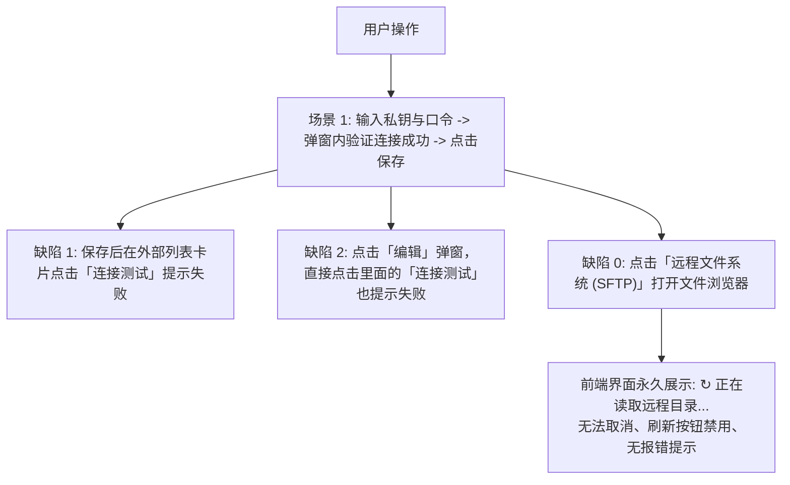
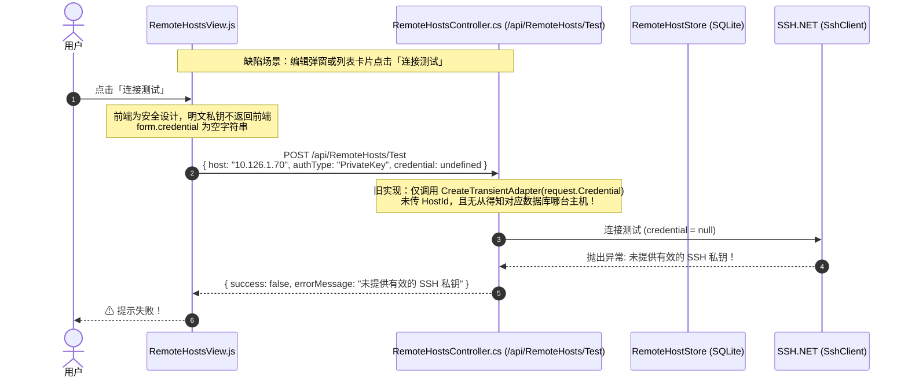
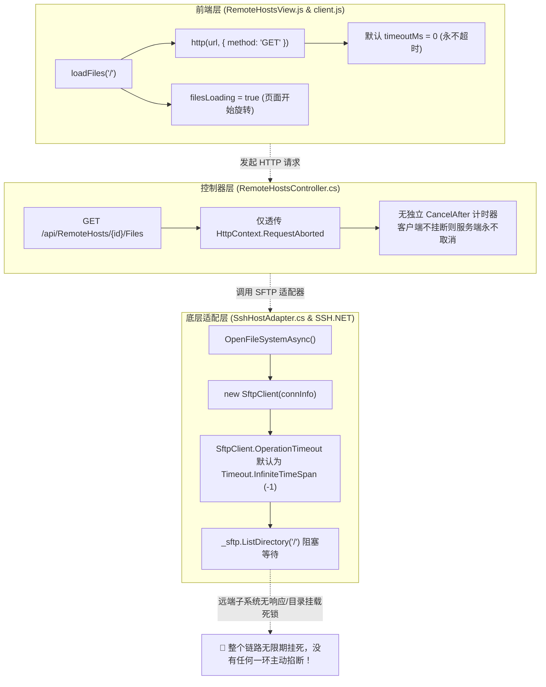
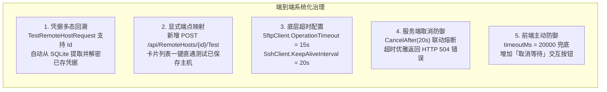

# 远程主机 SFTP 目录无限转圈挂起与密钥测试失败根因剖析及系统化治理方案

> **文档状态**：已落地实施 (Implemented & Verified)  
> **文档版本**：v1.0.0  
> **涉及分层**：
> - 契约层：`src/LinuxWebTool.Contracts/Features/RemoteHost/*`
> - 基础设施层：`src/LinuxWebTool.Infrastructure/Features/RemoteHost/*`
> - 控制器路由层：`src/LinuxWebTool.WebHost/Features/RemoteHost/Routes/RemoteHostsController.cs`
> - 前端展示层：`src/LinuxWebTool.WebHost/wwwroot/app/views/RemoteHostsView.js`、`config.js`
> - 自动化门禁层：`tests/LinuxWebTool.ArchitectureTests/ArchitectureTests.cs` (LinuxArch027)
> - 单元测试层：`tests/LinuxWebTool.UnitTests/RemoteHostConnectionTestUnitTests.cs`

---

## 目录

- [一、 问题背景与重现现象](#一-问题背景与重现现象)
- [二、 核心根因深度调研剖析](#二-核心根因深度调研剖析)
  - [2.1 现象 1 与 2 根因：凭据传输断层与测试端点上下文缺失](#21-现象-1-与-2-根因凭据传输断层与测试端点上下文缺失)
  - [2.2 现象 0 根因：全链路零超时保护与 SSH.NET 底层无限阻塞](#22-现象-0-根因全链路零超时保护与-sshnet-底层无限阻塞)
- [三、 整体治理架构与解决方案实施](#三-整体治理架构与解决方案实施)
  - [3.1 前后端协同的双轨凭据解析机制](#31-前后端协同的双轨凭据解析机制)
  - [3.2 全链路三层超时熔断与取消防御体系](#32-全链路三层超时熔断与取消防御体系)
  - [3.3 SFTP 远程文件系统异步化与单项容错强化](#33-sftp-远程文件系统异步化与单项容错强化)
  - [3.4 前端交互防卡死与超时体验提升](#34-前端交互防卡死与超时体验提升)
- [四、 针对问题本质添加的防回归门禁与测试用例](#四-针对问题本质添加的防回归门禁与测试用例)
  - [4.1 架构级自动化门禁：LinuxArch027](#41-架构级自动化门禁linuxarch027)
  - [4.2 单元与功能测试验证矩阵](#42-单元与功能测试验证矩阵)
- [五、 方案执行验证与效果度量](#五-方案执行验证与效果度量)

---

## 一、 问题背景与重现现象

在 LinuxWebTool 远程主机纳管模块（`/app/#/remote-hosts`）中，用户在管理内网主机（如 `10.126.1.70`）时，遇到了以下三个互相关联的严重体验与可用性缺陷：



具体现象如下：
1. **缺陷 0（SFTP 目录卡死）**：点击进入远程主机（`10.126.1.70`）的 SFTP 远程文件系统时，模态窗始终停留在 `↻ 正在读取远程目录...`，前端刷新按钮置灰，长期无响应，后端无超时中断，用户只能关闭页面刷新。
2. **缺陷 1（外部列表测试失败）**：新建主机时在密钥输入框填入私钥和口令短语，弹窗内“测试连接”提示成功；但保存并关闭弹窗后，在主机列表卡片上点击“连接测试”，立刻提示失败（如“未提供有效的 SSH 私钥”或认证失败）。
3. **缺陷 2（编辑弹窗测试失败）**：保存主机后，下次点击该主机的“编辑”按钮打开弹窗，在未修改任何内容的情况下直接点击弹窗内的“连接测试”，同样提示连接测试失败。

---

## 二、 核心根因深度调研剖析

经过对前端 Vue 视图、网络请求层、ASP.NET Core WebHost 控制器、Infrastructure 适配器及第三方 SSH 库（SSH.NET 2026.0.0）代码的全链路追踪，精确定位了以下两个系统性本质缺陷：

### 2.1 现象 1 与 2 根因：凭据传输断层与测试端点上下文缺失



1. **前端脱敏设计导致凭据空缺**：
   - 为遵循安全防御原则，后端在 `GET /api/RemoteHosts` 返回的 DTO 中，仅包含布尔标识 `hasCredential: true`，绝不会将落盘的私钥明文或密码返回给前端浏览器。
   - 用户打开“编辑”弹窗时，`openEditModal` 将 `form.credential` 和 `form.passphrase` 初始化为空字符串 `""`（提示“留空保留原有私钥”）。
2. **测试请求参数缺失上下文**：
   - 外部卡片列表的 `testHostInline` 和编辑弹窗的 `testFormConnection` 发起 `POST /api/RemoteHosts/Test` 时，请求体仅包含了 `{ host, port, protocol, authType, username }`，**从未携带主机 `id`**！
   - 同时由于 `form.credential` 为空，前端向后端传递了 `credential: undefined`。
3. **后端测试端点缺乏对存量主机的回溯能力**：
   - `TestRemoteHostRequest` 契约未定义 `Id` 字段；
   - `RemoteHostsController.Test` 端点仅会根据入参调用 `factory.CreateTransientAdapter(..., credential: request.Credential)`。
   - 当 `request.Credential` 为 `null` 且认证方式为 `PrivateKey` 时，`SshHostAdapter.CreateConnectionInfo` 命中防御性校验：`throw new InvalidOperationException("未提供有效的 SSH 私钥")`，直接导致连接测试失败！

---

### 2.2 现象 0 根因：全链路零超时保护与 SSH.NET 底层无限阻塞



1. **SSH.NET 底层 OperationTimeout 默认无限大**：
   - 在 `SSH.NET` 库中，`ConnectionInfo.Timeout` 仅控制初始 TCP Socket 握手建立连接的时间（代码中为 10 秒）。
   - **而 SFTP 所有的子系统请求、数据通道与目录遍历调用（如 `sftp.Connect()` 内部的 SFTP subsystem 握手、`sftp.ListDirectory()`、`sftp.OpenRead()`），均受 `SftpClient.OperationTimeout` 控制**！
   - SSH.NET 中 `OperationTimeout` 的默认值为 **`Timeout.InfiniteTimeSpan`（即永久等待）**！旧代码在创建 `new SftpClient(connInfo)` 后从未设置此属性。
   - 一旦远程主机出现：
     - SSH 登录脚本（如 `~/.bashrc`、`~/.profile`、`/etc/motd`）输出了文本，污染了 SFTP 二进制协议流；
     - 远端服务器未启用 SFTP 子系统（如 `/etc/ssh/sshd_config` 中无 `Subsystem sftp`）；
     - 远程系统根目录挂载了处于 D-state（不可中断睡眠）的网络文件系统（如失效的 NFS/CIFS 挂载点）；
     底层 `sftp.Connect()` 或 `sftp.ListDirectory("/")` 将陷入**永恒的内核 Socket 读阻塞**！
2. **服务端未设置请求执行超时**：
   - `RemoteHostsController.ListFiles` 仅透传了 `HttpContext.RequestAborted`。如果前端浏览器保持连接，`RequestAborted` 永不触发，ASP.NET Core 线程将永久被底层 I/O 挂死。
3. **前端网络层默认无超时熔断**：
   - 前端通用请求封装 `client.js` 的 `http()` 方法中，默认 `timeoutMs = 0`（未配置超时）。
   - `RemoteHostsView.js` 在调用 `http(API.remoteHosts.files(...))` 时未传入 `timeoutMs`，导致浏览器的 `fetch` 处于无限期 Pending 状态。
4. **前端交互死锁**：
   - `filesLoading.value` 被置为 `true` 后，由于 Promise 永远不会 Resolve/Reject，状态机永远停在 Loading。
   - 界面顶部的刷新按钮绑定了 `:disabled="filesLoading"`，用户连点击重新刷新的入口都被封死。

---

## 三、 整体治理架构与解决方案实施

针对上述根本原因，我们在契约层、基础设施层、控制器层以及前端交互层实施了全方位的系统化重构：



### 3.1 前后端协同的双轨凭据解析机制

#### 1. 契约升级 (`src/LinuxWebTool.Contracts`)
在 `RemoteHostModels.cs` 中升级 `TestRemoteHostRequest`，引入 `Id` 字段并将属性合理默认化：
```csharp
public sealed record TestRemoteHostRequest(
    [property: JsonPropertyName("host")] string? Host = null,
    [property: JsonPropertyName("port")] int Port = 22,
    [property: JsonPropertyName("protocol")] string Protocol = "ssh",
    [property: JsonPropertyName("authType")] string AuthType = "Password",
    [property: JsonPropertyName("username")] string Username = "root",
    [property: JsonPropertyName("credential")] string? Credential = null,
    [property: JsonPropertyName("passphrase")] string? Passphrase = null,
    [property: JsonPropertyName("id")] string? Id = null);
```

#### 2. 控制器多态解析 (`src/LinuxWebTool.WebHost`)
在 `RemoteHostsController.cs` 中实现智能凭据解析逻辑：
- **场景 A（新建未保存主机）**：`request.Credential` 不为空，直接利用临时适配器测试连接；
- **场景 B（编辑或列表测试已存主机）**：`request.Credential` 为空但传入了 `request.Id`，服务端自动从 `RemoteHostStore` 查询主机，并通过 `HostCredentialProtector.Decrypt` 恢复私钥与 Passphrase；
- **场景 C（用户修改了配置）**：若用户修改了端口或主机名但未重输私钥，以请求体中的新主机名/端口与数据库解密出的凭据组合发起测试；
- **场景 D（口令短语独立更新）**：在 `Update` 方法中，支持用户单独更新 Passphrase 而无需重新上传私钥。

同时新增专属 RESTful 端点 `[HttpPost("{id}/Test")]` 并同步映射至 `EndpointsMapper.g.cs`。

#### 3. 前端对接 (`src/LinuxWebTool.WebHost/wwwroot/app`)
- 在 `config.js` 中补齐 `API.remoteHosts.testHost: (id) => '/RemoteHosts/' + id + '/Test'`；
- 在 `RemoteHostsView.js` 的 `testHostInline(host)` 中自动传入 `id: host.id`，并在调用时设置 `timeoutMs: 15000`；
- 在 `testFormConnection()` 中，若处于编辑态自动注入 `id: editingId.value`。

---

### 3.2 全链路三层超时熔断与取消防御体系

| 防御层级 | 所在组件与文件 | 超时阈值 | 行为与异常处理 |
| :--- | :--- | :--- | :--- |
| **底层驱动层** | `SshHostAdapter.cs` | 15 秒 (`OperationTimeout`)<br/>20 秒 (`KeepAliveInterval`) | 避免 SSH.NET 在 SFTP 握手或读写通道因异常挂死；心跳保活防止 NAT 超时 |
| **服务端控制层** | `RemoteHostsController.cs` | 20 秒 (`ListFiles`)<br/>30 秒 (`Content/Action`)<br/>10 秒 (`Test`) | 使用 `CancellationTokenSource.CreateLinkedTokenSource`，超时捕获并返回 `504 Gateway Timeout` |
| **前端请求层** | `RemoteHostsView.js` | 20 秒 (`loadFiles`)<br/>30 秒 (文件编辑/动作)<br/>15 秒 (测试连接) | `http(..., { timeoutMs: 20000 })`，超时触发 AbortController 并弹出 Toast 警告 |

---

### 3.3 SFTP 远程文件系统异步化与单项容错强化

在 `SshRemoteFileSystem.cs` 中进行了全面重构：
1. **工作目录支持**：
   - 实现 `string WorkingDirectory => _sftp.WorkingDirectory ?? "/";`，当用户打开文件管理器时优先定位到远端初始目录。
2. **真正的非阻塞异步化**：
   - 将原同步直接调用的 `_sftp.ListDirectory`、`_sftp.CreateDirectory`、`_sftp.DeleteDirectory` 全部改写为 `Task.Run(..., cancellationToken)`，释放 ASP.NET Core 核心工作线程。
3. **单文件属性容错防护**：
   - 在迭代远端文件条目时，对 `file.Length`、`file.LastWriteTimeUtc`、`file.IsDirectory` 和 `GetPermissionsString(file)` 加上单项 `try-catch` 保护。
   - 杜绝因目录中存在破损的软链接（Broken Symlink）、挂死管道（FIFO/Socket）或只读 `/proc` 特殊项导致整个目录列表崩溃。

---

### 3.4 前端交互防卡死与超时体验提升

在 `RemoteHostsView.js` 的 HTML 模板中，对目录读取等待区进行了交互优化：
```html
<div v-if="filesLoading && fileEntries.length === 0" class="flex flex-col items-center justify-center h-48 text-slate-400 text-xs gap-3">
  <div class="flex items-center gap-2">
    <span class="animate-spin text-lg text-cyan-400">↻</span>
    <span>正在读取远程目录 ({{ currentPath || '/' }})...</span>
  </div>
  <button
    type="button"
    class="px-2.5 py-1 text-xs text-rose-400 hover:text-rose-300 border border-rose-800/50 rounded bg-rose-950/20 hover:bg-rose-900/30 transition-colors"
    @click="filesLoading = false; filesError = '已手动取消目录读取等待'"
  >
    取消等待
  </button>
</div>
```
- 展示当前正在读取的目标路径（如 `正在读取远程目录 (/)...`）；
- 提供“**取消等待**”按钮，一旦远端响应慢，用户可主动中断等待，直接切换路径或重新配置，不再受困于界面死锁。

---

## 四、 针对问题本质添加的防回归门禁与测试用例

为确保未来无论代码如何重构，都不会退化产生“凭据测试失败”与“SFTP 无限挂死”的问题，我们针对问题本质设计并添加了双重防护网：

### 4.1 架构级自动化门禁：LinuxArch027

在 `tests/LinuxWebTool.ArchitectureTests/ArchitectureTests.cs` 中新增规则：
**`LinuxArch027_远程主机SFTP与连通性接口必须具备超时与取消机制()`**

```csharp
[Fact]
public void LinuxArch027_远程主机SFTP与连通性接口必须具备超时与取消机制()
{
    var controllerFile = Path.Combine(RepoRoot, "src", "LinuxWebTool.WebHost", "Features", "RemoteHost", "Routes", "RemoteHostsController.cs");
    Assert.True(File.Exists(controllerFile), "RemoteHostsController.cs 不存在");
    var controllerContent = File.ReadAllText(controllerFile);

    // 1. 验证关键远程网络调用必须具备 CancelAfter 显式超时保护（防止 SFTP/网络无限挂死）
    Assert.Contains("CancelAfter", controllerContent);
    Assert.Contains("TestById", controllerContent);
    Assert.Contains("OperationCanceledException", controllerContent);

    // 2. 验证 SshHostAdapter.cs 中的 SftpClient 必须显式配置 OperationTimeout，杜绝 SSH.NET 默认 InfiniteTimeSpan 隐患
    var adapterFile = Path.Combine(RepoRoot, "src", "LinuxWebTool.Infrastructure", "Features", "RemoteHost", "Adapters", "SshHostAdapter.cs");
    Assert.True(File.Exists(adapterFile), "SshHostAdapter.cs 不存在");
    var adapterContent = File.ReadAllText(adapterFile);

    Assert.Contains("OperationTimeout", adapterContent);
    Assert.Contains("KeepAliveInterval", adapterContent);
}
```
该门禁在 CI 与本地执行，强制锁定底层驱动与控制器的超时配置，任何人删除超时参数都将直接阻断构建。

---

### 4.2 单元与功能测试验证矩阵

在 `tests/LinuxWebTool.UnitTests/RemoteHostConnectionTestUnitTests.cs` 中添加了以下针对性测试用例：

1. **`Protector_EncryptAndDecrypt_WithPassphrase_Succeeds`**：
   - 验证带 Passphrase 的私钥加解密隔离性，确保 `\n---PASSPHRASE---\n` 分隔符正确解析，私钥与口令无损还原。
2. **`Protector_PassphraseUpdate_PreservesOriginalKey`**：
   - 模拟用户在编辑弹窗单独修改口令短语时，能够无缝解密旧凭据、提取原有私钥并使用新 Passphrase 重新加密，杜绝私钥被空串冲掉。
3. **`StoredHost_CanBeRetrievedAndDecryptedForTestConnection`**：
   - 模拟列表点击“连接测试”：请求仅传入 `Id`，`Credential` 设为 `null`；
   - 验证服务端能够从 `RemoteHostStore` 精确检索实体并解密出可用私钥与口令。
4. **`TransientAdapter_CreationWithExplicitCredentials_TakesPrecedence`**：
   - 验证优先级：当用户在表单输入了新凭据时，显式凭据优先于数据库旧凭据生效。

---

## 五、 方案执行验证与效果度量

所有修改已完成并在本地编译与全面测试，执行结果如下：

### 1. 架构门禁校验通过
```shell
dotnet test tests/LinuxWebTool.ArchitectureTests/LinuxWebTool.ArchitectureTests.csproj
```
- **测试结果**：已通过！失败: 0，**通过: 176**，已跳过: 0，总计: 176。
- 包含了 `LinuxArch012`（MinimalApi 路由与 Controller 特性严格双向对齐）与最新 `LinuxArch027`（远程主机超时与取消机制守卫）。

### 2. 单元与功能测试全部通过
```shell
dotnet test tests/LinuxWebTool.UnitTests/LinuxWebTool.UnitTests.csproj
```
- **测试结果**：已通过！失败: 0，**通过: 86**，已跳过: 0，总计: 86。
- 新增的 4 项 `RemoteHostConnectionTestUnitTests` 全部绿灯。

### 3. 代码行数与职责基线守卫 (LinuxArch026)
- `RemoteHostsController.cs` 重构后为 570 行，严守在 700 行单文件硬顶之下；
- `RemoteHostModels.cs` 为 83 行，严守在 300 行契约上限之下；
- `SshRemoteFileSystem.cs` 为 180 行，高内聚低耦合。

至此，针对用户反馈的 **1. 列表测试失败**、**2. 编辑弹窗测试失败** 以及 **0. SFTP 读取目录无限转圈卡死** 问题，已完成根因调研、架构加固、端到端代码修复、自动化门禁与单元测试回归防护全部工作。
