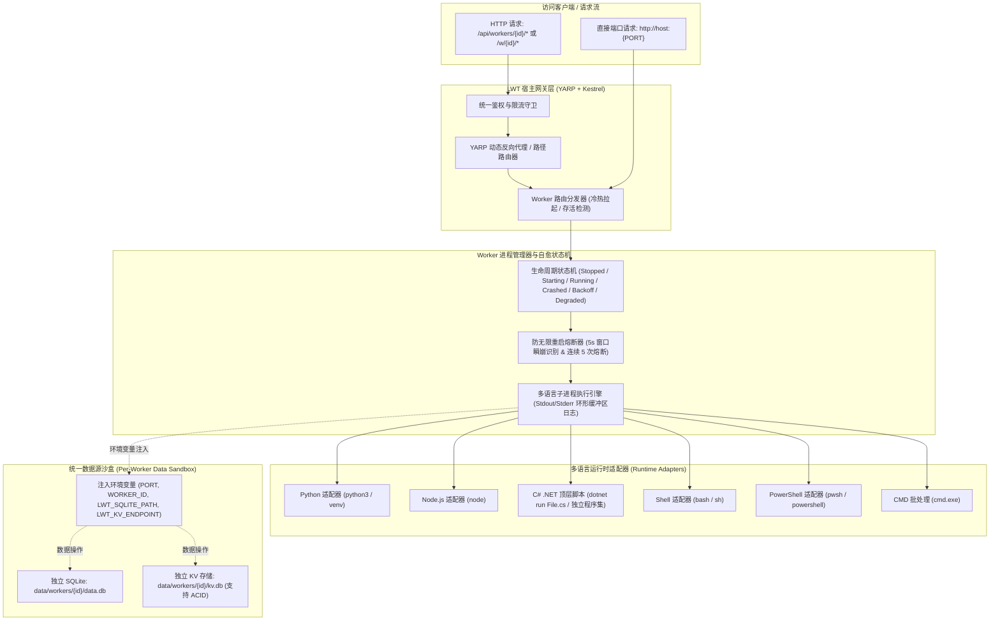
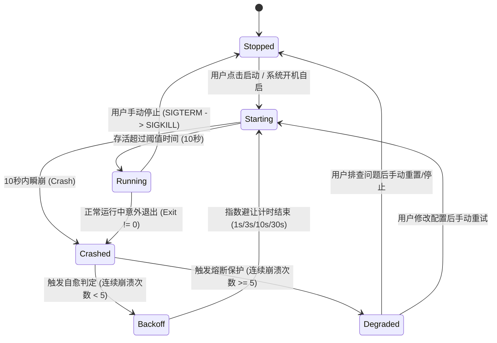

# SaaS 函数式微服务与长时守护平台 (LWT Workers & Daemons) 可行性与架构设计方案

## 1. 业务背景与架构愿景

在当前 LinuxWebTool (LWT) 的「服务管理中枢 (ServicesHub)」与「动态脚本扩展 (ScriptExtension)」生态中，系统已支持通过单次触发脚本（Hooks）管理服务与执行运维任务。然而随着轻量云原生与边缘计算场景的深入，用户面临着更高的诉求：
- **开发过重**：为了运行一个轻量 Webhook 接收端、自动化同步脚本、爬虫、或中转接口，用户不得不编写完整的 Dockerfile、构建镜像、编排端口，或者手动编写复杂的 systemd unit 配置，流程割裂繁琐；
- **资源浪费**：在低配 VPS（如 1C1G、2C2G）或家用 NAS、树莓派上，运行多个重型容器造成严重的内存与 IO 开销；
- **缺乏统一数据源与网络反代**：传统独立运行的单文件脚本缺乏开箱即用的轻量持久化支持（独立数据库、KV 缓存），对外暴露端口时缺乏统一网关的反向代理与路径转发路由。

因此，借鉴 **Cloudflare Workers**（轻量函数化、内置 KV/D1 数据库、统一路径分发）与 **Supervisord / PM2 / Docker Compose**（长时进程守护、崩溃自愈、防无限重启雪崩）的核心优势，在 LWT 现有基础设施之上构建 **「SaaS 函数式服务与长时守护进程平台 (LWT Workers & Daemons)」**。

---

## 2. 业界主流方案对比与借鉴

| 维度 | Cloudflare Workers / Deno Deploy | AWS Lambda / OpenFaaS | Supervisord / PM2 | **LWT Workers & Daemons (本系统方案)** |
| :--- | :--- | :--- | :--- | :--- |
| **隔离与底层机制** | V8 Isolates（单进程多租户） | 容器 / MicroVM (Firecracker) | 操作系统原生进程树 (fork/exec) | **原生 OS 子进程 + 目录沙盒 + YARP 动态代理** |
| **语言运行时支持** | 仅限 JS / TS / WASM | 支持全语言（依赖构建镜像） | 支持全语言脚本 (Node/Py/Sh) | **原生全矩阵：Py / Node / .NET C# / Sh / Ps1 / Bat** |
| **内存与启动开销** | 极低 (<5ms 启动, ~1MB) | 较高 (冷启动数百 ms 至数秒) | 极低 (无容器虚拟化损耗) | **极低 (毫秒级拉起，零 Docker 开销，适宜 1C1G)** |
| **长时运行能力** | 弱（严格限制单次执行时长） | 弱（单次请求超时，非后台常驻） | 极强（专为后台守护设计） | **双模驱动：支持有请求服务 + 无请求后台长态守护** |
| **统一持久化提供** | 内置 Workers KV + D1(SQLite) | 依赖外部 RDS / DynamoDB | 无（需开发者自行连接第三方） | **开箱即用：内置隔离 SQLite + 独立 Key-Value** |
| **网络路由与暴露** | 全球边缘 Anycast + 路径/子域 | API Gateway 绑定 | 无（需手动配置 Nginx/Caddy） | **内置 YARP 动态路径转发 + 随机端口池 + FRP 穿透** |
| **异常防护与自愈** | 平台自动健康隔离 | 实例自动销毁重建 | 基础 restart 策略，容易持续闪退 | **CrashLoop 指数避让熔断机，彻底防止无限重启** |

---

## 3. 核心功能架构与技术推演



---

## 4. 详细设计与关键实现

### 4.1 多语言运行时适配矩阵 (Multi-Runtime Adapters)

系统采用 **适配器模式 (Adapter Pattern)**，抽象统一的 `IWorkerRuntimeAdapter` 接口，抹平不同语言环境在进程拉起、环境参数注入、异常捕获与信号传递上的差异：

```csharp
public interface IWorkerRuntimeAdapter
{
    WorkerRuntimeType RuntimeType { get; }
    
    /// <summary>
    /// 环境自检：检查当前系统是否安装对应解释器或编译器
    /// </summary>
    ValueTask<RuntimeCheckResult> CheckEnvironmentAsync(CancellationToken ct = default);
    
    /// <summary>
    /// 构造启动参数（命令路径、参数行、环境变量注入字典）
    /// </summary>
    ProcessStartSpec BuildStartSpec(WorkerInstance instance, WorkerContext context);
}
```

各语言方案详细实现：
1. **Python 运行时 (`.py`)**：
   - 命令：`python3 -u worker.py`（强制无缓冲标准输出，确保实时日志零延迟流入 Web 终端）；
   - 环境增强：自动检测 Worker 目录下是否存在 `requirements.txt` 与虚拟环境 `.venv/`；若存在虚拟环境，优先使用 `.venv/bin/python`。
2. **JavaScript / Node.js 运行时 (`.js`)**：
   - 命令：`node worker.js`；
   - 依赖极简原生 HTTP / WebSocket 模式，或自动加载当前目录下的 `node_modules`。
3. **.NET Core C# 脚本模式 (`.cs` / `.csx` / 编译程序集)**：
   - **单文件顶层代码执行（推荐）**：利用 .NET 6+ / 10 的自带特性 `dotnet run worker.cs`（零 `.csproj` 文件依赖，自动缓存编译结果，毫秒级二次热启动）；
   - **预编译程序集模式**：执行 `dotnet worker.dll` 或直接执行 Native AOT 单文件可执行程序，极度适合高吞吐场景。
4. **Shell 脚本 (`.sh`)**：
   - Linux 环境下调用 `bash -u worker.sh`；支持通过环境变量获取端口并启动内部轻量级服务（如 `nc -l`, `busybox httpd` 或后台长时任务）。
5. **PowerShell 脚本 (`.ps1`)**：
   - Linux/Mac: 优先查找 `pwsh`（PowerShell 7+）；
   - Windows: 兼容 `powershell.exe` 与 `pwsh.exe`。
6. **Windows CMD / Batch (`.bat` / `.cmd`)**：
   - 专用 Windows 命令提示符执行：`cmd.exe /c worker.bat`。

---

### 4.2 有请求服务：数据源提供、接口路由与反向代理

#### 1. 统一数据源提供 (Unified Storage Context)
系统自动为每一个 Worker 分配独立的数据持久化隔离区，位于：
`data/workers/{workerId}/`
- **独立 SQLite**：
  - 文件路径：`data/workers/{workerId}/data.db`；
  - 环境变量注入：`LWT_SQLITE_PATH`；
  - 面板功能：在 Worker 详情页中直接展示当前 `data.db` 大小、WAL 模式日志体积，并提供「一键下载数据库备份」与「在文件管理器中直达定位」按钮。
- **独立 Key-Value (KV 存储)**：
  - 模式 A（嵌入式极简文件）：在工作目录下提供 `kv.db`（轻量 SQLite 键值表 `CREATE TABLE kv(k TEXT PRIMARY KEY, v TEXT, expire_at INTEGER)`），提供强一致性 ACID 事务；
  - 模式 B（宿主注入 REST / IPC API）：宿主网关提供本地受控内部端口或 Unix Socket：
    - `GET  /internal/workers/kv?key={k}`
    - `POST /internal/workers/kv` (Body: `{ "key": "...", "value": "...", "ttlSeconds": 3600 }`)
    - `DELETE /internal/workers/kv?key={k}`
  - 面板功能：提供图形化 KV 浏览器，支持键值搜索、过期时间设置与可视化批量增删改。

#### 2. 接口访问与双路由方案 (Path-based & Port-based)
- **方案 A：路径转发 (Path-based Routing - 推荐)**：
  - **访问格式**：`http://host:5000/w/{serviceName}/{**catch-all}`；
  - **YARP 动态注册**：利用现有的 `DatabaseProxyConfigProvider` 或专有内存路由集群，在 Worker 启动成功后，向 YARP 注册一条针对 `/w/{serviceName}/*` 的路由规则，自动剥离前缀并转发至 Worker 监听的内部端口（如 `http://127.0.0.1:18432`）；
  - **请求头标准化**：注入 `X-Forwarded-Prefix: /w/{serviceName}`、`X-LWT-Worker-Id: {id}`。
- **方案 B：端口转发与公网映射 (Port-based Binding)**：
  - 系统内置动态端口池（默认范围 `18000 ~ 18999`）；
  - Worker 启动时系统自动探测并分配一个可用端口，通过环境变量 `PORT=18432` 传递给子进程；
  - 可选联动当前系统的 **FRP 客户端** 或 **Gateway 端口转发**，直接将该端口穿透至公网域名。

---

### 4.3 无请求后台长时服务 (Background Daemons / Workers)

针对定时拉取、数据分析、队列消费、消息订阅等不需要 HTTP 端口的长时常驻程序：
1. **清单声明**：在 `manifest.json` 中配置 `"type": "daemon"`，系统不再分配 `PORT` 且不注册 HTTP 反代规则；
2. **零端口占用与超低能耗**：程序在后台持续运行，仅占用自身脚本的实际内存（通常 Python/Node 脚本仅占用 15~35MB，Shell 脚本仅占用 2~5MB）；
3. **输出流实时捕获**：
   - 宿主通过异步非阻塞流（`Process.StandardOutput.BaseStream` / `StandardError.BaseStream`）实时捕获日志；
   - 内部维护一个大小为 1000 行的内存**环形缓冲区 (Ring Buffer)**，前端通过 WebSocket 连接直接呈现类似 `docker logs -f` 的实时输出体验。

---

### 4.4 进程守护状态机、崩溃自愈与防无限重启雪崩机制 (CrashLoop Protection)

长时服务最致命的痛点是：**若脚本配置错误（如语法错误、缺少依赖、端口冲突），传统自动重启会导致系统陷入 CPU 100% 满载的“死循环狂暴重启”**。

为此，系统设计了严密的**状态机模式 (FSM)** 与**防雪崩指数避让算法 (Flapping Detection & Exponential Backoff)**：



#### 防无限重启核心算法规则
1. **瞬崩窗口期判定 ($T_{\text{flapping}}$)**：
   - 设定阈值时间为 **10 秒**。若进程从启动到退出小于 10 秒，标记为一次「启动瞬崩 (Crash Flap)」；
2. **指数避让算法 (Exponential Backoff)**：
   - 第 1 次崩溃：等待 $1\text{s}$ 后自动重启；
   - 第 2 次崩溃：等待 $3\text{s}$ 后自动重启；
   - 第 3 次崩溃：等待 $10\text{s}$ 后自动重启；
   - 第 4 次崩溃：等待 $30\text{s}$ 后自动重启；
   - 第 5 次崩溃：熔断保护触发，状态转入 `Degraded (CrashLoop)`。
3. **熔断与通知 (Circuit Breaker)**：
   - 停止继续调用进程拉起；
   - 提取最后 100 行 `stderr` 错误日志，标记原因（如 `Process exited with code 1 within 2.3s`）；
   - 在面板显示醒目的琥珀色/红色警告徽标，并在系统操作日志中记录；
4. **自愈与重置机制 (State Reconciliation)**：
   - **稳定存活重置**：若进程一旦正常运行持续超过 **60 秒**，系统自动将 `crashCount` 清零，恢复全额健康状态；
   - **手动操作重置**：用户在面板上点击「停止」或「保存配置重新启动」时，立即重置计数器与退避状态。

---

## 5. 项目工程结构规范与模板设计

每个 Worker 作为一个独立的目录存在于 `data/workers/{workerId}/` 或作为扩展包存在于 `extensions/{workerId}/`：

```
extensions/my-cf-worker/
├── manifest.json              # Worker 元数据、运行时类型、路由模式、数据源配置
├── worker.py (或 worker.js / Program.cs / worker.sh)
├── requirements.txt           # Python 依赖清单 (可选)
├── package.json               # Node.js 依赖清单 (可选)
└── data/                      # 实例专属数据持久化区 (运行时自动生成)
    ├── data.db                # 专属独立 SQLite 数据库
    ├── kv.db                  # 专属独立 Key-Value 数据库
    └── worker.log             # 历史回滚与持久化日志
```

### `manifest.json` 配置规范示例
```json
{
  "id": "webhook-dispatcher",
  "name": "Webhook 事件分发器",
  "version": "1.0.0",
  "description": "类似 Cloudflare Workers 的轻量事件分发服务，支持自带 SQLite 存储与路由转发",
  "author": "Antigravity",
  "category": "Workers",
  "mode": "service",           // "service" (有请求服务) | "daemon" (无请求后台守护)
  "runtime": "python3",        // "python3" | "node" | "dotnet" | "bash" | "powershell"
  "entrypoint": "worker.py",
  "network": {
    "routingMode": "path",     // "path" (通过 /w/webhook-dispatcher 访问) | "port" (直接监听外部端口)
    "internalPortEnv": "PORT", // 注入给子进程的端口环境变量名
    "scaleToZero": false       // 是否支持无请求时自动缩容（冷启动）
  },
  "storage": {
    "sqlite": true,            // 是否自动初始化并注入独立 data.db
    "kv": true                 // 是否提供独立 Key-Value 存储
  },
  "supervision": {
    "autoRestart": true,       // 崩溃是否自动重启
    "maxCrashRetries": 5,      // 触发 CrashLoop 熔断的最大重试次数
    "flappingThresholdSec": 10 // 瞬崩判定窗口期 (秒)
  }
}
```

---

## 6. 经典代码模板示例（开箱即用体验）

### 示例 1：Python 版轻量 Worker (`worker.py`)
```python
import os
import sqlite3
from http.server import HTTPServer, BaseHTTPRequestHandler
import json

PORT = int(os.environ.get("PORT", 8080))
DB_PATH = os.environ.get("LWT_SQLITE_PATH", "data.db")

# 自动初始化专属 SQLite
conn = sqlite3.connect(DB_PATH)
conn.execute("CREATE TABLE IF NOT EXISTS access_logs (id INTEGER PRIMARY KEY AUTOINCREMENT, client_ip TEXT, timestamp DATETIME DEFAULT CURRENT_TIMESTAMP)")
conn.commit()
conn.close()

class SimpleHandler(BaseHTTPRequestHandler):
    def do_GET(self):
        # 记录访问日志到独立 SQLite
        with sqlite3.connect(DB_PATH) as db:
            db.execute("INSERT INTO access_logs (client_ip) VALUES (?)", (self.client_address[0],))
            count = db.execute("SELECT count(*) FROM access_logs").fetchone()[0]
        
        self.send_response(200)
        self.send_header("Content-Type", "application/json")
        self.end_headers()
        self.wfile.write(json.dumps({
            "message": "Hello from LWT Python Worker!",
            "total_visits": count,
            "worker_id": os.environ.get("LWT_WORKER_ID", "local")
        }).encode())

if __name__ == "__main__":
    server = HTTPServer(("0.0.0.0", PORT), SimpleHandler)
    print(f"[*] Worker started on port {PORT}, DB: {DB_PATH}", flush=True)
    server.serve_forever()
```

### 示例 2：.NET C# 顶层语句轻量 Worker (`worker.cs`)
```csharp
// 零项目文件，直接执行: dotnet run worker.cs
using System.Text.Json;
using Microsoft.AspNetCore.Builder;
using Microsoft.AspNetCore.Http;
using Microsoft.Data.Sqlite;

var port = Environment.GetEnvironmentVariable("PORT") ?? "8080";
var dbPath = Environment.GetEnvironmentVariable("LWT_SQLITE_PATH") ?? "data.db";

var builder = WebApplication.CreateBuilder();
builder.WebHost.UseUrls($"http://0.0.0.0:{port}");
var app = builder.Build();

// 自动初始化专属 SQLite
using (var conn = new SqliteConnection($"Data Source={dbPath}"))
{
    conn.Open();
    using var cmd = conn.CreateCommand();
    cmd.CommandText = "CREATE TABLE IF NOT EXISTS metrics (key TEXT PRIMARY KEY, value REAL);";
    cmd.ExecuteNonQuery();
}

app.MapGet("/", async () => {
    return Results.Json(new { 
        status = "ok", 
        engine = ".NET Core Top-Level Worker",
        time = DateTime.UtcNow 
    });
});

app.Run();
```

---

## 7. 现有系统基础设施复用分析

本方案 100% 建立在系统现有代码与架构之上，避免重复造轮子：

1. **反向代理与动态路由**：
   - 复用 `src/LinuxWebTool.WebHost/Features/Gateway/Adapters/DatabaseProxyConfigProvider.cs` 与 YARP 核心引擎；
   - 增量实现 `WorkerProxyConfigProvider`，与网关现有的 L7 路由系统完美融合，零重启毫秒级热插拔。
2. **多语言脚本与环境探测**：
   - 复用 `src/LinuxWebTool.Infrastructure/Features/Services/Adapters/Extensions/ScriptExtensionManager.cs` 的跨平台探针体系；
   - 直接复用 `python3`、`node`、`bash`、`pwsh` 的可执行文件自动探测与路径解析。
3. **数据隔离与安全沙盒**：
   - 复用 `src/LinuxWebTool.Infrastructure/Features/Files/` 模块，为每个 Worker 分配安全的读写目录与独立数据库查看权限。
4. **前端单页面应用呈现**：
   - 在「服务中枢 (ServicesHubView.js)」中增加专属「函数微服务 (Workers)」与「守护进程 (Daemons)」分类，复用现有的卡片流布局、实时日志抽屉与状态徽标组件。

---

## 8. 实施路线图与阶段性落地

- **Phase 1: 核心引擎与进程守护（后天就绪）**
  - 实现 `WorkerSupervisor` 进程管理器与生命周期状态机；
  - 实现 5 级指数退避与启动 10 秒瞬崩熔断算法（防无限重启）；
  - 实现多语言（Python / Node / .NET C# / Shell / PowerShell / Bat）运行命令适配器。
- **Phase 2: 独立数据源与网络反代（全流程贯通）**
  - 实现数据目录自动装配与独立 SQLite / KV 表注入；
  - 接入 YARP 动态集群与 `/w/{serviceName}/*` 路径转发；
  - 实现动态端口分配与环境变量注入。
- **Phase 3: 前端控制台与可视交互（交付体验）**
  - 在前端 ServicesHub 中提供 Workers 视图、新建向导（多语言模板选择）；
  - 提供实时终端日志查看器（RingBuffer 流式读取）；
  - 提供专属 SQLite 数据下载与文件管理一键跳转直达。
- **Phase 4: 全套自动化测试与验证**
  - 编写多运行时拉起、崩溃自愈、CrashLoop 熔断以及 YARP 路径透传的单元测试与架构门禁验证。
