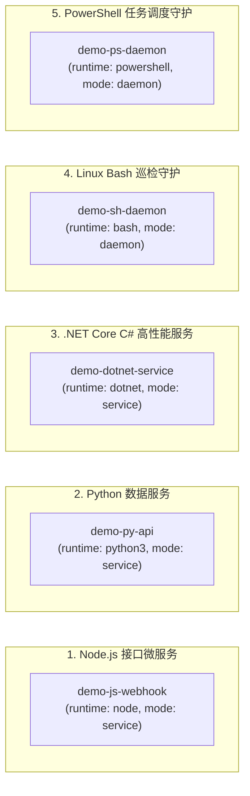
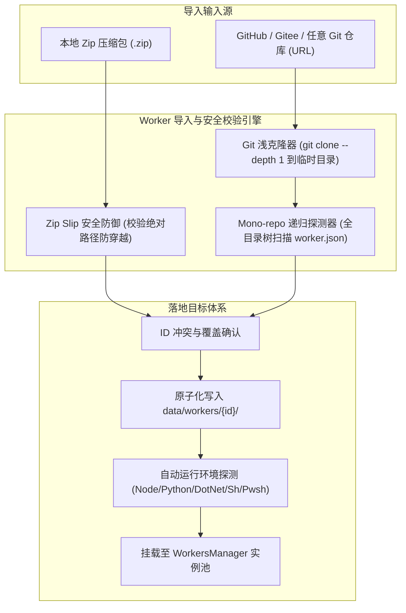
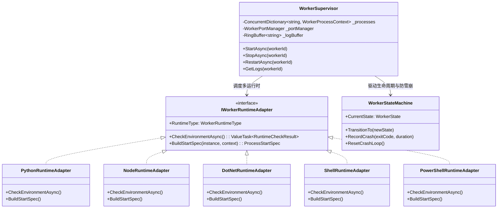

# SaaS 函数式微服务与长时守护平台 (LWT Workers & Daemons) 独立架构与落地设计方案

## 1. 业务背景与交互形态决策

在 LinuxWebTool (LWT) 体系中，已具备面向宿主运维的「服务管理中枢 (Services Hub)」。经过深入头脑风暴与用户心智模型推演，系统决定采用 **「另开独立一级页面」** 的架构形态：

### 1.1 为什么另开独立页面？（运维控制面 vs 业务计算面）
| 维度 | 现有「服务管理 (Services Hub)」 | 全新「函数服务 (Workers & Daemons)」 |
| :--- | :--- | :--- |
| **心智模型** | **系统运维控制面 (Ops / Control Plane)** | **轻量应用业务计算面 (Dev / Application Platform)** |
| **管理对象** | 宿主 `systemctl`、Docker 容器、系统网络/SSH、运维安全探针脚本 | 用户自编的 Webhook 接口、数据 API、后台爬虫、长时数据同步 Daemon |
| **交互深度** | 状态查看、启停、配置修改、执行预设运维钩子 (Hooks) | 代码模板向导、独立 URL 路由、在线调试、独立 SQLite/KV 查看、终端日志流 |
| **代码隔离** | 规避将庞大功能混杂进单个文件导致突破 2000 行前端门禁 | 独立为 `WorkersView.js`，高内聚低耦合，符合单一职责原则 |
| **行业范式** | Cloudflare 系统配置、宝塔「系统服务」 | Cloudflare Workers、Vercel Functions、宝塔「Web/Node/Python 项目」 |

### 1.2 页面定位与路由结构
- **前端路由**：`/workers`，注册视图组件 `src/LinuxWebTool.WebHost/wwwroot/app/views/WorkersView.js`；
- **导航入口**：在左侧主菜单 `Nav.js` 中新增独立一级菜单项 **「⚡ 函数服务」**（与「服务管理」、「网关与穿透」、「文件管理」平级）；
- **跨模块联动**：
  - 在「服务管理」顶部提供运行统计微标签（如 `⚡ 3 个函数服务正在运行 [一键跳转]`）；
  - 在「函数服务」卡片中提供「公网映射」按钮，一键无缝跳转至「网关与穿透」绑定独立域名与证书。

---

## 2. 存储规范与沙盒隔离机制

为确保所有微服务数据安全隔离、生命周期自闭环且与系统核心解耦，所有函数服务统一存储于：

$$\text{存储根路径} = \texttt{data/workers/\{workerId\}/}$$

每个 Worker 独占一个子目录，目录内物理结构规范如下：

```
data/workers/{workerId}/
├── worker.json               # 服务清单：元数据、运行时类型、网络路由模式、数据源配置、守护策略
├── worker.py (或 worker.js / Program.cs / worker.sh / worker.ps1)  # 入口源码
├── requirements.txt          # Python 依赖清单 (可选)
├── package.json              # Node.js 依赖清单 (可选)
├── .venv/                    # Python 独立虚拟环境 (按需自动创建)
├── data.db                   # 专属独立 SQLite 数据库文件 (运行时按需自动挂载)
├── kv.db                     # 专属独立 Key-Value 数据库文件 (支持 ACID)
└── worker.log                # 持久化输出流与滚动日志
```

### 环境变量沙盒注入规范
子进程拉起时，宿主环境向其自动注入以下标准环境变量：
- `PORT`：系统分配的内部监听端口（仅有请求 HTTP 服务注入）；
- `LWT_WORKER_ID`：当前函数微服务的唯一标识符；
- `LWT_DATA_DIR`：当前服务的绝对数据目录路径（`data/workers/{workerId}/`）；
- `LWT_SQLITE_PATH`：当前服务的独立 SQLite 路径（`data/workers/{workerId}/data.db`）；
- `LWT_KV_PATH`：当前服务的独立 KV 路径（`data/workers/{workerId}/kv.db`）。

---

## 3. 五大开箱即用官方示例服务 (js / py / netcore / sh / ps)

系统首次启动或重置时，在 `data/workers/` 下预置 5 种不同语言运行时与应用形态的种子示例：



### 3.1 JavaScript / Node.js 示例 (`demo-js-webhook`)
- **形态**：`service`（有请求 HTTP 服务），默认路由：`/w/demo-js-webhook/*`；
- **入口代码 (`worker.js`)**：
  ```javascript
  const http = require('http');
  const port = process.env.PORT || 8080;
  const workerId = process.env.LWT_WORKER_ID || 'demo-js';

  const server = http.createServer((req, res) => {
    res.writeHead(200, { 'Content-Type': 'application/json' });
    res.end(JSON.stringify({
      code: 0,
      message: 'Hello from Node.js Worker!',
      workerId,
      path: req.url,
      timestamp: new Date().toISOString()
    }));
  });

  server.listen(port, '0.0.0.0', () => {
    console.log(`[Node-Worker] Ready and listening on port ${port}`);
  });
  ```

### 3.2 Python 示例 (`demo-py-api`)
- **形态**：`service`（有请求 HTTP 服务），默认路由：`/w/demo-py-api/*`；
- **特性**：内置连接独立 SQLite，记录访问请求并返回访问计数器；
- **入口代码 (`worker.py`)**：
  ```python
  import os, sqlite3, json
  from http.server import HTTPServer, BaseHTTPRequestHandler

  PORT = int(os.environ.get("PORT", 8080))
  DB_PATH = os.environ.get("LWT_SQLITE_PATH", "data.db")

  # 自动初始化专属 SQLite
  with sqlite3.connect(DB_PATH) as conn:
      conn.execute("CREATE TABLE IF NOT EXISTS access_logs (id INTEGER PRIMARY KEY AUTOINCREMENT, ts DATETIME DEFAULT CURRENT_TIMESTAMP)")
      conn.commit()

  class Handler(BaseHTTPRequestHandler):
      def do_GET(self):
          with sqlite3.connect(DB_PATH) as conn:
              conn.execute("INSERT INTO access_logs DEFAULT VALUES")
              count = conn.execute("SELECT count(*) FROM access_logs").fetchone()[0]
          
          self.send_response(200)
          self.send_header("Content-Type", "application/json")
          self.end_headers()
          self.wfile.write(json.dumps({
              "message": "Hello from Python Worker!",
              "total_visits": count,
              "db": DB_PATH
          }).encode())

  if __name__ == "__main__":
      server = HTTPServer(("0.0.0.0", PORT), Handler)
      print(f"[*] Python Worker started on port {PORT}, DB: {DB_PATH}", flush=True)
      server.serve_forever()
  ```

### 3.3 .NET Core C# 顶层语句示例 (`demo-dotnet-service`)
- **形态**：`service`（有请求 HTTP 服务），默认路由：`/w/demo-dotnet-service/*`；
- **机制**：利用 .NET 6+ / 10 的现代化顶层语句 `dotnet run Program.cs`，零工程文件，具备毫秒级冷启动与超高并发性能；
- **入口代码 (`Program.cs`)**：
  ```csharp
  using System.Text.Json;
  using Microsoft.AspNetCore.Builder;
  using Microsoft.AspNetCore.Http;

  var port = Environment.GetEnvironmentVariable("PORT") ?? "8080";
  var builder = WebApplication.CreateBuilder();
  builder.WebHost.UseUrls($"http://0.0.0.0:{port}");
  var app = builder.Build();

  app.MapGet("/", () => Results.Json(new {
      message = "Hello from .NET Core C# Top-Level Worker!",
      runtime = ".NET 10 Minimal API",
      timestamp = DateTime.UtcNow
  }));

  app.Run();
  ```

### 3.4 Linux Bash 巡检长时守护示例 (`demo-sh-daemon`)
- **形态**：`daemon`（无请求后台长时常驻守护进程）；
- **功能**：每 30 秒巡检一次系统内存与磁盘空间，格式化输出到控制台（供前端 WebSocket 终端实时查看），并在异常时发出报警；
- **入口代码 (`worker.sh`)**：
  ```bash
  #!/usr/bin/env bash
  echo "[Shell-Daemon] Worker started. Data dir: ${LWT_DATA_DIR}"
  trap 'echo "[Shell-Daemon] Received SIGTERM, exiting gracefully..."; exit 0' TERM INT

  while true; do
      MEM_FREE=$(free -m | awk '/Mem:/ {print $4}')
      DISK_AVAIL=$(df -h / | awk 'NR==2 {print $4}')
      echo "[$(date '+%Y-%m-%d %H:%M:%S')] HealthCheck: Free Mem: ${MEM_FREE}MB, Disk Root Avail: ${DISK_AVAIL}"
      sleep 30
  done
  ```

### 3.5 PowerShell 任务队列长时守护示例 (`demo-ps-daemon`)
- **形态**：`daemon`（无请求后台长时常驻守护进程）；
- **跨平台支持**：Linux/Mac 下调用 `pwsh`，Windows 下调用 `powershell.exe`；
- **入口代码 (`worker.ps1`)**：
  ```powershell
  Write-Output "[PowerShell-Daemon] Service initialized on PID $PID"
  $counter = 0

  while ($true) {
      $counter++
      $time = Get-Date -Format "yyyy-MM-dd HH:mm:ss"
      Write-Output "[$time] Heartbeat tick #$counter - Host: $env:COMPUTERNAME, Worker: $env:LWT_WORKER_ID"
      Start-Sleep -Seconds 20
  }
  ```

---

## 4. 扩展包导入体系：Zip 单包与 Git 仓库多服务批量导入

完全对齐现有的服务扩展管理机制，为 Workers 提供极简高效的两种导入途径：



### 4.1 Zip 单包导入与安全防护
1. **Zip Slip 路径遍历漏洞严防**：
   - 提取文件前计算规范化路径：
     ```csharp
     var fullDestPath = Path.GetFullPath(Path.Combine(targetDir, entry.FullName));
     if (!fullDestPath.StartsWith(targetDir, StringComparison.OrdinalIgnoreCase))
     {
         throw new SecurityException("非法压缩包：检测到潜在的 Zip Slip 路径穿越风险");
     }
     ```
2. **清单合法性校验**：必须包含合法的 `worker.json`，且必须声明 `id`、`name`、`runtime`、`entrypoint`。

### 4.2 Git 仓库单仓多服务导入 (Mono-Repo Multi-Service Import)
1. **极速拉取**：利用临时目录执行浅克隆 `git clone --depth 1 <repo_url> <temp_dir>`，或直接通过 GitHub API 下载 tarball；
2. **多模块递归扫描**：遍历整个克隆目录树，搜寻所有包含 `worker.json` 的子目录；
3. **前端批量勾选交互**：
   - 前端弹出「单仓多服务导入向导」弹窗；
   - 呈现列表：模块名称、服务 ID、运行时类型（图标）、有无请求形态（Service/Daemon）、描述、是否已在本地安装；
   - 支持全选 / 反选 / 单选，支持勾选后一键「批量导入」；
4. **原子化落盘**：将选中的子目录完整拷贝至 `data/workers/{workerId}/`，并自动触发环境检测与就绪通知。

---

## 5. 核心架构与设计模式推演

### 5.1 架构设计模式全景



#### 1. 适配器模式 (Runtime Adapter Pattern)
- 抽象统一的 `IWorkerRuntimeAdapter`，统一封装：
  - 各运行时解释器路径探测（`python3`/`node`/`dotnet`/`bash`/`pwsh`）；
  - 启动参数构建（Python `-u` 无缓冲，.NET `run Program.cs`，Node 模块路径）；
  - 环境变量注入（`PORT`、`LWT_DATA_DIR`、`LWT_SQLITE_PATH`）。

#### 2. 状态机模式 (Supervisor State Machine) 与防无限重启雪崩 (CrashLoop Protection)
- **状态流转**：
  $$\text{Stopped} \xrightarrow{\text{Start}} \text{Starting} \xrightarrow{\text{存活} \ge 10\text{s}} \text{Running}$$
  $$\text{Starting / Running} \xrightarrow{\text{异常退出}} \text{Crashed} \xrightarrow{\text{重试} < 5} \text{Backoff} \xrightarrow{\text{延时结束}} \text{Starting}$$
  $$\text{Crashed} \xrightarrow{\text{连续崩溃} \ge 5} \text{Degraded (CrashLoop 熔断)}$$
- **指数退避梯度**：
  $1\text{s} \to 3\text{s} \to 10\text{s} \to 30\text{s} \to \text{熔断保护停机}$；
- **健康重置**：进程稳定存活运行超过 60 秒后，自动将连续崩溃计数器清零。

#### 3. 门面模式 (Facade Pattern)
- `WorkersManager` 集中封装端口池分配、YARP 动态反代注册、持久化沙盒定位与进程生命周期控制，为 Web 控制器提供极简统一的 API。

---

## 6. 逻辑、性能、安全性缺陷与应对方案

### 6.1 端口冲突与端口泄露治理 (Port Management)
- **风险**：子进程退出后端口处于 `TIME_WAIT`，或不同 Worker 争抢同一端口；
- **应对**：
  - 维护动态内部端口池 `18000 ~ 18999`；
  - 分配时通过 `TcpListener(IPAddress.Loopback, port)` 实时尝试绑定探测真实可用性；
  - 进程停止或崩溃时，由生命周期监听器统一回收端口映射。

### 6.2 孤儿进程与进程树泄露治理 (Orphan Process Leaks)
- **风险**：某些脚本内部使用 `nohup` 或派生子进程，单纯杀死父进程导致孙子进程孤儿驻留；
- **应对**：
  - **Linux 平台**：通过进程组发送信号 `kill -TERM -<PID>`，一次性回收整个进程树；
  - **Windows 平台**：调用 `taskkill.exe /T /F /PID <PID>` 彻底清除进程树；
  - 采用操作系统作业对象 (Job Object / cgroups) 绑定，宿主异常退出时自动级联销毁。

### 6.3 内存与高吞吐日志防暴涨 (RingBuffer Protection)
- **风险**：死循环输出 `console.log` / `print` 打爆 Web 宿主内存；
- **应对**：
  - 采用无锁环形缓冲区 (`RingBuffer<T>`，容量固定为 1000 行)；
  - 超过容量时自动覆写最老日志，内存恒定限制在 $\le 500\text{KB}$ 以内；
  - 前端通过轻量 WebSocket 按需订阅，断开连接后零网络开销。

---

## 7. 现有系统基础设施完全复用盘点

| 系统能力 | 对应现有代码文件 | 本方案复用方式 |
| :--- | :--- | :--- |
| **YARP 动态反向代理** | [DatabaseProxyConfigProvider.cs](file:///e:/WorkProject/CSharp/PrivateProject/Web/WebToolForLinux/src/LinuxWebTool.WebHost/Features/Gateway/Adapters/DatabaseProxyConfigProvider.cs) | 毫秒级热更注册 `/w/{workerId}/*` 路径转发，零重启 |
| **Mono-repo Git 扫描与克隆** | [ScriptExtensionManager.Repo.cs](file:///e:/WorkProject/CSharp/PrivateProject/Web/WebToolForLinux/src/LinuxWebTool.Infrastructure/Features/Services/Adapters/Extensions/ScriptExtensionManager.Repo.cs) | 直接复用 Git 浅克隆与多模块清单树扫描算法 |
| **多语言解释器环境探测** | [ScriptExtensionManager.cs](file:///e:/WorkProject/CSharp/PrivateProject/Web/WebToolForLinux/src/LinuxWebTool.Infrastructure/Features/Services/Adapters/Extensions/ScriptExtensionManager.cs) | 复用 Node/Python/PowerShell 的跨平台探测流水线 |
| **文件管理器与持久化直达** | [FilesView.js](file:///e:/WorkProject/CSharp/PrivateProject/Web/WebToolForLinux/src/LinuxWebTool.WebHost/wwwroot/app/views/FilesView.js) | 通过路由 `/files?path=...` 直达 `data/workers/{id}/` |
| **公网域名穿透与映射** | [FrpTunnelManager.cs](file:///e:/WorkProject/CSharp/PrivateProject/Web/WebToolForLinux/src/LinuxWebTool.Infrastructure/Features/Gateway/Adapters/FrpTunnelManager.cs) | 直接将分配的内部端口通过 FRP 或网关规则对外发布 |

---

## 8. 分阶段实施与验证计划

- **阶段一：后端核心 Supervisor 引擎与多运行时适配器**
  - 创建 `WorkerSupervisor`、`WorkerPortManager`、`CrashLoopGuard`；
  - 实现 Python / Node / .NET / Shell / PowerShell 5 大运行时适配器与进程树清理；
  - 固化 `data/workers/` 下 5 大官方示例种子工程。
- **阶段二：动态路由、持久化沙盒与导入引擎**
  - 接入 YARP `/w/{workerId}/*` 动态反向代理；
  - 实现 Zip 安全解压与 Git 仓库多模块递归扫描导入；
  - 挂载独立 SQLite 与独立 KV 数据库文件。
- **阶段三：前端全新独立视图 [WorkersView.js](file:///e:/WorkProject/CSharp/PrivateProject/Web/WebToolForLinux/src/LinuxWebTool.WebHost/wwwroot/app/views/WorkersView.js) 交付**
  - 左侧主导航新增「⚡ 函数服务」入口；
  - 实现微服务卡片流、新建向导（多语言模板选择）、Zip / Git 仓库导入向导；
  - 集成 WebSocket 实时日志黑底终端抽屉与独立 SQLite 一键下载/直达。
- **阶段四：全量架构测试、单元测试与发布**
  - 编写多运行时拉起、CrashLoop 熔断与 YARP 路径透传测试；
  - 确保通过 `frontend-gate.cjs` 与 Native AOT Release 编译。
