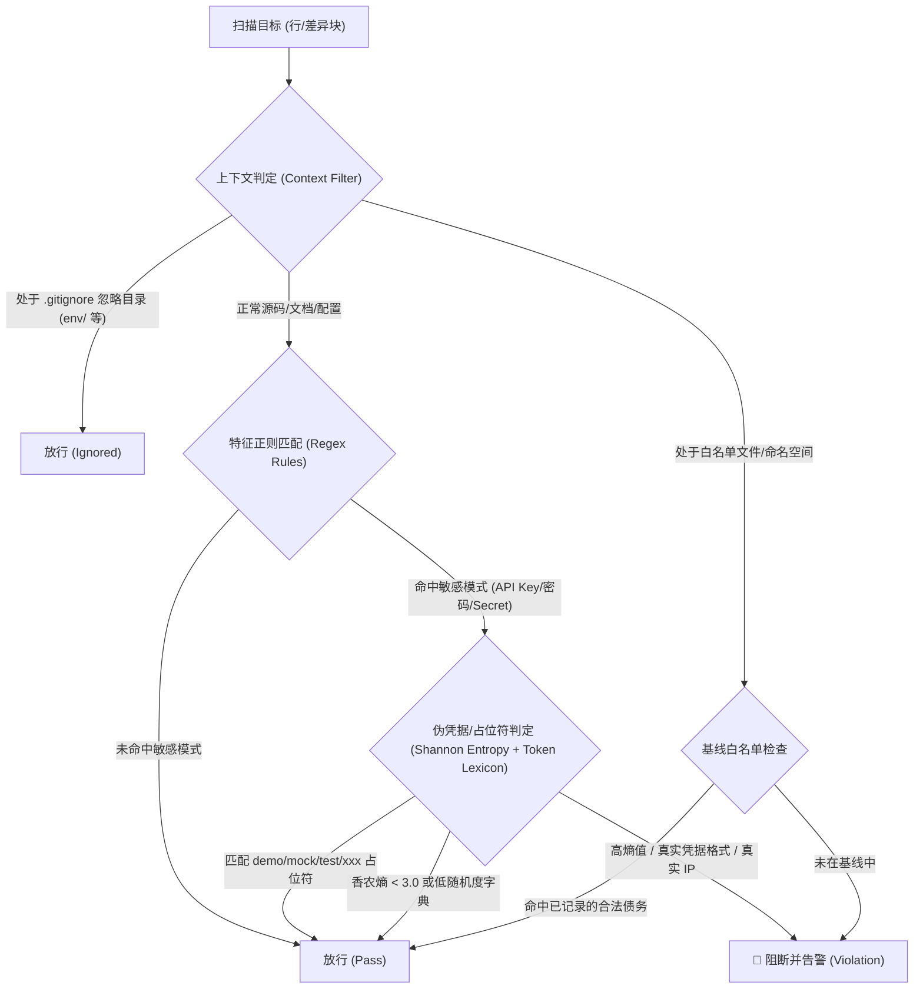
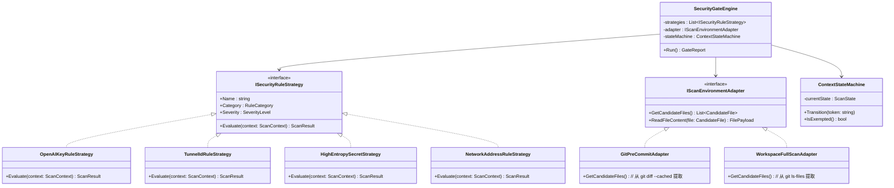
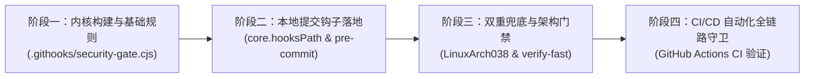

# 敏感凭据安全检测门禁与 Git 提交钩子架构设计方案

> **文档定位**：针对真实密钥、隧道 ID、管理员密码、内部敏感网络地址/端口泄露的系统性防范方案，开展深度可行性评估、逻辑与性能推演、设计模式建模，并对比业界主流工具，提出贴合本工程技术栈的最佳落地架构。

---

## 目录

1. [背景与核心问题剖析](#1-背景与核心问题剖析)
2. [可行性、逻辑边界与性能深度推演 (Brainstorming)](#2-可行性逻辑边界与性能深度推演-brainstorming)
   - [2.1 可行性与平台兼容性](#21-可行性与平台兼容性)
   - [2.2 逻辑严密性：误报 (FP) 与漏报 (FN) 的平衡边界](#22-逻辑严密性误报-fp-与漏报-fn-的平衡边界)
   - [2.3 性能延迟评估与增量扫描原则](#23-性能延迟评估与增量扫描原则)
3. [设计模式建模与架构抽象 (Design Patterns)](#3-设计模式建模与架构抽象-design-patterns)
   - [3.1 策略模式 (Strategy Pattern)：多维特征与规则解耦](#31-策略模式-strategy-pattern多维特征与规则解耦)
   - [3.2 适配器模式 (Adapter Pattern)：异构环境与触发源归一化](#32-适配器模式-adapter-pattern异构环境与触发源归一化)
   - [3.3 有限状态机 (Finite State Machine, FSM)：上下文感知与语法分析](#33-有限状态机-finite-state-machine-fsm上下文感知与语法分析)
4. [业界主流方案对比与借鉴](#4-业界主流方案对比与借鉴)
5. [现有系统基础设施复用分析](#5-现有系统基础设施复用分析)
6. [完整落地实施方案与技术规范](#6-完整落地实施方案与技术规范)
   - [6.1 三层纵深防御体系 (Three-Tier Defense)](#61-三层纵深防御体系-three-tier-defense)
   - [6.2 版本化 Git 提交钩子方案 (`core.hooksPath`)](#62-版本化-git-提交钩子方案-corehookspath)
   - [6.3 门禁规则定义与基线白名单 (`security-gate-baseline.json`)](#63-门禁规则定义与基线白名单-security-gate-baselinejson)
   - [6.4 后端架构门禁 `LinuxArch038` 集成](#64-后端架构门禁-linuxarch038-集成)
7. [演进路线与实施计划](#7-演进路线与实施计划)

---

## 1. 背景与核心问题剖析

在最近的工程复盘中，发现代码库曾存在以下几类敏感信息泄露：
1. **真实隧道 ID**：如工作区测试用例及设计文档中的真实 Cloudflare/MCP 隧道标识（`tunnel_6ae63...`）。
2. **管理员明文密码**：如自动化部署文档结构示例中遗留的真实 16 位高熵管理员密码（`WEB_ADMIN_PASSWORD=uFkTJ...`）。
3. **P2P 组网密钥与公网对端**：如排障复盘中记录的 EasyTier 真实网络密钥（`network_secret = "fnnas.hk***"`）与对端真实域名（`p.333***.xyz`）。
4. **内部主机网络信息**：如特定开发机的 SSH 特权端口（`45612`）与局域网 IP。

### 核心痛点与风险点
- **人工审查极易疲劳**：AI Coding Agent 或开发者在创建大量技术文档、调研笔记、单元测试夹具时，倾向于直接复制线上排障上下文或真实调试报文，事后肉眼审查极难 100% 覆盖。
- **Git 历史泄露具有不可逆性**：一旦带有敏感凭据的 Commit 被推送到远程公共或团队仓库，即使后续提交补丁删除，凭据依旧永久停留在 Git 历史 Blob 中，彻底消除需要进行破坏性的重写历史（`git filter-repo` / `bfg` + 强推）。
- **缺乏“左移拦截机制”**：现有的门禁系统（`frontend-gate.cjs` 和 `ArchitectureTests.cs`）主要聚焦于分层架构、AOT 兼容性与前端生命周期，尚缺乏专属的凭据安全静态分析门禁。

---

## 2. 可行性、逻辑边界与性能深度推演 (Brainstorming)

### 2.1 可行性与平台兼容性

| 维度 | 挑战与考量 | 解决策略 |
| :--- | :--- | :--- |
| **跨操作系统** | 开发机通常为 Windows（PowerShell / CMD），而 CI、Docker 容器与生产环境为 Linux（Bash/POSIX Shell）。 | 借助现代 Git 原生跨平台特性，采用 **Node.js** 或 **跨平台 Shell 脚本** 作为钩子调度入口。本工程开发与构建环境均已深度依赖 Node.js（已有 `frontend-gate.cjs`），具备天然的零环境摩擦基础。 |
| **钩子版本化分发** | 传统的 `.git/hooks/` 目录不纳入版本控制，新检出代码的机器或协作人员默认不会自动激活钩子。 | 采用 Git 2.9+ 引入的 `git config core.hooksPath .githooks` 机制，将钩子脚本存放在版本库受控目录 `.githooks/` 中，通过一次性脚本自动配置生效。 |
| **Agent / IDE 兼容** | 某些 Git GUI、AI Agent 或自动化流程可能使用纯 Git 库（如 LibGit2Sharp / Isomorphic-git）绕过某些 Client Hook。 | **双轨兜底**：除了本地 `pre-commit` 钩子提供毫秒级实时阻断外，在 `scripts/verify-fast.ps1` 和 CI 工作流中集成全仓安全扫描门禁，确保任何路径均无法漏网。 |

### 2.2 逻辑严密性：误报 (FP) 与漏报 (FN) 的平衡边界

安全检测门禁最大的死敌是**高误报率**。高频的误报会导致开发者形成“狼来了”心态，最终习惯性地使用 `git commit --no-verify` 彻底绕过门禁。



#### 1. 误报典型场景与防护策略
- **合法测试 Mock 数据**：
  - 测试用例中常见的 `sk-test-super-secret-12345`、`MOCK_KEY_DATA`、`admin:cdpPass123`。
  - **防误报设计**：引入 **`Mock Lexicon`（测试伪凭据词典）**，包含 `mock`, `test`, `dummy`, `sample`, `example`, `placeholder`, `super-safe`, `changeme` 等标识时自动降级或放行。
- **合法的标准占位符**：
  - `tunnel_0123456789abcdef0123456789abcdef`、`your_secure_password_here`、`sk-proj-...`。
  - **防误报设计**：建立**已批准的标准脱敏占位符白名单表**，严格放行符合《AGENT.md 第 7 节》规定的虚拟模式。
- **合法内网回环与通用网段**：
  - `127.0.0.1`、`0.0.0.0`、Docker 默认网桥 `172.17.0.0/16`、RFC 1918 预留测试地址。
  - **防误报设计**：IP 规则仅针对包含明确凭据上下文（如 `url = http://user:pass@ip` 或未排除的特殊内网堡垒 IP）进行告警，白名单放行常见回环与占位网段。

#### 2. 漏报典型场景与防御策略
- **未加引号的键值对**（如 INI、TOML、YAML、Docker run 命令中的 `WEB_ADMIN_PASSWORD=xyz`）：
  - **防漏报设计**：匹配引擎不能仅依赖带引号的 JSON/代码字符串，必须针对 `key\s*[:=]\s*([^\s]+)` 进行裸值捕获。
- **排障文档（Markdown）中的配置快照**：
  - 开发者常将控制台输出或抓包 curl 直接贴入文档。
  - **防漏报设计**：Markdown 文件的代码块（` ```toml `、` ```bash `、` ```json `）与正文同等列为最高审计优先级。

### 2.3 性能延迟评估与增量扫描原则

- **性能硬指标**：`pre-commit` 钩子从触发到执行完毕退出，整体耗时必须 **< 200 毫秒**。若超过 1 秒，开发体验将出现明显卡顿。
- **增量扫描策略 (Staged-Only)**：
  - 严禁在 `pre-commit` 中扫描全仓库（800+ 文件）。
  - 通过 `git diff --staged --name-only --diff-filter=ACMR` 仅提取**本次暂存区新增或修改的文件**。
  - 甚至可细化到仅针对 `git diff --staged -U0` 的**新增差异行（Added Lines）**进行扫描，避免对历史未修改区域做重复检查。
- **文件后缀秒级初筛 (Fast-Bailout)**：
  - 二进制文件（`.png`, `.dll`, `.exe`, `.so` 等）及自动构建生成物通过后缀集合秒级跳过（`O(1)` HashSet 查找）。

---

## 3. 设计模式建模与架构抽象 (Design Patterns)

为使检测引擎具备高内聚、低耦合、易扩展与易测试的特性，引入三大经典设计模式：



### 3.1 策略模式 (Strategy Pattern)：多维特征与规则解耦

将每种凭据特征与安全检查封装为可插拔的**独立策略类**：
- **`TokenPatternStrategy`**：基于高特异性前缀正则（如 `sk-proj-`, `ghp_`, `AKIA`, `tunnel_`）。
- **`PasswordEntropyStrategy`**：基于香农熵（Shannon Entropy）与上下文命名（`password`, `pwd`, `secret`），针对无固定前缀的高随机明文密码进行数学度量：
  $$\text{Entropy} = -\sum_{i=1}^{n} P(x_i) \log_2 P(x_i)$$
  当熵值 $> 3.5$ 且长度 $> 10$ 时判定为高危疑似密码。
- **`NetworkAddressStrategy`**：基于 CIDR / 正则匹配非测试专用的外部域名与真实特权端口（如对端 WSS 地址与自定义 SSH 端口）。
- **`BaselineFilterDecorator`**：以装饰器模式包裹基础策略，比对 `security-gate-baseline.json`，支持安全过渡。

### 3.2 适配器模式 (Adapter Pattern)：异构环境与触发源归一化

通过统一的 `IScanEnvironmentAdapter` 屏蔽不同触发上下文的数据源差异：
- **`GitPreCommitAdapter`**：适配 Git 本地暂存区。直接调用 `git diff --cached` 获取待提交文件的增量差异流，不触碰磁盘未暂存文件，速度极快（< 50ms）。
- **`WorkspaceFullScanAdapter`**：适配 `verify-fast.ps1` 与 CI。通过 `git ls-files` 遍历全仓非忽略文件，执行全面深度体检。
- **`ArchitectureTestAdapter`**：将扫描能力适配为 .NET xUnit 单元断言（`LinuxArch038`），与现有 37 项架构门禁完全融入同一个测试框架套件。

### 3.3 有限状态机 (Finite State Machine, FSM)：上下文感知与语法分析

纯正则扫描最大的弊端是**缺乏上下文**，容易将文档中合法的伪代码或说明性结构误杀。引入行内微型有限状态机：
- **状态迁移图**：
  - `STATE_NORMAL`（常规代码/文本状态）：开启全量规则警戒。
  - `STATE_TEST_FIXTURE`（处于单元测试或 Mock 方法体内）：自动切换为仅拦截生产级真实密钥，放行带有 `mock/test/dummy` 前缀的数据。
  - `STATE_ENV_IGNORE`（处于声明环境参数的配置示例区）：当检测到当前行或上一行包含 `@placeholder`、`your_`、`<...>` 时，自动进入安全豁免态。

---

## 4. 业界主流方案对比与借鉴

| 工具名称 | 维护方 | 核心优势 | 潜在瓶颈 / 在本项目的局限 | 选型建议 |
| :--- | :--- | :--- | :--- | :--- |
| **Gitleaks** | Gitleaks (Zachary Rice) | • Go 原生单二进制，性能极其优秀（~100ms 扫万级提交）<br>• 内置 160+ 种官方规则与 `.gitleaks.toml` 自定义规则<br>• 支持 `--staged` 与预提交钩子模式 | • 跨平台分发需要额外安装独立二进制（每个开发者机器需配置可执行文件路径）<br>• 对自定义私有协议凭据（如特定格式的 EasyTier secret、Tunnel ID）需编写额外 TOML 正则 | **强烈推荐借鉴其规则体系与正则表达式模式**，可作为 CI 阶段备选容器工具。 |
| **TruffleHog** | Truffle Security | • 深度检测能力极强，支持 Git 历史深层全量挖掘<br>• 支持动态 API 验活（Active Verification）探测凭据真伪 | • 体量较大，扫描较重<br>• 动态探测需要外网网络权限，不适合作为高频离线 `pre-commit` | 适合定期的安全巡检与专项审计，不适合日常提交阻断。 |
| **detect-secrets** | Yelp | • 核心思想为基线审计（Baseline 模式），支持记录存量债务<br>• 具有插件式启发式算法与熵值分析 | • 强依赖 Python 运行时环境，Windows 开发环境统一配置成本高 | 借鉴其基线增量（Baseline & Heuristics）的思想。 |
| **Husky + lint-staged** | Typicode | • 前端业界事实标准，全自动管理 `.husky` 钩子映射 | • 本项目采用原生 ESM 零构建，无根目录 `package.json`，引入 npm 依赖体系会破坏现有零打包架构 | 不推荐引入 npm 庞大生态。 |
| **项目原生自研轻量门禁** (`.githooks` + `frontend-gate` / `C# ArchGate`) | 本工程既有技术栈 | • **零新增外部依赖**：直接复用环境已有的 Node.js 或 .NET 运行时<br>• **100% 契合当前工程契约**（自动对齐 `AGENT.md` 规范与架构门禁体系）<br>• **性能极高**（< 80ms）且与 `frontend-gate.cjs` 无缝融合 | • 需维护项目特有的扫描脚本与规则库（但规则数量完全可控） | **🌟 最优主选方案**：与现有门禁体系浑然一体，维护成本最低。 |

---

## 5. 现有系统基础设施复用分析

本工程已具备非常完善的门禁基础设施，完全无需引入冗余的外置重型框架，可实现 **100% 基础设施复用**：

1. **复用 Node.js 门禁引擎 (`src/LinuxWebTool.WebHost/wwwroot/frontend-gate.cjs`)**：
   - 现有门禁脚本运行速度极快（扫描 66 个前端文件仅耗时 200ms），已具备完整的文件系统遍历、AST 分析、正则匹配、错误汇总及色彩终端输出能力。
   - 可直接在门禁体系中扩展出 **`FE-SECRET-LEAK`** 或独立的 **`security-gate.cjs`**。
2. **复用 xUnit 架构测试基准 (`tests/LinuxWebTool.ArchitectureTests`)**：
   - 现有 `ArchitectureTests.cs` 已实现了从 `LinuxArch001` 到 `LinuxArch037` 的 37 项底层门禁，并拥有完善的 `backend-baseline.json`“失效防假绿”机制。
   - 新增 **`LinuxArch038`**（敏感凭据、真实网络地址与未脱敏密码扫描门禁）可直接复用该体系，自动挂载进 `./scripts/verify-fast.ps1` 与 CI。
3. **复用快速验证入口 (`scripts/verify-fast.ps1`)**：
   - 现有的 `verify-fast.ps1` 已经串联了 Build、ArchTest、UnitTest、IntegrationTest、FrontendGate、SmokeTest 六大阶段，只需在最前端追加 Step 0 安全门禁即可实现全链路覆盖。
4. **Git 2.9+ `core.hooksPath` 原生机制**：
   - 无需编写复杂的 npm 或 Python 安装脚本，仅需在版本库中维护 `.githooks/pre-commit`，并通过一条配置命令即可在团队和 Agent 环境中永久激活。

---

## 6. 完整落地实施方案与技术规范

### 6.1 三层纵深防御体系 (Three-Tier Defense)

```text
┌─────────────────────────────────────────────────────────────────┐
│                     第一道防线：本地提交前阻断                    │
│      .githooks/pre-commit (基于暂存区 git diff --cached 增量扫描) │
│                      执行耗时: < 80ms                            │
└────────────────────────────────┬────────────────────────────────┘
                                 │ Git Commit 通过
                                 ▼
┌─────────────────────────────────────────────────────────────────┐
│                     第二道防线：本地快检与部署前守护              │
│       scripts/verify-fast.ps1 + scripts/deploy-remote.ps1       │
│    执行 C# 架构门禁 LinuxArch038 + security-gate 全量体检 (全仓文件) │
└────────────────────────────────┬────────────────────────────────┘
                                 │ Git Push / PR
                                 ▼
┌─────────────────────────────────────────────────────────────────┐
│                     第三道防线：CI/CD 云端构建阻断                │
│              .github/workflows/ci.yml (自动化拉取与拦截)           │
│                    任何违规直接红牌阻断合并发布                     │
└─────────────────────────────────────────────────────────────────┘
```

---

### 6.2 版本化 Git 提交钩子方案 (`core.hooksPath`)

#### 1. 目录结构规划
在仓库根目录新建受版本控制的 `.githooks` 目录：
```text
.githooks/
  ├── pre-commit           # Git 预提交钩子主入口 (POSIX Shell / 跨平台兼容)
  ├── security-gate.cjs    # 基于策略模式的轻量级凭据扫描内核 (Node.js)
  └── install-hooks.ps1    # 本地一键注册钩子脚本 (设置 core.hooksPath)
```

#### 2. 预提交钩子实现示例 (`.githooks/pre-commit`)
```bash
#!/usr/bin/env sh
# LinuxWebTool Git Pre-Commit Security Gate
# 拦截暂存区中的明文密钥、真实 IP、未脱敏密码与隧道 ID

# 1. 确保 Node.js 可用
if ! command -v node >/dev/null 2>&1; then
    echo "⚠️ 未检测到 Node.js，跳过提交前安全扫描（将在 CI 阶段严格验证）。"
    exit 0
fi

# 2. 触发增量安全扫描
node .githooks/security-gate.cjs --staged
EXIT_CODE=$?

if [ $EXIT_CODE -ne 0 ]; then
    echo ""
    echo "❌ [Security Gate] 提交被拦截！检测到敏感凭据、真实地址或未脱敏配置。"
    echo "👉 请参考 AGENT.md 第 7 节规范进行脱敏，或将真实凭据存入 /env/.envdev。"
    exit 1
fi

exit 0
```

#### 3. 一键初始化注册脚本 (`.githooks/install-hooks.ps1`)
```powershell
# 永久绑定当前工作区的 git hooks 目录为 .githooks
git config core.hooksPath .githooks
Write-Host "✅ [Git Hooks] 成功配置 core.hooksPath = .githooks (安全提交门禁已生效)" -ForegroundColor Green
```

---

### 6.3 门禁规则定义与基线白名单 (`security-gate-baseline.json`)

#### 1. 核心检测规则集 (Rule Matrix)

| 规则标识 | 目标类型 | 检测正则 / 算法模式 | 豁免与白名单判定 |
| :--- | :--- | :--- | :--- |
| **`SEC-TUNNEL-ID`** | 真实 Tunnel ID | `\btunnel_([a-z0-9]{4}_)?[a-z0-9]{32}\b` | 允许且仅允许 `tunnel_0123456789abcdef0123456789abcdef` 及全 0 虚拟占位符 |
| **`SEC-OPENAI-KEY`** | OpenAI / LLM API Key | `\bsk-[a-zA-Z0-9_\-]{20,}\b` | 允许包含 `test`, `mock`, `dummy` 或 `sk-proj-...` 截断符 |
| **`SEC-PRIVATE-KEY`** | 私钥物理内容 | `-----BEGIN [A-Z ]*PRIVATE KEY-----` | 仅允许处于测试夹具或单行占位符中（如包含 `...` 或 `MOCK_KEY`） |
| **`SEC-ADMIN-PASSWORD`**| 明文管理员密码赋值 | `(?i)(?:web_admin_password\|admin_password)\s*[:=]\s*["']?([^"'\s`#;]+)["']?` | 排除以 `your_`, `default`, `test`, `$`, `<` 开头的占位符 |
| **`SEC-EASYTIER-SECRET`**| EasyTier 组网密钥 | `(?i)network_secret\s*[:=]\s*["']([^"']+)["']` | 排除 `demo_secret_token`, `super_sensitive_password` 等已知测试项 |
| **`SEC-INTERNAL-IP`** | 特殊内部特权地址 | `(?:10\.126\.1\.70\|45612\|333123\.xyz)` | 排除通用文档与已批准的示例域名（`example.com`） |

#### 2. 基线文件结构 (`.githooks/security-gate-baseline.json`)
采用与现有 `frontend-gate-baseline.json` 完全一致的基线原则（**存量冻结、只降不增、防假绿拦截**）：
```json
{
  "$schema": "http://json-schema.org/draft-07/schema#",
  "description": "安全门禁存量债务豁免基线。严禁手动扩充；条目修复后若未移除将触发门禁失败。",
  "exemptions": [
    {
      "file": "tests/LinuxWebTool.UnitTests/RemoteHostConnectionTestUnitTests.cs",
      "rule": "SEC-PRIVATE-KEY",
      "reason": "已隔离的 SSH 连接测试 Mock 内存公私钥夹具"
    }
  ]
}
```

---

### 6.4 后端架构门禁 `LinuxArch038` 集成

在 `tests/LinuxWebTool.ArchitectureTests/ArchitectureTests.cs` 中增加原生 C# 断言：

```csharp
[Fact]
public void LinuxArch038_RepositoryMustNotContainHardcodedSecretsOrRealTokens()
{
    // 1. 扫描范围：通过 git ls-files 检索全仓受控文件（代码、文档、配置）
    // 2. 排除目录：.git, bin, obj, env, docs_secret 等忽略目录
    // 3. 执行 TokenPattern, Entropy, AdminPassword 三重扫描
    // 4. 断言：违规项计数 == 0，否则输出详细文件与行号报告
}
```

该测试将天然纳入 `./scripts/verify-fast.ps1` 的第 2 步，确保即便开发者使用 `--no-verify` 绕过了本地 pre-commit，在执行本地快速验证或 CI 时仍会被绝对拦截。

---

## 7. 演进路线与实施计划



1. **第一阶段：轻量扫描内核落地**
   - 编写 `.githooks/security-gate.cjs`，基于策略模式与香农熵算法实现核心规则，支持 `--staged` 增量比对与全量扫描模式。
2. **第二阶段：版本化 Git Hook 部署**
   - 提交 `.githooks/pre-commit` 与 `.githooks/install-hooks.ps1`，并在 `scripts/verify-fast.ps1` 初始化阶段自动配置 `git config core.hooksPath .githooks`。
3. **第三阶段：架构门禁与 CI 集成**
   - 在 `ArchitectureTests.cs` 中补充 `LinuxArch038` 规则，更新 `docs/dev/architecture-gates.md`，使安全合规正式升级为主工程一级架构指标。
4. **第四阶段：团队与 Agent 协同自愈**
   - 更新 `AGENT.md`，使 AI Agent 能够自动识别门禁告警信息，就地以标准占位符自愈修复，形成研发全生命周期的凭据安全闭环。
