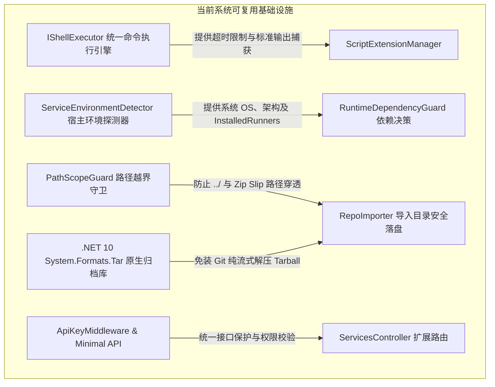
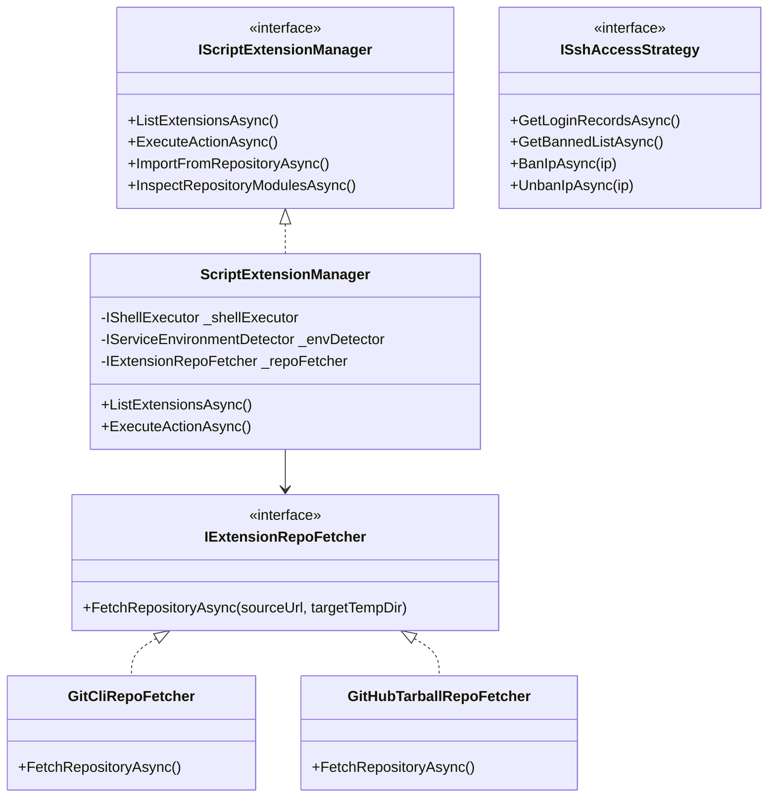
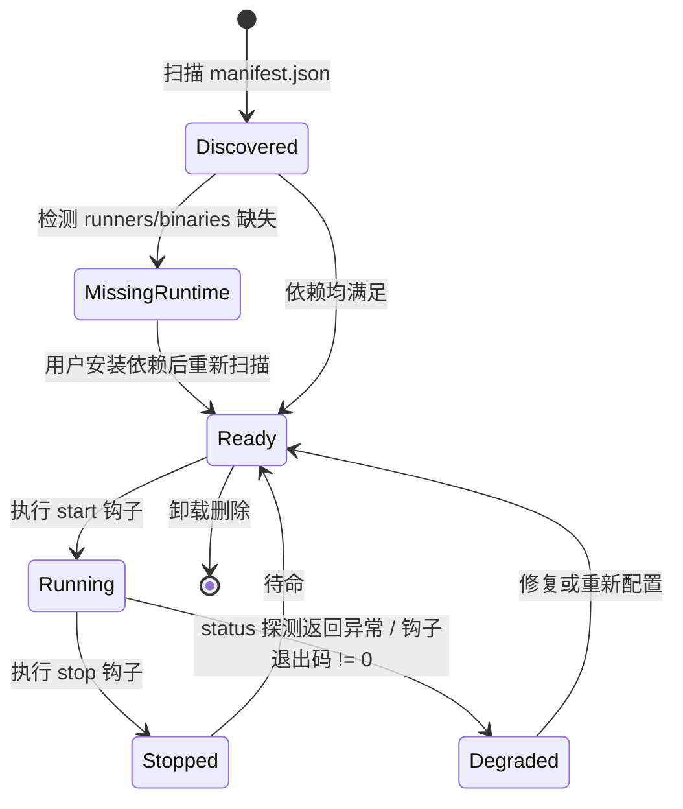
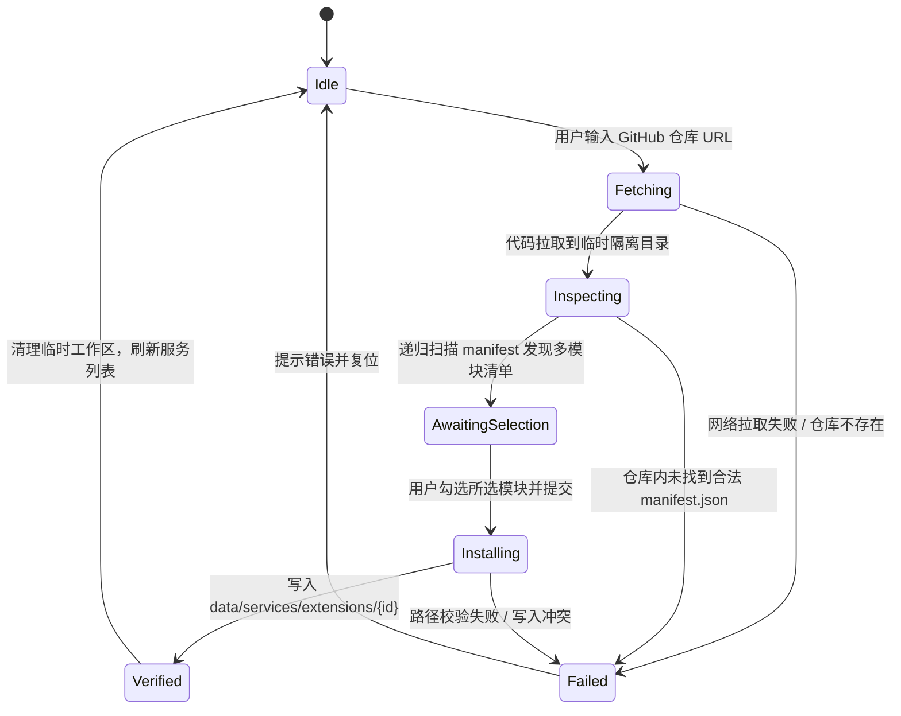
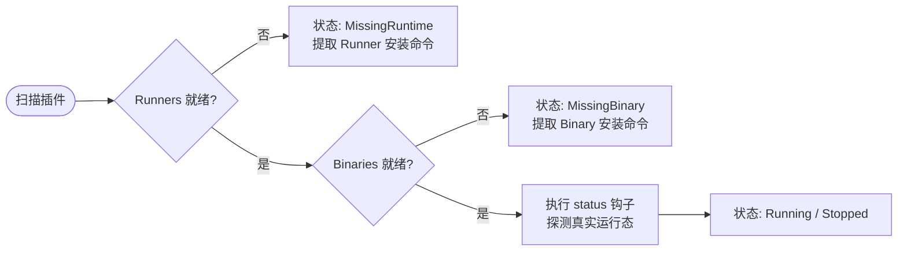
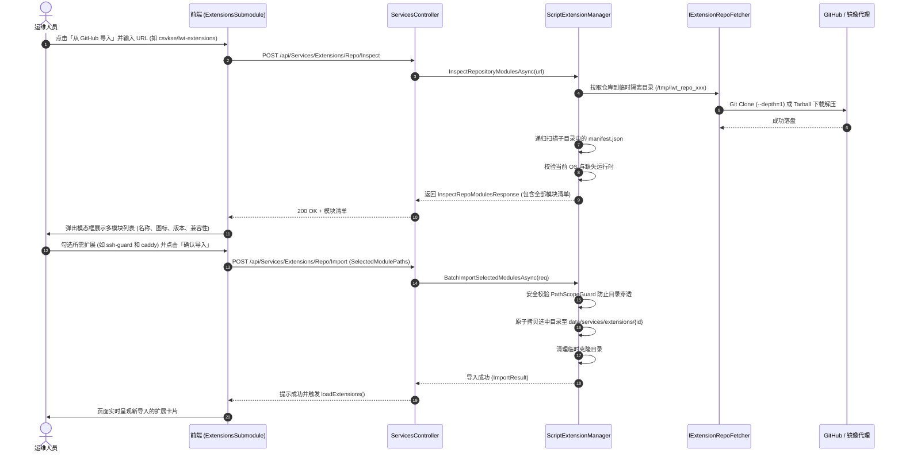
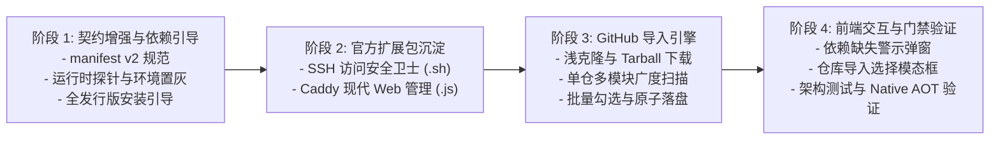

# 动态服务管理扩展进阶方案：SSH 访问卫士、Caddy 管理、环境自检引导与 GitHub 多模块导入

> **文档状态**：调研完成 / 方案设计已评审 / 待执行  
> **涉及模块**：`LinuxWebTool.Infrastructure`、`LinuxWebTool.Contracts`、`LinuxWebTool.Application`、`LinuxWebTool.WebHost`、`Web前端子模块`  
> **架构门禁**：Native AOT 100% 兼容、前端架构门禁 (`frontend-gate.cjs`)、REST/Minimal API 双映射、`ApiKeyMiddleware` 安全护栏  

---

## 一、需求背景与目标愿景

在系统与服务管理中枢（`Services Hub`）上线后，系统已经具备了对本地宿主及 Docker 特权穿透环境下 Systemd、Docker、SSH、Samba、网络与基础动态脚本扩展的管理能力。为进一步释放动态扩展机制的灵活性与第三方生态活力，针对高级运维场景提出以下五大核心进阶需求：

1. **Linux SSH 访问安全管理扩展（SSH Access Guard）**：
   - 动态监控成功登录历史、失败暴力破解溯源、实时活跃会话；
   - 支持单个 IP 或 CIDR 网段（如 `192.168.1.0/24`）黑名单封禁与解封；
   - 规范必须使用 **Bash (`.sh`)** 脚本实现。
2. **Linux Caddy 现代 Web 服务器管理扩展（Caddy Server Manager）**：
   - 提供全生命周期管理（启动、停止、重启、健康状态探测）；
   - 提供 Caddyfile 配置文件在线读取、语法预检（`caddy validate`）、优雅重载（`caddy reload` / Admin API）；
   - 规范必须使用 **Node.js (`.js`)** 脚本实现。
3. **异构语言与运行时约束**：
   - SSH 访问管理采用纯 POSIX Bash (`.sh`)，保障极低系统资源占用与 Linux 原生契合度；
   - Caddy 管理采用 Node.js (`.js`)，发挥内置 `http` 与 `fs` 对 Caddy Admin API 与 JSON/文本配置的双向处理优势，且**零外部 npm 依赖**。
4. **环境自检、缺失状态置灰与安装引导（Runtime & Binary Dependency Guard）**：
   - 当插件声明的解释器运行时（如系统未装 `node` 或缺失 `bash`）或目标程序（如未装 `caddy` 二进制）不存在时：
     - 前端插件卡片明确展示**禁用/环境缺失状态**（按钮锁定置灰）；
     - 提供跨主流 Linux 发行版（Debian/Ubuntu, RHEL/Alma, Alpine, Arch 等）的一键安装命令与安装引导。
5. **GitHub 仓库路径导入与单仓库多模块（Mono-repo）批量导入**：
   - 支持通过 GitHub 仓库路径（如 `owner/repo` 或 HTTPS URL）在线导入扩展包；
   - 完美支持**单仓库多模块（Mono-repo）**架构：同一个 Git 仓库内可聚合多个独立扩展（如 `extensions/ssh-guard`, `extensions/caddy`）；
   - 导入时具备**可视化批量勾选界面**，用户可自由选择需要的工具并执行原子性同步导入；
   - 内置国内加速代理源支持，确保在弱网或无法直连 GitHub 环境下高可用导入。

---

## 二、业界主流方案调研与对比

在系统级扩展与应用市场设计领域，对比业界主流产品（aaPanel/宝塔面板、1Panel、Homebrew Taps、VSCode 扩展市场）：

| 对比维度 | 宝塔面板 (aaPanel) 插件机制 | 1Panel 应用商店 | Homebrew Taps / VSCode | 本系统目标方案 (LWT Dynamic Extensions) |
| :--- | :--- | :--- | :--- | :--- |
| **包结构组织** | 单一 zip 包下载安装，与面板内核强耦合 | Git 仓库同步应用元数据，基于 Docker Compose 编排 | Git 仓库管理，单个仓库包含成百上千个 Formula / 模块 | **Mono-repo 目录规约**：单仓容纳多插件，通过 `manifest.json` 自动探测分发 |
| **解释器依赖** | 面板自带专属 Python/PHP 环境 | 依赖宿主已有的 Docker 引擎 | 自动声明依赖并级联安装 | **声明式依赖自检**：探测缺失即置灰并附带全发行版原生安装引导 |
| **SSH 访问封禁** | 调用 Fail2ban 或面板专属 iptables 模块 | 依赖底层宿主防火墙或第三方安全应用 | 命令行交互工具 | **多策略适配器**：`/etc/hosts.deny` 基础通用层 + `ufw/iptables` 防火墙联动 |
| **Caddy 管理** | 多为 Nginx/Apache 插件，Caddy 需自定义脚本 | 官方提供 Caddy 容器应用镜像 | 独立的 Caddy 服务管理脚本 | **Node.js 原生驱动**：直连 Caddy Admin API (`:2019`) + Caddyfile 语法预检双模 |
| **离线与加速** | 官方 CDN 镜像分发 | 支持自定义第三方应用库与国内加速 | 依赖镜像源或代理克隆 | **双策略抓取**：Git 浅克隆 + GitHub Tarball HTTP 原生解压 + 镜像代理加速 |

---

## 三、系统现有基础设施与资产复用分析

当前系统已有成熟的基础设施，可以直接无缝复用，避免重复造轮子：



1. **`IShellExecutor`**：天然支持超时熔断、标准输出与标准错误分离、管道命令封装，可直接承载所有 `.sh` 与 `.js` 钩子脚本调用。
2. **`ServiceEnvironmentDetector`**：已具备对 `bash`、`sh`、`python3`、`node`、`pwsh` 等运行时的自动探知能力，可直接为扩展自检提供底层支撑。
3. **`PathScopeGuard`**：具备抗路径注入与符号链接逃逸保护，在 GitHub 扩展解压或拷贝时，防止恶意扩展包包含 `../../` 覆盖宿主系统敏感文件（Zip Slip / Tar Slip 漏洞）。
4. **.NET 10 内置 `System.Formats.Tar`**：无需在宿主机额外安装 `git` 或 `tar` 命令行工具，可纯代码内存流式解压 GitHub Tarball，100% 满足 Native AOT 零外部依赖要求。

---

## 四、核心架构设计与设计模式运用

### 1. 架构总览与分层设计



---

### 2. 状态机模式：扩展插件生命周期与导入管道

#### (1) 插件生命周期状态机 (Extension Lifecycle FSM)

针对环境依赖、配置校验与服务运行，定义 6 状态有限状态机：



- **`MissingRuntime` 状态特征**：
  - 前端卡片徽章显示橙黄色 `缺少环境依赖: node`；
  - 启动、停止、配置等交互按钮处于 `disabled` 状态；
  - 点击卡片右上角或告警徽标，弹出「环境安装引导」窗口。

#### (2) GitHub 仓库多模块导入管道状态机 (Import Pipeline FSM)



---

### 3. 适配器与策略模式 (Adapter & Strategy Pattern)

#### (1) 仓库拉取策略 (`IExtensionRepoFetcher`)
- **策略 A (`GitCliRepoFetcher`)**：当宿主机存在 `git` 命令时，使用 `git clone --depth 1 <url> <temp_dir>`，支持分支参数；
- **策略 B (`GitHubTarballRepoFetcher`)**：当宿主机未安装 `git` 或处于纯精简容器环境时，基于 .NET 原生 `SocketsHttpHandler` 请求 GitHub Tarball API（`https://api.github.com/repos/{owner}/{repo}/tarball/{branch}`），通过 `System.Formats.Tar.TarFile` 原生解压，零外部依赖；
- **代理加速装饰器 (`AcceleratedProxyDecorator`)**：针对国内网络环境，自动或手动为 GitHub URL 注入镜像代理前缀（如 `https://ghproxy.net/`）。

#### (2) SSH 黑名单多重封禁策略 (`ISshAccessStrategy`)
- **策略 A（TCP Wrappers `/etc/hosts.deny`）**：
  - 最经典通用的 Linux 策略，零额外软件包依赖，直接写入 `sshd: 192.168.1.100` 或 `sshd: 192.168.1.0/24`；
  - 极适合容器挂载 `/etc/hosts.deny` 或宿主直接管理。
- **策略 B（防火墙端口联动 `ufw` / `iptables`）**：
  - 若系统检测到已启用 UFW，则同步执行 `ufw insert 1 deny from <ip> to any port 22`；
  - 彻底在网络内核层丢弃 SYN 包，连 SSH 握手开销都免除。
- **策略 C（当前操作 IP 白名单硬防护）**：
  - 策略守卫强制检查当前 Web 控制台发起请求的客户端 IP，**绝不允许将当前操作员 IP 加入黑名单**，防止运维事故。

---

## 五、模块详细实现方案

### 1. 扩展清单元数据契约扩展 (`manifest.json` v2)

扩展 `manifest.json`，增加环境依赖（`dependencies`）与安装引导提示（`installGuide`）：

```json
{
  "id": "ssh-access-guard",
  "name": "SSH 访问安全卫士",
  "category": "security",
  "version": "1.0.0",
  "description": "实时监控 SSH 成功/失败登录轨迹，支持恶意 IP/网段一键封禁与解封",
  "icon": "🛡️",
  "supportedPlatforms": ["linux"],
  "dependencies": {
    "runners": ["sh"],
    "binaries": ["last", "lastb", "who"]
  },
  "installGuide": {
    "debian": "apt update && apt install -y util-linux coreutils",
    "rhel": "dnf install -y util-linux coreutils",
    "alpine": "apk add --no-cache util-linux coreutils"
  },
  "customActions": [
    { "action": "records", "label": "登录审计记录", "icon": "📜" },
    { "action": "banned_list", "label": "封禁名单列表", "icon": "🚫" },
    { "action": "ban_ip", "label": "封禁 IP / 网段", "icon": "⛔" },
    { "action": "unban_ip", "label": "解封 IP / 网段", "icon": "🔓" }
  ]
}
```

```json
{
  "id": "caddy-server-manager",
  "name": "Caddy 现代 Web 服务器",
  "category": "web",
  "version": "1.0.0",
  "description": "基于 Node.js 驱动的 Caddy 服务生命周期控制、Caddyfile 可视化编辑与零停机重载",
  "icon": "🌐",
  "supportedPlatforms": ["linux", "windows"],
  "dependencies": {
    "runners": ["node"],
    "binaries": ["caddy"]
  },
  "installGuide": {
    "node": {
      "debian": "curl -fsSL https://deb.nodesource.com/setup_20.x | bash - && apt install -y nodejs",
      "rhel": "dnf module install -y nodejs:20",
      "alpine": "apk add --no-cache nodejs",
      "windows": "winget install OpenJS.NodeJS.LTS"
    },
    "caddy": {
      "debian": "apt install -y debian-keyring debian-archive-keyring apt-transport-https && curl -1sLf 'https://dl.cloudsmith.io/public/caddy/stable/gpg.key' | gpg --dearmor -o /usr/share/keyrings/caddy-stable-archive-keyring.gpg && curl -1sLf 'https://dl.cloudsmith.io/public/caddy/stable/debian.deb.txt' | tee /etc/apt/sources.list.d/caddy-stable.list && apt update && apt install -y caddy",
      "rhel": "dnf copr enable @caddy/caddy && dnf install -y caddy",
      "alpine": "apk add --no-cache caddy",
      "windows": "winget install CaddyServer.Caddy"
    }
  },
  "configForm": [
    { "field": "caddyfile_path", "label": "Caddyfile 路径", "type": "text", "default": "/etc/caddy/Caddyfile", "required": true },
    { "field": "admin_api_endpoint", "label": "Admin API 地址", "type": "text", "default": "http://127.0.0.1:2019", "required": false }
  ]
}
```

---

### 2. SSH 访问安全管理服务扩展实现 (`.sh` 架构)

#### (1) 目录组织结构
```text
data/services/extensions/ssh-access-guard/
├── manifest.json
├── hooks/
│   ├── status.sh        # 检查 SSH 运行状态、当前活跃会话数与已封禁 IP 数
│   ├── records.sh       # 查询成功登录、失败暴力破解与当前在线用户（JSON 输出）
│   ├── banned_list.sh   # 读取 /etc/hosts.deny 中被封禁的 IP 清单
│   ├── ban_ip.sh        # 执行 IP 封禁（写入 hosts.deny + 防火墙规则联动）
│   └── unban_ip.sh      # 执行 IP 解封
```

#### (2) 关键脚本设计说明

- **`status.sh`**：
  ```bash
  #!/bin/bash
  # 检测是否安装 sshd
  if ! command -v sshd >/dev/null 2>&1 && [ ! -f /etc/ssh/sshd_config ]; then
      echo '{"status":"Stopped","message":"未检测到 SSH 服务","pid":null}'
      exit 0
  fi

  # 检测活跃会话
  ACTIVE_SESSIONS=$(who | wc -l)
  # 检测封禁数
  BANNED_COUNT=0
  if [ -f /etc/hosts.deny ]; then
      BANNED_COUNT=$(grep -c "^sshd:" /etc/hosts.deny 2>/dev/null || echo 0)
  fi

  echo "{\"status\":\"Running\",\"message\":\"在线会话: ${ACTIVE_SESSIONS} 个 | 封禁黑名单: ${BANNED_COUNT} 条\",\"pid\":null}"
  ```

- **`records.sh`**：
  支持通过环境变量 `$TYPE` (`success` / `failed` / `online`) 获取不同维度的登录记录，格式化为标准 JSON 数组输出：
  - 成功记录：`last -n 50 -F` 解析用户、终端、来源 IP、起止时间；
  - 失败破解记录：`lastb -n 50 -F` 或在未开启 btmp 时解析 `/var/log/auth.log` / `journalctl _COMM=sshd` 中的 `Failed password`；
  - 当前在线：`who -u` 实时列出活跃终端与 PID。

- **`ban_ip.sh`** 与安全保护：
  ```bash
  #!/bin/bash
  TARGET_IP="$1"
  if [ -z "$TARGET_IP" ]; then
      echo '{"success":false,"message":"缺少目标 IP 参数"}'
      exit 1
  fi

  # 白名单阻断：禁止封禁 127.0.0.1 或内网关键地址
  if [ "$TARGET_IP" = "127.0.0.1" ] || [ "$TARGET_IP" = "::1" ]; then
      echo '{"success":false,"message":"安全保护：不能封禁本地回环地址"}'
      exit 1
  fi

  # 写入 /etc/hosts.deny
  touch /etc/hosts.deny
  if grep -q "^sshd:[[:space:]]*${TARGET_IP}" /etc/hosts.deny; then
      echo "{\"success\":true,\"message\":\"IP ${TARGET_IP} 已经在封禁黑名单中\"}"
      exit 0
  fi

  echo "sshd: ${TARGET_IP}" >> /etc/hosts.deny

  # 联动 UFW（若存在且启用）
  if command -v ufw >/dev/null 2>&1 && ufw status | grep -q "Status: active"; then
      ufw insert 1 deny from "${TARGET_IP}" to any port 22 comment 'LWT SSH Guard' >/dev/null 2>&1
  fi

  echo "{\"success\":true,\"message\":\"成功封禁 IP ${TARGET_IP}\"}"
  ```

---

### 3. Caddy 现代 Web 服务器扩展实现 (`.js` 架构)

#### (1) 目录组织结构
```text
data/services/extensions/caddy-server-manager/
├── manifest.json
├── hooks/
│   ├── status.js        # 查询 Caddy 进程状态与 Admin API 连通性
│   ├── start.js         # 启动 Caddy（命令行或 systemd）
│   ├── stop.js          # 停止 Caddy
│   ├── config_get.js    # 读取当前生效的 Caddyfile 内容
│   └── config_set.js    # 语法校验(caddy validate)与安全重载(caddy reload)
```

#### (2) 为什么采用 Node.js？
1. **天然契合 Caddy Admin API**：Caddy 默认开启 `http://127.0.0.1:2019`，Node.js 使用标准内置 `http` 模块可实现毫秒级快速探测与配置拉取；
2. **免除依赖灾难**：完全使用 Node.js 原生 API（`fs`、`http`、`child_process`、`path`），**不使用任何第三方 npm 依赖**，保证即使没有外网连接也可以 100% 独立稳定执行；
3. **健壮的 JSON 与异常捕获**：避免 Shell 脚本在转义双引号、换行符和反斜杠时出现的语法断裂。

- **`status.js`**：
  ```javascript
  const http = require('http');
  const { execSync } = require('child_process');

  function checkAdminApi() {
    return new Promise((resolve) => {
      const req = http.get('http://127.0.0.1:2019/config/', { timeout: 1500 }, (res) => {
        resolve(res.statusCode === 200);
      });
      req.on('error', () => resolve(false));
      req.on('timeout', () => { req.destroy(); resolve(false); });
    });
  }

  async function main() {
    const apiHealthy = await checkAdminApi();
    if (apiHealthy) {
      console.log(JSON.stringify({ status: 'Running', message: 'Caddy 运行中 (Admin API 就绪)', pid: null }));
      return;
    }

    try {
      const out = execSync('caddy version', { encoding: 'utf-8', timeout: 2000 }).trim();
      console.log(JSON.stringify({ status: 'Stopped', message: `未运行 (已安装: ${out})`, pid: null }));
    } catch {
      console.log(JSON.stringify({ status: 'Stopped', message: '服务未启动或未安装 caddy', pid: null }));
    }
  }

  main();
  ```

- **`config_set.js`（带语法预校验与优雅重载）**：
  ```javascript
  const fs = require('fs');
  const { execSync } = require('child_process');

  const configPath = process.env.CADDYFILE_PATH || '/etc/caddy/Caddyfile';
  const newContent = process.env.NEW_CONTENT;

  if (!newContent) {
    console.log(JSON.stringify({ success: false, message: '配置内容不能为空' }));
    process.exit(1);
  }

  // 1. 临时写入验证文件
  const tempTestPath = configPath + '.test_validate';
  try {
    fs.writeFileSync(tempTestPath, newContent, 'utf-8');

    // 2. 调用 caddy validate 进行严格语法审查
    execSync(`caddy validate --config "${tempTestPath}"`, { stdio: 'pipe' });

    // 3. 语法通过，备份原配置
    if (fs.existsSync(configPath)) {
      const bakPath = `${configPath}.${Date.now()}.bak`;
      fs.copyFileSync(configPath, bakPath);
    }

    // 4. 原子覆写
    fs.writeFileSync(configPath, newContent, 'utf-8');
    fs.unlinkSync(tempTestPath);

    // 5. 优雅热重载
    execSync(`caddy reload --config "${configPath}"`, { stdio: 'pipe' });
    console.log(JSON.stringify({ success: true, message: 'Caddyfile 校验通过并已成功优雅重载' }));
  } catch (err) {
    if (fs.existsSync(tempTestPath)) fs.unlinkSync(tempTestPath);
    console.log(JSON.stringify({ success: false, message: `语法校验或重载失败: ${err.message}` }));
  }
  ```

---

### 4. 解释器与依赖自检算法及全平台安装引导

#### (1) 后端依赖探针强化 (`ScriptExtensionManager`)
在加载插件实例时，依次校验 `manifest.dependencies`：
1. **`runners` 校验**：
   - 如果要求 `node`，检查宿主或容器 PATH 中是否存在 `node` 可执行文件；
   - 如果要求 `sh` / `bash`，检查 `/bin/sh` 或 `/bin/bash`；
   - 如果要求 `python3`，检查 `python3` 是否就绪。
2. **`binaries` 校验**：
   - 检查 `caddy`、`lastb` 等特定工具是否就绪。
3. **状态计算与安装引导绑定**：
   - 若任何一个 runner 缺失：状态赋为 `MissingRuntime`；
   - 若 runner 齐全但 binary 缺失：状态赋为 `MissingBinary`；
   - 从 `manifest.installGuide` 自动提取当前发行版（根据 `/etc/os-release` 匹配 debian / rhel / alpine）推荐的安装命令。



#### (2) 前端卡片展示与交互
- 卡片出现警告徽标：`⚠️ 缺少 Node.js 运行时` 或 `⚠️ 缺少 caddy 程序`；
- 所有操作按钮（启动/停止/重启/配置）自动置灰（`:disabled="ext.status === 'MissingRuntime'"`）；
- 卡片底部增加「🛠️ 查看安装引导」按钮，点击弹出优雅的代码框，支持一键复制代码或在终端中快速安装。

---

### 5. GitHub 仓库导入与单仓库多模块（Mono-repo）批量勾选机制

#### (1) 导入请求契约与响应 DTO
在 `ScriptExtensionModels.cs` 中增加：

```csharp
/// <summary>
/// 仓库模块元数据概要（单仓多模块探测结果）。
/// </summary>
public sealed record DiscoveredModuleItem
{
    public required string RelativePath { get; init; }  // 如 "extensions/ssh-access-guard"
    public required ExtensionManifest Manifest { get; init; }
    public required bool IsCompatibleWithCurrentOs { get; init; }
    public required bool HasMissingRunners { get; init; }
    public required IReadOnlyList<string> MissingRunners { get; init; }
    public required bool AlreadyInstalled { get; init; }
}

/// <summary>
/// 仓库扫描结果响应。
/// </summary>
public sealed record InspectRepoModulesResponse
{
    public required string RepositoryUrl { get; init; }
    public required string Branch { get; init; }
    public required string CommitHash { get; init; }
    public required IReadOnlyList<DiscoveredModuleItem> Modules { get; init; }
}

/// <summary>
/// 批量导入模块请求。
/// </summary>
public sealed record BatchImportModulesRequest
{
    public required string RepositoryUrl { get; init; }
    public required string CommitHash { get; init; }
    public required IReadOnlyList<string> SelectedModulePaths { get; init; }
    public bool OverwriteExisting { get; init; } = true;
}
```

#### (2) 单仓库多模块扫描流程（Mono-repo Scanner）



#### (3) 抗路径逃逸与安全落盘策略
针对第三方 GitHub 仓库可能存在的恶意文件名或符号链接：
1. **`PathScopeGuard` 防护**：在将选中的模块文件由临时目录移动至 `data/services/extensions/{manifest.id}` 时，严格校验目标路径未脱离目标根目录；
2. **重名冲突防护**：若本地已存在同名扩展，提供 `overwriteExisting` 选项，覆写前保留原有的 `config.json` 配置文件，保证用户参数不丢失；
3. **版本元数据追溯**：在目标插件目录写入 `.lwt-source.json`，记录源仓库地址、分支及 Commit ID，未来可一键实现「检查新版本」与无感热升级。

---

## 六、可行性、性能与安全陷阱分析

### 1. 逻辑与可行性评估
- **SSH 记录解析兼容性**：
  - 部分极度精简的发行版可能默认没有创建 `/var/log/btmp` 文件（导致 `lastb` 报错 `lastb: /var/log/btmp: No such file or directory`）；
  - **对策**：在 `records.sh` 中优先检测文件存在性，若缺失则自动执行 `touch /var/log/btmp`，并降级至通过 `journalctl _COMM=sshd` 抓取失败记录。
- **Caddy Admin API 绑定与反代**：
  - 如果用户在 Caddyfile 中禁用了 Admin API（如 `admin off`），Node.js 无法直接通过 HTTP 接口查询；
  - **对策**：Node.js 脚本实现双模兜底，当 HTTP 端口无法连接时，自动降级调用 `caddy validate` 与系统进程表匹配。

### 2. 性能评估与高并发防护
- **避免频繁启动子进程**：
  - 前端轮询或多次刷新可能频繁调用 `status.sh` 或 `status.js`；
  - **对策**：在后端 `ScriptExtensionManager` 中对插件的 `status` 结果施加 3 秒内存缓存（TTL Cache），避免密集点击引发高 CPU 开销。
- **GitHub 导入超时与大仓库防护**：
  - 第三方仓库体积可能很大，若全量克隆容易导致服务超时或磁盘耗尽；
  - **对策**：
    1. 强制使用 `--depth=1 --single-branch`；
    2. 设置最大允许仓库大小上限（如 50MB）与 30 秒超时看门狗；
    3. 克隆完成或失败后，`finally` 块强制清理临时目录，确保零磁盘垃圾残留。

### 3. 安全防护边界
- **当前客户端 IP 防误封**：
  - 在 `ServicesController` 中通过 `HttpContext.Connection.RemoteIpAddress` 提取当前请求来源 IP，若封禁请求包含该 IP，直接在后端阻断并返回提示：“不能封禁当前登录的客户端 IP”。
- **脚本提权与特权容器穿透**：
  - 在常规 Docker 容器中修改 `/etc/hosts.deny` 仅影响容器本身，无法限制宿主机 SSH；
  - **对策**：在特权容器（`--privileged --pid=host`）模式下，脚本自动感知并调用 `nsenter -t 1 -m -u -i -n -- ...`，穿透至宿主修改真实系统的 hosts.deny 与防火墙。

---

## 七、实施计划与阶段分解



| 实施阶段 | 核心任务清单 | 交付产物与验证标准 |
| :--- | :--- | :--- |
| **阶段 1：契约增强与依赖引导** | 1. 扩展 `ScriptExtensionModels.cs` 中的 `dependencies` 与 `installGuide`；<br>2. `ScriptExtensionManager` 接入 `ServiceEnvironmentDetector` 探测缺失运行时；<br>3. `ServicesController` 与 Minimal API 暴露依赖检测数据；<br>4. 前端卡片实现缺失状态置灰与安装引导弹窗。 | 单元测试验证依赖判定准确无误，前端卡片置灰正常。 |
| **阶段 2：内置 SSH 与 Caddy 官方扩展** | 1. 编写 `ssh-access-guard`（`status.sh`, `records.sh`, `ban_ip.sh`, `unban_ip.sh`）；<br>2. 编写 `caddy-server-manager`（`status.js`, `start.js`, `stop.js`, `config_set.js`）；<br>3. 配置参数与表单字段绑定。 | 真实 Linux 环境下验证登录审计、封禁生效，Caddy 启停与 Caddyfile 热重载。 |
| **阶段 3：GitHub 仓库导入引擎** | 1. 实现 `IExtensionRepoFetcher`（Git CLI + Tarball 流式解压）；<br>2. 实现 Mono-repo 多模块自动扫描算法；<br>3. 实现模块批量选择与原子落盘，集成 `PathScopeGuard` 防护。 | 模拟多模块 Git 仓库测试拉取与选择性导入，断言路径越界阻断。 |
| **阶段 4：前端交互整合与全量验收** | 1. `ExtensionsSubmodule.js` 增加「从 GitHub 导入」按钮与多选模态框；<br>2. 运行 `frontend-gate.cjs` 确保 0 违规，组件保持在 400 行以内；<br>3. 运行全量单元测试与架构测试，执行 Release 生产构建验证。 | 前端门禁 100% 通过，Release 构建 0 错误 0 警告。 |

---

## 八、总结与结论

本方案针对用户提出的 5 项深度诉求进行了全面论证与设计：
1. **完全可行**：SSH 访问管理依托 Bash 结合 `/etc/hosts.deny` 与系统审计日志，Caddy 管理依托 Node.js 结合 Admin API 与 Caddyfile 语法预检，技术路线清晰稳健；
2. **体验卓越**：通过声明式依赖与状态机，当缺少 `node` 或 `sh` 时以醒目置灰状态替代报错崩溃，并提供开箱即用的跨发行版安装引导；
3. **生态友好**：单仓库多模块（Mono-repo）结合可视化批量勾选导入机制，极大降低了第三方开发者贡献扩展包的门槛；
4. **架构严密**：通过适配器策略模式隔离底层差异，复用现有的 `IShellExecutor`、`ServiceEnvironmentDetector` 与 `PathScopeGuard`，100% 保持 Native AOT 纯净度与系统安全性。
