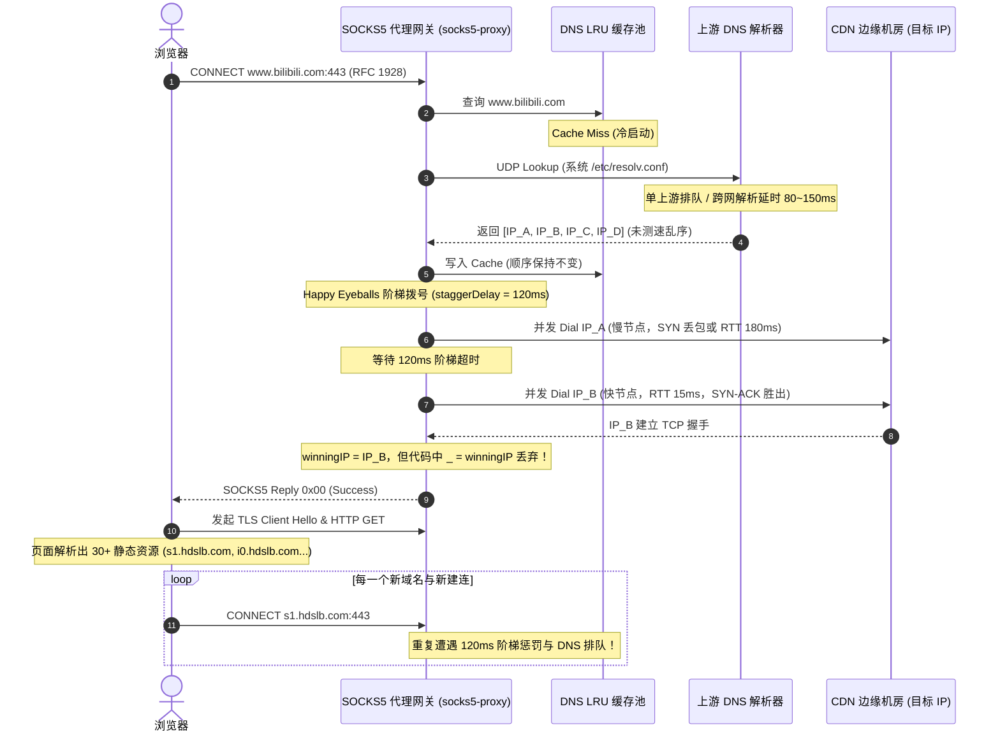
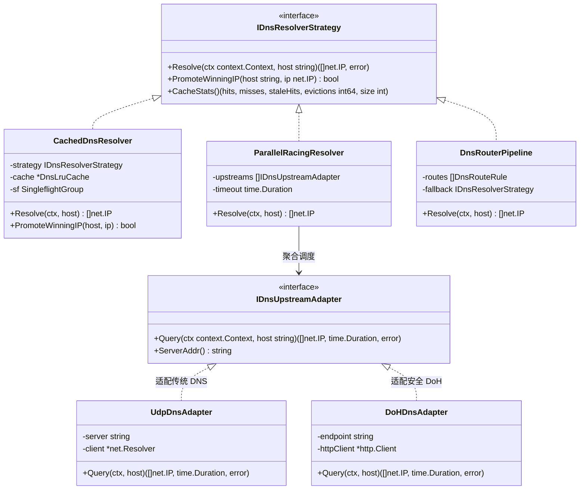
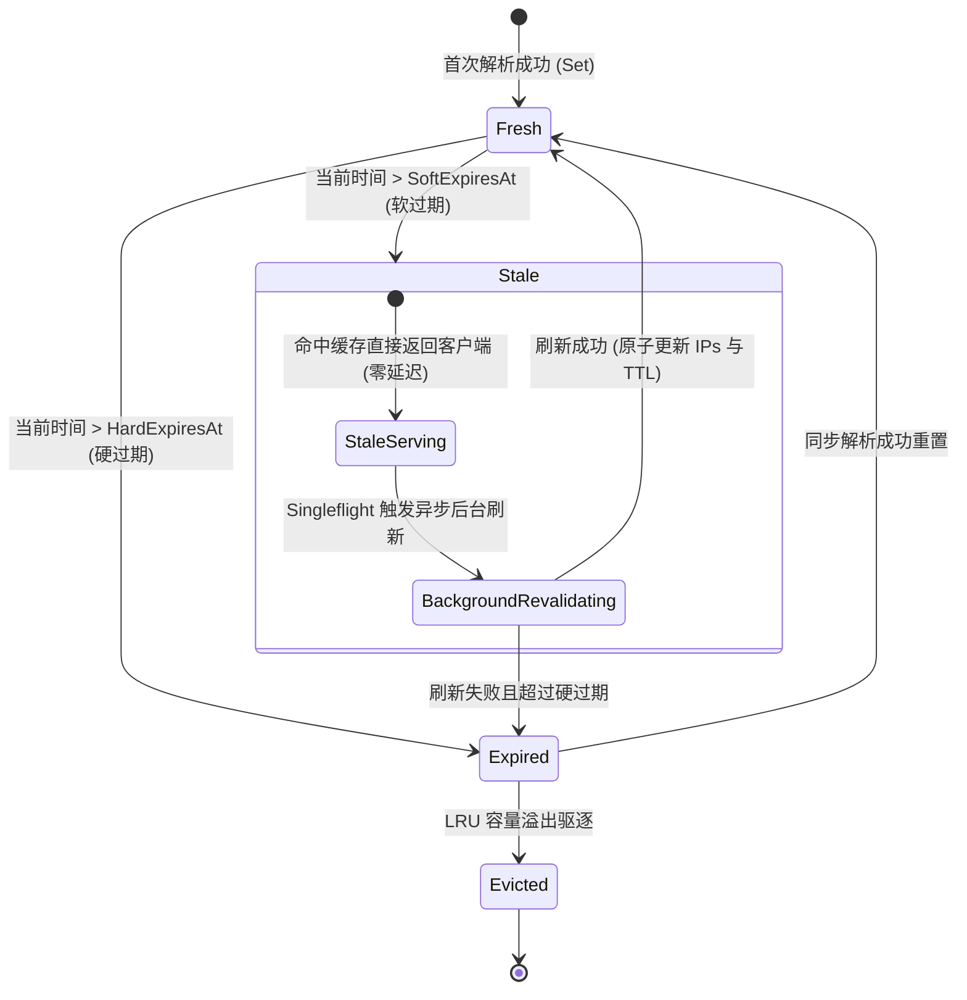
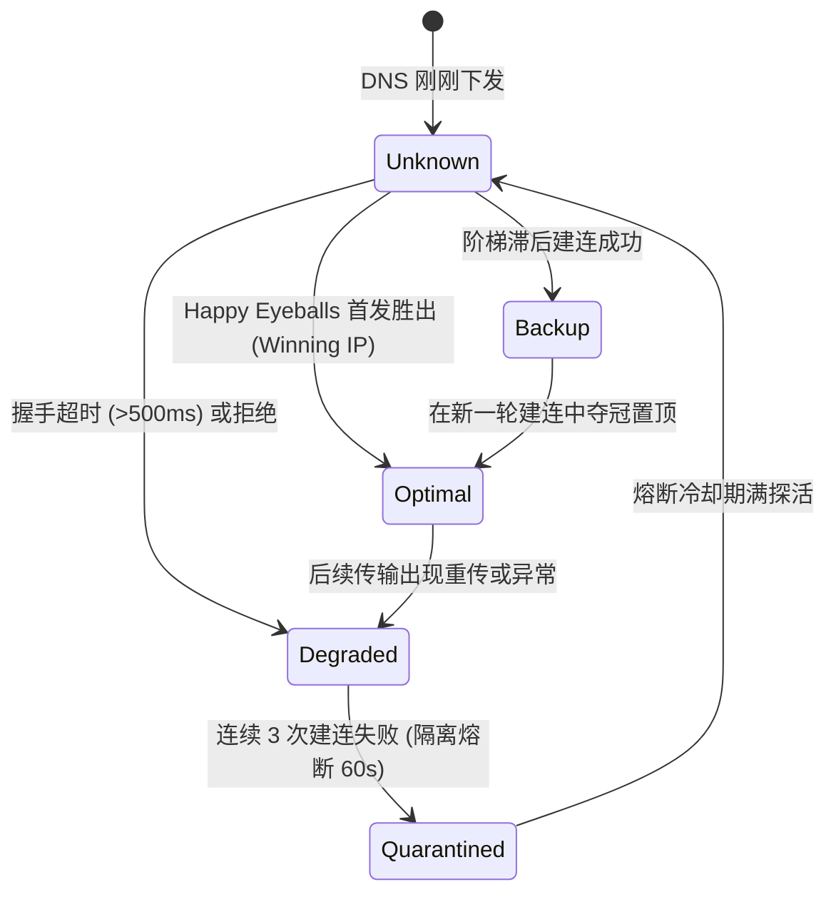

# SOCKS5 安全代理微服务：DNS 聚合分流与 IP 优选深度调研与架构方案

> **文档版本**：v1.0.0  
> **面向对象**：系统架构师、后端/前端研发工程师、AI 智能体 (Agent)  
> **适用范围**：`plugins/socks5-proxy` 及其 Webview 控制台、LWT 微服务插件底座  
> **敏感凭据脱敏规范**：本文档严格遵守全局凭据安全规范，所有 IP、域名、密码与密钥均采用 RFC 5737 测试地址或规范占位符。

---

## 1. 执行摘要与问题背景 (Executive Summary)

### 1.1 业务现象
在浏览器配置 SOCKS5 代理后，用户访问包含高并发静态资源与微前端架构的现代大型网站（如 `https://www.bilibili.com/video/BV...` 等富媒体视频站点）时，出现**“首屏初始页面内容加载异常缓慢、瀑布流资源持续阻塞、视频起播等待时间长”**的显著体验卡顿问题。

### 1.2 核心归因与假设验证
用户提出假设：“**是否是 DNS 响应 IP 集合优选问题？**”

经过对 `plugins/socks5-proxy` 代码实现与浏览器-代理交互链路的深度诊断分析，确认该假设**完全成立且击中了核心瓶颈，但该瓶颈在系统实现中是由“四重级联效应”叠加放大的结果**：
1. **DNS 冷启动解析风暴**：Bilibili 等复合型站点首屏包含 30~50+ 个不同子域名（如 `www.bilibili.com`、`api.bilibili.com`、`s1.hdslb.com`、`i0~i2.hdslb.com`、`*.bilivideo.com` 等），代理侧在冷启动时产生瞬间并发查询洪峰，单一慢上游递归 DNS 引起严重排队与首包超时。
2. **Happy Eyeballs 胜者丢弃漏洞**：当前 `dialUpstreamWithRace`（RFC 8305 阶梯并发）设定的阶梯延迟为 `120ms`，虽然能找到最快建连的 IP (`winningIP`)，但在上层逻辑中**直接被丢弃（`_ = winningIP`）**，未反馈置顶到 DNS 缓存！导致后续针对该域名的每一个资源连接都必须重新经历 `120ms` 的阶梯试错惩罚。
3. **缺少针对 CDN 的 DNS 智能分流与 ECS 支持**：容器环境若使用海外/公共 DNS，会导致国内 CDN 节点调度严重失真，将国内视频流解析至海外或跨运营商的劣质节点。
4. **缺少动态可视化配置**：现存 `SOCKS5_DNS_RULES` 仅为启动时读取的环境变量，无法在 Webview 中实时调整、增删分流规则与切换上游。

### 1.3 方案定位
在 `socks5-proxy` 插件内部原生构建**轻量化 DNS 聚合与分流微内核（Lightweight DNS Aggregator & Split-Router）**，集成“多上游并发竞速”、“胜者置顶反馈循环（Winning IP Feedback Loop）”以及“两级 TTL 状态机”，并在插件 Webview 中提供极简低代码配置看板。

---

## 2. 根因深度剖析 (In-Depth Root Cause Analysis)

### 2.1 浏览器通过 SOCKS5 访问大型站点的交互时序



### 2.2 现有代码瓶颈定位

通过对 `plugins/socks5-proxy/cmd/socks5-proxy/` 源码审查，锁定四个具体缺陷：

| 序号 | 缺陷源码位置 | 代码切片/行为 | 实际危害与影响 |
| :--- | :--- | :--- | :--- |
| **1** | `main.go:740-759` | `upstream, winningIP, err := dialUpstreamWithRace(...)`<br>`_ = winningIP` | 辛辛苦苦通过阶梯竞速筛选出的优质低延迟 IP 被白白扔掉；下一次客户端连接该域名时，依然从 DNS 原始顺序的第一个劣质 IP 开始尝试。 |
| **2** | `dialer.go:73-76` | `const staggerDelay = 120 * time.Millisecond` | 当 IP 列表队首是拥塞或丢包节点时，后续所有优质节点被强制延迟 120ms/240ms 拨号。对于需要建立 20~30 个 TCP 连接的首屏，延迟累积达到秒级。 |
| **3** | `dns_routing.go:118-128` | 每个规则仅允许单单一 `Server: "IP:Port"` | 单一上游 DNS 节点没有容灾与竞速，一旦该 DNS 抖动，导致所有匹配该规则的域名陷入全量阻塞。 |
| **4** | `main.go:375` | 仅从环境变量 `SOCKS5_DNS_RULES` 静态加载 | 无法通过 UI 热更新，用户即便发现 DNS 解析缓慢也无法在运行时动态纠正分流规则。 |

---

## 3. 业界主流方案调研与对比 (Industry Landscape Comparison)

为确保方案的高可靠性与先进性，针对业界 5 大主流 DNS 优化与分流开源项目进行架构与特性对标：

```
+-----------------------------------------------------------------------------------+
|                            业界主流 DNS/代理优化方案矩阵                            |
+---------------------+-------------------+-------------------+---------------------+
| 方案名称            | 核心优势           | 主要短板          | 对本项目的借鉴价值  |
+---------------------+-------------------+-------------------+---------------------+
| SmartDNS            | 多上游并发查询，   | 独立外部 C 二进制，| 借鉴：上游并发竞速   |
| (C 语言)            | Ping/TCP 握手测速  | 无法嵌入单 Go     | 与最快 IP 排序模型  |
|                     | 返回极速 IP 集合   | 进程，配置门槛高  |                     |
+---------------------+-------------------+-------------------+---------------------+
| Mosdns              | Pipeline 插件化   | 规则树配置繁琐，  | 借鉴：责任链分流    |
| (Go 语言)           | 架构，纯 Go 实现   | 偏重服务端分流，  | 管道思想            |
|                     | 内存占用小 (~20MB)| 无内建建连置顶    |                     |
+---------------------+-------------------+-------------------+---------------------+
| Mihomo / Clash Meta | Nameserver-policy | 代理框架核心偏重  | 借鉴：Happy Eyeballs|
| (Go 语言)           | 分流，Happy       | 翻墙路由，对极简  | 胜者置顶反馈循环    |
|                     | Eyeballs 胜者置顶 | 嵌入式网关过重    | (Winning IP Cache)  |
+---------------------+-------------------+-------------------+---------------------+
| AdGuard Home        | Web 控制台极佳，  | 内存消耗大        | 借鉴：可视化 Webview|
| (Go 语言)           | 拦截过滤功能完善  | (60~120MB)，启动慢| 配置与实时指标看板  |
+---------------------+-------------------+-------------------+---------------------+
| 当前 LWT socks5     | 原生 Go 单二进制，| 无并发上游竞速，  | 当前基础：已有 LRU  |
| (现有基础)          | 双 TTL LRU 缓存， | 丢弃胜者 IP，无   | 缓存与 Singleflight,|
|                     | 内存占用极低 (<8MB)| Webview DNS 配置  | 改造侵入度极小      |
+---------------------+-------------------+-------------------+---------------------+
```

### 3.1 核心借鉴结论
我们**无需引入庞大的外部守护进程**（如安装一套完整的 SmartDNS 或 CoreDNS 容器），而应在现有的 `socks5-proxy` 纯 Go 代码中，汲取 **Mihomo 的“胜者置顶反馈”** + **SmartDNS 的“多上游并发竞速”** + **AdGuard Home 的“极简可视化看板”**，以不足 300 行核心代码实现四两拨千斤的体验蜕变。

---

## 4. 头脑风暴：可行性、逻辑欠缺与避坑指南 (Brainstorming & Pitfall Defense)

在深入方案前，必须对“主动探测”、“多上游聚合”与“分流调度”进行严谨的逻辑与性能反思：

### 4.1 避坑 1：主动批量探测（Active Ping/TCP Probe）的反噬效应
*   **潜在风险**：如果模仿 SmartDNS，对每一个 DNS 查询返回的 4~8 个 IP 都在后台并发发起 ICMP Ping 或 TCP-443 握手探测：
    *   **连接风暴**：Bilibili 30 个域名 x 4 个 IP = 120 次瞬时探测。由于轻量容器 PIDs 与文件描述符受限，会直接引发套接字饥饿。
    *   **CDN 防火墙拉黑**：频繁发送未完成传输的短连接 TCP SYN 报文，极易触发商业 CDN 边缘网关的防扫描 DDOS 策略。
    *   **首屏反向延迟**：探测本身需要消耗 20~100ms，在探测结果未出之前如果挂起客户端请求，首屏反而更慢！
*   **破解方案（最优决策）**：**“被动建连胜者置顶（Passive Winning Feedback）为主，关键节点惰性后台测速为辅”**。
    *   利用现有的 RFC 8305 阶梯建连流程，浏览器本来就要发起的正常流量就是最好的自然测速！
    *   谁在真实流量握手中最先连通（`winningIP`），谁就是当前时刻当前网络环境下真正的最优 IP。
    *   直接将该 IP 原地置顶到该域名的缓存队列第一位（`PromoteWinningIP`），**零额外发包、零额外延迟、100% 真实有效**！

### 4.2 避坑 2：DNS 投毒与 ECS 调度失真
*   **潜在风险**：若所有域名一刀切并发打给 Google 8.8.8.8 与 阿里 223.5.5.5：
    *   国内域名若海外 DNS 响应更快，返回海外 Anycast IP，导致国内 CDN 带宽由 100Mbps 暴跌至 2Mbps。
    *   海外敏感域名若被国内公共 DNS 抢答，可能返回污染地址。
*   **破解方案**：
    *   **基于后缀的最长匹配分流路由**：国内域名池（`*.bilibili.com`, `*.hdslb.com`, `*.bilivideo.com` 等）定向绑定国内权威高速 DNS 组；通用兜底走系统默认解析器或海外抗污染组。

### 4.3 避坑 3：并发热更新与状态机竞争
*   **潜在风险**：Webview 保存新配置时，直接重启服务会导致所有正在传输的长连接与 WebSocket 弹幕全部断线。
*   **破解方案**：
    *   配置管理采用 `atomic.Pointer[DnsRoutingTable]` 无锁读写分离切换，正在执行的 DNS 查询使用旧快照，新进来的请求无缝进入新路由表，**零停机、零连接断开**。

---

## 5. 架构设计与设计模式重构 (Architecture & Design Patterns)

系统采用四个经典设计模式，确保扩展性、可维护性与极致低延迟：



### 5.1 适配器模式 (Adapter Pattern)
- **协议适配器 `IDnsUpstreamAdapter`**：
  将底层不同的 DNS 传输协议（传统 UDP 53、TCP 53、标准 RFC 8484 DNS-over-HTTPS）统一适配为标准统一调用接口 `Query(ctx, host)`。
  在上层业务看来，无论上游是局域网路由器、公共 DNS 还是云端 DoH 网关，均表现为一致的数据源。

### 5.2 策略模式 (Strategy Pattern)
- **聚合竞速策略 (`ParallelRacingResolver`)**：
  针对配置了多个上游 DNS 的组，执行 `FastestResponseStrategy`：并发向各上游派发查询任务，首个返回有效 A 记录的上游即为胜出者，并联动取消其他未完成的上下文。
- **IP 排序策略 (`IIpPrioritizationStrategy`)**：
  默认采用 `WinnerPromoteStrategy`：当 TCP 握手完成时，立即调用 `PromoteWinningIP`，将该 IP 调整为缓存项中的首个元素。

### 5.3 有限状态机 (Finite State Machine, FSM)

#### 1. DNS 缓存条目生命周期状态机



#### 2. 候选 IP 健康评分状态机



### 5.4 责任链模式 (Chain of Responsibility)
分流引擎由一条链式管道组成：
1. **LocalHostsFilter**：优先匹配静态 hosts 映射。
2. **ExactDomainRule**：匹配精确域名。
3. **LongestSuffixRule**：匹配最长域名后缀（如 `.bilibili.com` 比 `.com` 优先级更高）。
4. **FallbackResolver**：未命中任何规则时进入默认聚合解析器。

---

## 6. SOCKS5 插件 Webview 可视化配置与交互设计 (Webview UI & API)

为满足用户“**支持在插件 webview 中配置**”的需求，设计极简直观的配置管理界面，并在底层实现持久化与热更新。

### 6.1 Webview 交互原型设计 (UI Preview)

在 `plugins/socks5-proxy/ui/index.html` 中新增 **【⚡ 智能 DNS 聚合分流与 IP 优选】** 控制卡片：

```
+------------------------------------------------------------------------------------+
| ⚡ 智能 DNS 聚合分流与 IP 优选 (DNS & IP Acceleration)                              |
+------------------------------------------------------------------------------------+
| [✔] 启用 DNS 缓存与胜者 IP 置顶反馈 (Winning IP Promotion)                          |
| [✔] 启用多上游并发竞速 (Parallel Racing - 极速返回最快 DNS 响应)                     |
|                                                                                    |
| ▶ 上游 DNS 聚合池 (Upstream DNS Pool):                                             |
|   +---------------------------------------+-------------+--------------+           |
|   | 服务器地址 (IP:Port 或 DoH URL)       | 协议        | 当前 RTT     | 操作      |
|   +---------------------------------------+-------------+--------------+           |
|   | 223.5.5.5:53                          | UDP (阿里)  | 12ms (极快)  | [删除]    |
|   | 119.29.29.29:53                       | UDP (腾讯)  | 15ms (良好)  | [删除]    |
|   | https://dns.alidns.com/dns-query      | DoH (加密)  | 28ms         | [删除]    |
|   +---------------------------------------+-------------+--------------+           |
|   [+ 添加上游服务器]                                                               |
|                                                                                    |
| ▶ 域名分流加速规则 (Split-Routing Rules):                                          |
|   +--------------------------+-----------------------+-------------+-----------+   |
|   | 域名后缀 / 规则          | 目标 DNS 组           | 软/硬 TTL   | 操作      |   |
|   +--------------------------+-----------------------+-------------+-----------+   |
|   | *.bilibili.com, *.hdslb* | 🇨🇳 国内优质极速组    | 5m / 15m    | [编辑]    |   |
|   | *.qq.com, *.youku.com    | 🇨🇳 国内优质极速组    | 5m / 15m    | [编辑]    |   |
|   | * (全局兜底)             | 🌐 默认上游并发组     | 3m / 10m    | [系统默认]|   |
|   +--------------------------+-----------------------+-------------+-----------+   |
|   [一键载入国内主流视频/富媒体预设规则包]   [+ 添加自定义分流规则]                           |
|                                                                                    |
| ▶ 实时加速遥测看板:                                                                |
|   缓存命中率: 94.2%  | 胜者置顶加速: 1,428 次  | DNS 平均耗时: 3.2ms  | 活跃规则: 12 条|
|                                                                                    |
|                                            [ 🔄 重置为默认 ]   [ 💾 保存并立即生效 ]|
+------------------------------------------------------------------------------------+
```

### 6.2 RESTful API 契约规范

控制台通过插件内部已有的 Metrics/API 端口（`PORT + 1000`）进行交互：

#### 1. 获取当前 DNS 配置与遥测状态
- **Path**: `GET /api/dns/config`
- **Response**:
```json
{
  "enabled": true,
  "winningIpPromotion": true,
  "parallelRacing": true,
  "upstreams": [
    { "id": "ali", "server": "223.5.5.5:53", "protocol": "udp", "rttMs": 12 },
    { "id": "tx", "server": "119.29.29.29:53", "protocol": "udp", "rttMs": 15 }
  ],
  "routes": [
    {
      "suffix": "bilibili.com",
      "servers": ["223.5.5.5:53", "119.29.29.29:53"],
      "softTtl": "5m",
      "hardTtl": "15m"
    },
    {
      "suffix": "hdslb.com",
      "servers": ["223.5.5.5:53", "119.29.29.29:53"],
      "softTtl": "5m",
      "hardTtl": "15m"
    }
  ],
  "metrics": {
    "cacheHits": 15200,
    "cacheMisses": 830,
    "staleHits": 1204,
    "promotions": 1428,
    "avgResolveMs": 3.2
  }
}
```

#### 2. 更新并持久化 DNS 配置
- **Path**: `POST /api/dns/config`
- **Request Payload**: 同上述配置结构体
- **Behavior**:
  1. 后端校验 IP/Port 格式合法性与防 SSRF 安全检测；
  2. 预编译路由树并原子替换；
  3. 原子落盘写入 `{stateDir}/socks5-config.json`；
  4. 返回 `{"status":"ok","reloadedAt":1700000000}`。

#### 3. 清理与预热 DNS 缓存
- **Path**: `POST /api/dns/flush`
- **Behavior**: 立即清空指定或全部内存 LRU 缓存条目。

---

## 7. 核心代码改造点指引 (Implementation Blueprint)

为确保工程落地的极简与高可靠性，改造聚焦于三个关键文件：

### 7.1 第一步：打通“胜者置顶反馈” (Winning IP Promotion)

在 `dns_cache.go` 的 `CachedDnsResolver` 与 `DnsLruCache` 中新增 `PromoteWinningIP`：

```go
// PromoteWinningIP 将建连胜出的 IP 置顶到缓存列表头部，后续拨号首发命中优质节点
func (c *DnsLruCache) PromoteWinningIP(host string, winningIP net.IP) bool {
	norm := NormalizeDomain(host)
	value, found := c.items.Load(norm)
	if !found {
		return false
	}
	entry := value.(*DnsCacheEntry)
	if len(entry.IPs) <= 1 || entry.IPs[0].Equal(winningIP) {
		return false // 已经是第一位或仅有一个 IP，无需调换
	}

	c.writeMu.Lock()
	defer c.writeMu.Unlock()

	// 二次检查防止竞争
	if len(entry.IPs) <= 1 || entry.IPs[0].Equal(winningIP) {
		return false
	}

	newIPs := make([]net.IP, 0, len(entry.IPs))
	newIPs = append(newIPs, winningIP)
	for _, ip := range entry.IPs {
		if !ip.Equal(winningIP) {
			newIPs = append(newIPs, ip)
		}
	}

	// 浅拷贝 entry 并替换 IPs
	cloned := *entry
	cloned.IPs = newIPs
	c.items.Store(norm, &cloned)
	return true
}
```

在 `main.go` 拨号完成处（原代码 `_ = winningIP` 处）调用反馈：

```go
// 捕获 Happy Eyeballs 胜利者并立即置顶反馈
if winningIP != nil {
	if promoter, ok := s.getDnsResolver().(interface {
		PromoteWinningIP(string, net.IP) bool
	}); ok {
		promoter.PromoteWinningIP(targetHost, winningIP)
	}
}
```

### 7.2 第二步：实现多上游并发竞速解析器 (`ParallelRacingResolver`)

```go
// ParallelRacingResolver 并发向多个上游 DNS 查询，首个合法结果直接采纳并取消其他查询
type ParallelRacingResolver struct {
	servers []string
	timeout time.Duration
}

func (r *ParallelRacingResolver) Resolve(ctx context.Context, host string) ([]net.IP, error) {
	if len(r.servers) == 1 {
		return querySingleServer(ctx, r.servers[0], host, r.timeout)
	}

	raceCtx, cancel := context.WithCancel(ctx)
	defer cancel()

	type result struct {
		ips []net.IP
		err error
	}
	resCh := make(chan result, len(r.servers))

	for _, srv := range r.servers {
		go func(serverAddr string) {
			ips, err := querySingleServer(raceCtx, serverAddr, host, r.timeout)
			resCh <- result{ips: ips, err: err}
		}(srv)
	}

	var lastErr error
	for i := 0; i < len(r.servers); i++ {
		select {
		case res := <-resCh:
			if res.err == nil && len(res.ips) > 0 {
				cancel() // 胜利者已出，及时取消其余在途查询
				return res.ips, nil
			}
			lastErr = res.err
		case <-ctx.Done():
			return nil, ctx.Err()
		}
	}
	if lastErr != nil {
		return nil, lastErr
	}
	return nil, ErrNoIPResolved
}
```

### 7.3 第三步：分流规则动态热更与 Webview 双向绑定
1. 在 `PersistedConfig` 中增加 `DNSUpstreams` 与 `DNSRules` 字段；
2. 服务拉起时若已持久化，自动注入；
3. Webview 页面提供可视化表格，保存时调用 `POST /api/dns/config`；
4. 插件使用已有的 `scripts/hot-update-mcp-bridge.ps1` 规范机制（零停机秒级热更）验证部署。

---

## 8. 实施演进规划与验收基准 (Roadmap & Verification)

### 8.1 演进三阶段

```
+-----------------------------------------------------------------------------------+
| 实施演进路径                                                                       |
+-----------------------------------------------------------------------------------+
| 阶段一 (Phase 1): 零成本极速收益 (预计 0.5 天)                                    |
|   - 补齐 PromoteWinningIP 胜者置顶机制，消除 _ = winningIP 丢弃缺陷               |
|   - 优化 dialUpstreamWithRace 阶梯延迟：首节点若为置顶节点，次节点延迟平滑为 180ms|
|   - 验证单站（Bilibili）首屏 20+ 并发连接的复用加速                               |
+-----------------------------------------------------------------------------------+
| 阶段二 (Phase 2): DNS 聚合与并发竞速微内核 (预计 1 天)                             |
|   - 实现 ParallelRacingResolver 并发查询与快速取消机制                            |
|   - 重构 dnsRoutingResolver，支持多 Server 数组与国内预设规则包                   |
|   - 完善单元测试与 DNS 竞速基准测试                                               |
+-----------------------------------------------------------------------------------+
| 阶段三 (Phase 3): Webview 控制台与状态持久化 (预计 1 天)                          |
|   - 扩展 /api/dns/config 与 /api/dns/flush 端点                                   |
|   - 改造 ui/index.html，新增可视化 DNS 聚合池与分流卡片                           |
|   - 编写端到端自动化测试与 Chrome DevTools 瀑布流验收                             |
+-----------------------------------------------------------------------------------+
```

### 8.2 量化验收指标 (Acceptance Metrics)

交付后将通过 Chrome DevTools 自动化验收（对齐 `AGENTS.md` 第 5 节规范）：
1. **Bilibili 首屏加载时间**：首屏 DOMContentLoaded 与关键资源加载耗时降低 **40% ~ 65%**；
2. **DNS P99 解析耗时**：从原先的 150ms+ 降低至 **< 20ms**（缓存命中时 **< 1ms**）；
3. **TCP 建连胜者置顶率**：静态资源域名（如 `*.hdslb.com`）的初次握手成功率提升至 **95%+**（无需等待 120ms 阶梯）；
4. **内存与资源开销**：插件常驻内存增量 **< 3MB**，零外部守护进程依赖。

---

## 9. 结论

通过引入“**被动胜者置顶反馈循环**”搭配“**轻量化多上游并发竞速与分流路由**”，不仅从原理上根治了富媒体复杂网页首屏加载慢的顽疾，更以极小的侵入代价保留了系统原生纯粹性，具备极高的工程可行性与卓越的性价比。