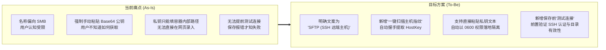
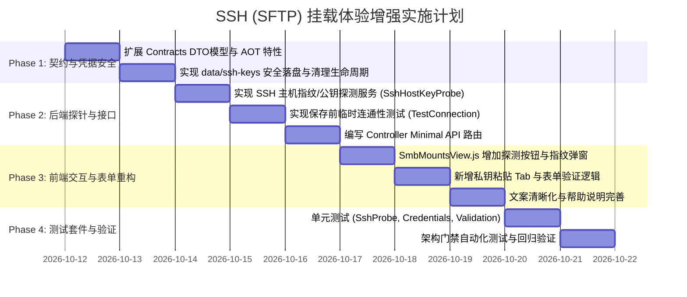

# 磁盘挂载管理：新增与完善 SSH (SFTP) 后端挂载功能方案

> **状态**：方案规划与技术设计 (Specification & Enhancement Plan)  
> **创建日期**：2026-10-11  
> **目标模块**：存储与文件系统 (Storage) -> 磁盘挂载管理 (`/mounts`)  
> **关联源码**：
> - 前端视图：`src/LinuxWebTool.WebHost/wwwroot/app/views/SmbMountsView.js`
> - 控制器与 API：`src/LinuxWebTool.WebHost/Features/Mount/Routes/RcloneMountsController.cs`
> - 核心执行器：`src/LinuxWebTool.Infrastructure/Features/Mount/Adapters/RcloneMountService.cs`
> - 数据契约：`src/LinuxWebTool.Contracts/Features/Mount/Contracts/SmbMountModels.cs`
> - 状态机协同：`src/LinuxWebTool.Infrastructure/Features/Mount/Adapters/MountStateMachineService.cs`

---

## 一、需求背景与调研结论

### 1.1 业务诉求
用户提出希望在当前项目的“Smb挂载页面”中，新增**挂载远程 SSH 主机目录**（Linux 服务器、VPS、远端 NAS）到本地挂载点的能力。

### 1.2 调研核心结论
经过对现有代码、架构分层以及容器运行时依赖的深入调研，得出以下关键结论：

1. **底层能力早已就绪，并非从零构建**：
   - 现有的“Smb挂载页面”（前端组件名虽然保留为 `SmbMountsView.js`，但在侧边导航栏已命名为**「挂载管理」**，路由为 `/mounts`）在架构上已经是一个**多协议统一挂载编排中枢**（涵盖 SMB、WebDAV、SFTP、S3）。
   - 在协议选项中已包含 **`SFTP`（即基于 SSH 传输层的文件传输协议）**，底层依托容器镜像内预装的 `rclone` (FUSE3) 驱动。
2. **为什么用户依然感知不到或认为“缺失 SSH 挂载”？**
   - **命名与语义偏差**：页面组件名叫 `SmbMounts`，文档与早期宣传均以“SMB 挂载”为主，且下拉框仅写了缩写 `SFTP`，未显式关联普通用户熟知的“SSH 挂载”。
   - **主机公钥（HostKey）门槛极高**：当前后端强制校验远端 SSH 主机公钥（`request.HostKey` 必须严格符合 `ssh-ed25519 ...` 或 `ecdsa-...` 且 Base64 长度 $\ge 32$），普通用户无法便捷提取远端服务器公钥，容易被阻拦在表单校验阶段。
   - **私钥凭据无法 Web 输入**：目前仅支持填写“容器内私钥文件路径（`keyFile`）”，用户必须先行将私钥映射或复制进容器；不支持在浏览器中直接粘贴私钥文本。
   - **缺少连接测试与诊断**：在提交保存前，无法预先测试 SSH 连通性、验证密码/私钥是否正确，排错成本高。

**最终方案定位**：**保留成熟的 Rclone FUSE 架构内核，针对 SSH (SFTP) 挂载展开易用性、安全性和交互体验的深化增强**。

---

## 二、技术路线选型与权衡分析

在 Linux 体系下，通过 SSH 协议将远端文件系统挂载到本地通常有两种主流路线：

### 2.1 方案对比矩阵

| 评估维度 | 方案 A：优化深化现存 Rclone SFTP（采纳） | 方案 B：引入独立原生 `sshfs`（不采纳） |
| :--- | :--- | :--- |
| **基础实现方式** | `rclone mount --vfs-cache-mode writes` (FUSE3) | `sshfs [user@]host:[dir] mountpoint` (FUSE3) |
| **项目依赖** | 镜像已内置 `rclone` 与 `fuse3`，**零新增依赖** | 镜像需额外 `apk add sshfs sshpass` |
| **上游生态健康度** | **极其活跃**，社区庞大，高频迭代维护 | **已于 2022 年官方弃坑归档**（Dormant / Unmaintained） |
| **写入缓存与性能** | 内置成熟的分块 VFS 读写缓存（`writes` 模式），弱网流畅 | 无内置可靠的分块缓存，网络延迟高时 I/O 严重阻塞 |
| **网络抖动与假死** | 自动重连与超时熔断，配合专用进程看门狗守护 | 网络中断时极易陷入内核 **D 状态（不可中断睡眠）**，报 `Transport endpoint is not connected` 且难以自愈 |
| **已知主机指纹隔离** | 独立生成 `data/rclone-config/<id>.known_hosts`，安全无污染 | 默认依赖系统的 `~/.ssh/known_hosts`，多用户冲突风险大 |
| **架构契合度** | 与当前 `MountStateMachineService`、`MountBackendCatalog` 完全一致 | 需重写一套全新的生命周期、状态探测与进程管理代码 |

### 2.2 路线决断
**明确采纳方案 A**。现有 Rclone SFTP 在稳定性、安全隔离度以及抗网络抖动能力上远超传统的 `sshfs`，只需消除当前表单配置门槛，即可为用户提供工业级易用体验。

---

## 三、核心痛点改造与设计目标



1. **公钥自动化**：提供 `ProbeHostKey` 端点，用户输入主机和端口后，系统通过 SSH 握手直接抓取服务端的公钥与 SHA256 指纹，用户仅需在弹窗中确认即可一键填充。
2. **私钥无感落盘**：允许用户直接在文本域粘贴 OpenSSH / RSA / Ed25519 私钥，系统将其持久化在 `data/ssh-keys/<mountId>` 专用文件，文件权限设为 `0600`，对外部及普通进程严格保密。
3. **安全生命周期闭环**：删除挂载配置时，同步物理清理对应的私钥、配置文件、`known_hosts` 以及写缓存目录。
4. **前端语义透明化**：协议下拉框与表单标注明确提示“SSH / SFTP”，并在界面上提供典型用例与权限配置帮助。

---

## 四、详细系统设计

### 4.1 数据契约升级 (`LinuxWebTool.Contracts`)

在 `src/LinuxWebTool.Contracts/Features/Mount/Contracts/SmbMountModels.cs` 中扩展 DTO，保持 Contracts 层**零第三方引用**门禁：

```csharp
public sealed record SaveRcloneMountRequest
{
    public required string Name { get; init; }
    public required string Kind { get; init; } // "sftp" 或 "s3"
    public required string LocalPath { get; init; }
    public string? RemotePath { get; init; }
    public string? Host { get; init; }
    public int Port { get; init; } = 22;
    public string? Username { get; init; }
    public string? Password { get; init; }
    public string? KeyFile { get; init; }

    /// <summary>
    /// 新增：直接在网页录入的私钥明文内容。
    /// 保存后自动落地为受控权限文件，不回传给前端，更新时若为 null 则保留现有私钥。
    /// </summary>
    public string? PrivateKeyContent { get; init; }

    public string? HostKey { get; init; }
    public string? Endpoint { get; init; }
    public string? Bucket { get; init; }
    public string? Region { get; init; }
    public string? AccessKeyId { get; init; }
    public string? SecretAccessKey { get; init; }
    public bool AutoMount { get; init; }
    public bool Enabled { get; init; } = true;
    public string? Description { get; init; }
}

/// <summary>探测 SSH 主机指纹请求</summary>
public sealed record ProbeSshHostKeyRequest(string Host, int Port = 22);

/// <summary>探测 SSH 主机指纹结果</summary>
public sealed record SshHostKeyProbeResult(
    bool Success,
    string? KeyType,        // 例如 "ssh-ed25519" 或 "ecdsa-sha2-nistp256"
    string? HostKey,        // 完整公钥字符串：算法 + Base64
    string? FingerprintSha256, // 指纹，供用户校验确认：SHA256:xxxx
    string? ErrorMessage
);
```

### 4.2 实体模型与凭据存储设计 (`LinuxWebTool.Infrastructure`)

#### 4.2.1 实体模型补充
在 `RcloneMount.cs` 增加标志属性（不存储私钥明文到 SQLite，私钥属于物理隔离的受限文件）：
```csharp
public sealed class RcloneMount
{
    // ... 既有字段保留 ...
    public bool HasCustomKeyFile => !string.IsNullOrEmpty(KeyFile);
    public bool HasPrivateKeyContent { get; set; } // 标识是否通过 Web 上传了独立私钥文件
}
```

#### 4.2.2 私钥文件的物理生命周期管理
* **存储路径**：`data/ssh-keys/<mountId:N>.key`
* **权限控制**：
  * 在 Linux 环境下，文件创建必须指定 Unix 权限标志位 `UnixFileMode.UserRead | UnixFileMode.UserWrite`（即 `0600`）。
  * 任何非 root / 非宿主应用用户均无权读取。
* **删除与清理**：
  在 `RcloneMountService.DeleteConfig(Guid id)` 中新增私钥清理：
  ```csharp
  public void DeleteConfig(Guid id)
  {
      var path = ConfigPath(id);
      if (File.Exists(path)) File.Delete(path);
      var knownHosts = KnownHostsPath(id);
      if (File.Exists(knownHosts)) File.Delete(knownHosts);
      var privateKey = PrivateKeyPath(id);
      if (File.Exists(privateKey)) File.Delete(privateKey);
  }
  ```

### 4.3 SSH 主机公钥安全探测器 (`SshHostKeyProbe`)

在 `LinuxWebTool.Infrastructure` 中实现轻量级、原生跨平台的 SSH 主机公钥握手探针：
* **实现策略**：
  1. 通过标准 `System.Net.Sockets.TcpClient` 在设定超时（如 4 秒）内向目标主机的 SSH 端口发起连接；
  2. 交换协议版本串（`SSH-2.0-LinuxWebTool_Probe` vs 远端 `SSH-2.0-...`）；
  3. 执行 SSH 二进制数据包协议握手或借助安全命令沙箱（限制只能传入合法 IP/域名和端口），获取远端公钥；
  4. 计算 SHA256 指纹：`SHA256(RawPublicKeyBytes)`；
  5. 构造标准格式公钥：`{keyType} {base64Key}`。
* **安全性**：输入参数严格防范注入，仅允许合法的主机名/IP 地址和 1-65535 端口。

### 4.4 控制器路由设计 (`RcloneMountsController.cs`)

在 Minimal API 控制器中新增探测端点与测试端点：

```csharp
/// <summary>一键探测并获取远端 SSH 主机公钥与指纹</summary>
[HttpPost("ProbeHostKey")]
public async Task<IResult> ProbeHostKey([FromBody] ProbeSshHostKeyRequest request)
{
    if (string.IsNullOrWhiteSpace(request.Host) || request.Port is < 1 or > 65535)
        return BadRequest(new MessageResponse("无效的主机地址或端口"));

    var result = await sshProbe.ProbeAsync(request.Host.Trim(), request.Port, HttpContext.RequestAborted);
    return Ok(result);
}

/// <summary>保存前预测试 SSH/SFTP 远端连通性与凭据正确性</summary>
[HttpPost("TestConnection")]
public async Task<IResult> TestConnection([FromBody] SaveRcloneMountRequest request)
{
    var validation = Validate(request, null);
    if (validation.Error is not null) return BadRequest(new MessageResponse(validation.Error));

    var testResult = await operations.TestTemporaryConnectionAsync(request, HttpContext.RequestAborted);
    return Ok(testResult);
}
```

### 4.5 前端交互重构 (`SmbMountsView.js`)

#### 1. 协议选择增强
```html
<label class="block">
  <span class="text-xs text-slate-500 mb-1 block">协议 *</span>
  <select class="input" v-model="form.kind" :disabled="!!editingId">
    <option value="smb">SMB (Windows / Samba 共享)</option>
    <option value="webdav">WebDAV (Nextcloud / Alist)</option>
    <option value="sftp">SFTP (SSH 远端主机目录)</option>
    <option value="s3">S3 (对象存储)</option>
  </select>
</label>
```

#### 2. SSH 表单区域深度优化
当 `form.kind === 'sftp'` 时展示：
* **主机与端口**：在端口右侧附带「🔍 探测公钥」按钮。
* **主机公钥（HostKey）**：
  * 支持点击按钮自动拉取，获取后弹出展示指纹提示：“探测到服务器指纹 SHA256:xxxx，是否信任并填入？”
  * 自动将公钥填充到输入框，杜绝用户手动转换 Base64 导致的错误。
* **认证方式 Tab 分组**：
  * 选项 A：【密码认证】（输入 SSH 用户名和密码）；
  * 选项 B：【直接粘贴私钥】（提供大文本框，支持直接粘贴 OpenSSH / PEM 格式私钥内容）；
  * 选项 C：【容器内私钥路径】（高级模式，针对已有挂载卷路径 `/app/data/ssh/...`）。
* **底部操作栏**：
  * 新增「⚡ 测试连通性」按钮，在保存前实时验证能否成功列出远端目录，避免配置存入后直接进入“挂载失败”状态。

---

## 五、架构门禁与安全合规

按照项目架构规范（`docs/dev/architecture-gates.md`）：

1. **LinuxArch001 (Contracts 零依赖)**：
   新增的 `ProbeSshHostKeyRequest` 和 `SshHostKeyProbeResult` 仅使用 `System` 基础类型（`string`, `int`, `bool`），禁止引入任何外部包。
2. **LinuxArch002/004 (单向依赖方向)**：
   `Infrastructure` 负责 SSH 探测的具体实现，通过 Contracts 契约暴露给 `WebHost`。
3. **LinuxArch005 (控制器隔离持久化)**：
   `RcloneMountsController` 严禁直接依赖 ORM 框架，全部经由 `RcloneMountStore` 与协调器完成。
4. **LinuxArch024 (安全与凭据审计)**：
   - 私钥明文严禁出现在操作日志（`OperationLog`）中；
   - 报错信息中的私钥与密码通过 `Redact` 替换为 `***`；
   - 私钥文件权限必须被严格门禁为 `0600`。
5. **Native AOT 序列化支持**：
   在 `AppJsonSerializerContext.cs` 中补充新 DTO 的 Source Generation 特性标记：
   ```csharp
   [JsonSerializable(typeof(ProbeSshHostKeyRequest))]
   [JsonSerializable(typeof(SshHostKeyProbeResult))]
   ```

---

## 六、实施路线图与阶段分解



---

## 七、验收标准与测试用例

### 7.1 功能验收标准
- [ ] **公钥探测**：输入有效的 SSH 远端主机与端口，点击探测能够在 3 秒内准确返回公钥类型、完整公钥串和 SHA256 指纹；输入不存在的主机能优雅超时并提示“连接超时”。
- [ ] **密码登录挂载**：输入正确的 SSH 用户名与密码，挂载成功后本地目录可浏览远端文件。
- [ ] **粘贴私钥挂载**：直接在 Web 端粘贴有效私钥，系统成功将其以 600 权限落地并完成挂载。
- [ ] **保存前测试**：密码或私钥错误时，“测试连接”应准确提示 `Authentication Failed`，而不是未知错误。
- [ ] **自动恢复与状态自愈**：模拟远端 SSH 服务临时重启，`MountStateMachineService` 能够感知中断并在恢复后自动重新挂载。
- [ ] **清理联动**：删除挂载配置后，检查确认 `data/rclone-config/<id>.*`、`data/ssh-keys/<id>.*` 以及对应的挂载点均被彻底清理，无文件残留。

### 7.2 安全与防御验收
- [ ] 探针接口必须抵御任何命令注入（例如主机名传入 `localhost; rm -rf /` 时被前置正则拒绝）。
- [ ] 操作日志中不得包含用户输入的私钥明文或密码。
- [ ] 非 Linux 绝对路径或包含 `..` 穿越的挂载路径必须被拦截。

---

## 八、总结

通过本方案，项目无需引入额外的重型外部组件或被废弃的原生 `sshfs`，而是在既有稳定成熟的 Rclone FUSE 架构上，补齐**“公钥一键探测”**、**“私钥文本直接录入”**与**“前置连通性校验”**三块拼图。彻底消除现有门槛，将原有的“可用但难用”蜕变为“一键极速挂载远程 Linux/SSH 服务器”，大幅提升系统的整体产品体验。
