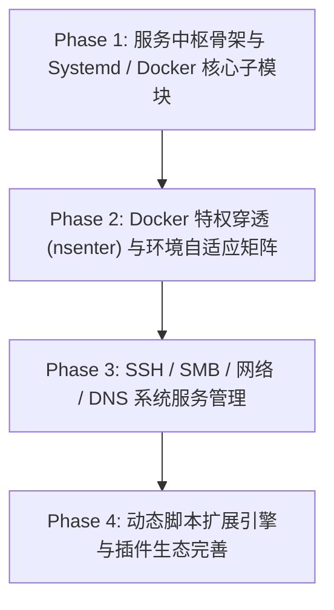

# 系统与服务管理中枢 (Services Hub) 可行性与深度架构方案

## 1. 需求背景与业务目标

随着 LinuxWebTool 在各类私有化部署场景（物理服务器、私有云虚机、家庭 NAS、Docker 容器）中的广泛应用，用户对底层系统资源与服务的控制诉求日益强烈。现有系统的能力主要分布在通用指令、Web 终端和定时任务等离散维度，缺少对**系统核心服务生命周期与底层基础设施配置的集成化管控**。

用户提出了 7 项关键架构诉求：
1. **systemctl 相关服务管理**：systemd 服务的列举、启停、重启、重载、开机自启、查看日志及单元文件。
2. **docker 相关服务管理**：Docker 容器状态、启停控制、实时日志、终端进入、资源统计及镜像管理。
3. **Docker 容器特权穿透**：在 Docker 特权模式（`--privileged`）或挂载特定 socket 时，支持管理宿主机的 systemctl 服务与宿主机 Docker。
4. **扩展服务管理**：系统级网络配置、DNS 解析、SSH 服务与安全策略、Samba 共享、系统防火墙等管理。
5. **动态脚本插件化扩展**：支持通过 Bash、PowerShell、Python、Node.js 脚本动态扩展服务管理工具，允许管理员自定义服务生命周期与配置规范。
6. **单页面 + 功能子模块 (Hub & Sub-Modules)**：避免在系统主导航栏无休止新增菜单项，采用统一「服务中枢」单页面集成承载所有子模块。
7. **环境自适应感知 (Environment-Aware)**：根据操作系统（Linux / Windows / macOS）以及运行形态（物理裸机 / 虚机 / Docker 容器）自动探测并匹配适用的功能子模块，不适用的子模块优雅折叠或显示环境挂载引导。

本文档围绕上述需求进行深度头脑风暴、逻辑可行性分析、性能与安全防范论证，结合设计模式（适配器、策略、状态机、门面），对比业界主流方案，并基于当前系统基础设施给出具体的演进落地路线。

---

## 2. 业界主流方案对比与参考借鉴

| 维度 | Cockpit (Red Hat) | 1Panel / CasaOS | Portainer | Webmin (老牌) | LinuxWebTool Services Hub (规划) |
| :--- | :--- | :--- | :--- | :--- | :--- |
| **systemd 管理** | 基于 D-Bus 原生 IPC，深度集成 journalctl | CLI 进程封装模式，仅支持常用系统服务 | 仅聚焦容器，不支持宿主 systemd | Perl 模块化封装，支持复杂 unit 解析 | **双模适配器**：Linux 下参数化 CLI/D-Bus，容器内采用 **`nsenter` 宿主穿透**，Windows 降级 Windows Services |
| **Docker 管理** | 借助 Podman/Docker 插件 | 原生 Go SDK 连接 docker.sock，支持 Compose 堆栈 | 专注于 Docker Socket API，功能完备且成熟 | 第三方模块，功能简陋且更新慢 | **轻量原生 HTTP Client**：通过 Unix Socket/Named Pipe 直连 Docker Daemon，零第三方重量级依赖，支持 Native AOT |
| **容器穿透宿主** | 不支持容器化部署管理宿主 | 挂载 `/var/run/docker.sock` 管理 Docker，不穿透 systemctl | 仅挂载 docker.sock 管理容器 | 传统裸机部署，极少容器化 | **全面穿透**：`-v docker.sock` 直管宿主 Docker；`--privileged --pid=host` + `nsenter` 直管宿主 systemctl |
| **扩展服务管理** | 包含 NetworkManager、防火墙、存储 | 侧重应用商店应用管理，网络与 SSH 配置较弱 | 无网络/系统配置支持 | 模块覆盖极其全面（SSH/Samba/DNS/Postfix） | **核心网络/SSH/SMB 深度配置**：带语法校验（`sshd -t` / `testparm`）与备份回滚事务保证 |
| **动态插件扩展** | JS 插件机制，依赖 Cockpit SDK，门槛高 | 支持自定义 App 模板 (Docker Compose)，无法定义底层系统服务 | 仅支持自定义模板 | Perl 脚本扩展，技术栈陈旧 | **多运行时契约扩展**：支持 Bash / PowerShell / Python / Node 脚本钩子 + JSON 表单清单定义，动态热插拔 |
| **导航与交互体验** | 左侧导航栏层级较深，随着插件增多变长 | 现代化卡片流，但多层级菜单跳转繁琐 | 专业容器控制台，无系统级管理 | **侧边栏严重爆炸**（上百个菜单项堆叠，寻找极其困难） | **统一服务中枢 (Services Hub)**：主菜单仅占 1 项，内部采用分类二级导航/卡片中枢，环境动态过滤 |
| **跨平台环境感知** | 仅支持 Linux | 仅支持 Linux | 支持 Linux/Windows/macOS | 主要针对 Unix/Linux | **全矩阵环境感知**：根据 OS、架构与容器挂载环境自动启用/隐藏子模块并提供安装挂载引导 |

---

## 3. 核心功能深度头脑风暴与可行性分析

### 3.1 systemctl 相关服务管理

#### 核心能力矩阵
1. **服务检索与过滤**：支持按服务类型（`.service`）、运行状态（Active / Inactive / Failed）、启动策略（Enabled / Disabled / Masked）进行高精度组合过滤与关键字模糊搜索。
2. **生命周期操作**：启动（`start`）、停止（`stop`）、重启（`restart`）、重载配置（`reload`）、启用开机自启（`enable`）、禁用开机自启（`disable`）、屏蔽/解屏蔽（`mask`/`unmask`）。
3. **单元详情与 Unit 文件查看**：展示 `Description`、`Loaded`、`MainPID`、`MemoryCurrent`、`TasksCurrent`，并支持直接读取 `/etc/systemd/system/` 或 `/usr/lib/systemd/system/` 下的 unit 文本定义。
4. **日志追踪 (journalctl 集成)**：拉取该服务的最近标准输出与错误日志（`journalctl -u <service> -n 100 --no-pager`），并支持时间段筛选。

#### 逻辑与性能瓶颈头脑风暴
- **性能挑战 1：全量服务查询性能**
  - Linux 系统通常有上百甚至上千个 systemd units，执行 `systemctl list-units` 如果解析过慢会导致页面卡顿。
  - **解决方案**：针对现代 systemd（v248+），优先使用 `systemctl list-units --type=service --all -o json`，单次获取结构化数据；老旧系统使用管道格式化提取；后端增加采样缓存（TTL = 3s），避免并发高频刷新导致 CPU 尖刺。
- **性能挑战 2：日志阻塞与内存溢出**
  - 使用 `journalctl` 时若未限制行数或未加 `--no-pager`，会导致进程挂起（进入 less/more 分页器）或拉出数万行日志冲垮内存。
  - **解决方案**：强制注入 `--no-pager -n 200`，严格限定返回行数，并支持游标式历史分页。
- **安全边界防御**：
  - 严禁对核心关键系统服务（如 `dbus.service`、`systemd-journald.service`、`ssh.service` 正在连接时）在毫无提示的情况下执行高危破坏性操作；前端设立二次强确认弹窗，并对关键基础设施标注保护标识。

---

### 3.2 Docker 相关服务管理

#### 核心能力矩阵
1. **容器全生命周期管理**：
   - 列表展示：容器名、镜像、运行状态（Up / Exited / Restarting / Paused）、端口映射、创建时间、网络模式。
   - 动作控制：Start, Stop, Restart, Pause, Unpause, Kill, Remove（支持带数据卷删除 `-v`）。
2. **实时性能监控 (Docker Stats)**：
   - 实时采集各容器的 CPU 占用率、内存占用与限额、网络流量 IO、块设备读写 IO。
3. **容器日志与动态控制台**：
   - 日志拉取（Tail / Follow 流式传输）；
   - Web 终端直连：基于已有 WebSocket PTY 机制，通过 `docker exec -it <container_id> /bin/sh`（或 `/bin/bash`）直接打开网页交互式终端。
4. **镜像与 Compose 堆栈管理**：
   - 本地 Docker 镜像列表展示、镜像拉取、未用镜像清理（Prune）；
   - Docker Compose 堆栈识别与基于项目的批量启停。

#### 底层技术选型：原生轻量客户端 vs 第三方 SDK
- **痛点分析**：引入重量级第三方库（如 `Docker.DotNet`）会导致：
  1. 引入上百个未充分适配的依赖模型，严重违背本工程的 `<IsAotCompatible>true</IsAotCompatible>`（Native AOT 裁剪可能导致运行时异常）；
  2. 依赖项升级受限，代码体积膨胀。
- **创新方案（Native AOT 友好之原生 SocketsHttpHandler）**：
  - Docker Daemon 本质上是标准的 HTTP 1.1 REST API（监听在 Unix Domain Socket `/var/run/docker.sock` 或 Windows 命名管道 `\\.\pipe\docker_engine`）。
  - .NET 原生提供的 `SocketsHttpHandler.ConnectCallback` 可以零额外包支持连接 Unix Domain Socket 与 NamedPipeClientStream！
  - 配合静态源码生成的 `System.Text.Json` 序列化上下文，实现：
    - **零第三方依赖**；
    - **100% Native AOT 兼容**；
    - **极致内存效率与性能**（响应时间毫秒级）。

---

### 3.3 Docker 容器特权模式下管理宿主 systemctl 与宿主 Docker

当用户把 LinuxWebTool 部署在 Docker 容器内部时，传统方式由于容器命名空间（Namespaces）和控制组（Cgroups）的隔离，容器内部无法直接看到宿主机的服务。

```
                    ┌────────────────────────────────────────────────────────┐
                    │               Host Operating System                    │
                    │  ┌─────────────────────────┐  ┌─────────────────────┐  │
                    │  │      systemd (PID 1)    │  │    dockerd daemon   │  │
                    │  └───────────▲─────────────┘  └──────────▲──────────┘  │
                    │              │                           │             │
                    │       nsenter 穿透              /var/run/docker.sock   │
                    │              │                           │             │
                    │  ┌───────────┴───────────────────────────┴──────────┐  │
                    │  │          LinuxWebTool Docker Container           │  │
                    │  │  (--privileged --pid=host -v /var/run/docker.sock│  │
                    │  │  ┌────────────────────────────────────────────┐  │  │
                    │  │  │       HostEnvironmentDetector              │  │  │
                    │  │  │  [DockerSocketAdapter] [NsenterHostAdapter] │  │  │
                    │  │  └────────────────────────────────────────────┘  │  │
                    │  └──────────────────────────────────────────────────┘  │
                    └────────────────────────────────────────────────────────┘
```

#### 1. 管理宿主 Docker 服务：Unix Socket 映射机制
- **原理与可行性**：
  - 启动容器时挂载宿主机 Docker Unix Socket：`-v /var/run/docker.sock:/var/run/docker.sock`。
  - 容器内的程序只要与挂载的 `/var/run/docker.sock` 通信，发送的 Docker API 命令便直接由宿主机 Docker Daemon 处理。
  - **可行性**：100% 可行，属于 Docker 生态管理工具（如 Portainer、Watchtower、1Panel）的工业标准。

#### 2. 管理宿主 systemctl 服务：特权模式与命名空间穿透 (Namespace Piercing)
在普通容器中，PID 1 是容器主进程，执行 `systemctl` 会报 `System has not been booted with systemd as init system (PID 1). Can't operate.`。
通过特权挂载有三种方案，分析对比如下：

| 方案 | 容器启动参数要求 | 执行机制 | 稳定性与兼容性 | 推荐程度 |
| :--- | :--- | :--- | :--- | :---: |
| **方案 A：`nsenter` 宿主穿透** | `--privileged --pid=host` | `nsenter -t 1 -m -u -i -n systemctl <action> <service>` | 极高：直接进入宿主 PID 1 的环境运行，使用宿主自带的 systemctl 与库 | **强烈推荐 (首选)** |
| **方案 B：D-Bus Socket 挂载** | `-v /var/run/dbus/system_bus_socket:... -v /run/systemd/system:...` | 在容器内执行 systemctl 并指定 `--host` 或通过 D-Bus 通信 | 中等：要求容器内 systemd 版本与宿主机匹配，库依赖易缺失 | 备用降级 |
| **方案 C：挂载根文件系统 chroot** | `-v /:/host:ro` + 读写隔离 | `chroot /host systemctl ...` | 低：缺少 PID/IPC 空间映射，D-Bus 通信经常被内核拒绝 | 不推荐 |

- **`nsenter` 宿主穿透技术深度解析**：
  - 当容器具备 `--privileged` 且共享宿主 PID 命名空间 `--pid=host` 时，容器内可以看到宿主机的真实 PID 1 进程（即宿主 systemd）。
  - 执行 `nsenter -t 1 -m -u -i -n -- systemctl status ssh` 时：
    - `-t 1`：锁定目标为 PID 1（宿主 systemd）；
    - `-m`：进入宿主机挂载点命名空间（看到宿主完整文件系统与 `/run/systemd/private`）；
    - `-u`：进入宿主机 UTS 命名空间（主机名与域名一致）；
    - `-i`：进入宿主机 IPC 命名空间（信号量与消息队列互通）；
    - `-n`：进入宿主机网络命名空间（网络完全透传）。
  - **最终效果**：在容器内发起的管理指令，执行效果等同于在宿主机物理机 root 终端敲击命令，完美管理宿主机的所有 systemd 单元与 journalctl 日志！

---

### 3.4 其它扩展服务管理（SSH、SMB、网络、DNS、防火墙）

除了 systemd 和 Docker 之外，系统运维中最高频且最具痛点的 5 类服务应作为原生子模块纳入服务中枢：

#### 1. OpenSSH 服务与配置管理
- **服务状态**：实时监控 `sshd` 服务运行状态；
- **配置项可视化维护 (`/etc/ssh/sshd_config`)**：
  - 核心参数：SSH 监听端口（Port）、禁止 Root 远程密码登录（PermitRootLogin）、公钥认证开关（PubkeyAuthentication）、密码认证开关（PasswordAuthentication）；
  - **语法安全检测与事务机制**：修改前自动创建带时间戳的备份文件；写入新配置前先执行 `sshd -t -f /path/to/candidate.conf` 校验语法，若校验不通过立即终止并提示语法错误，绝不允许错误配置生效导致用户被锁在服务器外！
- **免密公钥管理 (`~/.ssh/authorized_keys`)**：
  - 可视化列表展示已添加的公钥（指纹、算法、备注、添加时间）；
  - 支持一键添加客户端公钥或吊销老旧公钥。

#### 2. Samba / SMB 服务端配置管理
- **服务状态**：监控 `smbd`、`nmbd` 服务状态；
- **共享文件夹管理 (`/etc/samba/smb.conf`)**：
  - 维护各个共享块（Share Section）：共享名称、物理路径、只读/读写开关（`read only`）、访客访问权限（`guest ok`）、可用用户列表（`valid users`）；
  - **语法检测**：修改后通过 `testparm -s` 校验合法性；
  - 与现有客户端挂载模块形成闭环：左侧是服务端共享管理，右侧是远程/局域网挂载消费。

#### 3. 网络接口与网卡配置 (Network Interfaces)
- **网卡与 IP 拓扑**：
  - 调用 `ip -j addr`、`ip -j link`、`ip -j route` 解析物理网卡、虚拟网卡（Docker、EasyTier、WireGuard 等）的 IP/掩码、MAC 地址、MTU、上下行状态及默认路由网关；
- **网络管理器适配**：
  - 识别当前系统的网络栈：Ubuntu Netplan、RHEL/CentOS NetworkManager (`nmcli`) 或传统 `interfaces`；支持查看当前网卡配置详情。

#### 4. DNS 解析配置 (DNS Resolver)
- **配置读取与诊断**：
  - 读取当前 Nameserver 列表（来自 `/etc/resolv.conf` 或 `systemd-resolved` 的 `resolvectl status`）；
  - 提供 DNS 解析连通性与时延测试（测试解析常用域名并计算响应耗时）。

#### 5. 系统防火墙管理 (Firewall)
- **后端自动适配**：自动探测当前启用的防火墙工具（UFW / Firewalld / Iptables / Nftables）；
- **核心操作**：防火墙总开关状态、当前开放端口规则列表、一键放行新端口（TCP/UDP）、移除过期端口规则。

---

### 3.5 动态脚本扩展服务管理工具（Script-Driven Extension Engine）

为了避免随着业务发展，不断在代码中硬编码添加新的非标服务，必须引入**基于契约规范的动态脚本扩展引擎 (Dynamic Script Extension Engine)**。

#### 1. 扩展包目录结构规范
管理员在系统数据目录 `/data/services/extensions/<extension_id>/`（或通过 UI 导入 zip 包）放置以下结构：

```text
/data/services/extensions/frp-server/
├── manifest.json            # 扩展清单文件（元数据、表单字段、能力声明）
├── icon.svg                 # 图标（可选）
├── hooks/
│   ├── status.sh            # 状态检查钩子（Linux）
│   ├── status.ps1           # 状态检查钩子（Windows）
│   ├── start.sh             # 启动服务
│   ├── stop.sh              # 停止服务
│   ├── restart.sh           # 重启服务
│   ├── config_get.sh        # 读取当前配置
│   ├── config_set.sh        # 保存新配置
│   └── logs.sh              # 拉取最新日志
```

#### 2. `manifest.json` 契约定义
```json
{
  "id": "frp-server",
  "name": "FRP 服务端 (frps)",
  "category": "network",
  "version": "1.0.0",
  "author": "Admin",
  "description": "高性能内网穿透服务端核心进程",
  "supportedPlatforms": ["linux", "windows"],
  "capabilities": {
    "lifecycle": true,
    "config": true,
    "logs": true
  },
  "configForm": [
    {
      "field": "bind_port",
      "label": "服务端监听端口",
      "type": "number",
      "default": 7000,
      "required": true
    },
    {
      "field": "auth_token",
      "label": "连接鉴权 Token",
      "type": "password",
      "required": false
    }
  ],
  "runtime": {
    "linux": { "runner": "bash", "statusScript": "hooks/status.sh" },
    "windows": { "runner": "powershell", "statusScript": "hooks/status.ps1" }
  }
}
```

#### 3. 多运行时执行调度分发器 (Runner Dispatcher)
系统内置多语言脚本分发引擎：
- **Bash 脚本 (`.sh`)**：复用现有的 `IShellExecutor`，Linux 下执行 `/bin/bash`，Windows 开发环境自动探测 Git Bash；
- **PowerShell 脚本 (`.ps1`)**：Windows 平台执行 `powershell.exe -ExecutionPolicy Bypass -File ...`，Linux 平台若探测到 `pwsh` 则调度执行；
- **Python 脚本 (`.py`)**：检测宿主机是否有 `python3` / `python`；
- **Node.js 脚本 (`.js`)**：检测宿主机是否有 `node`；
- **安全沙箱与超时防护**：每个钩子执行受全局超时限制（默认 10s），标准输出按 JSON 契约规范解析；若钩子异常崩溃，自动捕获并标记服务为 `Unknown`，杜绝卡死宿主线程。

---

### 3.6 单页面 + 功能子模块 (Services Hub) 交互设计

#### 1. 痛点：杜绝侧边栏无限膨胀与视听疲劳
- 当前系统左侧/顶部导航已有概览、运维控制（远程主机/终端/指令/工作流/定时/系统监控）、存储与媒体、网络与穿透、安全与审计等大类。
- 如果将 systemd、docker、ssh、smb、network、dns、防火墙以及后续几十个自定义插件都在导航栏添加一项，将重蹈 Webmin 导航臃肿灾难。

#### 2. 交互解决方案：服务运维中枢 (`/services`)
在主导航「运维控制」组下仅新增一个一级入口：**服务运维 (Services)**。
进入 `/services` 页面后，界面架构分为三个核心区域：

```
┌──────────────────────────────────────────────────────────────────────────────────┐
│ Services Hub  [🔍 快速搜索服务...]  [环境: 🐧 Linux (BareMetal) | Docker Socket ✅] │
├──────────────────────────┬───────────────────────────────────────────────────────┤
│ 📂 子模块分类导航树      │ 🖥️ 子模块工作视窗 (Active Module Canvas)              │
│                          │                                                       │
│ ▾ 基础运行引擎           │  [服务管理: Docker 容器服务]                           │
│   🐳 Docker 容器 (8) ●   │  [▶ 启动] [⏹ 停止] [🔄 重启] [➕ 新建] [🔍 筛选容器]  │
│   ⚙️ Systemd 服务 (124)● │ ┌───────────────────────────────────────────────────┐ │
│ ▾ 系统与网络服务         │ │ 容器名称   镜像           状态     端口        操作   │ │
│   🔒 OpenSSH 服务 ●      │ │ nginx-gw   nginx:alpine   🟢 运行  80->8080   ...   │ │
│   📁 Samba 共享 ●        │ │ redis-app  redis:7        🟢 运行  6379->6379 ...   │ │
│   🌐 网络与网卡          │ │ mysql-db   mysql:8        ⚪ 停止  -          ...   │ │
│   🛡️ 系统防火墙          │ └───────────────────────────────────────────────────┘ │
│ ▾ 动态扩展服务           │ ┌─ 实时控制台 / 容器日志 ─────────────────────────┐ │
│   🔌 FRP 服务端 ●        │ │ [10:20:01] Worker process started successfully... │ │
│   ➕ 导入扩展插件        │ └─────────────────────────────────────────────────┘ │
└──────────────────────────┴───────────────────────────────────────────────────────┘
```

#### 3. 深度链接与快捷切换
- 支持 URL Query 深度链接：`/services?module=docker`、`/services?module=systemd`、`/services?module=ssh`，便于从仪表盘或其他页面直接跳转对应子模块。
- 移动端窄屏自适应：屏幕宽度 $\le 768px$ 时，左侧导航自动收起，以顶部网格卡片（Grid Hub）形式呈现各个子模块，点击后滑入模块详情视图并提供「‹ 返回服务中枢」导航头。

---

### 3.7 根据系统环境动态自适应匹配 (Environment-Aware Adaptive Matrix)

#### 1. 系统环境探测模型
后端暴露 `GET /api/services/hub/environment` 接口，在前端初始化时返回完整的宿主环境画像：

```json
{
  "os": "Linux",
  "platform": "Unix",
  "is64Bit": true,
  "executionMode": "DockerContainerPrivileged",
  "hasSystemd": true,
  "systemdPierced": true,
  "hasDocker": true,
  "dockerEndpointType": "UnixSocket",
  "hasSshd": true,
  "hasSamba": true,
  "networkStack": "NetworkManager",
  "availableRunners": ["bash", "python3"]
}
```

#### 2. 自适应决策矩阵 (Decision Matrix)

| 场景 | systemctl 子模块表现 | Docker 子模块表现 | 扩展插件表现 |
| :--- | :--- | :--- | :--- |
| **Linux 物理机/虚机裸机** | 完整可用（本地原生 systemd） | 完整可用（检测 local docker.sock） | 支持 Bash / Python / Node 插件 |
| **Linux Docker (特权 `--privileged --pid=host`)** | 完整可用（标记为「宿主机 Systemd 穿透」） | 完整可用（挂载 `/var/run/docker.sock`） | 完整可用 |
| **Linux Docker (普通非特权)** | 提示不可用，显示「如何开启宿主特权穿透」命令说明卡片 | 若挂载 socket 则可用，若未挂载则引导挂载参数 | 仅支持容器内局部命令 |
| **Windows 宿主开发环境** | 自动平滑转换为 **Windows 系统服务 (Services)** | 连接 `\\.\pipe\docker_engine` 或提示 Docker Desktop | 支持 PowerShell / CMD / Node 插件 |
| **macOS 开发环境** | 转换为 launchd 或提示不受支持 | 连接 Docker Desktop for Mac | 支持 Bash / Python 插件 |

这种机制保证了系统在任何环境下都能保持高健壮性与自解释性，绝不会因为缺少宿主环境而报错白屏。

---

## 4. 架构设计与软件工程设计模式落地

为了保证服务中枢的可维护性、可测试性以及对 Native AOT 的完全兼容，采用以下经典设计模式进行重构与抽象：

### 4.1 适配器模式 (Adapter Pattern)
针对不同环境下的服务抽象出统一的 `IServiceManagerAdapter` 契约：

```csharp
public interface IServiceManagerAdapter
{
    string ModuleId { get; }
    string DisplayName { get; }
    Task<ServiceHealthStatus> ProbeHealthAsync(CancellationToken ct = default);
    Task<IReadOnlyList<UnifiedServiceItem>> ListServicesAsync(ServiceFilterCriteria criteria, CancellationToken ct = default);
    Task<ServiceOperationResult> ExecuteActionAsync(string serviceId, ServiceLifecycleAction action, CancellationToken ct = default);
    Task<string> GetLogsAsync(string serviceId, int tailLines, CancellationToken ct = default);
}
```

- **实现类族**：
  - `NativeSystemdServiceAdapter`：直接在本地宿主执行 systemctl；
  - `NsenterPiercingSystemdServiceAdapter`：在特权 Docker 容器中通过 nsenter 穿透执行；
  - `WindowsServiceAdapter`：在 Windows 系统上调用 Win32 / SC 服务 API；
  - `NativeDockerEngineAdapter`：通过 Unix Domain Socket 直连 Docker Daemon；
  - `DynamicScriptExtensionAdapter`：针对自定义脚本插件的通用动态适配器。

### 4.2 策略模式 (Strategy Pattern)
针对宿主环境穿透与不同平台脚本执行，抽象 `IHostExecutionStrategy`：
- `BareMetalExecutionStrategy`：本地直接启动子进程；
- `NsenterHostBreakoutStrategy`：拼接 `nsenter -t 1 -m -u -i -n -- ...` 参数化传递；
- `Win32ExecutionStrategy`：Windows 原生环境调度。

针对各类服务配置文件的读写解析，抽象 `IConfigFileStrategy`：
- `IniConfigStrategy`：用于解析 systemd unit、smb.conf；
- `KeyValueConfigStrategy`：用于解析 sshd_config；
- `JsonConfigStrategy`：用于解析插件 manifest 和 docker daemon.json。

### 4.3 状态机模式 (State Machine Pattern)
每个服务单元在系统内部维护规范的四态生命周期状态机：
$$\text{Stopped} \underset{\text{Stop}}{\overset{\text{Start}}{\rightleftharpoons}} \text{Starting} \rightarrow \text{Running} \underset{\text{Reload}}{\overset{\text{Restart}}{\rightleftharpoons}} \text{Running}$$
并在异常时转移至 `Degraded` 或 `Failed`。状态机统一裁决前端按钮的可点击状态，并在状态跃迁过程中防止用户重复并发触发相同动作。

### 4.4 门面模式 (Facade Pattern)
定义 `ServicesHubOrchestrator` 作为后端业务网关门面，统一接收前端请求：
- 统一聚合所有可用适配器的运行状态；
- 统一分发生命周期指令，记录操作审计日志；
- 统一做环境安全边界拦截。

---

## 5. 潜在技术风险、边界约束与防御方案

1. **配置破坏风险 (Misconfiguration Lockout)**：
   - **风险**：用户通过 Web 页面修改 `sshd_config`（如将端口改为被占用的端口，或误关密码且无密钥），可能导致服务器 SSH 彻底失联。
   - **防御策略**：
     - **预编译检测**：强制执行 `sshd -t -f <candidate>` 语法预校验；
     - **事务性副本**：永远保留原始文件的历史备份（如 `sshd_config.bak.20261031_070000`）；
     - **自愈回滚机制**：重启 sshd 后发起内部端口拨测；若拨测失败，自动重载上一份安全配置。
2. **Docker 特权逃逸与容器安全性 (Privileged Container Security)**：
   - **风险**：特权容器具备宿主 root 权限，脚本注入可能导致宿主被黑客勒索。
   - **防御策略**：
     - 服务中枢接口必须受系统最高等级 JWT / API Key 保护；
     - 扩展脚本目录仅限管理员本地置入，严禁通过未经鉴权的公网接口任意上传可执行二进制；
     - 所有输入参数经过严格的参数列表化隔离（避免 `bash -c "cmd $user_input"` 字符串拼接注入）。
3. **高频状态采样拖垮系统 CPU (Polling Spikes)**：
   - **风险**：若前端每秒轮询数百个 systemd 服务或高频执行 `docker stats`，会引发可观的上下文切换开销。
   - **防御策略**：
     - 后端采用**单次在途缓存 (Single-Flight In-Flight Cache)** 与 3 秒滑动窗口缓存；
     - 日志输出优先采用长连接或分片游标获取，不进行全量轮询。

---

## 6. 分阶段落地实施路线图 (Implementation Roadmap)



### 阶段一：服务中枢骨架与 Systemd / Docker 核心子模块
- [ ] 创建前端服务中枢视图 `ServicesHubView.js`，包含左侧分类二级导航与右侧通用模块承载视窗；
- [ ] 后端实现轻量化原生 `DockerEngineClient`（基于 `SocketsHttpHandler`，直连 Docker Socket，Native AOT 兼容）；
- [ ] 实现 `SystemdServiceAdapter`，支持本地 Linux 环境下的 systemctl 状态查询与常用控制；
- [ ] 前端实现容器管理列表、日志查看与 systemd 服务启停。

### 阶段二：Docker 宿主穿透 (nsenter) 与环境自适应感知矩阵
- [ ] 实现 `ServiceEnvironmentDetector`，开机及请求时自适应探测 OS、Docker Socket、nsenter 宿主机穿透能力；
- [ ] 实现 `NsenterPiercingSystemdServiceAdapter`，使部署在 Docker 容器内的 LinuxWebTool 能透明管理宿主机的 systemctl 与 journalctl；
- [ ] 前端根据环境画像动态展示对应标签，并在缺少挂载时提供一键复制的 `docker run` / `docker-compose.yml` 引导。

### 阶段三：SSH / SMB / 网络 / DNS 系统级服务精细化管理
- [ ] 增加 OpenSSH 子模块：支持 `sshd_config` 参数安全编辑、`sshd -t` 语法检测、免密公钥管理；
- [ ] 增加 Samba 共享子模块：支持 `smb.conf` 共享段维护与 `testparm` 校验；
- [ ] 增加网络与 DNS 子模块：网卡 IP/路由拓扑感知与 resolv.conf 解析测试；
- [ ] 完善操作前历史备份与回滚事务链。

### 阶段四：动态脚本扩展引擎与插件规范落地
- [ ] 制定扩展包清单与钩子规范（`manifest.json` + `hooks/`）；
- [ ] 实现 `DynamicScriptExtensionAdapter`，支持多运行时调度（Bash / PowerShell / Python / Node）；
- [ ] 前端提供扩展插件安装、动态表单渲染与自定义服务控制台；
- [ ] 编写测试套件与安全门禁，确保架构稳定性。

---

## 7. 结论

本方案全面解答了用户提出的 7 项需求，从理论可行性、架构扩展性、性能与安全防范、设计模式应用以及分阶段实施等维度进行了完整论证：
1. **统一单页面中枢交互**避免了导航栏菜单项爆炸；
2. **轻量化原生 Docker 客户端**免去了庞大第三方 SDK 的困扰，天然兼容 Native AOT；
3. **`nsenter` 宿主穿透策略**完美攻克了 Docker 特权容器管理宿主机 systemd 的核心痛点；
4. **多运行时脚本扩展引擎**赋予了系统未来无限扩展新服务的能力；
5. **环境自适应感知决策矩阵**让系统在物理机、云虚机、Docker 容器以及不同操作系统间平滑适配。
方案具备高度的前瞻性与工业级落地可行性。
