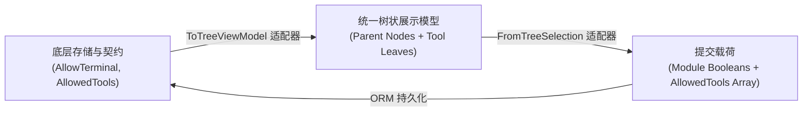
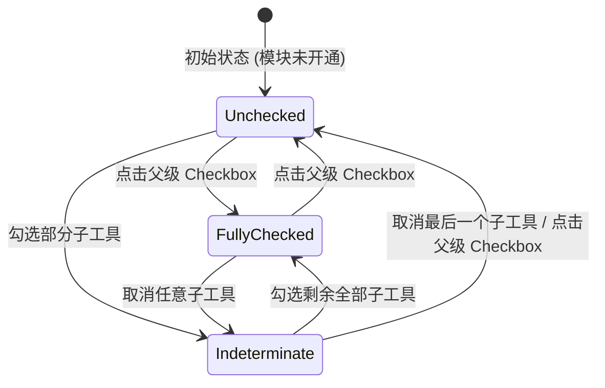

# 统一业务模块与 MCP 二级工具树状授权方案设计与可行性调研

## 1. 概述与背景 (Overview & Context)

### 1.1 现状与痛点
在 `v0.2.18` 版本中，系统上线了基于 Anthropic MCP 协议的二级工具目录与调度能力。然而在生产环境与前端交互中暴露了两个关键问题：
1. **.NET 10 Native AOT 序列化异常**：
   在访问密钥管理页面（`/app/#/keys`）时触发 HTTP 500 内部错误：
   ```text
   JsonTypeInfo metadata for type '<>z__ReadOnlyArray`1[LinuxWebTool.Contracts.Features.Mcp.Contracts.McpCategoryCatalog]' was not provided by TypeInfoResolver of type '[LinuxWebTool.WebHost.Composition.AppJsonSerializerContext]'.
   ```
   **根因分析**：C# 12 集合表达式 `[ ... ]` 隐式赋予 `IReadOnlyList<T>` 接口时，Roslyn 编译器在 .NET 10 AOT 模式下合成了内部类 `<>z__ReadOnlyArray`1`。当作为 Minimal API 的 `Results.Ok(...)` 响应载荷返回时，运行时类型为编译器生成的私有类型，导致 AOT 源生成代码（Source Generator）无法解析元数据。
2. **授权界面体验割裂 (UI/UX Inconsistency)**：
   原版 UI 将“业务模块授权 (Module Matrix)”（扁平勾选框）与“MCP 二级工具树状独立勾选”（分类卡片）割裂为两个独立区域。这给用户带来心智负担：
   - 用户无法直观看出某业务模块（如“终端与指令”）与其下的 MCP 细粒度工具（如 `command_run`, `terminal_execute_command`）的包含与派生关系；
   - 界面垂直空间浪费严重，无法快速检索、批量筛选、按协议（API vs MCP）过滤；
   - 缺少业界成熟的分级权限树交互模式（如 AWS IAM、K8s RBAC、以及参考项目 `DNSPodForNETCore` 的树状权限列表）。

### 1.2 目标愿景
- **AOT 零反射安全**：消除所有 `<>z__ReadOnlyArray`1` 合成类型，强制采用强类型 `List<T>` / `T[]` 并完备注册于 `AppJsonSerializerContext`；
- **业务模块与 MCP 工具统一树状列表**：参考 `DNSPodForNETCore` 的成熟生产级实践，将“业务模块开关”与“MCP 二级工具细粒度勾选”融合为**统一的树状层级结构 (Unified Hierarchical Tree)**；
- **设计模式优化**：
  - **适配器模式 (Adapter Pattern)**：在前端将扁平的模块布尔状态与细粒度工具白名单双向映射为统一的树节点树形状态，保持后端数据库与契约 100% 稳定向后兼容；
  - **策略模式 (Strategy Pattern)**：支持“全量授权”、“仅只读安全策略 (Read-Only)”、“防破坏安全策略 (No Dangerous)”、“完全自定义”等一键快速策略应用；
  - **状态机模式 (State Machine Pattern)**：根节点三态联动（未勾选 Unchecked $\leftrightarrow$ 半选/部分勾选 Indeterminate $\leftrightarrow$ 全选 Fully Checked），保证父子级级联行为严格自洽；
- **符合各项架构防线**：
  - `Features/Mcp/` 目录下所有单文件 $\le 400$ 行 (`LinuxArch026`)；
  - Contracts $\le 300$ 行，标准 C# $\le 700$ 行；
  - 前端门禁 `node frontend-gate.cjs` 零违规。

---

## 2. 业界主流方案对比与调研 (Industry Benchmarking)

| 方案维度 | AWS IAM 策略体系 | Kubernetes RBAC | DNSPodForNETCore (参考项目) | LinuxWebTool 统一树状方案 |
| :--- | :--- | :--- | :--- | :--- |
| **层级模型** | Service -> Action -> Resource (`ec2:Describe*`) | APIGroup -> Resource -> Verb (`apps/deployments/get`) | Category -> Module -> Sub-capability / Tools | **Module (业务领域) -> Tool Leaf (MCP 叶子工具)** |
| **通道支持** | AWS CLI, SDK, Console 统一鉴权 | Kube-apiserver 统一拦截 | 显式标记 `supportsApi` 与 `supportsMcp` | **显式标记 `SupportsApi` 与 `SupportsMcp`，支持按协议过滤** |
| **细粒度控制** | 支持通配符与具体 Action 声明 | 支持 Resources 与 Verbs 白名单矩阵 | 支持模块级勾选与独立工具勾选 | **一级模块控制 REST/MCP 准入，二级工具控制 MCP 精确白名单** |
| **AI 优化** | 无特定针对 AI Agent 裁剪 | 无特定裁剪 | 动态裁剪 MCP Tool List，降低 Token 上下文 | **动态投影 MCP tools/list，节省约 70% Token 消耗并阻断越权幻觉** |
| **前端呈现** | 折叠式 JSON 策略编辑器与权限树 | YAML 资源配置清单 | 搜索式树形卡片 + 三态级联 Checkbox + 协议标签 | **搜索式树形卡片 + 三态级联 Checkbox + 风险等级徽标 (Read/Exec/Danger)** |

### 2.1 借鉴自 DNSPodForNETCore 的关键设计
从 `E:\WorkProject\C#\【个人项目】\Web\自选DNS\DNSPodForNETCore` 的 `ApiKeysView.js` 与 `ApiKeyModules.cs` 提炼出的优秀实践：
1. **统一模型**：每个业务模块既有统一的代码与名称，又挂载了其包含的 MCP 工具名列表与对应的 REST API 路由；
2. **实时搜索与协议过滤**：
   - 顶部提供关键词实时高亮检索（支持匹配中文名、英文代码、描述、工具名称）；
   - 顶部提供协议过滤标签（全部 / 仅 REST API / 仅 MCP 工具）；
3. **三态级联 Checkbox 交互**：
   - 父级完全未勾选：未选中；
   - 子级部分勾选：父级呈现横杠半选（`:indeterminate="true"`）；
   - 子级全部勾选：父级呈现全选勾号；
   - 点击父级：一键级联选中/清空所有子工具；
4. **折叠/展开优化**：针对项数较多的模块提供折叠展开箭头，降低长页面滚动疲劳。

---

## 3. 设计模式与核心算法 (Design Patterns & Core Logic)

### 3.1 适配器模式 (Adapter Pattern)：双向数据转换
系统底层存储（`ApiKeyEntity`）具有稳定的列结构：
- 一级布尔列：`AllowTerminal`, `AllowSchedules`, `AllowFiles`, `AllowTranscode`, `AllowGateway`, `AllowRemoteHosts`；
- 二级工具集合列：`AllowedTools`（JSON 字符串数组，或 `*` 全通配）。

前端通过适配器逻辑实现双向解耦：


- **下发装配 (Entity to Tree UI)**：
  根据 `key.allowedTools` 与 各个 `allow*` 标记，自动判定每个分类节点的勾选态与半选态；
- **上报同步 (Tree UI to Request DTO)**：
  根据勾选的工具，反向更新对应的模块布尔开关；若某模块下勾选了任意工具，则其模块开关自动激活为 `true`；若用户主动关闭某模块，则该模块下的子工具全量取消。

### 3.2 状态机模式 (State Machine Pattern)：父子勾选联动
每个一级模块节点及其子工具构成的状态机流转图如下：



- **数学判定式**：
  设模块 $M$ 的有效工具集合为 $C = \{t_1, t_2, \dots, t_n\}$，当前已选工具集合为 $S$：
  - **完全勾选**：$\forall t \in C, t \in S \land \text{allowModule} == \text{true}$
  - **完全未勾选**：$\forall t \in C, t \notin S \land \text{allowModule} == \text{false}$
  - **半选状态 (Indeterminate)**：$\exists t_a, t_b \in C \text{ s.t. } t_a \in S \land t_b \notin S$，或者 $\text{allowModule} == \text{true}$ 但 $S \cap C \neq C$。

### 3.3 策略模式 (Strategy Pattern)：一键安全策略
针对不同的 AI 部署场景，提供一键策略算子：
1. **`FullAccessStrategy` (全量授权)**：
   激活所有 6 大业务模块，勾选全量 36 项工具（或提交 `allowedTools: null` 表示完全通配）。适用于拥有完全信任的本地自运行 Agent。
2. **`ReadOnlyStrategy` (只读监控策略)**：
   激活所有业务模块，但仅勾选风险等级为 `Read` 的只读探测工具（如 `command_list`, `workflow_get_batch`, `schedule_list`, `remote_host_list`, `file_list` 等），过滤掉所有 `Execute` 与 `Dangerous` 工具。适用于仅负责状态分析和日报汇总的 Agent。
3. **`SafeAutomationStrategy` (防破坏安全策略)**：
   允许常规执行，但彻底剥离所有高危操作（如 `terminal_execute_command`, `command_delete`, `schedule_delete`, `file_delete`, `remote_host_write_file`）。
4. **`ClearStrategy` (清空策略)**：
   清空所有选择，便于按需从零点选。

---

## 4. Native AOT 修复与后端重构方案

### 4.1 根因消除
1. **替换集合表达式为具象 `List<T>`**：
   在 `McpCatalogRegistry.cs` 中，将：
   ```csharp
   private static readonly IReadOnlyList<McpCategoryCatalog> Categories = [ ... ];
   ```
   修改为强类型的 `List<McpCategoryCatalog>`，显式使用 `new List<McpCategoryCatalog> { ... }` 与 `new List<McpToolCatalogItem> { ... }`，避免 Roslyn 生成 `<>z__ReadOnlyArray`1`。
2. **增强领域元数据契约 (`McpCategoryCatalog`)**：
   在 `McpCategoryCatalog` 中追加 `ModuleCode`、`SupportsApi`、`SupportsMcp` 等元数据属性，为前端统一树提供最完备的信息载荷。
3. **确立 AOT JSON 序列化上下文 (`AppJsonSerializerContext.cs`)**：
   确保如下类型全部显式注册：
   ```csharp
   [JsonSerializable(typeof(McpToolCatalogItem))]
   [JsonSerializable(typeof(List<McpToolCatalogItem>))]
   [JsonSerializable(typeof(McpCategoryCatalog))]
   [JsonSerializable(typeof(List<McpCategoryCatalog>))]
   ```

---

## 5. 前端统一树交互规范 (UI/UX Specification)

### 5.1 布局结构
在密钥创建与编辑模态框中：
1. **基础信息区**：名称、过期时间、协议通道开关（允许 REST API / 允许 MCP 工具）；
2. **主机限制区**：全部主机 / 自定义主机多选；
3. **统一权限与工具树状列表 (Unified Permission Tree)**：
   - **快捷策略工具栏**：
     - 搜索框（支持实时按名称、工具名、描述模糊匹配）；
     - 协议过滤器单选组（全部 / 仅 API / 仅 MCP）；
     - 快捷策略按钮（全选全部、只读策略、清空、全部展开/折叠）；
   - **树节点列表（可滚动的容器）**：
     - **一级分类根节点**：
       - 折叠/展开箭头（`▶` / `▼`）；
       - 三态勾选框（支持 Native `indeterminate` 属性）；
       - 模块名称与 `#code` 标识；
       - 通道徽标：`API` (青色)、`MCP` (紫色)；
       - 子工具统计徽标（如 `包含 6 项工具`）；
       - 模块摘要描述；
     - **二级工具叶子节点**（展开时可见）：
       - 独立 Checkbox；
       - 工具名称（等宽字体，如 `workflow_run`）；
       - 风险等级徽标：
         - 🟢 `Read`：只读安全
         - 🟡 `Execute`：执行/状态变更
         - 🔴 `Dangerous`：高危/Shell指令/删除操作
       - 工具说明文案。

---

## 6. 验证与回归测试策略 (Verification & Test Strategy)
1. **后端单元测试**：针对 `ApiKeyPermissionMatrix` 与 `McpCatalogRegistry` 执行细粒度测试，覆盖各种白名单与三态组合；
2. **架构守卫测试**：运行 `dotnet test tests/LinuxWebTool.ArchitectureTests`，确保 `McpMaxLines`（$\le 400$ 行）及所有分层架构约束通过；
3. **前端代码门禁**：运行 `node src/LinuxWebTool.WebHost/wwwroot/frontend-gate.cjs`，确保零 HTML 实体与语法违规；
4. **运行时联调**：验证 `/api/ApiKeys/McpCatalog` 返回正确的 HTTP 200 JSON 载荷，彻底解决 `<>z__ReadOnlyArray`1` 异常。
