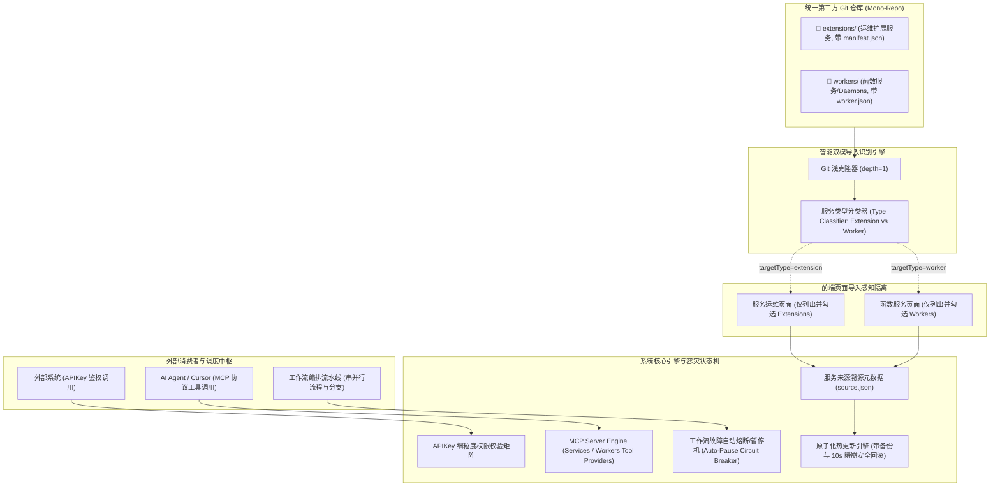
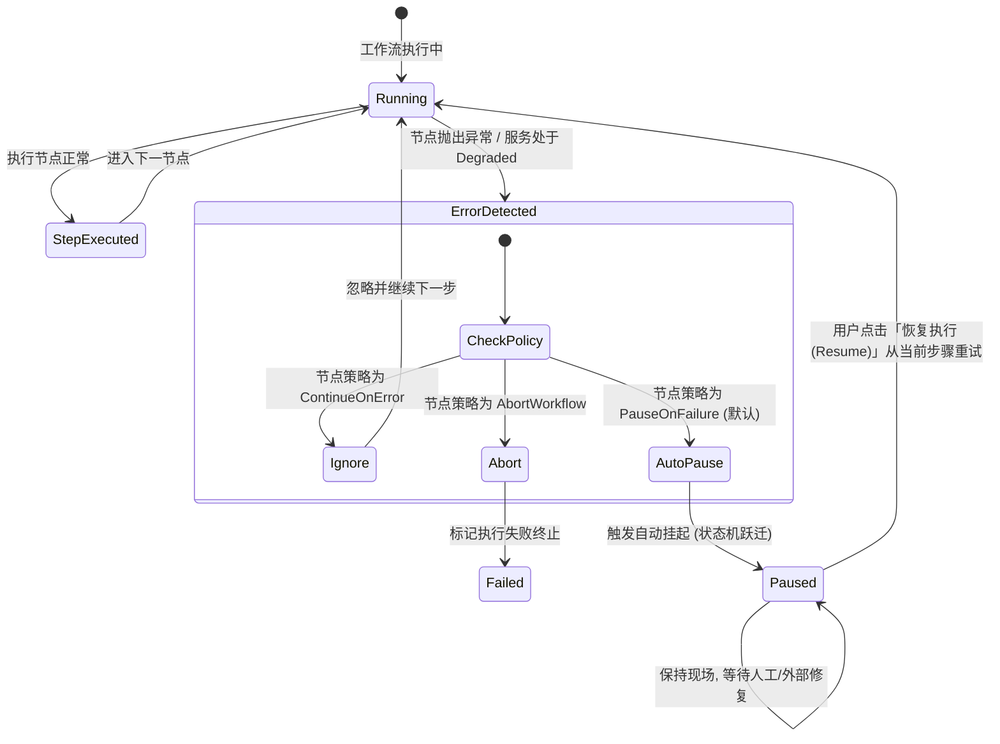
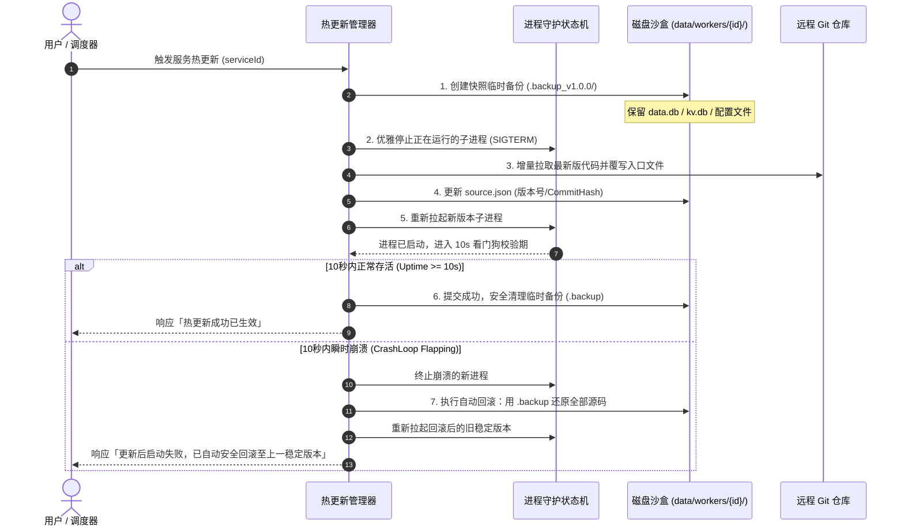

# 扩展服务与函数服务混合单仓、MCP/APIKey调用、工作流编排与在线热更新架构方案

## 1. 业务背景与系统全景演进

在 LinuxWebTool (LWT) 当前体系中，已形成了两大各司其职的核心服务体系：
1. **系统与服务管理中枢 (Services Hub - 扩展服务 Extensions)**：面向主机运维与系统探针（`systemctl`、`Docker`、`ssh-access-guard`、`caddy-server-manager`、`process-top-monitor` 等）；
2. **SaaS 函数微服务与长时守护平台 (Workers & Daemons)**：面向业务负载（类似 Cloudflare Workers / PM2 / Fly.io，如 Python 数据清洗、Node.js Webhook、.NET 高性能接口、Bash 巡检守护等）。

随着服务生态的日益丰富，用户提出了更深度的四项企业级与平台级需求：
- **混合单仓管理 (Unified Mono-Repo)**：允许第三方或组织用单个 GitHub 仓库同时维护两种服务，且各页面导入时精准分类、绝不穿帮；
- **开放接口与 AI 赋能 (APIKey & MCP)**：支持外部系统通过 APIKey 鉴权调用，并作为 MCP 工具无缝暴露给大模型（AI Agent）；
- **工作流编排与容灾 (Workflow Integration & Auto-Pause)**：支持在工作流流水线中将服务操作作为标准步骤，且服务异常时工作流能自动安全暂停（挂起），保留现场；
- **全生命周期溯源与热更新 (Provenance & Hot Update)**：记录每个服务的导入来源，支持一键远程检查版本更新，并支持带安全回滚的热重载。

---

## 2. 核心架构设计全景



---

## 3. 详细设计与关键实现

### 3.1 单仓库混合存储与类型感知隔离导入 (Unified Mono-Repo)

#### 1. 仓库目录推荐结构规范
第三方插件或开发者可在一个 Git 仓库中混合存放运维扩展与函数服务：
```
my-lwt-suite/
├── extensions/                  # 运维扩展工具目录
│   ├── ssh-guard/
│   │   ├── manifest.json        # 必须包含 "capabilities" 或 "dependencies"
│   │   └── hooks/
│   └── caddy-mgr/
│       └── manifest.json
└── workers/                     # 业务函数微服务目录
    ├── order-webhook/
    │   ├── worker.json          # 必须包含 "runtime"、"entrypoint"、"mode"
    │   └── worker.js
    └── sync-daemon/
        ├── worker.json
        └── worker.py
```

#### 2. 智能分类与类型推断规则 (Type Inference)
为了最大化兼容，同时支持显式标记与基于特性的智能推导：
- **显式标记**：清单中声明 `"kind": "extension"` 或 `"kind": "worker"`；
- **隐式推导**：
  - 若包含 `worker.json` 或清单包含 `runtime`、`entrypoint`，判定为 **`Worker`**；
  - 若包含 `manifest.json` 或清单包含 `dependencies.runners`、`capabilities`，判定为 **`Extension`**。

#### 3. 页面导入感知隔离机制
后端扫描接口统一增加类型过滤参数 `?targetType=extension|worker|all`：
- **在「服务运维 (Services Hub)」页面**：
  - 请求：`POST /api/Services/Extensions/Repo/Inspect?targetType=extension`
  - 前端仅展示筛选后的「扩展服务」列表，复选框仅能选择该类服务；
  - 导入安装路径：绝对锁定在 `extensions/{id}/`；
- **在「函数服务 (Workers)」页面**：
  - 请求：`POST /api/Workers/Import/Repo/Scan?targetType=worker`
  - 前端仅展示筛选后的「函数微服务」列表；
  - 导入安装路径：绝对锁定在 `data/workers/{id}/`。
- **杜绝混淆**：即使仓库根目录下混合平铺数十个服务，各页面依然做到 100% 隔离呈现。

---

### 3.2 APIKey 细粒度授权与 MCP 工具能力透传

#### 1. APIKey 权限矩阵扩展
在 `ApiKeyEntity` 中新增两项细粒度权限开关：
```csharp
public sealed record ApiKeyEntity
{
    // ... 现有字段 ...
    
    /// <summary>是否允许访问系统与扩展服务管理接口 (/api/Services/*)。</summary>
    public bool AllowServices { get; init; } = false;

    /// <summary>是否允许访问与管理函数微服务接口 (/api/Workers/*)。</summary>
    public bool AllowWorkers { get; init; } = false;
}
```
在 `ApiKeyMiddleware.cs` 中更新拦截策略：
- 当请求 `/api/Services/*` 时，校验 `entity.AllowServices`；
- 当请求 `/api/Workers/*` 时，校验 `entity.AllowWorkers`；
- 对于 Worker 暴露的直接业务路径 `/w/{id}/*`，保持开放或支持在请求头透传自定义 `Authorization` 给子进程自身处理。

#### 2. MCP (Model Context Protocol) 全生命周期工具能力（导入、更新、启用、禁用、控制）
在 `LinuxWebTool.WebHost/Features/Mcp/Engine/Providers/` 下增加两个专有 Tool Provider，赋予大模型（AI Agent，如 Cursor / Claude / Antigravity）对两大服务体系完整的**全生命周期闭环治理能力**：

##### A. `ServicesMcpToolProvider`（服务运维与扩展工具集）
| MCP 工具名称 | 描述 | 参数 |
| :--- | :--- | :--- |
| `services_list` | 查询宿主 Systemd、Docker 容器及已安装扩展服务状态与启用状态 | `category` (optional) |
| `systemd_action` | 执行 Systemd 服务启停查重操作 | `serviceName`, `action` ("start"/"stop"/"restart"/"status") |
| `docker_action` | 执行 Docker 容器生命周期控制 | `containerId`, `action` ("start"/"stop"/"restart"/"pause") |
| `extension_execute_action` | 执行指定脚本扩展自定义动作（如查询封禁IP、解封IP、查Top快照） | `extensionId`, `action`, `param` (optional) |
| `extension_import` | **从 GitHub/Git 仓库导入一个或多个运维扩展服务** | `repoUrl`, `moduleIds` (string[]), `overwrite` (bool) |
| `extension_set_enabled` | **启用或禁用指定的运维扩展服务**（禁用后停止运行且不可执行操作） | `extensionId`, `enabled` (bool) |
| `extension_check_update` | **查询指定或全部扩展服务的远程版本与更新说明** | `extensionId` (optional) |
| `extension_hot_update` | **对指定扩展服务执行在线热更新**（备份旧版本，失败自动回滚） | `extensionId`, `force` (bool) |

##### B. `WorkersMcpToolProvider`（SaaS 函数微服务与守护治理工具集）
| MCP 工具名称 | 描述 | 参数 |
| :--- | :--- | :--- |
| `workers_list` | 列出所有函数微服务与长时常驻守护进程的状态、端口、指标与启用状态 | 无 |
| `worker_control` | 启动、停止或重启指定的函数微服务 | `workerId`, `action` ("start"/"stop"/"restart") |
| `worker_invoke` | 向指定的 HTTP Worker 发起内部调用并返回响应结果 | `workerId`, `subPath`, `method`, `body` (optional) |
| `worker_get_logs` | 获取指定 Worker 进程最新的标准输出与错误日志 (RingBuffer) | `workerId`, `lines` (default: 50) |
| `worker_import` | **从 GitHub 仓库批量导入函数微服务或后台长时守护** | `repoUrl`, `moduleIds` (string[]), `overwrite` (bool) |
| `worker_set_enabled` | **启用或禁用指定 Worker**（禁用时优雅杀进程、停自愈拉起、网关阻断） | `workerId`, `enabled` (bool) |
| `worker_check_update` | **检查指定 Worker 或全部 Worker 的最新远程发布版本** | `workerId` (optional) |
| `worker_hot_update` | **对指定 Worker 执行安全在线热更新**（保留独立 SQLite/KV 数据并带看门狗回滚） | `workerId`, `force` (bool) |

##### C. 启用/禁用状态在底层与网关层的硬性拦截规范
1. **禁用状态的持久化**：
   - 在服务的 `manifest.json` 或 `worker.json` 中持久化 `"enabled": false`（或在目录内生成轻量 `.disabled` 锁文件）；
2. **进程守护看门狗拦截**：
   - 处于禁用状态的 Worker，即使配置了 `AutoRestart = true`，**看门狗状态机坚决不予自动拉起**；
3. **网关动态路由拦截 (`/w/{id}/*`)**：
   - 当收到对禁用 Worker 的请求时，Kestrel 网关直接返回：
     ```json
     { "code": 503, "message": "Service Disabled: Worker 'my-worker' is explicitly disabled." }
     ```
4. **AI Agent 安全保护与幂等性**：
   - 若服务已处于目标状态（例如已禁用再调禁用），操作为安全幂等并返回当前状态描述；
   - 所有 MCP 工具调用统一返回符合 MCP 协议标准的 Content 结构（包含可读文本提示与结构化 JSON 数据），大模型能直观理解执行结果。

---

### 3.3 工作流编排调用与故障自动暂停 (Auto-Pause Circuit Breaker)

#### 1. 新增工作流活动节点 (Workflow Activities)
在工作流编排中，新增两类标准活动节点：
1. **`ExtensionActionActivity`**：
   - 目标：执行运维扩展钩子动作（如自动化构建后调用 `caddy-server-manager` 校验配置并热重载）；
   - 配置属性：`ExtensionId`、`Action`、`Parameter`。
2. **`WorkerServiceActivity`**：
   - 目标：触发业务函数运行、调用 Worker HTTP 接口、或启停常驻守护进程（如爬虫前先拉起采集 Worker，执行完毕后优雅停止）；
   - 配置属性：`WorkerId`、`Operation` ("start" | "stop" | "restart" | "invoke")、`TimeoutSeconds`。

#### 2. 服务故障自愈与工作流自动暂停保护机制 (Auto-Pause)
工作流串行流水线执行中，若遇到服务异常（如 Worker 处于 `Degraded` 熔断状态、脚本返回非 0 退出码、HTTP 接口返回 502/503）：



- **工作流自动暂停核心优势**：
  - 避免传统流水线在服务挂死后继续执行后续的危险操作（如清理旧数据、发送广播通知、删除临时库）；
  - 完整保留当前节点的上下文变量与执行现场；
  - 面板发出高亮告警提醒，运维人员修复好底层环境或脚本配置后，可在工作流详情页一键「恢复执行 (Resume)」，系统从断点处自动重试并继续向后推进。

---

### 3.4 来源元数据溯源 (Provenance) 与在线热更新 (Hot Update)

#### 1. 溯源元数据规范 (`source.json`)
无论通过 Git 仓库导入、Zip 上传导入还是系统内置种子，安装时均在服务目录下生成 `source.json`：
```json
{
  "sourceType": "git",                      // "git" | "zip" | "builtin"
  "repoUrl": "https://github.com/org/suite",
  "subDirectory": "workers/demo-py-api",    // 在仓库中的相对目录
  "installedVersion": "1.0.0",
  "installedCommitHash": "e8a93bc",
  "installedAt": "2026-10-31T08:00:00Z",
  "lastCheckedAt": "2026-10-31T08:30:00Z",
  "remoteVersion": "1.1.0",                 // 检查更新时写入
  "hasUpdate": true
}
```

#### 2. 版本比对与检查更新流水线 (Check Update Pipeline)
1. **触发时机**：
   - 用户在服务卡片上点击「检查更新」按钮；
   - 或系统定时后台轻量检测（每 24 小时一次）；
2. **轻量检测逻辑**：
   - 后端读取 `source.json` 中的 `repoUrl` 和 `subDirectory`；
   - 通过 Git 浅层探测远程仓库（或通过 GitHub Raw 内容 API 请求 `manifest.json` / `worker.json`），无需拉取整个仓库历史；
   - 提取远程版本号，通过语义化版本（SemVer: `Major.Minor.Patch`）比对；
   - 若远程版本高于本地，更新 `source.json` 并向前端返回 `hasUpdate = true`，前端卡片亮起「⬆️ 可更新至 v1.1.0」提示徽章。

#### 3. 安全热更新与自动回滚事务 (Atomic Hot-Update & Safe Rollback)
热更新涉及代码替换与进程重载，绝不能造成用户业务数据丢失或面板卡死：



---

## 4. 接口契约定义 (API Specifications)

### 4.1 混合仓库扫描与导入统一接口
- **统一扫描接口**：`POST /api/Services/Extensions/Repo/Inspect?targetType={type}`
  - `targetType`: `extension` | `worker` | `all`
  - 返回统一的 `DiscoveredModuleItem` 列表，包含 `kind` ("extension" | "worker")、`id`、`name`、`version`、`relativePath`；
- **页面专用导入**：
  - 扩展服务导入：`POST /api/Services/Extensions/Repo/Import`（仅导入扩展）；
  - 函数服务导入：`POST /api/Workers/Import/Repo/Apply`（仅导入 Worker）。

### 4.2 版本检查与热更新接口
- **检查更新**：`POST /api/Workers/{id}/CheckUpdate` / `POST /api/Services/Extensions/{id}/CheckUpdate`
  - 返回：`{ hasUpdate: bool, currentVersion: string, remoteVersion: string, releaseNotes: string? }`；
- **执行热更新**：`POST /api/Workers/{id}/HotUpdate` / `POST /api/Services/Extensions/{id}/HotUpdate`
  - 请求参数：`{ force: bool }`；
  - 执行事务性更新并在失败时自动回滚。

### 4.3 来源元数据查询接口
- `GET /api/Workers/{id}/Source` / `GET /api/Services/Extensions/{id}/Source`
  - 返回当前服务的完整来源信息（导入方式、Git 地址、提交哈希、安装时间）。

---

## 5. 架构测试与工程门禁规范

为保证新增功能依然符合系统的高标准工程约束：
1. **AOT 契约规范 (`LinuxArch008`)**：所有 Controller 响应必须是强类型显式 DTO（如 `WorkerUpdateCheckResponse`、`WorkerHotUpdateResponse`），严禁使用匿名对象；
2. **源生成 JSON 规范 (`LinuxArch018`)**：所有 JSON 序列化/反序列化必须传入对应的 `*JsonContext.Default.*`；
3. **单文件行数限制 (`LinuxArch026`)**：
   - C# 代码单文件 $\le 700$ 行，采用 Partial Class 或领域服务分离；
   - 前端非 View 组件 $\le 400$ 行，View $\le 2000$ 行；
4. **前端标签平衡 (`FE-TEMPLATE-TAG-BALANCE`)**：所有 Vue 模板反引号严禁嵌套导致门禁正则提早截断。

---

## 6. 实施演进路线图

- **阶段 1：单仓混合分类与导入隔离**
  - 在现有 `InspectRepositoryModules` / `ScanRepoAsync` 中增加双模识别逻辑与 `targetType` 过滤；
  - 保证在「扩展服务」与「函数服务」两端页面互不干扰、各自精准导入。
- **阶段 2：APIKey 权限矩阵扩展与 MCP Tool Provider 接入**
  - 在 `ApiKeyEntity` 与 `ApiKeyMiddleware` 中增加 `AllowServices` 与 `AllowWorkers` 放行控制；
  - 增加 `ServicesMcpToolProvider` 与 `WorkersMcpToolProvider`，并注册入 `McpServerEngine`。
- **阶段 3：工作流活动节点与自动暂停状态机**
  - 注册 `ExtensionWorkflowActivity` 与 `WorkerWorkflowActivity`；
  - 在工作流调度引擎中接入故障自动挂起（Auto-Pause）与断点恢复逻辑。
- **阶段 4：来源溯源、版本比对与带回滚的热更新**
  - 为服务注入 `source.json` 溯源清单；
  - 实现 SemVer 版本探测与事务性安全热更新流水线；
  - 前端卡片增加版本号展示、来源弹窗与「一键更新」操作。
